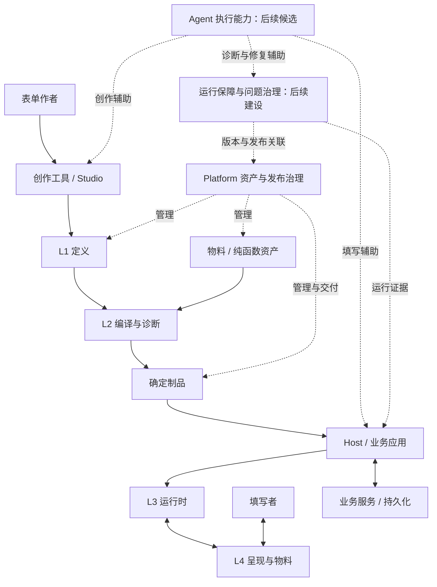
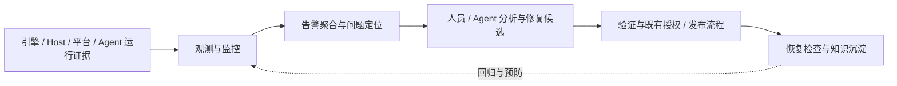

# 整体架构设计

这是一个面向复杂动态表单与数据录入的声明式引擎。先看系统怎样分层、各层如何协作，再沿[能力图谱](capability-map.md)进入具体设计。当前仍处于设计讨论与规范细化阶段，已有共识、候选机制与未决问题分别标明。

## 整体产品与建设蓝图（待审阅） {#product-blueprint}

2026-10-20 用户确认方向二：以核心引擎建设为主线，通过 Host 串联，再由平台管理和组织能力；开始前先讨论清楚完整蓝图，不进入具体技术细节。以下产品组织和阶段安排仍为讨论稿，不能因保存而视为确认。原 [Platform P1–P4](platform-studio.md#platform-draft) 保留待定，本轮先审阅蓝图。

### 目标与使用者

建议目标：让复杂业务表单能够被定义、验证、交付、运行和持续演进。核心可独立嵌入业务应用，平台提高复用与交付效率，Agent 提高创作与使用效率。

使用者包括引擎 / 物料开发者、表单作者、业务接入开发者、资产维护 / 发布人员和最终填写者；这是工作角色，同一人可以兼任，不据此决定账号或组织系统。初期作者是否以开发人员和技术配置人员为主仍待确认。

### 六部分协作全貌

| 组成 | 核心价值 | 与其他部分的关系 |
| --- | --- | --- |
| 四层引擎 | L1 定义、L2 编译、L3 执行与校验、L4 呈现 | 以可复用库提供能力，具体包划分后定 |
| 能力资产 | UI 物料、同步纯函数及契约与实现 | 作者选择、L2 检查，运行端使用确定实现 |
| Host 与业务应用 | 把引擎接入真实业务 | 管请求、业务持久化、外部校验执行与实际提交 |
| Studio | 帮助作者制作正确的表单 | 编辑定义、复用诊断、隔离预览，使用平台资产与发布服务 |
| Platform | 管理可复用资产及交付 | 管定义修订、能力登记、构建与发布、权限和审计；不接管填写数据 |
| Agent 能力体系 | 辅助创作、填写、诊断与运维 | 候选由平台治理相关资产，独立执行能力经 Studio / Host 接入，可集成外部系统 |



这是协作关系，不是部署或逐跳调用图。取得确定制品后，表单运行不依赖 Studio / 平台管理服务持续在线。Agent 不增加为表单第五层。平台治理与独立 Agent 执行的具体产品组织仍为候选。

### 两条完整工作流 {#blueprint-workflows}

```diagram
{
  "id": "figure-blueprint-workflows",
  "title": "蓝图 · 创作交付与业务运行双流程",
  "rows": [
    [
      {
        "title": "作者 / Studio",
        "body": "需求、定义与能力选择"
      },
      {
        "title": "L2 / 预览",
        "body": "检查、修正与测试"
      },
      {
        "title": "Platform / 交付",
        "body": "固定修订与依赖，发布确定制品"
      }
    ],
    [
      {
        "title": "Host / 初始化",
        "body": "获取制品，建立固定版本会话"
      },
      {
        "title": "L3 / L4 / 填写者",
        "body": "填写、联动、校验与反馈"
      },
      {
        "title": "Host / 业务服务",
        "body": "外部服务、校验数据交付与业务提交"
      }
    ]
  ],
  "flow": true,
  "arrows": [
    "交付确定制品 → Host 获取并建立会话"
  ],
  "note": "上行为创作与交付，下行为填写与业务完成；外部服务在运行中按需参与，不仅出现在最后一步。平台上的定义修订与业务填写数据分属不同所有者。"
}
```


**创作与交付：**需求 → 创建 / 修改定义 → 选择物料与纯函数 → 编译检查与修正 → 预览 / 测试 → 固定修订和依赖 → 发布确定制品 → Host 使用。初期可由文件、CLI 和最小预览承载，后续纳入平台与 Studio；不要求先有完整拖拽设计器。

**填写与业务完成：**Host 获取确定制品并初始化 → 用户填写 → 引擎联动与校验 → Host 执行必要外部服务 → 引擎交付完整校验结果及对应数据 → Host 构造业务请求并保存 / 提交。填写草稿、订单与业务流程属于业务应用，与平台中的定义修订分开。

新发布作用于后续选用该制品的新会话，已有会话固定原制品。配置升级与业务数据迁移分开。配置错误回到创作检查，服务失败由 Host 承接，运行错误可定位；不将所有失败混为一次业务事务。

### 三种编排的归属

- 表单组合：作者组合字段、视图、规则和物料，Studio 辅助创作，L2 检查，Runtime 执行声明语义。
- 资产交付：Platform 组织登记、构建、发布和回滚，交付确定制品。
- 业务 / Agent 任务：Host 或独立执行服务组织外部调用、多步骤任务和结果，不借用 Flush 调度网络与长流程。

平台可以提供任务配置与治理入口；管理能力不意味着全部执行系统必须自建。

### Agent 在完整蓝图中的位置 {#blueprint-agent}

场景覆盖创作生成 / 修改、诊断与测试、填写解释 / 提取 / 补全、业务知识和工具协作、运维分析。知识 / RAG、模型与 Prompt、工具与 Skills、记忆、单 / 多 Agent 执行、结构化与流式交互、权限 / 观测 / 评测继续使用[平台主题中的完整清单](platform-studio.md#agent-capability-plan)，不另建平行体系。

纳入蓝图不等于首期全部建设或全部自建。创作结果先作为候选定义检查；填写建议经授权与适用性检查走受控写入；解释不代替权威业务校验。表单与 Agent 会话分别管理生命周期。生成新表单与热改正在填写的表单属于不同能力，当前不默认支持后者。

### 运行保障与问题治理（纳入蓝图，后续建设） {#blueprint-operations}

2026-10-20 用户确认：将可观测性、监控、问题处理及 Agent 辅助错误处理纳入完整蓝图，实现可以后置，不作为当前核心引擎建设的前置。该确认限定能力覆盖与建设节奏，具体接口、监控产品、部署方式和自动处置权限仍待设计。

这是一项贯穿创作、构建、发布、运行与外部调用的横向能力，沿用六部分协作及四层内核边界，不新增引擎层。

| 能力 | 蓝图目标 |
| --- | --- |
| 可观测性 | 通过诊断、日志、指标和 Trace 解释发生了什么，关联定义、制品版本、运行实例与执行位置 |
| 监控与告警 | 观察错误、性能、服务可用性及 Agent 成功率 / 成本；按影响聚合、去重并交给相应处理者 |
| 问题处理 | 贯通发现、影响判断、定位、恢复 / 修复、验证和处理记录，避免只上报而无后续 |
| Agent 辅助 | 基于授权证据分析问题、提出修复候选并协助验证；后续按场景设计受控处置 |
| 知识沉淀 | 将处理结果回流已知问题、回归样例和知识库，支持后续排查与预防 |



引擎与物料接入提供必要诊断、执行事实及既有错误隔离；Host 关联业务请求并承接用户提示、网络失败与业务恢复；Platform 关联版本 / 发布 / 问题及告警与审计；Studio / Devtools 展示源位置、执行链并验证修复。具体组织可复用外部监控和问题管理系统，不预设全部自建或独立部署。

Agent 的候选能力按只读诊断、生成修复候选 / 验证、受控处置逐步展开。分析须区分事实、推断与证据缺失；发布、回滚、业务重试等动作沿用既有权限与执行流程，纳入规划不等于授权自动操作生产。Agent 的工具调用、变更与结果本身也需要观测和审计。具体自动化范围与人工交接策略后续确认。

**建设节奏：**完整监控、告警聚合、问题治理入口以及 Agent 诊断 / 修复 / 自动处置可后续分阶段建设，不要求首个纵切具备完整运维平台。已有错误隔离、必要诊断与 Host 错误报告要求继续有效；首期按核心契约提供必要出口，具体采集接口随模块契约固化。现有 Trace 的预算、截断、敏感数据限制与复现边界保持不变，不能因 Agent 分析而默认长期保存全部填写数据。详见 [L3 诊断与 Trace](l3-observability.md)。

### 建设顺序与成果（建议） {#blueprint-roadmap}

```diagram
{
  "id": "figure-blueprint-roadmap",
  "title": "蓝图 · 建设路径（建议，待确认）",
  "rows": [
    [
      {
        "title": "当前 · 蓝图审阅",
        "body": "目标、职责、完整流程与未来能力位置",
        "major": true
      }
    ],
    [
      {
        "title": "核心库 + Host",
        "body": "用真实业务纵切贯穿四层、物料、外部校验和提交"
      }
    ],
    [
      {
        "title": "最小 Platform",
        "body": "资产、构建、确定交付、追踪与回滚"
      }
    ],
    [
      {
        "title": "Studio 深化",
        "body": "从最小编辑与预览发展完整创作体验"
      },
      {
        "title": "Agent 场景接入",
        "body": "完整规划，选择场景后逐步集成或自建"
      }
    ]
  ],
  "arrows": [
    "先定应用 / 包 / 服务与工程边界，再选型并整合契约",
    "把已验证能力纳入治理",
    "在已有闭环上扩展"
  ],
  "note": "表示价值与依赖方向，不是严格串行排期。预览 / 诊断从核心阶段就需要；Studio 与 Agent 的具体先后及范围待确认。"
}
```


| 阶段 | 建设重点 | 可观察成果 |
| --- | --- | --- |
| 蓝图确认 | 目标、职责、工作流与扩展位置 | 对全貌和近期范围形成共识，不冻结接口 |
| 应用与工程架构准备 | 应用 / 服务、包 / 目录、依赖与工程要求，随后技术选型 | 形成可审阅结构及选型依据，再按确认范围创建骨架 |
| 核心与 Host 首个纵切 | 整合必要契约，按库组织并贯穿实现四层、基础能力与业务接入 | 一个真实场景从定义到提交可运行，关键失败路径有验证 |
| 最小平台闭环 | 将已验证能力纳入资产、构建与发布治理 | 可复用、可追踪、可回滚地交付表单 |
| 创作体验深化 | 从最小编辑 / 预览发展 Studio | 作者高效完成编辑、诊断、预览与交付 |
| 运行保障深化（可后置） | 监控告警、问题处理闭环及 Agent 辅助，按场景集成或建设 | 问题可定位、处置可追踪、恢复可验证；不作为核心纵切前置 |
| Agent 场景落地 | 选择有价值场景，决定集成 / 自建及配套治理 | 一个辅助工作流产生可检查结果，再逐步扩展 |

这是价值与依赖顺序，不要求上一阶段全部结束才允许下一阶段探索。预览和诊断从首个纵切就需要，完整 Studio 可后续深化；Agent 现在规划，当前不转为核心建设前置。不等所有库全部完成才接 Host。首期已选 Web/TS + React 及六包目录；具体业务场景、公共 API、存储与部署后续确定；工具组合与初始化流程已在[工程方案](engineering.md)确认并完成工程底座本地验证。

### 本轮集中审阅点

- B1：目标、使用者与六部分组织是否完整？
- B2：是否采用两条工作流及三种编排分责？
- B3：是否采用核心库与 Host 纵切共同推进，再补齐最小平台与创作体验的顺序？
- B4：Agent 是否完整规划、按场景接入，独立于表单内核执行，暂不决定全部自建？

以上待用户整体审阅。蓝图覆盖不将 Platform / Studio 提升为设计完成，也不替代正式契约与生产验收。

## 应用与工程架构：首期边界与目录 {#application-engineering}

2026-10-20 讨论收敛：首期 Web/TypeScript 与 React，六个 TS 包直接位于 packages，后续 Flutter 使用顶层 packages-flutter。用户已授权建立目录占位并统一归档，初始只完成 .gitkeep 骨架；应用产品范围、后端部署、正式契约与运行实现仍待落地。工具链已在后续[工程方案](engineering.md)确认，且后续已按授权完成工程底座初始化与本地联验；生产核心契约仍未完成。本节只将确认的范围和边界固化，不将保存文档或建立目录解释为生产模块完成。

### 1. 架构需要定到什么程度

本阶段输出应用 / 服务边界、代码依赖、资产与业务数据所有权、初期部署关系、包与目录职责，以及工程质量和交付要求。技术选型随后验证这些边界的可行性，必要时调整物理组织；不将目录树视为永久冻结的架构。完整实现仍以对应 L1–L4 / Host 契约为准。

当前在本项目仓库组织核心包与后续应用 / 服务，便于跨包契约联验；工作区与依赖管理已采用 pnpm / Turborepo，实施见[工程方案](engineering.md)；未来 Dart 可使用自身工具链，不要求现在搭建多语言工作区管理。库是可复用代码，应用是用户入口，服务是具有运行边界的后端能力，领域模块不必独立部署。

### 2. 应用与服务组织（候选）

| 组成 | 职责 / 所有权 | 首期安排与扩展 |
| --- | --- | --- |
| Host Playground | 可运行的参考业务应用，消费公开 SDK，负责示例请求、业务数据与提交 | 核心纵切入口，从第一阶段建设；测试可用模拟服务，模拟不作为真实集成证据 |
| Platform Web / Studio | 平台管理和表单创作入口，共用预览与诊断能力 | 初期最小编辑 / 预览，完整管理与创作后续建设；暂建议同一应用中的不同功能区 |
| Platform API | Form / Capability Registry、构建记录、发布 / 分发、访问与审计等领域模块 | 预留逻辑边界；需要平台闭环时落地。建议先在一个服务内模块化，不按模块逐个建微服务 |
| 编译执行入口 | 本地 CLI / 创作工具 / 服务调用同一编译库 | 初期本地运行；耗时或隔离需求出现后可增加构建 Worker，不另实现一套编译器 |
| Agent Executor | 模型、知识、工具、记忆、任务 / 流式执行的候选接入位置 | 未来独立服务或外部平台集成，当前只保留架构位置；不创建空 Agent 框架 |
| 外部业务与基础设施 | 业务 API、组织身份、元数据 / 制品存储；未来任务基础设施 | 通过明确边界接入，按场景选型。引擎库不直连平台数据库或业务数据库 |

Platform API 的业务元数据与不可变制品分别拥有存储边界，存储产品后选。业务订单 / 填写草稿归 Host 系统，Agent 会话 / 记忆归对应执行系统；不共用一张泛化“状态表”。构建 Worker 与 Agent Executor 是可能的运行隔离边界，不是当前部署承诺。

```diagram
{
  "id": "figure-application-engineering",
  "title": "应用与工程组织（候选）：库可独立使用，服务按需落地",
  "rows": [
    [
      {
        "title": "Host Playground / 业务应用",
        "body": "参考集成、业务服务、保存与提交"
      },
      {
        "title": "Platform Web / Studio",
        "body": "资产管理、定义编辑、诊断与预览"
      }
    ],
    [
      {
        "title": "核心与接入库",
        "body": "Protocol、Compiler、TS Runtime、React Renderer、React 物料与纯函数",
        "major": true
      }
    ],
    [
      {
        "title": "本地 CLI",
        "body": "复用编译库，无平台服务也能验证"
      },
      {
        "title": "Platform API（预留）",
        "body": "注册、构建、发布 / 分发、访问与审计模块"
      },
      {
        "title": "Agent 执行（后续）",
        "body": "独立或集成；由 Studio / Host 接入"
      }
    ]
  ],
  "arrows": [
    "应用消费公开接口",
    "工具与服务按职责复用；不表示核心反向依赖服务"
  ],
  "note": "这是代码与运行边界的组织草案，不是逐层调用图。取得确定制品的业务应用不要求平台管理服务在线。"
}
```

### 3. 首期六个 TS 包与依赖方向

用户已确认 Web/TS 首期、React 呈现以及下列包目录。逻辑分层不机械对应发布包数量，目录存在只代表职责位置已建立；正式类型、公共入口、产物与发布元数据仍需随实现固化。决策见 [ADR-FE-013](decisions/ADR-FE-013-ts-react-packages.md)，原七项草案与候选比较保留在[设计演进](design-history.md#ts-react-package-layout)。

#### 包边界：职责、入口与发布分别判断 {#package-boundary-discussion}

| 包目录 | 职责与消费者 | 内部边界与限制 |
| --- | --- | --- |
| packages/protocol | 统一可交换协议结构源及 TS 绑定，供作者、Compiler、Runtime、创作工具消费；包含 Definition、Prepared、Material / Pure Function Manifest 通用结构 | definition / capability / prepared 三领域与公共入口已于 2026-10-21 确认，正式命名类型及组成类型按领域公开，具体 exports 随完整类型实施；Prepared 与 L1 格式版本独立，不把所有内部类型、Runtime API、平台 DTO、数据库模型、Agent 协议或组件实现集中进来 |
| packages/compiler | L2 分析、静态检查、诊断、规范化与依赖准备，向 CLI、编辑预览和平台构建提供确定 Prepared | 不依赖 Runtime 执行实例，不导入 UI 物料实现；解析、检查和依赖准备先作为内部模块，不逐步骤拆包 |
| packages/runtime | TS 数据 / Snapshot、Scope、表达式、Command / Reaction / Flush、校验、诊断与实例生命周期；提供公开读写、订阅、校验和 Host 注册接口 | 不依赖 React、网络或平台数据库；上述执行机制先内部模块化。内部实现可以采用正常 TS，不为未来 Dart 建跨语言执行框架 |
| packages/renderer-react | React 呈现、共用 Adapter、物料装配、Binding / Props / Event 接入、Scope 关联、订阅清理与局部错误隔离 | 消费 Runtime 公开接口，不保存第二份权威业务状态；各物料共用 React Adapter，不要求未来 Vue / Flutter 复用源码，暂不建通用 renderer-core |
| packages/materials-react | React 基础字段、容器和展示物料及具体 Manifest | 与 Renderer 分开，业务方可选择自有物料；Manifest 与 UI 实现可分别消费，编译侧不能被迫加载 React 组件；后续物料集按实际分发需要再拆 |
| packages/pure-functions | TS 基础同步确定性纯函数与签名，运行端注册实现，编译侧读取确定契约 | 不依赖 UI、网络或 Runtime 可变内部；签名与实现归具体函数集，通用 Manifest 结构归 protocol，Compiler 不执行函数 |

**接入与开发支持的归属：**不另建 host-sdk 包。实例与 Host 能力注册接口归 Runtime，呈现装配归 renderer-react，查询 / 上传 / 保存 / 提交 / 业务恢复归 Host 应用。capabilities 保留能力总称，UI 物料与纯函数分别组织构建与交付。testkit 先作为内部测试支持，出现真实外部消费者后再判断公开发布；现有 docs/validation 不直接提升为生产协议或 testkit。

**依赖约束：**protocol 不依赖应用实现；Compiler / Runtime 分别消费协议入口，不互相依赖生产实现。Renderer 消费 Runtime 公共接口，物料通过接入契约协作，不直接访问 Store。应用在顶层装配物料、纯函数与 Host。跨包只用公开入口，禁止深层导入、核心反向导入 apps / services 和循环依赖。共享算法先明确所有者及必要性，不预建万能 shared / utils 包。当前不要求各包统一发布节奏；库版本不替代 Protocol / Prepared / 能力身份的独立兼容规则。

**运行保障：**Compiler、Runtime、Renderer 各自提供必要诊断 / Trace / 错误接入，Host 连接业务上报。平台监控、问题治理与 Agent 分析保留后续建设，不提前成为核心全局依赖包，不改变已有预算 / 脱敏 / 错误隔离原则。

**组合验收：**服务端或 CLI 编译只依赖 Compiler、Protocol 与确定能力契约；已发布表单运行不携带 Compiler / Studio 或依赖平台管理服务在线；创作预览组合编译与运行能力；无界面规则验收不引入 Renderer。上述为工程验收要求，尚无生产通过证据。

### 4. 已建立的目录与后续预留 {#project-directory}

采用浅层组织：TS 包直接位于 packages，未来 Dart / Flutter 位于同级 packages-flutter，不增加 ts / web / flutter 的统一嵌套层。packages 中的 Compiler、Runtime、Protocol、纯函数也可供 CLI / 服务端使用，目录不限制其运行环境。

```text
项目根目录/
├── apps/                         # 已有轻量 Next.js playground
├── packages/
│   ├── protocol/                 # 脚手架与工程验证入口
│   ├── compiler/                 # 脚手架与工程验证入口
│   ├── runtime/                  # 脚手架与工程验证入口
│   ├── renderer-react/           # 脚手架与工程验证入口
│   ├── materials-react/          # 脚手架与工程验证入口
│   └── pure-functions/           # 脚手架与工程验证入口
├── packages-flutter/              # 当前仅 .gitkeep；后续 Dart / Flutter 工作区
├── services/                     # 已有 NestJS api 工程骨架
├── tools/                        # 保留现有 docs 文档工具
├── tests/                        # 已有跨包 / 浏览器工程验收
└── docs/                         # 保留现有设计、阅读视图、历史与验证证据
```

最初建立 10 个空文件占位；现已由脚手架生成工作区、六个 TS 库、Next Playground 和 Nest API，建立 package.json、单一锁文件与统一质量脚本，并移除已有内容目录的占位；packages-flutter 继续预留。只有工程接入样例，没有生产协议 Schema 或完整核心实现，详见[实际初始化记录](engineering.md#engineering-implementation)。后端不按能力预建微服务，Platform API 的模块组织、构建 Worker 与 Agent Executor 保留规划，出现真实需求再部署 / 拆分。Host Playground、平台 / Studio 应用、CLI 以及 tests 的具体子目录亦在实际建设时创建，不因方案讨论生成空框架。

单元测试随模块维护，tests 承载跨模块验收与可复用行为用例；具体 fixture / support / conformance / integration / e2e 组织在工具选型后细化。CLI 初期可放 tools，只有需要独立分发时再提升为包。普通子目录与文件名可合理演进，无须逐项重新决策。

#### 多语言与一致性的最小准备

当前只实现 TS。统一协议源可位于 packages/protocol，未来 Dart 绑定由它派生，不能在 packages-flutter 重新维护一份协议。生成适合覆盖类型、枚举、编解码及结构检查的可支持部分，不承诺由协议结构生成完整 Runtime 或跨框架 UI。2026-10-21 已确认以原生 TS 类型声明及 JSDoc 为权威结构源，自动生成 JSON Schema，Compiler 使用 Ajv 做结构校验；见 [L1 结构源与校验链路](l1/08-decisions-release.md#protocol-structure-source)及 [ADR-FE-015](decisions/ADR-FE-015-protocol-source.md)。具体 TS → Schema 生成器、约束注解及支持子集仍待实施固化，优先复用现成工具，不首期自建通用生成平台。协议生成产物不得把允许业务不合法的 Working Data 强制收窄为始终合法的业务模型。

TS Runtime 与 React Renderer 完成本期实现；未来 Dart Runtime 遵守同一执行语义，Flutter Renderer / 物料按框架实现，React 与 Vue 可共享 TS Runtime。Compiler 可面向 Flutter 目标生成可消费的 Prepared，不要求随 Flutter 重写一份 Dart Compiler。共享规则语义应一致，目标视图、能力实现和锁定信息可以不同。正式输入仍遵循 JSON、未知字段、Missing / null、数值和已有快照 / Scope / Flush 等契约，不以语言默认行为代替公共规范。

首期用普通 TS 自动化测试，关键行为用例分离输入、操作、完成检查点与明确预期；未来增加 Dart / 其他 Renderer 驱动。协议、Runtime 和 UI 行为分层验收，UI 测试实际操作组件，不能仅发 Command 证明 Renderer 正确。只统一契约承诺的结果，不要求内部对象 ID、未承诺的执行顺序、DOM / Widget 树、像素和动画一致；允许的平台差异显式限定。异步测试控制完成 / 返回顺序，跨端既对照明确预期也可比较差异，避免两端共同犯错仍通过。断言描述、统一比较器、多语言驱动和具体数据格式均在需要时细化，不首期建设通用测试 DSL / 多语言调度系统。

### 5. 工程化作为首期交付内容

完整选型比较、脚手架与 pnpm 最新依赖安装步骤、Git / 质量门禁及验收统一见[工程工具链与初始化方案](engineering.md)。下表保留工程要求；其中“后续选型内容”已在工程专题确认的部分以该专题为准，其余继续待定。

| 范围 | 先明确的规则与验收 | 后续选型内容 |
| --- | --- | --- |
| 开发环境 | 可重复安装、锁定工具链 / 依赖、统一任务入口与本地配置说明 | 语言 / 运行时、包管理器、工作区工具 |
| 依赖与公共 API | 无循环、禁止越界导入、核心与框架隔离、声明目标环境 | 依赖检查、类型检查、构建与 API 检查工具 |
| 质量门槛 | 格式 / 静态检查、契约与边界测试、关键业务 E2E，失败阻止交付 | 测试框架、浏览器工具与 CI 平台 |
| 构建与发布 | 库 / 能力代码构建和 Definition 编译两条链分别验证，锁定输入后汇聚不可变 Release | 包发布、制品存储、缓存与版本自动化 |
| 兼容与演进 | 公共契约变更可识别，Prepared 首阶段精确匹配，迁移与回滚有验证 | API 差异检查、版本策略工具；不预先发布协议版本 |
| 调试与性能 | 编译诊断、Runtime Trace 与业务请求日志区分，跨链路能定位；用基准验证预算和性能 | 日志 / Trace 接入与性能测量工具 |
| 服务与部署 | 环境配置、凭证注入、健康检查和退出清理；服务上线时具备元数据备份与制品恢复路径 | 服务框架、数据库、部署平台；队列 / Worker 按需 |
| 文档 | 保持现有 Markdown → HTML 构建、--check 与验收说明 | 在 CI 中复用既有文档工具 |

工程基础设施与首个可运行纵切共同验收，避免仅有模板和空目录。平台服务尚未建设时，其数据库 / 部署流水线也不作为核心库本地开发前置。完整性能与多端验收按既有路线推进，不将首期测试通过解释为全平台完成。

### 6. 已确认范围与后续工作

已确认先确定应用 / 包 / 目录与工程要求，再推进技术选型和实现；Web/TS、React、六包位置与 Flutter 顶层预留已经明确。工程底座已初始化；包管理 / 工作区、构建 / 测试与 UI 组合及通过脚手架、pnpm latest 初始化的流程已在[工程方案](engineering.md)确认。E1–E4 已完成配置与本地联验，远端 CI / 分支保护未运行；下一步推进正式核心契约与实现，协议结构源仍待选，同时整合正式消费契约，按首个业务纵切落地。参考 Host / Studio 产品组织和 Platform P1–P4、后端存储与部署、微服务拆分、Agent 方案继续保留各自待定状态，不重新开放既有 L1–L4 原则。

完整专题先在对话中讨论，用户确认收敛结果后统一整理当前设计、演进 / 必要 ADR、治理与来源，再构建检查；讨论中不逐段保存候选或把助手建议记为共识。

## 整体架构：四层核心、受控扩展与宿主边界 {#architecture}

先划定逻辑职责，再决定代码模块、包边界和部署形态。下图展示整体层次及 Runtime 内部模块的关系。图中的 L4、Platform 和 Studio 只表示已有职责范围，完整模块设计仍待展开。

```diagram
{
  "id": "figure-architecture",
  "title": "图 1 · Logical Architecture：四层核心与横向协作",
  "rows": [
    [{"title":"Tooling / Form Studio / Platform","body":"配置编辑 · 预览 · Diagnostics · Devtools · Form / Capability Registry · 发布治理"}],
    [{"title":"L1 · Definition / 表单定义","body":"Data Schema · Reference / Scope · Expression · Constraint · Command / Reaction · Views / Templates"}],
    [{"title":"L2 · Preparation / 静态协议编译","body":"原始 Definition + 契约快照 + Target → PreparedForm / 确定依赖与执行计划"}],
    [{"title":"L3 · Form Runtime / 表单运行时","body":"唯一不可变 Working Data · 即时 Command · 统一观察与最新状态 Flush；对外 read / snapshot / dispatch / subscribe","major":true,"items":["Data / Field State","Scope / Relative Position","Expression Evaluation","Dependency Matching / Flush","Command / Reaction","Validation / Readiness","Flush Outcome / Diagnostics","Instance Lifecycle"]}],
    [{"title":"L4 · Renderer / Material Adapter","body":"Web / Flutter · Material 实例 · Binding 连接 · 挂载 / 改绑 / 卸载订阅 · 局部 UI State"}],
    [{"title":"Material Registry","body":"Props、Binding Ports、Slots、Events 的 Manifest 与平台实现"},{"title":"Pure Function Catalog","body":"内置与注册的同步纯函数、签名、版本与跨端实现"},{"title":"Host Integration","body":"外部校验执行 · host.emit · 注入的物料服务"}],
    [{"title":"Host Application / Backend","body":"异步加载 · 业务 Baseline / Dirty / Reset · 保存 / 提交 · 权限 / 外部业务"}]
  ],
  "arrows":["↓","↓","↓","↕","↕","↕"],
  "note":"这是职责关系图，不是逐跳调用顺序。平台管理资产与不可变发布，L2 消费契约，L3/L4 绑定已锁定实现；Host 管外部请求，需改数据时显式提交 Command。"
}
```

| 层 / 协作方 | 核心问题 | 主要服务对象 |
| --- | --- | --- |
| L1 · Definition | 表单是什么？数据与业务规则是什么？ | 配置者、设计器、Preparation |
| L2 · Preparation | 定义是否合法？如何形成可消费的准备产物？ | Runtime、开发工具、发布流程 |
| L3 · Runtime | 数据如何变化、传播、校验并形成可观察状态？ | Renderer、Host、调试工具 |
| L4 · Renderer | 如何呈现语义、适配输入并管理组件实例？ | 最终用户、平台与物料开发者 |
| Material Registry | 如何声明、检查和加载可复用的 UI 能力？ | 设计器、L2、Renderer |
| Pure Function Catalog | 如何统一检查和绑定内置、领域纯计算能力？ | L2、Runtime、能力开发者 |
| Host | 如何连接请求、业务与服务端权威状态？ | 宿主应用、业务服务、自定义物料 |
| Tooling | 如何配置、诊断、验证、调试和发布？ | 配置者、开发者、交付团队 |

**状态归属只有一个权威源。**每个 Form Instance 只有一份 Working Data。Renderer 不保存第二份权威业务数据，也不另行解释业务规则。

**不要求交付多个独立引擎。**不预建独立 View Engine、Workflow Engine 或复杂双向桥接平台。外部流程通过 Host 集成；内部纯计算通过受控 Pure Function 扩展。

**两份结构，一条执行路径。**FormDefinition 供业务作者编辑和审查，PreparedForm 是编译后的运行输入；Canonical / Authoring 仍属于 L1，不是第三套业务协议。L3 只消费兼容 PreparedForm，不在失败时退回直接解释 L1。编辑期调用 L2 给出建议，作者确认后修改定义再编译；Prepared 的执行依赖在编译时确定。完整对照见 [原始与编译后协议](dependency-reactivity.md#dependency-compiled-protocol)。

## 产品能力边界 {#boundary}

我们建设的是复杂动态表单与数据录入引擎。所有原生能力都应服务于表单式数据交互，避免扩张为通用页面搭建器、任意脚本平台或完整 BPM 系统。

| 能力范围 | 处理方式 | 原因与边界 |
| --- | --- | --- |
| 字段定义、数据绑定、布局分组 | L1 + Runtime + Material | 表单基础能力；数据和视图具有不同身份 |
| 条件显隐、必填、禁用 | Expression / Constraint + View Props | 展示条件与数据合法性分别表达，不依赖控件单独保证业务规则 |
| 跨字段计算、动态校验、同步联动 | 核心原生 | 纯计算不写数据；实际修改通过 Command / Reaction |
| 嵌套对象、动态数组、重复区块 | 核心原生 | 需要统一寻址、词法作用域和稳定实例身份 |
| 数据加载、实例装载、批量赋值与业务恢复 | Host 编排 + L3 初始输入 / Command | Host 管业务 Baseline / Dirty / Reset；L3 管实际数据变化和新实例激活 |
| 异步选项、远程查询、外部业务校验 | Host / 物料服务 | Host 管请求、缓存与重试；Runtime 接收有效校验事实 |
| 分步骤表单 | View 容器 + Host / 生命周期 API | 不等于核心内置工作流，切换步骤不自动删除共享规则 |
| 自定义复杂业务字段 | Material 扩展 | 隔离领域交互，但最终业务值必须通过 Binding / Command 交付 |
| 报价、核保、审批、支付、生成保单 | 宿主业务服务 | 保留服务端权威状态，不放入核心同步调度 |
| 任意页面搭建、营销动效、通用 BPM | 不作为核心目标 | 成本与表单引擎的主要价值不匹配 |

被保人录入、条件联动、资格校验和异步报价展示可以组合在同一业务页面。它们由不同职责协作完成，不必因此全部成为 Runtime 的内部能力。

贯穿方案的思想是让稳定业务语义可声明、可分析、跨端复用，同时把实例状态、界面交互与外部业务放在各自边界内。

| 思想 | 具体设计 | 接受的代价 / 约束 |
| --- | --- | --- |
| 业务数据只有一个权威源 | Data / View 分离，多 Profile 共用 Runtime | Renderer 不另算业务或绕过 Command 修改数据 |
| 先声明语义，再准备执行 | L1 受控 DSL，L2 静态计划，L3 绑定真实实例 | 禁止任意脚本；正式 Prepared ABI 需要单独固化 |
| 输入即时生效，联动趋于最新状态 | 不可变 Root、结构共享、pending 合并与 Flush | 中间状态可存在；引擎交付完整校验与对应数据，Host 转换并检查业务输出，不以联动成功为门槛 |
| 匹配共用，消费与生命周期分别负责 | Reaction / Validation / View 共享观察基础 | Flush 完成不代表外部校验或 UI 完成 |
| 有限执行、事实可追踪 | 整体 Flush 预算、临时 Trace、真实异常结果与报告 | 无通用终止证明；完整重放和复杂调度延期 |

## 各层总览：能力、取舍与责任边界 {#overview}

| 层次 | 核心能力 | 重要取舍 | 不应该负责 |
| --- | --- | --- | --- |
| Definition | 数据、引用、纯表达式、约束、命令、联动与视图声明 | 配置友好与协议复杂度 | 求值队列、事务波次、网络调度、DOM |
| Preparation | 规范化、静态诊断、词法与模板解析、依赖分析、索引 | 预处理深度与维护成本 | 用户输入、交互状态、当前请求和会话 |
| Runtime | Working Data、稳定快照、Scope、新实例激活、变化驱动规则、Validation 与 Flush | 协议执行正确性、性能和可解释性 | DOM、请求、Dirty / 业务 Baseline / Reset 策略、主动修复业务结果 |
| Renderer | 物料树、绑定与事件适配、订阅、局部交互 | 跨端语义与平台体验 | 独立业务求值、绕过 Command 写 Store |
| Material | UI 契约、容器组合、领域组件、平台实现 | 灵活性与契约约束 | 篡改内部状态、隐式增加协议语义 |
| Pure Function | 同步确定性计算、类型签名、内置与领域扩展 | 复杂算法复用与跨端一致性 | I/O、外部可变状态、数据写入和校验状态管理 |
| Host Integration | 查询、上传、外部校验、提交和业务流程 | 通用接入与业务差异 | 替代核心数据命令或服务端权限控制 |
| Tooling | 编辑、预览、测试、Trace、版本治理 | 作者体验与建设成本 | 成为线上执行的必需依赖 |

总体分层与 L3 执行基线已确定，不等于内部实现全部冻结。后文保留模块图、修改与 Flush 流程和接口草图，具体缓存、错误分类接口、通知重入、精确顺序和 SDK 返回值仍需契约与验收。旧事务候选由即时 Command + 非原子 batch + 独立 Flush 取代，历史原稿保留追溯。

**跨层依赖基线：**读取依赖描述可能用到的输入，触发依赖描述哪些变化需要响应，活跃订阅描述此刻正在观察的消费者。L2 统一编译 Dependency Plan，L3 按状态来源、引用和 Scope 实例统一匹配；Reaction / Constraint 随 Runtime 激活，View 随 L4 实际挂载订阅。完整使用位置、计划、生命周期、方案比较和验收见 [跨层依赖编译与响应式订阅](dependency-reactivity.md)。

**运行执行基线：**Command 即时写入，待执行 Reaction 实例合并后读取最新状态，同步级联留在当前 Flush。可隔离 Command 错误记录后继续独立行为，安全预算超限停止整轮，已写 Data 保留；有序 Trace 记录事实，图由开发工具派生。完整状态所有权、执行契约与行为验收见 [L3 运行时](l3-reactive-engine.md)；数据与身份、校验、Trace 分别在对应能力主题维护。

**执行资格与业务编辑分开。**常规 Reaction 仅因显式 Watch 的有效观察值变化新增入队；runOnActivate 只用于新规则实例首次激活。导入 age25 / premium80 覆盖 age25 / premium150，若只 watch age 且没有先前 pending，Runtime 保留导入的 80，不自动修复为 150。Runtime 保证协议执行与声明校验，Host 决定编辑、业务基准、恢复与保存期望；snapshot 只读取稳定数据，不标 Clean 或重算。Context 保留现行只读 / Data-only Watch 契约。

## 完整案例：保险投保表单的一次交互 {#flow}

仍以目的地、投保人、被保人列表、监护人条件和动态报价贯穿各层。图中恢复从初始化到业务回写的完整交互路径，并把外部请求归属更新为 Host。

```diagram
{
  "id":"figure-interaction",
  "title":"图 7 · Interaction Timeline：投保录入的端到端路径",
  "rows":[
    [{"title":"01 · 准备定义并初始化","body":"Host 明确初始数据，L3 用 Prepared 建身份与规则，新实例按 runOnActivate；Host 按需读取 snapshot 自选业务基准"}],
    [{"title":"02 · 建立可观察状态","body":"明确入口处理初始校验；L4 挂载年龄字段与父条件观察者，读取数据、Props 和 Field State"}],
    [{"title":"03 · 用户修改被保人年龄","body":"Binding Adapter 提交 Command，即时发布新 Root 与一致身份；有效变化匹配观察者"}],
    [{"title":"04 · 联动收敛与消费者响应","body":"Reaction pending 合并并同步收敛；随后根 Schema / 本轮 Constraint 校验，字段 Issue 聚合；父条件按订阅响应"}],
    [{"title":"05 · Host 决定是否重新报价","body":"Host 自主管理请求，检查返回结果仍适用于当前实例和依赖"}],
    [{"title":"06 · 展示报价 / 受控回写 / 提交","body":"结果按适用性展示或 Command 回写；完整校验通过后交付数据，Host 构造业务输出并核对许可提交"}]
  ],
  "arrows":["↓","↓","↓","↓","↓"],
  "note":"图示反映即时写入与独立 Flush；可隔离错误继续，预算超限整轮停止；通知重入与 SDK 方法名待固化。父条件成立后 L4 挂载监护人子节点并订阅；正常联动后校验方向已确认；外部请求时机、通知重入和 SDK 仍待固化。"
}
```

```text
Preparation → Prepared Form / Profile Bundle
Host        → Initialize(initialData)
Runtime     → Working Data / Scope / 注册规则 / 显式首次激活
Runtime     → 执行已入队初始规则 / 提供稳定 snapshot 与执行观察
Host        → 按需选择快照和时点 → 自行保存业务 Baseline / Dirty / Reset 策略
Renderer    ← 当前数据、Props 与 Field State

User        → Change insured.age
Renderer    → Binding Adapter → 受控 Command
Runtime     → 即时 Data Change / pending 合并 / Constraint 失效
Runtime     → 延迟启动同步 Flush / 最新状态 Reaction / 内部同轮写回
Runtime     → 正常收敛后根 Schema + 本轮 Constraint 链 → Source / 字段 Issue 聚合
Renderer    ← 按框架订阅读取最新 Data、Props、Field State 与诊断

Host        → 观察报价依赖 → Business Service
Business    → Quote Response
Host        → 适用性检查 → 外部展示，或显式 Command 回写

Host        → 执行已声明外部校验 → 上报结果
Runtime     → 检查义务与依赖有效性 → Report / Readiness / 对应数据快照
Host        → 基于已校验快照构造业务输出、检查业务条件 → 实际提交
```

这条主路径不需要独立 Workflow Engine 或通用双向 View-Logic 桥接平台。内部执行失败、业务 Invalid 和网络失败要分别说明：网络失败不等于内部同步事务回滚，Host 负责请求恢复与业务补偿。

**过度设计判断：**新模块或调度机制应能提升这类主路径的可靠性、交付效率、性能或可维护性，并有可验证收益。这个标准用于控制新增抽象，不能据此删去解释已有架构的图示和设计内容。

对应的 [完整投保定义](l1/07-examples.md#sample) 与 [协议样例](../validation/index.html) 用于检查组合表达；现有候选静态检查与有界探针不代替生产事务、身份、异步和跨端实现验收。

## 继续阅读：从全貌进入具体能力 {#current-design-map}

设计者的主线只有三步：先建立系统全貌，再看纵向与横向能力，最后进入各层的完整设计。

| 阅读顺序 | 要回答的问题 | 入口 |
| --- | --- | --- |
| 1 · 整体架构 | 建设什么、核心边界是什么、各层如何协作？ | 本页的架构图、责任边界与贯穿案例 |
| 2 · 能力图谱 | 纵向有哪些层，横向能力跨越哪些层？ | [纵向与横向能力图谱](capability-map.md) |
| 3 · 具体设计 | 每项能力的数据、接口、流程与边界是什么？ | 从图谱或左侧的 L1 / L2 / L3 / L4 进入 |

要继续参与设计，进入[设计进展与待讨论事项](governance.md)；了解取舍原因时，再查[设计决策与讨论演进](design-history.md)。来源、历史、审查证据都是按需入口，不是主线的必读前置。
