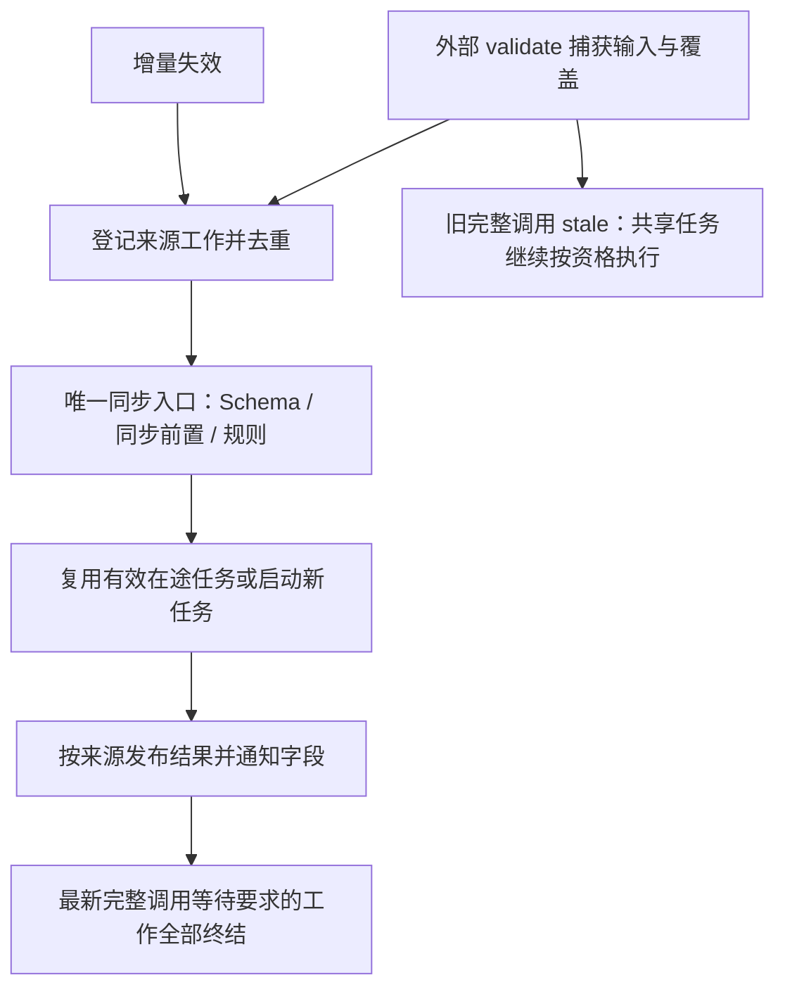

# L3 校验与结果

校验读取当前数据并产生结果，正常联动后消费本轮任务。它复用运行时的数据与依赖匹配，不另建响应式系统，也不修改 Working Data。已确认原则直接整理为契约，SDK 与验收未完成不等于需要重新讨论架构。

## 目标、职责与当前状态 {#validation-baseline}

L2 输入输出已确认 Constraint 就地 watch 和准备后的 requires：Internal 合并 when / assert，External 合并显式输入与 when，再传递前置输入；字段 requires 增加相关 Internal 的 constraintIds。实例绑定、本轮补齐与异步有效性仍由本层负责，不把输入输出确认当作校验算法实现。见[输出差异](l2-preparation.md#compiler-io-differences)。

Validation 读取业务数据，产生结构化 Issue，供 View / Host 消费。它不修改 Working Data，不拦截业务不合法的输入，不回滚 Command，也不自动修复结果。Dirty / 业务 Baseline / Reset 仍归 Host，Touched 和错误显示时机归交互层。

| 状态 | 当前设计 |
| --- | --- |
| 已收敛 | 保留完整 JSON Schema；业务 Constraint 独立于 Schema 库扩展；Flush 结束后统一执行内部 / 外部校验，Schema 先执行、同步前置决定就绪；复用 Data Dependency Index；按编译依赖触发并补齐本轮前置，不建立前置结果 PubSub；按字段聚合错误 |
| 已确认的前置策略 | L2 自动补全可推导的校验依赖；后置入队时递归补齐前置 Constraint，使用本轮前置结论，不复用历史通过结果 |
| 推荐实现 | 按 Source 保存结果、字段索引派生；同步结果原子替换；默认消息模板加局部覆盖；实例代次隔离；独立任务继续 |
| 必须满足的正确性 | 过期或已销毁实例的异步返回不能提交；执行异常 / 跳过 / 未校验不能冒充通过；无 Issue 不等于校验完备 |
| 待固化 / 验证 | 前置 / Prepared 消费的实际实施、Issue / 完整结果 API、通知时序、性能与 Web / Dart 一致性 |

Reaction 和 Validation 共用 Data / Scope / 依赖匹配，分别管理待执行任务与完成语义。需要“条件不成立则清空保障”时，两者可以复用同一纯业务条件；不让 Reaction 监听 Validation Result 来产生 Data → Reaction → Validation → Reaction 的跨轮循环。异步后续业务动作由 Host 明确发出 Command。

背景、原有备选及代价见 [ADR-FE-010](decisions/ADR-FE-010-validation.md)。本篇保留完整执行、结果、异步与完备性说明，来源讨论单独放在[设计演进](design-history.md)；缺失前置与跨轮资格的张力在 [REV-01 / 02](design-review.md#rev-01)有具体反例，异常 Flush 交接见 [REV-03](design-review.md#rev-03)。2026-10-19 讨论已确认依赖补全与前置共同入队方向；引用语法、字段资格范围和异步交接仍待固化，不据此擅自扩展正式语法。

## 一次联系人导入如何完成校验 {#validation-story}

Host 选择历史联系人，以普通 Command 导入被保人。每条有效修改经过已有 Data / Scope 前后值比较，登记 Reaction 和受影响 Constraint。Reaction 按自己的显式 Watch 收敛，Validation 随后读取当前数据。

```diagram
{
  "id":"figure-validation-round",
  "title":"同一变化入口，两种执行职责",
  "rows":[
    [{"title":"Command → Data + Scope","body":"比较有效观察值；共享 Dependency Index 定位消费者"}],
    [{"title":"Reaction Pending → Flush","body":"同步联动收敛；后续 Command 继续补充校验失效"},{"title":"Validation Pending","body":"根 Schema 待校验标记 + ConstraintInstanceId 去重集合"}],
    [{"title":"根 Schema + 本轮 Constraint 链","body":"完整结构校验；检查本轮前置、必要重排，再判断准入","major":true}],
    [{"title":"Source Issues → Field Issue Index","body":"保留来源、按稳定 Scope 定位，原子替换来源贡献"}],
    [{"title":"View / Host","body":"读取或订阅字段聚合；完整校验另核对执行与新鲜度"}]
  ],
  "arrows":["↓","↓","↓","↓"],
  "note":"正常 Reaction 收敛后启动校验；没有 Reaction 时也有校验入口。异步不阻塞同步 Flush；前置缺失、异常与熔断衔接不得解释为业务通过。"
}
```

根 Schema 检查必填、类型、证件号码静态约束。C1 检查证件类型与号码一致性，C2 执行身份核验，C3 检查独立年龄规则。若 C2 明确以前置 C1 为条件，则先整理 C1 / C2 的顺序，再核对 C1 是否通过；C1 失败只使 C2 跳过，C3 继续。各来源的 Issue 最终聚合到对应成员的字段。一轮校验不要求全部外部请求同步完成，独立异步操作可以并发。

## 完整 JSON Schema 与平台 Adapter {#validation-schema}

首版保留完整标准 Schema，作为根级校验域。自动拆成字段或 Keyword 单元可能破坏 oneOf、条件组合与 unevaluated* 等语义，还要求额外依赖分析；先测完整校验成本，再评估能够证明等价的局部优化。根数据传入校验器，由 Schema 决定适用规则，并非无条件对全部字段执行全部关键字。

| 层 / 平台 | 负责什么 | 不携带什么 |
| --- | --- | --- |
| L1 | 完整 Schema、业务 Constraint；现有断言 / 外部义务语义继续有效 | 不加入校验状态、请求或库私有规则 DSL |
| L2 | 保留 Schema 资源、引用与 Adapter 约定；准备规则读取依赖和消息映射 | 不把 Ajv 生成的 JavaScript 函数跨端传输，不装入实例结果 |
| Web / Node Adapter | 以 Ajv 的 Draft 2020-12 入口为候选，缓存编译后的校验函数，再验证当前 Root | 不在每次输入时重新 compile，不修改 Working Data |
| Flutter / Dart Adapter | 选择满足约定 Draft / 关键字范围的实现，归一化为同一 Issue 契约 | 不宣称现有 Dart 库已通过兼容验收 |

复用编译函数不同于缓存数据校验结果：每次调用仍校验本次数据，不能认为未重新编译就自动得到了字段级增量结论。[Ajv 的编译复用说明](https://ajv.js.org/guide/managing-schemas.html#re-using-validation-functions)支持这种使用方式。

```typescript
// Adapter 概念示意；preparedSchema 指已有 Schema 资源，不冻结 Prepared 字段。
import Ajv2020 from 'ajv/dist/2020';
const ajv = new Ajv2020({
  allErrors: true,
  strict: true,
  useDefaults: false,
  coerceTypes: false,
  removeAdditional: false
});
const validateRoot = ajv.compile(preparedSchema); // 按资源、版本和选项复用
function validateCurrentRoot(dataRoot: unknown) {
  return validateRoot(dataRoot)
    ? []
    : normalizeAjvErrors(validateRoot.errors ?? []);
}
```

Adapter 禁用赋默认值、类型转换、移除额外属性等会修改输入的选项，保持“校验只读”边界；这些选项的作用见 [Ajv 数据修改说明](https://ajv.js.org/guide/modifying-data.html)。装载时的默认值按已有生命周期契约处理，不借校验回写数据。

业务 Constraint 由 Expression / Pure Function / Host 外部能力执行，沿用 Internal `assert: boolean` 与 External 义务，不改造成 Ajv 自定义 Keyword 的跨端 ABI，也不据来源的 `execute(): Issue[]` 伪代码放宽 L1 断言返回类型。跨端需对齐 Draft、关键字、format 是否作为断言、引用解析、数字 / 正则行为、Issue 目标和消息；正式支持范围与 Dart 选型由一致性测试确定。

## 增量登记与校验入口 {#validation-pending}

匹配发生在 Command 的有效 Data Change 阶段。已有 Dependency Index 定位候选，再比较观察值，命中的 ConstraintInstanceId 加入初始本轮集合；Runner 沿编译前置计划递归补齐并去重后消费该集合，不扫描所有注册 Constraint 再判断谁读了修改字段。根 Schema 保守观察整个 Working Data，有效修改后登记一次待校验标记。

```typescript
// 概念结构，不是冻结接口。
interface PendingValidation {
  schemaNeedsValidation: boolean;
  constraints: Set<ConstraintInstanceId>;
}
// Data Change：共享索引与观察值比较已完成后分别投递。
// Reaction → pendingReactions.add(instanceId)
// Constraint → pendingValidation.constraints.add(instanceId)
// Root Schema → schemaNeedsValidation = true
```

来源中的 `schemaDirty` 只是“根 Schema 需要重新校验”的内部工作标记，现行示意称 schemaNeedsValidation，避免与 Host 的业务 Dirty 混淆。它不记录用户编辑来源，也不重新引入核心编辑状态。

| 变化 / 入口 | 本轮范围 |
| --- | --- |
| 修改一位被保人的 age | 根 Schema 一次；先登记有效观察值变化的 Constraint 实例，再补齐其前置 |
| 多 Command 命中同一规则 | Pending 去重；Reaction 造成的后续变化继续登记，正常收敛后按最新输入执行 |
| 同值写入 / 整对象导入 | 无有效变化不新增任务；对象导入按相关子路径观察值比较，不因索引命中就执行 |
| 没有 Reaction 被触发 | 校验仍有独立启动入口，不以必须出现一轮 Reaction 为前提 |
| 初始化 / 新 Scope / 主动校验 | 显式覆盖应检查的规则；不等待第一次 Data Change，不以 subscribe 代替初次执行 |
| Host 完整校验 / Submit | 根 Schema + 全部适用 Constraint 构造完整校验链，不能用普通增量集合冒充完整性 |

Internal 依赖仍来自 when + assert；External 以显式 Data watch + when 可见读取作为基础依赖，两者均叠加 L2 传递的前置输入。有效变化立即使旧结论失效并登记 Pending，外部校验与内部校验统一在 Flush 结束后的本批次执行：先根 Schema，再按稳定顺序处理已满足同步前置的 Constraint，未满足者按前置关系后排；前置失败只阻止对应后置，独立规则继续。External 发起任务后不等待网络阻塞其他独立规则，异步完成不计入同步 Flush。没有 Reaction 时校验独立启动；普通增量仍只覆盖命中任务及前置，完整校验覆盖全部适用规则。网络、重试与实际取消由 Host 实现。

## 本轮前置检查、重排序与四种推演 {#validation-round}

本轮以依赖匹配命中的 Constraint 为初始任务，沿已解析前置关系递归补齐前置 Constraint，按具体实例身份去重，形成闭合任务集合，再以配置顺序为稳定起点重排，使前置先于后置。同步 / 异步是执行形式，不据此把全部 Constraint 强分为两个固定阶段。根 Schema 是基础校验域；作为前置的字段资格按当前适用同步校验完成且无相关错误判断，不要求作者枚举 Schema / Internal 来源，不能以根级任一错误阻断全部无关 Constraint。同步资格不证明该字段异步或完整校验已通过。

`requires` 是来源使用的前置关系占位名称，**尚未作为现行 Canonical 字段发布**。字段 / 规则两种引用沿用已确认方向；2026-10-21 明确按具体 Scope 实例唯一绑定，首期仅等待同步前置、不支持集合 or / any。正式引用字段、字段资格集合与编译表示仍待固化。运行时前置使用解析后的具体实例身份，不能把不同数组项的同名规则混成一个任务。

| 场景 | 初始本轮任务 | 整理与执行结果 |
| --- | --- | --- |
| 正常 | Schema、A、B；B 以前置 A 为条件 | A 通过后 B 执行 |
| 乱序 | B、A | 重排 A → B；排好序仍须判断 A 已通过 |
| 初始集合未含前置 | 仅 B，B 引用 A | 补入 A，再按 A → B 执行；A 的历史通过结果不代替本轮执行 |
| 前置失败 | A、B、独立 C | A 产生自己的业务 Issue；B 跳过，不伪造 B 业务失败；C 继续 |

自依赖、环路、非法引用均需诊断，排除无法合法执行的任务与受其影响的后置，独立任务继续。排序只能表示先后，不能把“已排在前面”视为“已执行且通过”。跳过、执行异常或尚未完成均不等于通过；前置资格丧失时后置旧来源 Issue 不再有效。

### 前置引用与首期等待范围 {#prerequisite-scope-contract}

2026-10-21 用户确认：字段与规则两种前置引用是既有方向，不重新作为取舍；前置绑定到具体 Scope ID 对应的唯一实例。规则实例还须结合规则身份定位，不可仅用 Scope ID 混同同一成员内的多条规则；根级规则使用唯一根上下文。成员移动后跟随稳定身份，不能按变化后的数组下标误绑定兄弟项。跨多个实例的 or / any 等集合前置本期不增加，有真实需求后再评估。

首期只允许等待同步前置。External 可以依赖同步资格后发起异步校验，但不能把另一个异步 Constraint 的完成作为可等待前置；多步异步交由同一个 Host Validator 封装。同步前置的失败 / 未完成 / 执行异常均不能按“无 Issue”放行，独立任务继续；共同入队、依赖补全、当前轮结论、失效撤销及完整校验等待原则继续有效。

后续完整草案已获用户确认：字段前置明确表示同步资格，包括根 Schema 对该字段的结论及相关、当前适用的 Internal Constraint，不包括 External。类型可通过 phase: sync 明示范围，不将它命名或使用为完整通过证明；规则前置指向 External 时编译拒绝。多个前置均须满足，不增加 or / any。同步资格集合包含当前规则自身时仍报自包含错误，不静默排除自身。父结构错误仅在确实影响字段定位或检查时阻断该字段，不能把无关根错误扩散成全部字段无资格。正式名称、判别 Union 和归属规则在实现中按这些原则整合，不再逐项重开讨论。

### 原严格缺失算法及其替代关系

```text
pending = 本轮去重后的任务，保留配置顺序
selected = 本轮任务身份集合
重复：排除前置不在 selected 的任务，记录缺失诊断
      直到集合不再变化（后置依赖无效任务时也被排除）
ordered = []
重复：选配置顺序中第一条尚未排出、全部前置已排出的任务
      若存在，将其加入 ordered
      若不存在，对剩余无法排序任务报告环路 / 受环阻塞诊断并停止
执行 ordered：检查本轮前置的实际结论，满足才执行；独立任务继续
```

以上原候选算法保留用于说明替代关系：其中“排除前置不在 selected 的任务”已被递归补齐合法前置取代，不再是现行执行步骤。现行步骤为：从初始 Pending 沿前置计划求闭包、按实例去重，再拓扑排序并检查本轮实际结论；非法引用、不可绑定实例与环路仍须诊断，不能靠补齐掩盖。这只遍历命中任务及其前置，不遍历全部已注册规则。直观实现可以扫描本轮列表；任务多时可用本轮临时入度表优化，不必持久维护前置结果反向索引或发布订阅。剩余无法排序者可能包含环成员和受环阻塞的后置，不能都误报为环成员。

2026-10-21 用户明确首期仅允许等待同步前置；不支持跨 Constraint 的异步前置等待，多步异步 A → B 封装在同一个 External Constraint 的 Host 实现中。独立异步任务可以并发，完整校验仍须等待全部适用异步任务，不能把前置限制误解为提交不等待异步校验。

### 增量前置共同入队与编译依赖补全

A 读取 idNumber，B 自身读取 name 并以前置 A 为条件。只修改 name，初始 Pending 为 B，再补齐 A；身份证变化时，B 也因编译补全的有效依赖失效并进入校验调度。两种路径都按本轮 A 的结论决定 B 能否执行。A → B → C 的前置链须递归补齐；数组中按已绑定的具体规则实例处理，不能混入兄弟 Scope 的同名规则。

2026-10-19 已确认：可从表达式和已解析前置关系确定的依赖由 L2 自动补全，不要求作者重复配置，也不因未重复声明阻止编译。Internal 从 when / assert 等读取推导；External 的 Host 内部业务依赖不可见，只有无法推导的部分才由作者显式提供，不能声称编译器能发现所有遗漏。前置的数据依赖沿前置链传递纳入后置的有效触发依赖，具体可分析输入映射与正式字段仍待定义。Reaction 的显式 Watch 语义保持不变。

依赖补全决定结果失效和待校验任务；请求不在 Command 内立即发送，而在 Flush 结束后的统一校验批次中，按适用性与同步前置发起。不再把“外部默认只等失焦或显式调用”作为当前策略。编译计划应保留补全依据供诊断。根 JSON Schema 已全量校验，不按 Constraint 前置链重复补任务；字段资格按前置完成且该字段无错误判断，无关字段错误不能阻断全部规则；精确解析与实例绑定仍待固化。

## 结果按来源保存，按字段聚合 {#validation-results}

推荐 `issuesBySource` 作为结果事实来源：根 Schema、每个绑定 Scope 的 Constraint 实例分别贡献 Issue。`fieldIssueIndex` 是从来源结果派生的查询索引，以稳定 ScopeId + 相对路径定位字段；不是第二份业务事实，也不由 L4 重新聚合一遍。

```typescript
// 概念算法；SourceId / IssueRef 等正式字段、顺序和去重待固化。
function publishIssues(sourceId: SourceId, next: ValidationIssue[]) {
  const old = issuesBySource.get(sourceId) ?? [];
  const affected = collectAffectedFieldKeys(old, next);
  issuesBySource.set(sourceId, next);
  updateFieldIssueIndex(sourceId, old, next);
  notifyAggregatesThatChanged(affected);
}
```

例如 root-schema 对成员 A 的 age / name 各有 Issue，age-constraint@A 也对 age 报错。字段 age 聚合两个来源；根 Schema 重跑只替换自己的贡献，不清除业务 Constraint 的错误。仅维护一份 formErrors 数组难以准确撤销各来源旧贡献，故保留来源所有权。

根 Schema 的物理 JSON Pointer 由 Adapter 结合**本次校验输入对应的 Scope 读取视图**转换成稳定成员身份 + 相对路径，不能用已变化的位置把旧结果附给另一成员。对象 / 数组错误可归容器或 root，不强迫伪造子字段。现行推荐在当前 Root 同步完成根校验；若以后延迟计算，须保持其数据 / Scope 配对与新鲜度。

Issue 的最小字段、稳定排序、去重、根级查询与多目标表示还未冻结。Internal Constraint 沿用已有声明目标与错误码，Source 保存 / Field 聚合不自动扩展其返回协议。

## 消息生成、字段订阅与展示 {#validation-messages-subscription}

消息推荐按“字段 / 约束专属覆盖 → 平台关键字模板 → 通用回退”选择。Schema 的 title 可提供显示名；maximum 可用“{title}不能超过 {limit}”，required 可用“请填写{title}”。无需作者为每个 JSON Pointer 维护重复提示。

来源 `validationMessages` 示例是概念性 L1 扩展，该名称不是正式类型。后续已确认按 Schema 声明位置 / keyword 与 Constraint 局部消息覆盖，资源解析归 Host，详见[首期消息契约](#validation-message-contract)；当前仍未修改候选 Schema 接受该占位字段。底层错误先归一化为结构化 Issue，消息覆盖不能改变校验是否通过。

Ajv 的 instancePath、keyword、schemaPath、params 可供 Adapter 转换；required 的缺失属性位于 params.missingProperty，须与父路径组合并正确编码 Pointer，不能直接把父对象当作缺失字段。其他错误仍按自身关键字语义归属，不一概套用此规则。底层字段定义见 [Ajv 错误接口](https://ajv.js.org/api.html#validation-errors)；Dart Adapter 需给出相同语义。

```typescript
// 概念 SDK；不增加 L1 validationBind / errorBind。
const field = { scopeId: 'insured-A', path: ['age'] };
const readIssues = () => runtime.getIssues(field);
const unsubscribe = runtime.subscribeIssues(field, () => {
  renderIssues(readIssues());
});
```

| 情形 | 推荐发布行为 |
| --- | --- |
| Schema 重跑，字段聚合内容相同 | 不发送没有内容变化的字段通知 |
| 同步校验旧结果失效至新结果就绪 | 聚合原子替换，避免旧 → 空 → 新闪烁；内部仍及时标记结论不再有效 |
| 异步输入有效变化 | 撤销该来源过期 Issue，不清除其他来源；是否显示 loading 由 UI 决定 |
| 数组成员移动 | 相对字段订阅仍跟随同一 ScopeId；固定物理位置观察按原有位置语义解释 |
| Scope 删除 / 实例销毁 | 清理来源贡献、派生索引及对应实例订阅；旧返回不能恢复它们 |

结果按来源就绪及时发布：同步校验结果与通过适用性检查的外部返回分别更新自身贡献，有实际聚合或对外校验状态变化即通知对应订阅；不等全部异步任务结束后才统一交付。完整校验调用的全适用等待与输入证明仍独立维护。贯穿关系见[运行时全景](l3-reactive-engine.md#runtime-overview)。

View 主要消费字段聚合，不必逐步感知每个校验单元的内部执行状态。L4 可封装 Vue Hook、Flutter Stream / Listenable 等接入。减少 UI 状态暴露不等于删掉内部有效性：请求代次、是否完成、是否过期仍供运行正确性与完整校验使用。Dirty、Touched、spinner 和何时展示错误不因此进入 L3。

### 消息的首期交付契约 {#validation-message-contract}

2026-10-21 用户确认默认模板 + 声明位置覆盖。Constraint 在已有 issue 声明附加可选消息；Schema 错误在统一覆盖表按 schemaRef + keyword 定位，数组实例复用声明，不增加数据路径通配符与匹配优先级语言。消息可为字面 text 或资源 key 的严格判别结构；语言与资源解析归 Host，不建设协议国际化系统。

选择顺序是专属覆盖 → Host 默认模板 → 通用回退；资源缺失不得让错误消失。消息参数来自结构化错误，消息配置不能改变校验结论。Schema title 可作为显示名。覆盖表的挂载字段和完整类型在正式协议实施中一次整合，原 validationMessages 仅为候选名称，不将旧占位当作已实现结构。

此选择相对数据路径覆盖减少动态数组 / 通配符规则；代价是同一 Schema 在不同位置要求不同文案时按实际场景再扩展。Issue / 消息解析 SDK 属 Runtime / Host 接缝，归属及异步有效性原则不变。

## 异步结果与实例生命周期 {#validation-async}

外部校验由 Host 注册的能力执行。每个 Constraint 实例独立管理输入 / 请求代次及 Scope 存活，不能仅以全表 Data Version 变化丢弃所有无关请求。返回成功和异常都要做同样的适用性保护，避免销毁后旧错误报告重新污染结果。

```typescript
// 概念保护流程；invokeHostValidator / 输入和代次协议尚待固化。
async function runExternal(unit: ConstraintInstance) {
  const generation = unit.generation;
  const scopeId = unit.scopeId;
  const input = readCurrentInput(unit);
  const isCurrent = () => isScopeAlive(scopeId)
    && isCurrentInstance(unit)
    && unit.generation === generation;
  try {
    const issues = await invokeHostValidator(unit, input);
    if (!isCurrent()) return;
    publishIssues(unit.sourceId, issues);
  } catch (error) {
    if (!isCurrent()) return;
    reportExecutionError(unit, error);
  }
}
```

有效输入变化、实例替换 / 销毁、前置资格丧失须使旧请求不再适用。重复请求相同输入时仍需区分当前请求，具体 token 与代次 API 待固化；取消只是优化，不能代替返回时核对。前置失败使后置跳过，不产生“后置验证失败”业务 Issue；执行异常写诊断与不完备结论，不伪装业务通过。

这里不建立前置结果 PubSub。L2 将可推导的前置输入依赖纳入后置有效依赖，使相关输入变化可使后置结果失效并登记待校验，不依赖前置结果通知触发后置。异步在途结果仍须校验输入、实例与前置资格；具体 token、撤销与通知时序待固化，不能把共同入队视为这些接口已完成。

Context 由 Host 提供、表达式只读；Host 通过显式替换快照更新，Context 身份改变后撤销旧完整证明及旧外部任务资格，保守失效全部校验来源并登记重新校验。当前 Flush 正在执行时在结束后校验，否则独立启动；旧调用读取自己的稳定 Context 快照，不能混读新值。完整证明关联本次 Data / Context / Runtime 身份，数据局部变化仍按自身依赖保护独立任务，不套用 Context 的整体失效策略。该管理入口不增加 Context Command、External.watch 或 Reaction.watch 来源，具体行为见 [Context 交接](extension-integration.md#host-context-update)。

## 完整校验、Readiness 与异常轮次 {#validation-completeness}

| 入口 | 范围 | 完成含义 |
| --- | --- | --- |
| 普通自动增量 | 根 Schema 待校验项 + 本轮命中的适用 Constraint | 更新当前来源结果和字段聚合，不证明全表已完整通过 |
| 显式完整校验（validateAll 为概念名称） | 当前根数据与全部适用 Constraint，构造完整链 | 需核对执行完成、业务失败、诊断、异步有效性与调用输入 |
| Submit 准备 | 完整校验全部当前适用的同步 / 异步规则，交付对应数据快照 | 全部完成且通过后 Host 决定业务许可与真实提交；不以部分完成冒充完整通过 |

`getIssues().length === 0` 只能说明当前没有展示出来的 Issue，不能证明必要规则均执行并通过。完整结果至少需区分当前通过（valid）、业务不通过（invalid）、未完成 / 执行异常 / 配置阻塞（incomplete）、输入已改变（stale）的语义；具体 TS 返回类型与通知交接仍待整理，完整校验等待全部适用同步 / 异步义务已确认。来源 D17 将配置错误的完整返回列为待验证，当前只保证不能把它当作 valid。

数据变化时，单个外部结果依据自身输入与实例判断是否仍适用；完整校验证明则关联该次所验证的整体输入。无关字段变化不应误伤独立请求，却可能使上一份全表完整证明不再对应当前表单。这两个判断层次不能混用。

2026-10-19 已确认：Reaction 错误只表示相应联动未完成，不自动阻止提交；独立规则继续，已写 Data 不回滚。代码异常报告交 Host，用于正确用户提示与监控告警；网络失败由 Host 提示 / 重试。业务校验不通过与校验执行异常分别表达，必要校验无法完成不能放行。非关键辅助操作失败不阻断主流程。

整体预算熔断只停止整个当前 Reaction Flush，清空剩余待执行 Reaction；保留已写 Data、填写 / Command、读取 / 快照与独立完整校验。旧 Pending 不跨轮转移或自动重试，当前轮真正结束后的下一次外部交互或 Host 新操作若产生有效 Watch 失效，按正常流程建立新轮次与新预算。无有效变化不伪造入队，不补跑被清空任务，不重新激活已有实例，也不需要显式恢复入口。开发端报告可定位错误，生产交 Host 监控告警及业务承接；继续填写不保证未执行的业务计算已经完成，必须成立的关系仍由 Constraint 检查。不建立局部 Health 或失败下游传播。2026-10-22 本轮决定替代原持续暂停方案，见 [ADR-FE-018](decisions/ADR-FE-018-flush-round-protection.md)。

Host 主动对当前数据发起完整校验，不为提交额外触发一轮 Reaction，也不要求历史 Reaction 成功。Schema 与全部适用同步 / 异步 Constraint 通过后，可提交该次证明对应的数据快照。必须成立的业务关系应表达为校验约束，不能只依靠联动成功维护。联动 Outcome 与完整校验结论分别报告；校验通过不把熔断改记为正常收敛。若数据已无法可靠读取或校验机制不可用，则无法证明合规，不允许据此提交。

正常自动增量在联动收敛后统一执行内外校验；当前轮熔断后仍允许独立完整校验，后续新触发正常执行。异步不纳入同步 Flush；完整结果语义已定，结构由维护者按下方信息模型整合，具体 SDK、通知与实际验收尚未完成。

### 完整结果的信息结构与组合 {#validation-result-contract}

完整结果的四类语义已经确定，用户授权维护者整理结构，不再逐字段重开决策。下表是 SDK 承载的信息模型；TS Runtime 已提供对应结构与无界面用例，完整跨端 / UI 验收仍未完成，不向可序列化 L1 / Prepared 增加实例字段。

| 信息 | 含义与约束 |
| --- | --- |
| 调用身份 / 输入身份 | 关联本次完整调用、Runtime 代次、Data 修订与 Context 身份；旧证明不能代表新输入 |
| 对应数据快照 | 稳定只读的本次校验对象，Host 据此转换业务请求；不构造引擎内部第二份输出 |
| 总体状态 | valid、invalid、incomplete、stale；状态与 Issues / 诊断分别表达，不丢失并存事实 |
| Issues | 当前输入下已确认的业务错误，保留来源及稳定 Scope / 字段定位 |
| 覆盖与原因 | 区分完成、正常不适用、前置阻断、未完成及执行异常；无 Issue 不代替覆盖证明 |
| 诊断关联 | 解释缺能力、执行异常和输入 / 任务资格失效，技术错误不伪造业务 Issue |

组合表达按输入资格优先：输入或调用资格已失效为 stale；否则存在必要校验未完成、缺能力或执行异常为 incomplete；否则存在业务错误为 invalid；全部适用义务完成且通过才为 valid。前置已明确业务失败导致后置按契约跳过时，保留该阻断原因并汇总真实业务错误，不伪造后置业务失败，也不单因这次正常跳过改记 incomplete；前置未完成或异常造成的阻断则不能证明完备。业务错误与异常可同时保留，即使总体只给一个状态也不能丢弃证据。when=false 是本次正常不适用；when 求值失败是执行异常。

每次完整调用固定本次输入身份与覆盖范围，不自动追赶后续编辑，也不为提交额外触发 Reaction。Host 如需等待已安排联动结束，可先观察其 Outcome，再对当前状态发起完整校验。等待期间输入改变使旧调用成为 stale；仍有独立资格的异步任务可以继续更新自己的来源，不能据此把旧完整调用恢复为当前通过。TS Runtime 的调用过期与任务复用验收见下节；跨端、实际 UI 提交及生产性能仍须独立验证。

### 完整调用合并与在途任务复用 {#validation-work-coalescing}

2026-10-26 用户确认：自动增量与外部完整调用共用队列和唯一同步执行入口，运行中新增需求只补充未执行工作；补齐同步前置并按来源实例去重。新完整调用使旧调用返回 stale，仍有效的在途任务由新调用继续等待，不因调用被取代就撤销重发。当前实现已从每次 `validate()` 独立 `run(true)` 改为登记完整覆盖需求，再交给统一入口。决策理由与取舍见 [ADR-FE-021](decisions/ADR-FE-021-validation-work-coalescing.md)。

| 所有者 | 保存内容与生命周期 |
| --- | --- |
| Source | 某个 Schema / Constraint + Scope 的当前状态、Issues、输入代次和网络句柄；按依赖或实例生命周期失效 |
| ValidationWork | 此来源当前的一份排队 / 执行 / 在途工作，以及该工作封存结果；不保存整份已完成输入历史 |
| ValidationCall | 本次完整调用的输入身份、快照、覆盖工作与结果等待；被新调用取代或输入改变时 stale，不拥有共享任务的取消权 |
| FlushContext | 当前同步联动及校验反馈预算；异步工作不持有它，也不能靠合并请求重置它 |



尚在队列或同步执行中的同来源工作合并；已启动网络任务在实例、代次和依赖资格有效时复用，同时重新核对本次适用性与同步前置。不同数组成员各有独立工作，绝不能仅按规则名去重。队列只负责选择工作，来源中的任务资格才决定结果能否发布；A→B→A 不能按值相同恢复旧请求。

同一次执行中已经完成的同步前置可以复用；新的完整调用允许重跑已完成的外部来源，保留用户重试及服务端新鲜度语义。结果发布期间视为终态正在封存，业务回调主动重试时建立新工作，避免把它错误合并回旧失败。只合并需求时不清旧 Issues、不重复发布 pending；真正失效或重跑时仍只更新该来源贡献，不清空其他来源。

完整结果不能只 `Promise.all` 登记当时已出现的网络任务：重入时有些必需工作还在队列中。调用固定要求覆盖的工作，只有它们全部终结，才根据正常跳过、业务阻断、错误与输入资格形成四类结论。共享任务的错误保留启动时完整输入和 origin，`relatedCalls` 记录等待该任务的完整调用；收集器按这些关联路由，调用结束立即解除，不能把旧调用或整个 Journal 留在任务里。技术异常在状态通知前先采集并关联错误现场，避免回调修改输入或发起重试时，旧调用已经封存而丢失已发生的错误。Schema 通知若产生新输入，先交接完成新的根 Schema 工作，再继续未执行规则。

一次同步入口消费当前交接批次；通知或输入变化新增的工作交回现有 Scheduler，继续受同轮反馈预算约束。没有增加协程、全局异步 DAG 或跨 Constraint 的异步前置等待，也没有改变独立异步请求发起后继续执行其他规则的行为。

**后续优化候选，尚未实施：**已完成结果缓存、字段查询 / Issue 派生索引。用户确认目前无必要，先保留方向；未来有真实重复计算或扫描瓶颈，再比较 Host 校验器启动及 cancel 次数、Schema / 规则执行次数、来源发布 / 查询量、内存与耗时。缓存须另行明确重试和服务端结果新鲜度；索引须验证多目标 Issue、成员移动 / 删除及通知一致性。此处不选定缓存策略、阈值或新公共 API，也不建立全字段状态树。

## 跨层交付、替代方案与取舍 {#validation-layers}

| 层 | 本专题新增说明 | 保持的边界 |
| --- | --- | --- |
| L1 | 完整 Schema + 业务 Constraint；有限前置与消息覆盖的语义方向 | requires / validationMessages 尚非正式字段；Internal boolean、External Data watch 保持 |
| L2 | PreparedValidation 方向：解析规则 / 字段引用、读取依赖、消息计划与执行器身份 | 可序列化；不保存实际 Pending / 结果，不自动改 Reaction Watch |
| L3 | Data 匹配 → Pending → 本轮整理 / 执行 → Source Issues → 字段聚合 | 不增加全局异步 DAG、前置结果 PubSub、Keyword 局部引擎或编辑状态 |
| L4 / Host | 按字段查询与订阅；Host 执行外部能力，决定交互 / 保存 / Submit 策略 | 数据回写须显式 Command；校验报告另走有效性入口 |

原候选“固定 Schema → 全部同步 → 全部异步”改为根 Schema 基础域 + 按前置整理的本轮 Constraint 链；原候选“复杂源状态全部向 UI 暴露”改为字段聚合消费，内部保留必要有效性。自动局部 Schema 拆分、前置结果反向索引、Reaction 监听校验结果均不作为当前采用方案。原严格缺失跳过候选已由编译依赖补全与本轮前置共同入队替代。完整 Schema 的全量成本和前置重复执行成本需由基准衡量，不能为简化描述隐藏。

## 设计验收与下一步 {#validation-acceptance}

以下 V01–V16 对应来源的 16 个案例，是后续实现验收，**不计入当前候选验证器通过统计**。

| 编号 | 场景 | 预期与证据边界 |
| --- | --- | --- |
| V01 | 基础类型 / 必填 / 枚举错误 | 根 Schema 产生标准化 Issue，Data 不因业务不合法而回滚 |
| V02 | 全量 Schema 反复校验 | 复用编译函数；Web / Dart 同数据结果对照，缓存编译不冒充增量结果 |
| V03 | Data 同值写入 | 没有有效观察值变化，不新增增量 Constraint 任务 |
| V04 | 多 Command 命中同一 Constraint | Pending 去重，正常收敛后本轮执行一次 |
| V05 | 对象整体替换 | 子字段观察值有效变化才使相关实例入队 |
| V06 | 数组移动与 Scope | Issue 跟随逻辑成员，不错误附着到原物理位置的其他人 |
| V07 | Schema / 业务错误重叠 | 同一字段聚合两类来源，不互相覆盖 |
| V08 | 根 Schema 部分错误消失 | 仅撤销该 Source 旧贡献，其他 Source 不受影响 |
| V09 | 前置项排在后面 | 本轮重排，无前置结果二次发布订阅 |
| V10 | 前置缺失 | 合法前置递归补齐并去重；非法引用 / 实例绑定失败须诊断，受影响后置不执行 |
| V11 | 前置失败且有独立规则 | 后置跳过，独立规则继续；跳过不算通过 |
| V12 | 仅 B 入 Pending，A 旧结果有效 | 补齐并重跑 A，按本轮结论决定 B；改变 idNumber 也应经补全依赖使 B 失效 |
| V13 | 异步乱序返回 | 仅当前请求 / 输入与存活实例的结果可提交 |
| V14 | 异步输入失效 | 撤销该外部来源过期 Issue，其他同步来源保留 |
| V15 | Submit 校验完整性 | 首次未执行的必要规则仍被完整覆盖；Reaction 错误 / 熔断不直接阻止提交，必要校验未完成 / 配置异常 / stale 不算通过 |
| V16 | 校验结果内容不变 | 字段聚合不重复通知；具体通知时序仍需验证 |

依赖补全与前置共同入队方向已确认；下一步固化实例绑定、资格撤销与异步交接，再冻结前置引用范围与语法、PreparedValidation 最小结构、Issue 查询 / 订阅 / 完整结果 API。随后用相同测试向量对照 Web / Dart，度量根 Schema 在目标设备的成本，决定是否需要延迟通知或局部优化。附带图示、伪代码与交互原件只是设计说明，不代替正式类型、Schema、Adapter 和 Runtime 实现。

### 交互限制与数据写入的校验分责

业务输入限制在交互入口落实；例如 maxItems=5 时界面禁用添加按钮，不发出插入 Command。数据层不依据业务 Schema 拦截写入：若 Host 导入或程序写入第六项，只要操作结构可执行，就写入 Working Data，再由 Validation 报告超限并阻止提交。目标不是数组、位置非法等结构性错误仍须拒绝，不能与业务校验失败混为一类。该边界统一适用于插入、修改和导入，保留暂时业务不合法的工作态，不增加逐 Command 业务预校验或事务机制。

这是对既有允许业务不合法工作态原则的澄清，不代表协议示例或 Runtime 已实现；原歧义见 [REV-04](design-review.md#rev-04)。

### 本组确认：字段资格、完整等待与错误收集

原组确认用“字段有效”表示前置校验完成且无字段错误；2026-10-21 首期基线已明确收窄为 Schema + 相关适用 Internal 的同步资格，不要求作者枚举这两类来源，不包括 External，也不证明完整有效性。有前置条件的任务后置执行，执行前核对实际前置已完成且通过；不能仅凭排在后面就当作前置通过。前置未完成或执行异常也不能按“无字段错误”放行。循环、自依赖和字段聚合导致的自包含仍须静态诊断，准确引用 / 实例绑定契约待固化，不据此扩展通用异步 DAG。

完整校验覆盖全部当前适用的同步和异步校验，只有全部完成且通过才能报告成功；不能把仍未完成或失败的异步校验当作可忽略的外部服务。无关报价、埋点等 Host 业务服务不属于校验等待范围。业务错误或执行异常不能报告完整通过，错误与未完成的具体组合编码仍待固化。

尽量收集独立规则的错误；失败只阻止以它为前置的后置任务，不终止其他独立校验。后置跳过不伪造业务失败；保留前置错误与真实执行诊断。此原则同时适用于同步与异步任务，不采用首错停止，也不因其他独立字段有错就一律停止全部远程校验。

旧候选 requiredForSubmit 字段仍保留在历史来源及候选样例中，本次不修改样例或正式发布协议；它不能成为完整校验忽略适用异步校验的依据。字段去留 / 迁移在类型与 Schema 固化时统一处理。同步校验不会被新的输入事件插入，但异步等待会释放 JS 调用栈；输入变化沿正常后续 Flush / 校验处理，重复调用按下方任务级机制处理，不将全表自动追赶记为共识。

### 重复异步调用的任务级处理

异步校验的重复调用在校验任务执行层处理，不扩展 Flush 或建立自动追赶的全局调度。同步校验完成后，异步任务可以继续在途；新输入按正常 Command → 下一轮 Flush → 受影响校验路径处理。同一规则实例再次发起校验时，可用版本 / 请求身份识别新旧任务，或撤销旧任务的适用资格并由 Host 尝试取消旧请求；不强制固定某一种实现。独立规则和其他 Scope 实例不因无关请求被替换而整体取消。

正确性要求是旧任务不能覆盖当前有效结果：输入 / 前置资格变化、实例销毁或新调用替换旧调用后，旧成功与旧异常均不得重新发布为当前结果。取消网络请求未必成功，调用替换时撤销结果发布资格与实际请求取消应分开；具体版本号、任务句柄与取消 API 属于后续实现 / SDK 固化。引擎不禁用编辑、不添加全局 Loading，相关交互由 Host 管理。完整校验仍等待全部适用同步 / 异步校验；被替换的调用不能冒充当前表单完整通过，准确取消 / 过期返回编码仍待固化。

### 已选定的取消接入与任务代次

External Constraint 接入选定“Host 返回结果任务及可选 cancel 句柄”。引擎按具体 Constraint 实例管理调用代次 / 任务身份，输入或前置资格失效、同实例新调用替换、Scope 删除及实例销毁时，先撤销旧任务的发布资格，再调用其可选取消句柄。成功与异常返回都必须核对实例存活、任务代次与输入资格；不能只依据全表版本变化取消无关任务，也不能仅比较值相同就接收 A→B→A 的旧请求。

版本与结果有效性是必要正确性契约；取消是尽力而为的资源优化，Host 可以不提供，也不保证网络请求终止。Host 负责实际请求及取消实现，引擎不理解 HTTP / 重试。取消回调要求幂等，任务完成或退出后释放句柄；取消异常只记诊断，不中断其他任务清理或恢复旧任务资格。被主动取消的旧任务不得再发布业务错误或成功，相关诊断与正常网络故障区分。

该能力属于运行时 Host Validator 接口，不将回调写入 L1 或可序列化 Prepared，也不引入异步 Reaction。本次不新增跨端取消信号抽象。完整调用的取消 / 过期返回类型、具体代次编码与 SDK 仍需固化，但不再重新选择取消接入方向。

### Host 能力与校验数据交付

Host 能力缺失按用途降级，开发 / 调试端明确报诊断，用户端不暴露未注册能力名、堆栈等技术错误，不因局部能力缺失默认阻止表单填写。可选埋点等可跳过，业务操作的降级由 Host 决定；适用校验器缺失必须记为未完成，不能静默当作通过。用户交互由 Host 以业务语言承接，用户无感知不等于伪造完整通过或放行未校验数据。

引擎完整校验只证明对应 Working Data 满足表单声明的全部适用校验，并向 Host 交付对应数据快照与结果身份；不负责构造或验证另一个业务请求输出。Host 自行转换、组装业务请求及执行所需输出检查，转换失败属于 Host 业务交付错误，不回写或改写引擎已完成的表单校验结论。表单业务本身需要正确的数据应在配置的数据模型、Binding、同步联动和约束中表达，不依赖提交时隐式修正。Normalized Output 如保留该术语，仅表示 Host 构造的业务提交数据，不是 Runtime 的第二份核心状态或新的通用输出 DSL。

### 输入值与校验对象的一致性

普通输入的非法工作值进入 Working Data 后由现有 Schema / Constraint 校验，不对组件里保留的旧合法值发出通过结论。明确确认型交互在确认前不交付，确认后按正常 Command / Flush / 校验路径处理；引擎不扫描组件草稿或建立额外解析状态。详见 [L4 输入交付](l4-renderer.md#input-handoff)。

## 字段状态观察与逐结果通知 {#validation-state-observation}

执行异常报告遵循[完整现场契约](l3-observability.md#l3-error-evidence)：保留对应完整触发 / 调用输入、Constraint 与 Validator / Schema 身份、Scope、配置身份和错误阶段；异步失败使用任务发起时快照，不以当前数据替代。现场采集与存储介质、上报批次分开，由 Host / Devtools 承接可选持久化；不能因 Trace 截断省略必需现场。该要求不改变业务 Issue、技术未完成与完整校验证明的分别表达，2026-10-25 本批 Runtime 的诊断 SDK 已实现该错误现场与按完整调用收集的接口，回归入口见 [Runtime Review 入口](../../packages/runtime/README.md)；这不表示完整 Devtools 或持久化已交付。

字段校验展示与 Reaction 采用同一观察目标描述：source=validation，field 为 DataReference，observe 为 issues / status / state。View / Host 可以订阅该描述，Reaction 在 watch 中声明该描述；不把 Validation State 当成可写 Data，不改变 Constraint 的数据依赖与同步 requires。

发布顺序固定为：检查任务 / 输入 / Scope 资格 → 替换该来源贡献 → 一致更新受影响字段的 Issues 聚合与公开状态 → 登记命中的内部观察失效 → 通知对应外部订阅。通知回调读取到的是已完成发布的快照，不能看见新 Issues 配旧状态。来源结果每次就绪分别发布，不等全部外部任务完成；完整校验仍独立等待全部适用义务。

投影决定变更比较：issues 关注问题内容，status 关注公开校验状态，state 关注整个对外字段快照。空问题列表从 pending 进入完成时，issues 不变但 status / state 可变化。完整状态的精确枚举、Issue 排序和 SDK 返回仍待固化；不能以没有 Issue 证明已完成。只发布对外状态的有效变化，不暴露 Runner 临时中间态。

按字段快照一致发布不要求一次重跑的所有来源全量锁步完成，也不允许清除其他来源贡献。数组 Scope 稳定身份、过期结果拒绝与删除清理继续适用。普通订阅回调同步通知，Reaction 消费者进入其规则调度；若校验在当前 Flush 的收敛交接中产生新 Reaction，先记录入队，不能递归调用 Runner，按现有轮次 / 重入规则继续调度。网络返回时没有活动 Flush，则请求一次延迟启动。跨异步轮循环不由单轮预算保证收敛。

ValidationReference 供 Reaction when / 动作按调用读取上述投影，读取本身不建立观察。状态满足时才发起 Host 行为可由 when + 注册纯函数表达；不是把校验结果监听退化成 Host 自行猜测的外部数据监听。Runtime 观察 SDK、执行事件与完整校验结果类型仍需独立落地，本轮协议 / 编译通过不表示执行实现完成。
