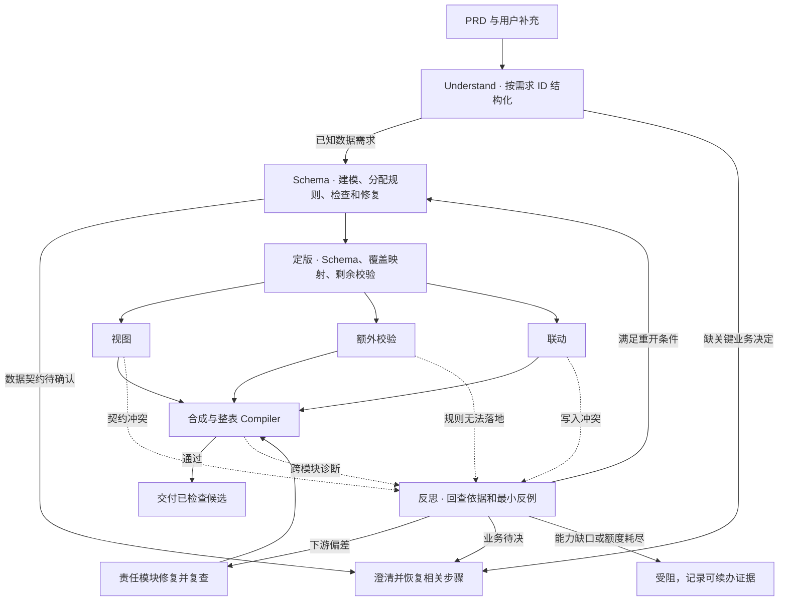

# Compose 分阶段实施手册

> 待评审。适用于统一助手中的表单创建，以及基于已授权工作稿继续生成的路径。节点契约、字段名称和样例均为实施草案。首期验证从新建旅险候选开始，后续接入已有候选的定向修改和续办。

现行 Compose 在准备 Schema 草稿时并行查能力，随后整表生成、编译和修复。现行绑定修复可以替换被诊断字段的 Schema。本草案将 Schema 定为单向上游，新增独立的定版检查、模块输入投影和定点修复。Graph 掌握依赖、预算、状态提交和交付，Agent 在节点内理解需求、选择实现、查证和提出补丁。沿用统一轮次入口、Agent 任务状态与 Platform 草稿的归属、现行 Compiler 和交付契约。 [现行创建与 Graph](platform-studio.md#agent-create-contract) · [轮次恢复](platform-studio.md#agent-turn-recovery)



## 1. 节点契约与上下文 {#compose-node-contracts}

| 节点 | 代码投递给模型或检查器的输入 | 写入产物 | 通过与退出 |
| --- | --- | --- | --- |
| Understand | 首轮读 PRD、用户补充和已确认答复。续办投递相关旧记录和变更，原文按来源回查 | 一份按 ID 保存的需求记录，含来源、业务条件、例外、关联规则、验收场景与待决项 | 程序检查 ID、来源引用与关系合法性。业务待决按影响阻塞相应分支 |
| Schema | 字段、数据及可能属于 Schema 的校验和对应场景，已明确的工作数据约定、受支持关键字、必要的 Schema 资源。修订时附当前基线和授权范围 | Schema、字段路径与 Scope 映射、规则覆盖映射、剩余校验清单及检查证据 | 执行第 2 节定版检查，可修复问题在节点内限量复查 |
| 视图 | 相关 Schema 子树及其 Scope 和引用闭包、视图需求、选定 Material Manifest、必要的 Host 请求与事件契约 | 视图及模板、归属视图的交互映射、供依赖方读取的交互标识 | 检查结构、端口、绑定、作用域以及外部连接证据。所需能力缺失时提供具体契约与受影响需求 |
| 额外校验 | Schema 的相关字段和 Scope、剩余校验条目、约束协议、实际使用的纯函数或 Host Validator 契约 | 已分配的 Constraint、所需 Validator 引用及规则映射 | 检查表达式和函数签名、读取路径、错误归属、同步前置或外部依赖 |
| 联动 | Schema 的相关字段和 Scope、联动需求、Command 协议、所需纯函数和已核对的交互契约 | Reaction、Command 与规则映射 | 检查触发、条件、读取及写入路径、赋值形状和 Scope。有视图交互依赖时等待对应契约 |
| 反思 | 诊断、最小配置片段、有出处的需求、相关目录或 Host 契约、已有尝试 | 原因判断、反例、证据、建议责任模块、修复范围与复验项 | Graph 验证证据、权限及预算后再执行路由 |
| 合成与检查 | 同一执行中仍有效的产物、受权基线、目标、目录与 Schema 资源 | 完整 Authoring Definition、需求映射与整表检查回执 | 程序检查片段归属和引用，调用真实 Compiler，按第 5 节路由或交付 |

业务语义只有一份需求记录。每个节点投影它所需的条目和引用闭包，按职责选取条目内的事实。例子中“被保人未成年时显示监护人并要求填写”共享年龄条件和来源，视图读取显隐行为，Schema 读取具备条件的字段约束。节点可以按需求 ID 或能力 ID 进一步回查。生成阶段的提示词要求返回片段、需求映射和结构化缺口。资料按实际选用的协议与能力版本提供。

并行只用于输入已齐且输出归属分离的分支。额外校验和联动可以同时使用同一函数签名。视图事件驱动的联动先读取视图分支产出的交互契约，普通数据联动可以先做。协议区分交互、Reaction 和 Constraint 的职责，首期按实际 Authoring Definition 字段落实归属表。 [L1 视图与交互](l1/05-view-material-host.md#interaction) · [L1 联动](l1/04-command-reaction.md#reactions) · [L1 校验](l1/03-expression-validation.md#constraint)

## 2. Schema 定版检查 {#compose-schema-gate}

**依次完成需求覆盖、Schema 可执行性和业务样例检查。** 定版只表示本次任务采用一份已检查的数据契约。下游兼容性和整表交付分别判断。

1. **核对字段定义。** 覆盖对象、数组、成员 Scope、类型、必填、枚举及动态来源、缺失和 null、默认值及来源。区分工作值和 Host 输出契约。缺失且会改变业务含义的决定触发澄清，已允许留空的信息按未指定处理。
2. **给每项校验分配责任。** Schema 优先处理实际引擎可执行的当前数据断言，包括单字段、跨字段和条件必填。需要日期计算、字段值比较或 Context 的断言按目标能力分配给 Internal Constraint。外部权威结果分配给 External Constraint 与 Host Validator。数据写入交给 Reaction / Command。同一需求含多个行为时按行为记录覆盖。
3. **运行确定性检查。** 复用 Compiler / Runtime 的 `compileDataSchema` 及目标 Schema 资源解析。检查语法、元 Schema、引用和实际可编译性。样例用根数据输入运行，覆盖依赖条件和 Scope。关键业务正反例来自已确认需求或可溯源的测试资料，Agent 衍生样例标注依据。当前通用编译语义关闭 `format` 断言，规则落点以实际能力为准。
4. **原子提交定版产物。** 保存 Schema 与字段映射、覆盖映射、剩余校验清单及检查记录。记录需求 ID 与修订、Schema 摘要、目标环境和资源摘要、场景输入及期望与实际结果。未分配的必需校验、未通过的场景或者无法执行的 Schema 都阻止定版。已有明确下游责任的校验允许在 Schema 定版后继续实现。

**检查入口草案。** Agent 内部向 TypeScript 检查边界提交 Schema、已授权资源及场景，并取得结构化检查结果。优先在现有 Compiler 集成附近验证共享编译路径，避免在 Python 侧独立解释关键字。现行整表检查继续作为交付门槛。S0 探针需要证明差异可诊断、资源和执行配置一致，尤其要对比局部与整表结果。 [数据契约](l1/02-data-reference-scope.md#data) · [L2 Compiler](l2/compiler.md)

### 旅险交接样例 {#compose-travel-example}

以下是用于走查的合成需求及其产物。R3 同时影响数据与视图。R4 以已确认的出行日期和出生日期计算规则为前提。

| ID | 需求与来源摘录 | Schema 交付及下游输入 |
| --- | --- | --- |
| R1 | 「一单 1 至 5 名被保人。」 | `/insureds` 为数组，`minItems: 1`、`maxItems: 5` |
| R2 | 「每名被保人年龄为 0 至 80 岁的整数。年龄必填。」 | 各成员 Scope 里的 `age` 必填，整数，范围 0–80 |
| R3 | 「未满 18 岁时显示监护人，并要求填写姓名。」 | Schema 覆盖姓名条件必填。视图读取 R3 的显隐条件和相同边界 |
| R4 | 「按出生日期和出行日期计算出行年龄，并校验该结果符合承保年龄范围。」 | 两个日期字段由 Schema 定义。剩余校验附 Scope、两个字段引用、年龄计算契约与边界、Internal Constraint 的建议归属 |
| R5 | 「更换国家时清空已选城市。未选择城市时工作值为空值。」 | Schema 按已确认的工作值类型声明城市可为 `null`。联动读取国家路径和城市路径，输出清空命令 |

R3 的条件草案位于 `insureds.items`。谓词显式检查 `age` 存在，年龄缺失由 R2 报错。

```json
{
  "if": {
    "required": ["age"],
    "properties": { "age": { "type": "integer", "exclusiveMaximum": 18 } }
  },
  "then": {
    "required": ["guardianName"],
    "properties": { "guardianName": { "type": "string", "minLength": 1 } }
  }
}
```

R4 的校验节点投影读取日期字段允许的输入形状、成员 Scope、R4 条件、真实函数签名、Constraint 参考及边界样例。依赖如闰日计算仍缺业务依据时，保留待决项。这个投影无需载入 R3 的显隐需求或 R5 的写入定义。

以下是剩余校验的一条交接记录。字段名用于评审，字段路径以本次 Schema 定版产物为准。

```json
{
  "requirementId": "R4",
  "behavior": "travel-age-eligibility",
  "owner": "internalConstraint",
  "scope": { "from": "/insureds", "mode": "each" },
  "reads": [
    { "scope": "currentMember", "path": "/birthDate" },
    { "scope": "root", "path": "/travelDate" }
  ],
  "assertion": "出行日实际年龄满足已确认的承保年龄范围",
  "handoffReason": "需要按已确认的日期算法计算出行年龄",
  "sourceRefs": ["R4"],
  "scenarioRefs": ["R4-age-boundaries"]
}
```

## 3. Schema 重开与反思 {#compose-schema-reopen}

**Schema 子流程拥有写入权。** 下游生成和修复提交诊断及建议，程序根据证据判断是否可以重开。方案建议将已承诺的数据契约和 PRD 留给 Agent 的技术选择记录在定版映射中，供反思核对。

| 触发与证据 | Graph 路由 | 最小复验 |
| --- | --- | --- |
| 绑定或引用不兼容，但原需求及已定 Schema 一致 | 重跑责任模块，查找兼容物料或既有适配。目标没有对应能力且证据充分时返回受阻 | 修复模块检查，随后整表 Compiler。Schema 摘要一致 |
| 已确认需求、反例和 Schema 明确冲突，如误把提交编码建成工作字段 | 自动重开 Schema，只授权修正相关路径和规则 | Schema 定版检查、影响到的模块、整表检查 |
| 原需求允许选择工作形状，旧选择明确记为开放，出现真实绑定和 Host 转换证据 | 待评审例外。证据能证明仍满足工作与提交契约时，可在授权内自动重开 | Schema 定版检查、工作值与输出例证、受影响模块及整表检查 |
| 原文与补充冲突，或改动会改变已承诺数据行为 | 回到 Understand 澄清，保留共享需求 ID 与冲突证据 | 答复更新需求以后，按依赖重新运行 |
| 无法取得可信回执，或检查器出现超时、不可用 | 走技术故障路径，保留已完成产物和候选 | 恢复检查器后按原输入重试 |
| 重复出现同一有效诊断且候选无有效变化，或预算耗尽 | 返回受阻，记录最后一项真实修改、诊断及尝试范围 | 用户下一轮续办时重新核对环境和需求版本 |

**反思触发与输出。** 单模块诊断能直接归属时由责任节点复查。跨模块诊断、字段形状冲突或反复无进展触发反思，并纳入总预算。反思输出需求 ID、原决策、当前表现、最小反例、证据引用、建议归属、建议修改范围和复验清单。Graph 验证路径、证据和授权后接收结果。反思本身只写判断记录。

**迁移现行字段修复。** 切片接管的路径上，把按绑定诊断直接写属性的入口改为提交结构化诊断。确有数据偏差时由 Schema 子流程产出新修订并重新定版。旧候选缺定版记录时，以受权当前工作稿和可取得的证据重新校验建立基线。只有经过兼容入口明确接管的旧产物才可参与新合成。现行入口与规则变更集中评审。 [现行 Compiler 修复路径](platform-studio.md#agent-create-compiler-repair)

**失败样例与后续演进。** 首期在获准范围记录有证据的失败样例、实际补丁、复验结果和对应 Prompt、资料、模型及检查器版本。后续可以用脱敏可复现案例提出 Prompt、参考资料或确定性检查的改进候选，用固定回归集比较后再更新共享版本。单次 Compose 执行只产出改进线索。

## 4. State、失效与恢复 {#compose-state-recovery}

| State 记录 | 身份和最小字段 | 用途 |
| --- | --- | --- |
| 需求 | 任务身份、稳定需求 ID、条目修订、来源版本与摘录、行为及依赖、待决项、场景 | 节点按 ID 取得所需片段。局部更正更新相关条目 |
| 定版 Schema | 修订、内容摘要、受检查的需求与资源、字段及 Scope 投影、校验落点和检查记录 | 模块执行期间只读，重开后按新修订重新检查 |
| 模块产物 | 模块、执行步骤身份、输入摘要、引用的需求和上下游产物、目标与已读契约版本、输出摘要、检查证据 | 通过依赖核对复用、重验或重跑。挂接失败诊断与尝试记录 |
| 执行与候选 | 轮次、步骤和尝试身份、输入快照、预算、已提交步骤、候选摘要、Compiler 回执和工作稿基线 | 同轮重放、失败续办、检查与交付去重 |
| 失败改进资料 | 有权限且可复现的诊断、最小样例、实际修复和复验 | 回归评测与资料维护 |

**输入投影与失效。** 先以完整定版 Schema 的身份约束模块输出，节点的模型上下文仍可只读取所需子树、作用域和引用闭包。Schema 更新后，只有能由程序证明读写路径、规则分工和引用闭包都未受影响的产物才可复用，并记录适用性检查。依赖不明时重验。视图文案变化只使引用该文案的产物和整表回执失效。修改字段类型、路径或 Scope 时，按实际依赖失效。目标、环境或目录变化时复核对应输入和回执。

**并行合入。** 启动时固定输入修订，返回后由程序核对当前执行、依赖和模块归属。旧分支不得覆盖新结果。独立分支分别提交；合成前再次核对全部必需模块及交互依赖。变更期间的中间产物留在 Agent，Platform 接收已通过交付门槛的候选。

**恢复。** 沿用轮次日志记录节点开始、模型调用和已完成结果。模块身份加入步骤标识，调用重试以同一输入和各自尝试身份记录。恢复时优先复用已提交且输入匹配的通过结果；未完成且无法接回的步骤按现行同轮重试规则续做。恢复后走同一合成门槛。恢复旧格式任务时按其真实可读证据建立基线。 [统一轮次](platform-studio.md#agent-turn-graph) · [数据归属](platform-studio.md#agent-conversation-draft-ownership) · [消息与执行恢复](platform-studio.md#agent-turn-recovery)

## 5. 检查、预算与交付 {#compose-check-delivery}

| 检查层 | 核心断言 | 失败去向 |
| --- | --- | --- |
| 节点结构 | 输出类型、授权路径、需求与字段引用、产物负责人 | 返回节点局部修复或记录缺证据 |
| 模块行为 | 运行能独立执行的真实检查，记录作用域、案例和结果。缺局部入口的项目带证据到整表检查 | 局部修复，跨模块冲突进入反思 |
| 合成 | 依赖版本匹配、各片段归属明确、ID 与引用一致、全部必需行为可追踪 | 路由到责任模块，归属有争议时反思 |
| 真实 Compiler | 用当前目标和授权目录检查确切候选，取得与原文和环境匹配的回执 | 新诊断按代码、路径和依赖归属，故障按技术路径退出 |
| Runtime 验证 | 用代表场景确认条件校验、重复成员隔离、联动写入和 Host 测试替身行为 | 进入工程验收和失败样例 |

模块检查先复用已有结构和规则检查器。确需整表上下文才能证明的行为，在合成阶段取得证据。诊断路由优先使用结构化诊断的代码、路径和需求映射，模糊归属时让 Agent 提供反例和建议。

**预算草案。** 延续首次整表检查加最多 10 轮整表修复的现行上限。旅险探针建议以每个模块累计最多 2 次局部修复、每次执行最多 2 次反思和 1 次 Schema 重开为起点，数值随基线评审。整表诊断启动一轮修复时扣减整表修复额度，局部修复、反思和重开在对应动作获准启动时各扣自身额度。并行调度前由 Graph 保留所需额度，回放已完成步骤不重复消耗。无进展识别至少比较有效输入、候选摘要、诊断及适用环境。重开、重路由和并发分支都由同一执行累计。耗时与服务层调用边界沿用现行配置，探针另外采集累计调用、耗时和 token。 [现行修复预算与退出条件](platform-studio.md#agent-create-compiler-repair)

**交付资格草案。** 整表 Compiler 回执必须成功且匹配当前候选原文及适用环境，需求映射必须能说明必需行为的落点。按现行契约允许交付的 Host 待集成事项随结果明示。其余阻塞性业务、能力或验证缺口走受阻或澄清。沿用 Platform 校验草稿基线、权限和交付身份，并由用户审阅、试填及保存的流程。 [平台交付契约](platform-studio.md#agent-create-contract)

## 6. 实施切片与验收 {#compose-delivery-plan}

| 切片 | 实施落点 | 完成证据 |
| --- | --- | --- |
| S0 · 独立 Schema 检查探针 | TypeScript 共享 Schema 执行、资源解析和 Agent 检查集成边界 | 同份 Schema 的局部和整表结果可对照。条件样例、错误正则、缺失引用及禁用格式断言能复现 |
| S1 · 旅险贯通 | 复用 Understand 的标准需求，新增投影和定版记录，视图、额外校验、联动各交付片段，程序合成并走现行 Compiler | 一个新建旅险候选从输入到真实回执跑通，需求和剩余校验可追溯，校验节点载荷仅含授权的相关事实 |
| S2 · 失败与恢复 | 反思、旧绑定修复接入、修订失效、并行合入和中断恢复 | 下面反例全部有测试或执行轨迹，错误回执和过期产物均无法进入交付 |
| S3 · 基准与演进资料 | 固定合成 PRD、模型版本、目标目录和测试替身，比较现行与分阶段 Compose | 得到可解释的成功率和成本基线，沉淀可重放失败样例 |

| 验收用例 | 操作 | 当场断言 |
| --- | --- | --- |
| 条件必填与 Scope | 两名成员分别 17 岁和 18 岁，各缺少监护人；再补齐、移除年龄 | 初始只在 17 岁成员报监护人缺失；补齐后清除；无年龄时报告 R2 的年龄缺失 |
| Schema 能力边界 | PRD 要求严格邮箱格式，候选只写 `format`；另提交不可编译正则 | 前者不得声称已覆盖，给出真实落点；后者定版失败 |
| 控件选错 | 城市工作值为编码，选了仅接收对象的控件，目录中有兼容项 | 只修视图，Schema 摘要一致，整表复验通过 |
| Schema 漏建模 | 已确认工作值为城市对象，实际生成编码 | 反思有原文和反例，自动重开，只重跑或复验相关模块 |
| 真实能力缺口 | 所有获准控件不支持工作值且无适配 | 返回需求 ID 与相冲突证据，保留定版，停止无效重试 |
| 晚到与恢复 | 修订 Schema 后旧视图才返回；另在模块完成后中断并恢复同轮 | 旧视图不能合入，已提交且仍适用的模块可复用，交付一次 |
| 故障与预算 | Compiler 超时、相同诊断反复，及用尽预算后仍失败 | 故障不改配置，重复修复停止，最终结果可追溯 |
| 回执与工作稿竞争 | 整表检查后替换候选原文或手工修改基准草稿 | 旧回执不得交付新文本；晚到结果不覆盖手工工作稿 |
| Host 及 Runtime | 使用 Host 测试替身运行换国清城市、成员校验和试填 | 工作值为已约定的清空形状，成员互不影响，预览消费确切候选 |

现有验收入口可用来建立基线。Agent 用脚本化模型覆盖路由、输入投影和恢复，Compiler 覆盖语义，Runtime 覆盖实际数据和事件行为。真实模型和 Studio 端到端另跑，其中浏览器试填与检查凭据交付沿用现有验收入口。以下为实现验收命令，手册编写阶段未执行这些功能测试。

```sh
uv run --project services/agent pytest services/agent/tests/test_create_form.py -q
pnpm --filter @form-engine/compiler test
pnpm --filter @form-engine/runtime test
```

Studio 联调入口为 `node apps/studio/tests/verify-create-form.mjs`，使用开启本地登录的隔离 Studio 与 API。该入口当前覆盖现行流程，新切片实施时补断言并按当时的候选契约同步场景。

**效果对比。** 同一批 PRD、目录和模型配置记录首轮编译通过率、最终可交付率、Runtime 场景通过率、端到端耗时、模型调用、累计输入与输出 token、整表重编次数。计入澄清、受阻及故障结果，保留每类样本分母和失败归属；以实测基线决定目标。首批样例以当前 [Agent 验收材料](../../services/agent/examples/README.md) 为起点。

## 评审结论待收口 {#compose-open-decisions}

- **数据契约与开放选择。** 确认第 3 节对开放工作形状的例外，以及允许自动重开所需的证据。该决定影响现行绑定修复如何迁移。
- **定版与交付。** 确认剩余校验有明确归属即可完成 Schema 定版，以及各类 Host 待集成事项在整表交付中的资格与说明。
- **检查契约与预算。** S0 校准独立检查可复用的语义和入口。局部检查入口、总预算与复用粒度以探针及旅险基线为依据，实施前冻结对应的测试断言。

## 首批实施范围 {#compose-implementation}

标准化的新建请求使用分阶段 Compose。普通 Studio 新建在会话层也会形成需求文档。已有工作稿的编辑、精确候选复查与兼容入口继续按现行创建契约处理。

- 样例生成和 Schema 生成各自调用模型，样例先固定后执行。样例区分 Schema、Runtime 与 Host 检查层。定版入口只执行 Schema 能独立判定的样例，并要求至少一个有效正例。后续层的用例保留在 Agent 证据中，供对应模块生成。外部决定及拒绝原因属于 Host 运行状态。最终载荷明确需要的派生值按提交数据建模。需求明确引用 Host 请求并保存其返回值时，Schema 阶段可以读取该请求的返回契约。定版使用 Compiler 与 Runtime 共用的 Schema 执行器。定版证据包含原文摘要、环境、字段与断言的实际指针以及剩余校验。
- 投保试填的首屏本人由已声明的名单属性默认值初始化。本人两处可编辑控件共享投保人工作数据，视图通过按钮命令及成员 Scope 增删家人。终保日与护照有效期由同一校验断言读取，修改任一日期都会使该断言失效并重新检查。Studio 预览可调用 `travel.previewUnderwritingSubmit`，使用完整本地校验通过的当前快照，规范化邮箱及证件字段，并将投保人身份复制到输出名单首位。渠道核保、正式提交及目标 Host 装载需要各自的接入证据。
- 视图、额外校验和联动投影不同的需求，各自做片段写入范围与覆盖检查。整表 Compiler 承担跨片段语义验证。字段形状与配置归属由程序保护，反思重开依据来源和可复现反例。重开后保守地重新生成下游。
- 标准稿中的模型推导场景可供审阅。生成和反思按原文证据、确认的需求和实际契约判断行为，避免从推导场景引入额外的数据要求。
- 对明确点名 Host 请求的需求，合成可以从默认视图可达的请求映射补齐遗漏的落点。补齐以真实目录和精确请求名称为依据，整表 Compiler 继续核对声明与目标签名。
- 轮次日志支持同轮复用已经记录的模型与工具输出。定版或合成受阻且本轮已结束时，Agent 保留用例、最近的 Schema 和诊断、定版证据及通过局部检查的片段。续修的需求、文档和目标环境匹配时复用这些产物。合成缺少 Host 落点或延期说明时重跑责任片段。字段级依赖缓存和自进化评估属于后续实施。
- 分阶段生成收到联动提交的直接成员删除重分派时，只接受本片段负责的需求 ID，并重跑受影响的视图和联动。视图必须将该需求落到含成员 Scope 的 `activate` → `array.remove` 命令；删除后的错误归属由 Runtime 维护，生成回执将该场景标为待试填。视图重跑受阻可保留原先可用页面供编辑，原页面不充当该需求的成功覆盖证据。其他片段或整表编译受阻的交付规则见 [Platform 草稿交付](platform-studio.md#agent-create-contract)。
