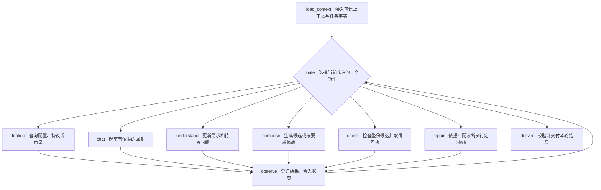
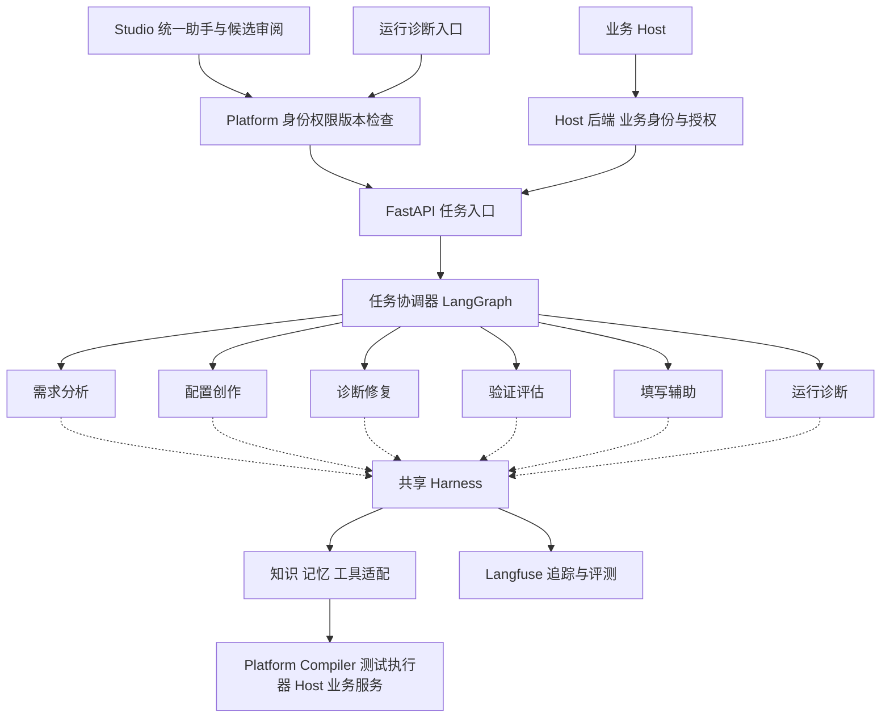

# Platform 与 Studio：产品蓝图与待设计工作

2026-11-08 用户确认通用动态表单低代码平台的产品定位与蓝图组织方式，并授权整合现行文档、补入用户权限等基础管理。以下以典型场景归并业务环节，再关联前端页面与后端模型；2026-11-10 已进一步确认[最小 MVP 与创作版本规则](#platform-authoring-mvp)，页面细节、接口与实现继续补齐。

平台架构采用 [DDD 思路的模块化单体](architecture.md#platform-modular-monolith)：五块业务职责逐项细化，首期不拆微服务；从表单创作管理开始，结合列表与工作台设计业务模型、状态及操作。表单、配置版本与发布关系见下文最小 MVP，存储与接口未冻结。

## 已有边界，尚未展开的设计 {#platform-studio-status}

| 范围 | 已有基础 | 尚未讨论完整的内容 | 继续设计入口 |
| --- | --- | --- | --- |
| Platform | 蓝图、RBAC、模块化单体及创作 MVP；配置版本追加与 releaseId 在线消费已确认 | 身份接入、API、存储、制品装载与运维细节 | [OD-16 / T09](governance.md#OD-16) |
| Studio | 列表 / 工作台职责、逐次保存配置版本与历史编辑规则 | P1 / P2 具体交互、预览适配、权限反馈及接口 | [OD-17 / T10](governance.md#OD-17) |

用户权限等基础管理已纳入范围；首期内置账号、服务端授权及 GitHub 登录已进入本地实施验收，真实 OAuth 往返待部署配置。蓝图组织确认不等于这些模块契约闭环。

## 产品蓝图：业务环节、前端页面与后端模型 {#platform-blueprint}

### 蓝图目标与阅读方式 {#blueprint-overview}

> **2026-11-08：产品定位与组织方式已确认；当时具体页面、模型与 MVP 保持待设计；当前首期范围由下文最小 MVP 承接。** 用户授权将 HTML 蓝图整合到现行主题，并补入用户权限等基础能力管理。AI 留到下一阶段讨论。来源见 [SRC-PLATFORMBLUEPRINT](source-map.md#src-platform-blueprint)。

建设一个**通用动态表单低代码平台**：作者设计与验证表单，开发者提供扩展能力，接入人员向业务系统交付确定版本，维护人员定位问题并推动迭代。

**典型场景发现需求 → 业务环节归并共用活动 → 前端页面承载操作 → 后端模型表达业务事实。** 用户故事是输入，最终蓝图落到页面、模型及两者之间的操作关系。

| 视角 | 回答的问题 | 当前草案规模 |
| --- | --- | --- |
| 典型场景 | 为什么需要这些功能？ | 4 类代表场景 |
| 业务环节 | 共用的工作过程有哪些？ | 6 个主环节 + 资产供给的配套过程 |
| 前端页面 | 用户在哪里完成这些工作？ | 5 类业务页面候选 + 基础管理入口待设计；不冻结路由数量 |
| 后端模型 | 系统要管理哪些事实与关系？ | 原 8 类业务对象视角；创作模型已收敛，其余按专题细化；不冻结表或服务数量 |

Schema、Scope、编译、Runtime、Renderer 和 SDK 继续作为技术支撑。**平台不设置独立的数据结构设计器。** 业务数据库、凭证、实际请求及业务提交由 Host 所在业务系统承担。

### 典型场景 · 共用同一条链 {#blueprint-scenarios}

| 场景 | 经过的主要环节 | 特有关注点 |
| --- | --- | --- |
| 从零创建并交付表单 | 管理 → 编辑 → 验证 → 发布 → 接入 | 首次完成交付闭环 |
| 修改已有表单并发布新版 | 管理 → 编辑 → 验证 → 发布 → 接入 | 基于旧版修改、差异与升级 |
| 使用或升级业务物料 | 资产选择 → 编辑 → 验证 → 发布 → 接入 | 确定能力版本与兼容要求 |
| 排查已发布表单问题 | 维护 → 定位版本 → 编辑 → 验证 → 发布 | 诊断证据、复现与修复关联 |

四类场景复用编辑、验证、发布和版本查看，不各自建立一套页面与流程。表单作者、扩展开发者、接入与维护人员可以由同一人兼任。

### 业务环节 · 六个主环节 {#blueprint-stages}

| 环节 | 主要工作 | 形成的结果 |
| --- | --- | --- |
| ① 管理表单 | 找到、新建、复制、继续已有工作 | 明确的表单与编辑起点 |
| ② 编辑配置 | 组合物料、布局、属性、绑定和规则 | 当前编辑内容 |
| ③ 检查与预览 | 检查配置、试填、模拟必要交互、修正 | 与确定输入对应的检查和预览结果 |
| ④ 发布版本 | 固定内容与依赖，构建并发布 | 可追溯的确定发布版本 |
| ⑤ 接入使用 | 查看接入要求，在 Host 中装配并联验 | 业务系统中的可运行表单 |
| ⑥ 维护迭代 | 定位问题、回查版本、修复与验证 | 处理结果或新的修订与发布 |

**配套过程：物料与函数供给。** 开发者通过现有工程链开发、构建和验证能力；平台提供登记、查找与使用信息。它贯穿编辑、发布和接入，不是每个作者都必须先执行的第七步。

环节不是单向审批流水线：编辑与验证会反复往返，维护会回到编辑，接入失败也可能回到能力装配或发布检查。

### 前端页面 · 业务页面与基础管理入口 {#blueprint-pages}

| 页面类型 | 页面职责 | 承载环节 | 主要操作对象 |
| --- | --- | --- | --- |
| P1 表单列表 | 找到表单并进入工作 | ① 管理 | 表单、可继续的草稿、版本摘要 |
| P2 表单工作台 | 保持编辑上下文，完成设计、检查与预览 | ② 编辑、③ 验证 | 草稿、配置版本、能力版本、检查结果 |
| P3 版本与发布详情 | 查看历史、发布结果和接入要求 | ④ 发布、⑤ 接入、⑥ 版本回查 | 修订、构建记录、发布版本、发布记录 |
| P4 物料与函数目录 / 详情 | 查找、理解和提供扩展能力 | 配套供给；支持②④⑤ | 能力资产与版本、使用关系 |
| P5 运行问题列表 / 详情 | 关联证据与版本，跟踪处理 | ⑥ 维护 | 问题记录、相关发布版本 |

预览可以是工作台中的区域或独立窗口；版本历史可以作为表单详情的标签页。目录和详情可能对应多个路由。此处先固定职责，再设计导航和页面拆分。

**页面衔接：**P1 打开 P2；P2 查看或交付版本时进入 P3；P4 的能力选择服务于 P2；P5 回查 P3 的准确版本，再从该版本进入 P2 修复。接入说明在 P3，实际业务填写运行在 Host 中。

### 后端模型 · 业务事实及关系 {#blueprint-models}

| 候选对象 | 表达的业务事实 | 主要关系 |
| --- | --- | --- |
| M1 表单 | 稳定身份、用途与归属 | 拥有编辑内容、修订与发布历史 |
| M2 编辑草稿 | 本地未保存内容 | 编辑器内的临时状态 |
| M3 编辑 / 定义修订 | 每次成功保存的不可变内容，可有配置错误 | 直接归属表单；检查通过才可交付 |
| M4 能力资产与版本 | 物料、函数的契约、说明及确定制品身份 | 被编辑选择和构建输入引用 |
| M5 构建记录 | 哪些确定输入经过编译，结果是什么 | 关联修订、确定能力集合、编译目标及产物 |
| M6 表单发布版本 | 可交付的不可变产物及锁定依赖 | 来源于成功构建；供 Host 获取 |
| M7 发布记录 | 谁将哪个版本交付到哪个用途，以及结果 | 引用发布版本；形成历史 |
| M8 运行问题记录 | 问题、证据及处理状态 | 关联表单与发布版本，必要时关联修复版本 |

**主关系：**表单 → 不可变配置版本 → 构建记录 → 表单发布版本 → 发布记录。草稿属于编辑状态。能力版本参与确定构建；运行问题回指对应发布版本。

以上 M1–M8 仅为本节模型候选编号，不是治理矩阵的模块 ID。基础权限对象另见下节。

这些是概念对象，不是已冻结的数据库设计：

- 保存将原始文本追加为配置版本；打开时读取确定版本，具体存储结构待实现。
- 普通编辑检查可以只返回即时结果，不必每次持久化构建记录；正式交付需要追踪确定输入与结果。
- 运行问题可对接已有系统，平台未必自行实现完整工单模型。
- 能力快照、依赖锁、摘要和目标信息需在交付中准确表达；是否作为独立存储实体后续确定，不推导额外页面。

后端建模用于实现平台自身业务，与面向表单作者的“数据结构设计器”无关。

### 基础能力管理 · 用户与权限 {#blueprint-foundation}

**基础管理范围及单团队 RBAC 已确认，见[完整权限方案](#platform-rbac)。** 本节保留管理能力全貌；内置账号和 GitHub 登录见[首期访问契约](#platform-github-login)。 基础能力管理服务所有业务环节：管理员管理谁能进入平台、谁能访问哪些表单或资产、谁能编辑或发布，以及谁能调整权限。它同时具有管理入口与业务操作中的授权职责。

| 视角 | 纳入蓝图的工作 | 待设计内容 |
| --- | --- | --- |
| 业务环节 | 用户 / 成员访问管理、权限分配与回收、必要操作追溯 | 身份接入接口待细化，单空间、业务级粒度及变更行为已在 RBAC 方案确定 |
| 前端入口 | 用户 / 成员管理、角色与权限管理；各业务页展示可操作范围及拒绝原因 | 集中设置页还是拆分页面、菜单与交互；P6 仅作候选入口标识 |
| 后端概念 | 用户身份关联、成员关系、角色 / 权限、资源授权关系与审计信息 | 单空间成员与内建角色已确认；对象持久化、存储与 API 待设计 |
| 跨环节关系 | 管理员调整授权 → 业务页面按权限提供操作 → 服务端检查对应资源与动作 | 撤权及审计行为已确认；并发与缓存的一致性实现待设计 |

基础管理不作为表单创作流水线中的第七步。平台权限不能由按钮隐藏替代，也不替代 Host 对业务数据和实际提交的授权。已确认一个默认团队空间及四种内建角色；内置账号及 GitHub 登录已确认，多团队 / 多租户产品和组织层级留后续，不默认自建账号中心。

表单管理与工作台的操作权限映射已确认，见[操作表](#rbac-form-actions)；后续具体页面设计承接该授权边界与反馈。完整权限管理页面与模型另行补齐，基础授权不能等到团队增强阶段才出现。

### 环节、页面和模型怎样协作 {#blueprint-relationships}

下图是**候选职责映射**，不是服务部署图或精确执行时序。多个环节可以共用页面，一个页面也可以读写多个模型。

```diagram
{
  "id": "figure-platform-page-model-map",
  "title": "业务环节 → 前端页面 → 后端业务对象（候选职责映射）",
  "rows": [
    [
      {
        "title": "管理表单",
        "body": "业务环节"
      },
      {
        "title": "P1 · 表单列表",
        "body": "前端承载"
      },
      {
        "title": "表单 / 编辑起点",
        "body": "后端概念候选"
      }
    ],
    [
      {
        "title": "编辑与验证",
        "body": "业务环节"
      },
      {
        "title": "P2 · 表单工作台",
        "body": "前端承载"
      },
      {
        "title": "配置版本 / 能力版本",
        "body": "后端概念候选"
      }
    ],
    [
      {
        "title": "发布与接入",
        "body": "业务环节"
      },
      {
        "title": "P3 · 版本与发布详情",
        "body": "前端承载"
      },
      {
        "title": "修订 / 构建 / 发布 / 发布记录",
        "body": "后端概念候选"
      }
    ],
    [
      {
        "title": "能力供给",
        "body": "业务环节"
      },
      {
        "title": "P4 · 能力目录与详情",
        "body": "前端承载"
      },
      {
        "title": "物料与函数资产 / 版本",
        "body": "后端概念候选"
      }
    ],
    [
      {
        "title": "维护迭代",
        "body": "业务环节"
      },
      {
        "title": "P5 · 问题列表与详情",
        "body": "前端承载"
      },
      {
        "title": "问题记录 / 对应发布版本",
        "body": "后端概念候选"
      }
    ],
    [
      {
        "title": "基础管理（贯穿）",
        "body": "业务环节"
      },
      {
        "title": "P6 · 用户权限管理入口（待设计）",
        "body": "前端承载"
      },
      {
        "title": "身份 / 成员 / 角色权限 / 授权关系",
        "body": "后端概念候选"
      }
    ]
  ],
  "note": "按行读取映射，不是执行时序或服务部署图。多个页面共享修订、能力和发布等模型；用户权限贯穿各业务操作。首期创作页面职责与模型见最小 MVP，其余具体页面继续细化。",
  "flow": true,
  "arrows": [
    "",
    "",
    "",
    "",
    ""
  ]
}
```

**贯穿例子：修改并发布表单。** 作者在 P1 找到表单，进入 P2 基于已有修订编辑草稿；每次保存形成确定修订；选定修订检查与预览通过后进入发布流程。P3 展示对应构建、发布版本和交付结果。Host 取得确定版本运行；发生问题时，从 P5 回到 P3 查明准确版本，再进入 P2 修复。

### 关键操作 · 连接前后端 {#blueprint-actions}

| 操作 | 前端入口 | 后端职责 / 关联对象 | 用户看到的结果 |
| --- | --- | --- | --- |
| 新建 / 复制 | P1 | 建立表单；复制内容形成编辑起点 | 进入可编辑表单 |
| 保存编辑 | P2 | 追加不可变配置版本 | 明确成功、失败或结果待确认 |
| 检查 / 预览 | P2 | 对确定内容和能力集合调用现有 Compiler；预览由预览 Host 运行 | 当前输入的诊断与试填结果 |
| 发布 | P2 发起 / P3 查看 | 关联确定修订、成功构建与不可变发布版本，记录交付操作 | 发布结果、版本身份与接入要求 |
| 接入指定版本 | P3 → 业务 Host | 提供确定制品和依赖信息；Host 装配并验证实际能力 | 可在业务系统运行 |
| 选择旧版 / 回滚 | P3 | 按交付方式重新选用旧发布版本，保留操作历史 | 后续选用旧版的会话运行原制品 |
| 管理成员与权限 | 基础管理入口（待设计） | 管理身份关联与资源授权，业务操作校验权限并保留必要记录 | 明确可访问与可操作范围 |
| 提供 / 升级能力 | P4，或工程侧交付 | 登记确定能力版本；使用新版须重新检查相关表单 | 作者能选择并理解能力 |
| 处理运行问题 | P5 → P3 → P2 | 关联证据、原发布版本和修复结果 | 能追踪问题与迭代结果 |

**Studio 的工作版本与保存快照。** 表单列表 → 版本列表 → 配置控制台。版本列表的一行代表一个有固定身份和名称的工作版本。未发布时可以反复打开、编辑和保存；一次成功保存追加一份不可变配置快照，行内「保存历史」可打开当次原文。发布在列表页确认并固定到当前快照，发布成功后该工作版本只读。基于它创建新版会生成独立工作版本，首次保存保留来源快照。配置控制台用于查看、编辑、检查和预览选定配置。既有配置快照、发布与公开 Host 链接继续使用原 ID；升级前没有工作版本身份的配置按每份快照独立列出，以免错误合并。

保存只追加不可变配置版本的规则已确认，检查 / 构建 / 发布与编辑保存分开；具体按钮布局和存储实现继续细化。接入过程中的实际请求、凭证和业务提交归 Host。

**贯穿约束：**有 Error 不生成新可执行产物；发布不可变；能力升级不静默影响旧发布；运行中会话固定原版本；回滚表单制品不等于回滚业务数据。权限和审计随相应写入操作设计，不另推导一套复杂审批产品。

### MVP 与逐步演进 {#blueprint-mvp}

> 首期最小闭环已确认，详见[创作 MVP](#platform-authoring-mvp)；后续扩展顺序仍为候选。

| 阶段 | 用户完成什么 | 前端覆盖 | 后端 / 技术支撑 |
| --- | --- | --- | --- |
| 1 · 最小 MVP | 创建、编辑、验证、发布，在示例 Host 运行；查阅能力目录并管理团队成员 | P1、P2、P3、最小 P4 与成员角色入口 | 表单、不可变配置版本、RBAC、构建发布、releaseId 在线消费、目录查询及成员管理 API |
| 2 · 扩展与复用 | 更高效地制作复杂表单，登记与升级业务能力 | 丰富 P2、扩展 P4 | 资产登记与治理、使用关系与升级检查 |
| 3 · 团队维护 | 多人持续修改、比较版本、控制交付 | 完善 P1、P2、P3 | 首期交付权限与配置版本留存，后续按需求评估比较、合并及历史治理 |
| 4 · 运行治理 | 汇总运行问题，关联版本并跟踪修复 | 补齐 P5，联通 P3 / P2 | 问题证据与处理关联，按需对接监控与告警 |

MVP 用一份含布局、条件显示、校验和必要外部交互的表单验收。扩展能力仍由工程侧提供，首期增加最小 P4 查询目录，不依赖完整资产管理后台；首期即可保留版本身份并使用已有诊断和 DevTools，不必等 P5 完成才具备排错能力。基础权限和错误处理随首批相关功能交付。

正式填写界面由现有 Renderer 与业务 Host 承载，不是新建一套平台业务运行端。AI 不计入本轮阶段，下一步单独讨论。

### 逐项设计顺序与确认边界 {#blueprint-next-design}

先展开 **表单管理（P1）→ 表单工作台（P2）**，一并核对用户访问、资源归属和操作权限；再展开 P3 的版本发布与接入，本轮一并设计最小 P4 与成员角色管理入口，P5 和完整资产治理后置。每个完整专题先在对话中形成方案并确认，再更新本主题或成熟后的子主题。

本轮已确认通用动态表单平台定位、按场景归并环节并映射页面与模型的组织方式、用户权限等基础管理纳入范围，以及 AI 下一阶段再议。最小 MVP、模型关系、逐次保存与历史编辑、精确发布消费已于 2026-11-10 确认；内置账号与 GitHub 登录范围随后确认，具体交互、API、存储和装载实现待细化；权限粒度及角色行为已随后在本页 RBAC 专题确认；不据此宣布 M18 / M19 完整设计或实现完成。

## 最小 MVP：配置版本与发布闭环 {#platform-authoring-mvp}

首期采用配置文本编辑器、DDD 模块化单体与单团队 RBAC。创建表单、保存配置、检查与预览、发布、Host 在线装载组成表单交付闭环。2026-11-14 用户进一步确认最小物料与纯函数目录、成员与角色管理纳入本次 MVP，每块均须覆盖 API、页面和验收；原“物料后台全部后置”和“仅单人首用”的范围限制据此调整。本节为已确认设计，实际验收随各轮实施完成。见 [ADR-FE-029](decisions/ADR-FE-029-platform-config-versions.md)及[确认来源](source-map.md#src-platform-simplified)。

### 模型、身份与所有权 {#authoring-models}

| 概念 | 职责 |
| --- | --- |
| 表单 `formId` | 稳定资产，保存名称、说明、归属、归档状态。直接组织配置版本和发布记录。 |
| 配置版本 `versionId` | 每次保存追加的完整不可变原文，含所属表单、保存人、时间、可选名称 `name`、备注及来源 `basedOnVersionId`。 |
| 发布版本 `releaseId` | 构建发布模块持有的不可变交付，关联配置版本、锁定输入、目标、制品与摘要。 |

草稿是编辑器中的未保存内容。来源只供追溯，多个版本可以从同一版本开始。最近保存是默认编辑起点。首期按完整配置版本选择发布，多需求的组织与合并由使用者决定。

```diagram
{
  "id": "figure-platform-authoring-mvp",
  "title": "创作版本与宿主交付",
  "rows": [
    [{"title":"表单","body":"稳定 formId，组织配置版本"}],
    [{"title":"不可变配置版本","body":"每次成功保存追加；错误内容也可留存；旧修订保留"}],
    [{"title":"检查与构建","body":"固定配置版本、依赖与目标；Error 不生成可执行制品"}],
    [{"title":"不可变发布版本","body":"releaseId 标识确定交付；Host 显式选择并固定会话"}]
  ],
  "note":"配置保存、检查和发布是独立操作。Host 通过 releaseId 读取确定交付。"
}
```

### 页面与最小范围 {#authoring-pages}

| 入口 | 首期职责 |
| --- | --- |
| P1 表单列表 | 创建、查询、重命名、打开、复制、归档及恢复。分别展示最近保存和最近发布摘要。 |
| P2 工作台 | 显示所用配置版本与保存状态。提供配置文本编辑、保存、检查、预览和发布。 |
| P3 配置版本与发布详情 | 查看准确内容、来源、作者、时间、备注、诊断、发布结果及 releaseId。可基于历史编辑或复制成表单。 |
| P4 最小能力目录 | 分别提供物料与纯函数列表、搜索、详情、版本、契约说明与配置示例，复用工程侧资产。 |
| 基础管理 | 受控初始化默认空间及内置管理员；内置账号与 GitHub 登录；提供成员列表、添加、角色分配、停用与恢复，沿用单团队 RBAC。 |

2026-11-14 阅读与节点编辑修订（用户确认）：Studio 将 JSON 查看和编辑统一为可复用组件；配置工作台默认按对象 / 数组展开，可以直接编辑节点值与类型、重命名属性、添加 / 删除属性或数组项，并撤销 / 重做。对象 / 数组节点编辑时显示四空格缩进、逐层换行的完整 JSON（视觉等效 JSON.stringify(value, null, 4)），可整块修改；应用时同时校验 JSON 语法与所选节点类型。历史版本与目录契约复用只读模式。导入粘贴先校验、格式化显示，原文修复作为辅助入口；保存当前编辑必须通过 JSON 语法校验，再移除字符串外空白，由 Platform 统一按 UTF-8 检查 64 KiB 单份配置上限。候选检查、预览、草稿编辑、保存和表单版本使用同一配置限额。未修改节点保留数字字面量、重复键、转义和属性顺序；重复键按节点位置编辑，不通过对象反序列化覆盖。超过树阅读安全边界时回退文本。

2026-11-14 实际使用复查修订（用户授权）：进入 JSON 文本视图时自动显示四空格缩进的完整内容；仅格式化不清除检查结果，也不改变保存状态，短文本随内容调整高度，长内容在局部区域滚动。表单工作台采用沉浸式布局，隐藏全局侧栏、顶栏与账号操作，保留返回表单列表、配置 / 历史 / 发布标签及编辑所需操作；返回仍执行未保存和待确认请求保护，目录参考在新标签页打开。

物料与纯函数目录分开提供“用途分类”和“实现技术”筛选。分类来自工程资产元数据，当前物料实现为 React、纯函数为 JavaScript；选项由已接入条目派生，为后续 Vue / Flutter 等技术保留扩展，不把尚未接入技术显示为可用能力。物料详情提供当前契约版本对应的真实组件交互预览，使用独立示例数据和模拟 Host，不写入表单或发布；重置销毁旧实例再创建。没有匹配版本示例时明确提示，不将旧效果冒充新版本。物料列表采用卡片网格：统一高度的效果预览在上，名称、分类、实现技术及简短说明在下，整卡点击或键盘激活进入详情。列表预览只展示外观且按可见区域加载，交互留在详情页；加载失败仍保留详情入口。卡片随窗口宽度切换列数，保持紧凑间距，长说明限制为两行。纯函数列表仍优先展示可读名称、用途摘要与分类，工程标识和完整契约仍可查阅。

纯函数详情与新版物料详情共用固定标题区和全宽滚动正文。标题区显示返回目录、名称、摘要、标识、版本、分类和技术。有配置示例时，由标题区按钮打开示例弹窗。技术信息弹窗提供制品、摘要、来源与完整 Manifest。正文依次显示函数签名、首条调用示例、参数与返回值。更多调用示例在弹窗中查看，支持复制完整表达式和分别复制参数、返回值 JSON。可选参数、后续可变参数、字段约束及返回语义由契约呈现。

API 仍按实际收到的完整文本留存，包括历史或直接 API 保存的无效文本，不迁移或重写既有版本；因此历史无效 JSON 仍可读取与按版本复制，Studio 新编辑保存需要先修复。格式化不构成修改，历史浏览保留当前缓冲、备注和待确认请求，只有明确从历史继续编辑才确认替换。

逐页交互修订：发布确认显式列出所选版本实际提供的 Web 视图，多视图必须选择，保存并发布冻结确认的内容和目标；可填写最多 80 字符的单行发布名称，名称随请求及发布事实冻结，显示名称不替代 releaseId 身份；旧发布无名称时用发布时间，完整 ID 按需展开；成功发布关联确定版本及 Host 地址。表单、历史版本、发布记录、目录详情、成员与账号页面使用可刷新和后退的 URL；异步结果不得覆盖较新的导航，离开时提示未保存内容或待确认请求。未知发布 ID 不得静默替换为另一发布。目录搜索名称 / 标识 / 说明，展示实际约束、事件、请求和可复制示例。属性、绑定、函数有序参数与返回值统一展示完整类型结构、人类可读字段表及可展开的实际值示例；物料事件显示参数与返回约定，函数保留位置参数和可变参数语义；Host 请求按入参和出参分表，递归展示对象与数组字段、类型、必填及约束，并说明并发策略。说明来自按资产版本匹配的目录元数据，结构和校验规则仍从真实 Manifest 解析；元数据缺失时明确标注，不猜测含义。成员更新区分并发冲突与最后管理员保护，自身更新保留成功反馈并重新核验权限。页面控件与短标签保持单行，长标识缩写或局部滚动；窄屏切换单列、表格局部横向滚动，不挤压内容造成整页溢出。Host 默认复用同一发布的已装载实例，另提供显式新建独立实例，实例编号、当前状态与 URL 对应，恢复无草稿时给出反馈。

首期采用共用 JSON 节点编辑器和既有 Compiler / Runtime / Renderer。分支、覆盖确认、实时协作、自动合并、表单发布审批、多空间 UI、灰度及完整资产登记 / 上传 / 升级治理后台均后置。最小能力目录和成员角色管理不再后置。

### 创建与复制 {#authoring-fork}

创建只记录表单，打开无版本表单时使用统一初始文本。首次保存才生成版本。复制创建独立表单和一份来自所选版本或明确冻结的本地文本的配置版本，记录来源。可复制归档表单的确定版本，分别检查来源查看权限和目标创建权限。复制不带入原历史与发布。

### 保存与历史 {#authoring-save}

保存原始文本，包括未完成或无法解析的 JSON。服务端校验身份、权限、资源归属、表单状态、输入类型及大小。配置语法与业务诊断在检查阶段处理。每次新的成功保存追加一个版本，不比较来源是否为最近版本。同一创建、保存或复制请求的幂等重试返回原结果。

保存请求可附可选 `name`（去首尾空白，单行，最多 80 字符）。名称与该次保存一起冻结并参与非空名称请求的幂等指纹；空名称保留旧指纹，旧记录通过可空列迁移保留。名称不是身份、允许重复，不能原位改写历史版本。配置历史、当前版本和发布关联版本依次使用名称、备注、保存时间作为可读标题；长标题省略并提供完整提示，UUID 放在可展开、可复制的标识区。

工作台加载确定版本。后续保存成功只确认当时提交的文本，等待期间的后续修改保持未保存。切换历史或离开前处理未保存内容，失败或撤权时保留本地文本。历史只读，基于历史编辑后保存形成新版本。归档停止常规编辑，保留配置历史及发布。保存与归档按提交顺序判定。

### 检查、预览与发布 {#authoring-publish}

检查和预览针对点击时冻结的文本或明确选择的配置版本，绑定输入、能力集合与目标。两项操作不自动保存。旧诊断不得标记后续编辑通过。有 Error 时返回诊断，禁止生成可执行 Prepared。预览使用受控 Host 适配，不调用生产业务提交。具体 UI 状态、释放和诊断映射由对应提案细化。

发布选择确定的 versionId。发布请求接受可选 name（去首尾空白，单行，最多 80 字符）；空名称沿用既有幂等指纹，非空名称参与指纹并保存于受理快照与发布事实；重试不能改名。同一发布名称允许重复，身份与去重仍使用 releaseId / 请求键。增量可空列保留旧发布与旧回执；成功回执、发布列表、最近发布摘要和公开 delivery 可附 name，不修改既有 preparedText / digest。配置原文保留其中明确声明的能力选择。发布受理时固定实际能力版本、Schema 资源、目标与 Compiler，重试沿用同一输入。成功制品、发布事实、审计和成功回执一致提交后返回 releaseId。错误或提交失败时不产生可读取的发布。

发布请求键按空间及发起人定位。同键同参沿用原操作，同键异参返回冲突。成功回执长期保留，发起人持当前查看权限可用同一请求重放原 releaseId，包括提交后响应丢失或表单随后归档的情形。发起或继续未完成的发布须具备当前发布资格。若固定构建输入已无法取得，重试明确失败。

拥有编辑和发布权限时可使用“保存并发布”。等待期间的修改不进入本次发布。保存失败或结果未知时先解决保存结果。仅发布者可选择现有配置版本。

提交边界复核账号、成员、发布权限和表单状态。主动退出结束会话，已受理操作按发起人的当前资格继续。停用、撤权或归档先完成时，新发布不得落地。已有发布保留。

### Host 消费与交付身份 {#authoring-host}

Host 首期可凭指定 releaseId 公开在线读取已提交的不可变交付，无需平台会话或 Host 凭证。公开响应提供 Prepared 制品及装载所需元数据。Studio 的发布记录与成功回执仍按当前查看权限访问。

Host 核对制品摘要、目标与能力兼容性，再创建运行实例。Host 持有填写数据与生产业务交互。切换 releaseId 影响新实例，已有实例固定原版本。加载失败显式反馈。首期示例每次新装载在线读取，响应使用 `no-store`，响应编码与装配细节见实施记录。

### 最小验收与实施边界 {#authoring-acceptance}

| 交付切片 | 验收场景 |
| --- | --- |
| 内置访问与首次保存 | 初始化管理员后登录并创建表单。首次保存追加版本，重开原样恢复。两个基于同一版本的保存独立成功，重试同一请求只产生一个结果。 |
| 配置历史与预览 | 从历史或归档表单复制，保留准确来源。错误文本可保存并定位诊断。可运行输入受控试填，旧检查结果不标记新输入。 |
| 发布与在线装载 | 发布绑定明确版本，后续编辑不混入。响应丢失后凭当前查看权限同键重试取得原 releaseId，同键异参冲突。停用、撤权和归档与提交的竞态有确定结果。未登录的 Host 可按 releaseId 分别读取并装载兼容的新旧制品。 |
| GitHub 登录 | 依赖内置身份与会话契约。绑定后两种登录进入同一用户，未绑定账号经注册确认可创建平台账号，成员资格须经申请审批，见[账号准入](#platform-account-admission)。 |

以含布局、条件、校验和必要 Host 交互的表单完成验收。领域联合设计细化共同契约，交付按上述闭环分别建立 OpenSpec 提案、审查和实施。

### 本次 MVP 补齐范围与纵向任务 {#platform-mvp-completion}

2026-11-14 用户确认本节范围，并授权先统一范围和任务、同步工作台设计会话，再按现有工作流逐步推进。此处是范围与验收拆分，不代替各块正式 API / 页面设计；新增部分均未因归档而完成。来源沿用 [SRC-PLATFORMSIMPLIFIED](source-map.md#src-platform-simplified)。

**能力目录边界：**物料与纯函数保留两个清晰入口，共用工程侧 manifest 与已安装资产作为数据来源。提供列表、搜索、详情、确定版本、参数 / 属性或返回契约、说明和配置示例。平台不在本期编辑执行代码、上传制品或建设市场；不能用页面上的手写假目录冒充已接入能力，也不能在已有数据缺失时编造说明。目录可用范围须与检查、发布和示例 Host 的实际能力对应，具体身份、查询字段和授权在提案中闭环。

**成员管理边界：**默认团队空间，内建查看者 / 编辑者 / 发布者 / 管理员，成员可组合角色；列表、添加、分配 / 回收角色、停用 / 恢复及角色说明均须有 API 和页面。继承 [RBAC](#platform-rbac) 的已验证身份、至少一位有效管理员、服务端授权和撤权生效规则，不引入自定义角色、逐权限勾选或多空间。2026-11-15 确认 GitHub 自助注册、申请与审批替代管理员分发初始密码的普通入口；成员可自行管理登录方式，新流程已完成本地API和页面集成验收，各切片独立审查通过。具体行为见[成员生命周期](#rbac-members)。

| 任务 | API / 后端工作 | Studio 页面工作 | 验收与当前状态 |
| --- | --- | --- | --- |
| MVP-A · 表单管理与工作台补齐 | 核对已有表单、配置历史、检查、预览与发布契约，补版本备注等真实缺口 | Admin 导航、表单列表、配置编辑、历史与发布详情；补保存状态及错误反馈 | Linear 工作台、JSON组件、可读名称及导航修复已实现；最终自动验收与独立审查通过，待用户人工验收 |
| MVP-B · 最小物料目录 | 从工程资产提供列表、搜索与详情查询，返回版本、属性契约与示例信息；核对实际可用能力 | 物料列表、搜索、详情与可复制配置示例，提供回到创作入口 | 14项物料卡片与详情已接入；属性、绑定、Host出入参及示例对应校验通过；独立审查完成，待人工验收 |
| MVP-C · 最小纯函数目录 | 复用目录基础设施，提供函数列表、搜索与详情，包含签名、参数、返回类型、版本与示例 | 函数列表、搜索、详情和表达式 / 配置示例 | 23项函数详情与宽输入说明已统一；示例Schema和普通函数求值校验通过；独立审查完成，待人工验收 |
| MVP-D · 成员与角色管理 | 成员查询、添加、角色变更、停用 / 恢复；身份接入细化；事务内保护最后一位有效管理员，复核访问资格 | 成员列表、添加与编辑流程、内建角色说明、停用 / 恢复确认及拒绝原因 | 自助注册、申请审批、角色启停及登录方式管理已实现；本地API/Chrome验收通过，各切片独立审查通过，真实OAuth与人工验收待完成 |
| MVP-E · 集成验收与收口 | 复核上述 API 的授权、错误、数据来源及与现有发布链路的集成 | 按真实用户路径覆盖各入口、键盘交互、空态、加载和错误态 | 最终API 6组集成、Chrome 19条流程通过，含发布到Host、成员生命周期及创建导航竞争反例；独立审查1项P2已修复复验，人工验收待用户，真实GitHub OAuth单独未验证 |

最终代码基线、命令、独立审查覆盖与人工清单见[收口证据](../../openspec/changes/archive/2026-11-14-studio-linear-catalog/final-verification.md)。自动验收、独立审查与用户人工验收分别记录，不互相替代。

实施顺序：先把 A–D 纳入同一 Admin 设计稿，使用 frontend-design 设计并以 web-design-guidelines 检查，交用户确认；分别细化各纵向任务的 proposal / API / 页面 / 验收，按项目工作流 review 后执行。B、C 可以共享目录实现与一个提案，但任务和验收必须分别可追踪；D 独立设计和审查。API 和页面作为同一切片交付，不能仅完成接口或放置导航占位就关闭任务。E 在各切片的实际证据齐备后收口。正式任务进入各自 OpenSpec change 时引用本节，执行状态在相应单一 tasks.md 维护，不另抄一套主规格。新增会话按用户明确授权创建，本节不自行启动多窗口。

2026-11-14 用户已选择 Linear 轻量风统一整个 Studio，包括物料、纯函数目录和成员管理。目录、成员及凭证切片的实际检查与独立审查在对应 OpenSpec change 记录；不能以页面实现或旧四切片验收代替扩展 MVP 的完整验收。

### GitHub 登录与会话 {#platform-github-login}

首期为平台用户与 GitHub 账号的一对一有效绑定，以 GitHub 稳定用户 ID 识别账号。2026-11-15 用户确认自助注册与申请审批：已有绑定登录同一平台用户；未知身份经注册确认创建平台账号与绑定，但不创建成员或自动授予角色。平台会话与团队授权分离。此规则替代此前“未绑定身份无法创建会话或用户”的限制，完整流程见[账号准入](#platform-account-admission)。新流程已按三个纵向切片实现，本地API和Chrome验收通过，各切片独立审查通过；真实OAuth和用户最终人工验收仍单独保留。

绑定与解绑均要求当前有效会话及为本次操作重新验证该用户的内置密码。绑定证明仅供原会话本次发起使用，短期有效。回调使用一次性状态、PKCE 和原发起浏览器验证，绑定还复核原会话及资格。完整性校验、提供方失败或回调过期时不产生部分绑定或会话。退出撤销当前会话及该浏览器凭据关联的在途流程，无需重新验证密码。

每次重新绑定有独立身份。解绑原子移除有效绑定并撤销该绑定签发的全部平台会话，保留内置会话。解绑先于登录提交时，旧回调不能签发，即使同一 GitHub 账号随后重新绑定。登录先提交时，随后解绑撤销该会话。失效绑定不能借迟到的绑定回调恢复。撤销后如需重新绑定，需重新验证内置密码并发起授权。

GitHub 令牌仅用于本次身份读取。GitHub 侧撤销授权不主动终止既有平台会话，后续成功登录仍需完成 GitHub 授权并查得有效本地绑定。本地解绑无需调用 GitHub。OAuth 配置缺失时保留内置登录和本地解绑；真实往返依赖现成 OAuth 应用、服务端凭据及匹配的 Studio 回调 URL。

### 平台账号、申请加入与审批 {#platform-account-admission}

2026-11-15 用户通读完整方案后确认。主流程为 GitHub 注册平台账号 → 申请加入默认团队 → 管理员审批并授予角色 → 进入工作台；登录方式管理独立于团队成员管理。采用现有模块化单体，不新增服务。来源见 [SRC-PLATFORMSIMPLIFIED](source-map.md#src-platform-simplified)。本节为已确认设计，三个纵向切片的API与Studio已实现并通过本地自动验收，各切片独立审查通过；真实GitHub OAuth与用户最终人工验收未完成。执行证据维护在本次 platform-account-admission 变更，不以旧MVP验收替代。

| 模型 | 职责 | 约束 |
| --- | --- | --- |
| User | 平台中的一个人 | 注册不自动获得团队权限 |
| Credential / GitHubBinding | 登录身份的证明 | GitHub 稳定用户 ID 一对一绑定；不按邮箱或用户名合并账号 |
| Session | 登录状态及登录来源 | 可以属于尚未加入团队的账号；保留具体绑定来源以支持撤销 |
| Membership | 团队资格与角色 | 同账号同团队最多一份；沿用启用、停用、角色组合及最后管理员保护 |
| JoinRequest | 加入申请与审批结果 | 同账号同团队最多一条待审批；保留历史处理结果 |

首期只有默认团队；成员与申请携带 spaceId，不增加团队创建、搜索或切换页面。平台登录校验与成员授权分开，所有团队资源 API 按当前成员状态和角色授权，不能只凭有效平台会话放行。

#### 页面与操作

| 页面 | 操作与状态 |
| --- | --- |
| 登录页 | 内置账号登录、“使用 GitHub 继续”；说明首次使用可创建平台账号；未配置提供方时明确提示 |
| 首次注册确认 | 展示 GitHub 身份，说明仍需申请团队权限；确认创建或返回登录已有账号 |
| 团队准入页 | 未申请、待审批、已拒绝、已停用；分别提供申请、撤回、重新申请或联系管理员；已撤回可重新申请 |
| 成员管理 | 成员与加入申请两个页签；保留角色调整、停用、恢复及角色说明 |
| 审批面板 | 申请人、说明、提交时间；显式选择角色后批准，或填写原因拒绝 |
| 账号与安全 | 查看登录方式、绑定 GitHub、首次设置或修改密码、解绑及退出 |

无成员资格者只能访问准入页和本人的账号设置，不能访问表单、物料、函数或成员目录。停用成员仍能管理本人登录方式，但不得通过申请绕过停用。账号本身或会话无效仍拒绝访问。首期不做邮件通知或实时推送，状态页可刷新；批准后重新获取授权即可进入工作台，不要求退出重登。公共 Host 按 releaseId 匿名装载的规则不变。

#### 状态与一致性

GitHub 授权成功后，有有效绑定则登录已有账号；没有绑定则进入注册确认。确认消费短期、一次性且绑定发起浏览器的注册证明，事务创建账号与绑定。授权取消、回调失败、确认过期不能产生部分账号或绑定；并发注册复核身份唯一性，不能重复创建。

申请的状态为 pending → approved / rejected / withdrawn，终态不回写 pending。拒绝或撤回后允许创建新申请，保留旧记录。重复提交已有 pending 时返回原申请，不增加重复记录。申请人只填写说明，不选择或自授角色。

管理员批准时显式选择查看者、编辑者、发布者、编辑＋发布或管理员；编辑＋发布复用角色组合，不新增角色类型。拒绝必须填写原因。批准与创建成员、授予角色在同一事务完成；提交时复核管理员当前 member:manage 权限、申请状态、预期 revision 和申请人的成员状态。记录操作者及处理结果。审批与撤回、两人审批并发时先完成的有效操作生效，其余返回状态冲突，页面刷新，不出现已批准但没有成员的中间状态。已是成员或已停用者不能借申请重复建成员或自行恢复。

#### GitHub 原生账号与登录方式

已有内置账号通过账号设置验证当前密码再授权 GitHub，绑定到本人；GitHub 已属于其他平台账号时返回冲突，不自动合并账号、迁移成员资格或角色。首次注册确认页提醒已有账号用户返回原账号绑定。

GitHub 注册账号最初没有内置密码，可持续仅用 GitHub 登录，不强制设密。需要增加内置登录方式时，重新完成用途限定的 GitHub 身份验证，确认仍为当前绑定身份，再设置唯一登录名与密码。首次设密保留发起会话，撤销其他会话；事务内复核会话、绑定及证明，避免重复设密和解绑竞态。密码约束沿用至少12字符、至多256字节及安全派生存储。后续改密沿用现有当前密码验证规则。

只有存在可用内置登录方式，才能重新验证内置密码并解绑 GitHub，禁止移除唯一登录方式。解绑原子撤销该绑定签发的全部会话，保留内置会话；当前为 GitHub 会话时，成功后引导内置登录，确认前说明影响。无团队资格不妨碍本人凭有效账号会话管理登录方式。

登录、注册、绑定、首次设密的 OAuth 流程用途隔离，不能互相消费证明；继承一次性 state、PKCE、浏览器绑定和短期有效约束。解绑前启动的迟到回调不能恢复绑定、签发会话，也不能转入自助注册创建新账号；服务端复核流程用途与绑定变更状态。GitHub 上游撤销不主动结束本地会话的既有规则保留。

账号合并、跨账号迁移及丢失唯一登录方式后的自助找回不在首期。误注册独立账号时明确说明绑定冲突及返回原账号的路径，不提供一键合并。

#### API 与实施接口

以下以 /api/platform 为前缀，已接入API和Studio。账号认证与成员授权分别处理；实施选择不改变本节已确认公共行为。

| 方法与路径 | 授权和行为 |
| --- | --- |
| GET /account | 有效平台会话；本人资料、登录方式、默认团队准入状态 |
| GET /access | 保留团队授权语义；当前成员角色与权限 |
| POST /github/login | 发起登录或注册识别流程，不自动授予团队权限 |
| GET /github/callback | 校验用途与证明；已有绑定登录，未知身份进入注册确认 |
| POST /github/register | 一次性注册证明；事务创建账号与绑定 |
| GET /join-requests/mine | 本人当前申请与最近处理结果 |
| POST /join-requests | 本人申请默认团队，复核成员及 pending 申请 |
| POST /join-requests/:id/withdraw | 本人撤回 pending，提交预期 revision |
| GET /join-requests | member:manage；分页查询申请与状态 |
| GET /join-requests/:id | member:manage；查询确定申请，用于响应丢失及冲突后的结果恢复 |
| POST /join-requests/:id/decision | member:manage；决定、角色或原因及预期 revision |
| POST /github/password-setup | 本人有效会话；发起用途独立的GitHub重新验证 |
| GET /account/password/setup | 本人有效会话；返回提供方可用性、内置登录状态、绑定身份、证明是否有效及过期时间 |
| POST /account/password/setup | 专用 GitHub 重新验证证明，首次建立内置登录方式 |
| 现有密码、绑定、解绑及成员 API | 复用既有行为，分别检查账号身份与团队资格 |

实施细化：GET /account返回userId、username、githubLogin、hasPassword及membership（spaceId、none/active/suspended、可用memberId、permissions）。待注册身份通过GET /github/registration读取login与expiresAt，注册证明绑定原浏览器，确认接口不接受客户端提供身份；成功响应丢失后同浏览器可重试恢复已有账号。

加入申请返回requestId、申请人及显示身份、spaceId、explanation、status、revision、createdAt/decidedAt/decidedBy、reason与roles。mine返回最新一条；管理员列表默认pending，每页20，返回items/total/offset/limit，最大100。初始revision为0，处理后递增；说明与拒绝原因去除首尾空白后1至1000字符。每用户每小时最多新建10条申请，重复pending返回原说明，不计新增。批准响应丢失时可查询确定申请恢复结果，不能盲目重复授予角色。

首次设密证明五分钟有效，绑定当前会话、用户、GitHub稳定ID与绑定序号，普通登录/注册/绑定证明不可替用；用户名冲突返回409并保留有效证明，成功重复提交409，由账号查询恢复结果而不覆盖已设密码。凭证、会话撤销、证明消费及审计在同一事务；异步密码派生之后再次复核全部条件。

登录发起限流当前为单进程每来源IP五分钟30次，过期计数清理且限制内存容量；重启清零。Studio反向代理后可能共用来源IP桶，真实部署前须核对可信代理及共享限流方案，不直接信任任意客户端转发头。真实OAuth验证单独跟踪。

401 表示会话失效，回登录页；403 表示已登录但无团队资格或操作权限，展示准入状态或权限提示，不能一律清除登录；409 表示已处理、revision 冲突或绑定冲突，保留输入并引导刷新。身份响应禁止缓存；写入检查可信来源，注册与申请限制频率，服务端限制说明长度；不得信任客户端指定用户、审批人或权限。

#### 兼容、交付切片与验收

现有账号、密码、成员、角色与发布记录继续有效，不迁移为重复账号或重新申请。普通成员管理入口改为申请审批，不再默认由管理员分发密码；受控初始化继续建立首位管理员。旧POST /members暂保留为既有调用方的兼容API，继续要求当前成员管理权限及原验证；普通Studio入口已改为申请审批，未宣称旧API退役。

| 切片 | API 与页面交付 | 关键反例 |
| --- | --- | --- |
| 1 · 账号与准入分离 | 注册确认、平台会话、本人账号查询、无团队状态页、旧账号兼容 | 注册后直接访问表单或目录被拒绝；取消/过期注册无部分账号；并发注册无重复身份 |
| 2 · 申请与审批 | 提交、撤回、拒绝、批准、角色分配及成员页签 | 双击提交、双管理员审批、撤回与批准并发、审批前撤权、停用后申请绕过均有确定结果 |
| 3 · 登录方式管理 | 首次设密、绑定冲突、唯一方式保护、解绑及会话反馈 | 绑定占用身份拒绝；迟到回调不恢复或注册；唯一方式不可解绑；首次设密与解绑竞态复核 |

每个切片按既有工作流执行只读预检、契约细化、实现、验收及高风险独立 review。真实 GitHub OAuth 单独跟踪，不以模拟测试代替；新流程的浏览器及安全回归必须在实际实现后补验，旧 MVP 通过结果不能关闭此增量。

## Studio UI 契约 {#studio-ui-contract}

2026-11-22 确认。沿用 Studio 已确认的 Linear 轻量风，统一登录、管理、目录、表单与版本列表、配置工作台及预览外壳的组件、字阶、主题和交互。预览内部的业务表单与 `/host` 交付表单由 Renderer、物料与 Host 契约负责。本站设计正文描述规则和取舍，源码维护组件接口和实际变量值。当前处于契约归档阶段，组件迁移、色值落定、工程检查和样板验收待实施。

**设计范围（2026-11-23 确认）。** Studio 组件和 UI 页面仅面向 PC 桌面浏览器设计。组件状态、页面布局、视觉稿和交互验收均以桌面端为准；移动端页面、手机断点和触屏专用交互不在设计范围内。正文中仍适用的「窄屏」布局指 PC 浏览器窗口或工作区面板收窄。

**桌面光标。** 可点击执行操作的控件使用手形光标（`cursor: pointer`），包括链接、按钮、标签页、选择项和整卡入口。禁用操作统一使用禁止光标（`cursor: not-allowed`），覆盖原生禁用和组件库禁用状态。验收时将鼠标移到实际命中区域，包含图标、文字及禁用原因提示的触发区；同时验证可用项能激活、禁用项无法激活。文本输入区保留文本插入光标。

### 组件来源与封装 {#studio-ui-components}

Studio Design 由[设计准则](../../packages/studio-design/guidelines.md)、组件包、Token 包与 Handbook 组成。Studio 从 `@form-engine/studio-design-components` 消费共享控件和组件样式，从 `@form-engine/studio-design-tokens/tokens.css` 加载主题变量。Handbook 使用同一套组件和 Token，应用特有的业务示例从 Studio 源码装配。页面使用 Studio 公开组件及其变体，第三方 primitive 的导入集中在封装内；共享接口保留业务所需的原生表单属性、可访问名称、错误关联和事件能力。跨页面复用的交互或语义由共享组件承担，单页组合、权限、提交和文案由业务保留。

基础组件以仓库内的 [Design Handbook](../../packages/studio-design/handbook/studio-design-handbook.html) 为使用示例，统一从 `@form-engine/studio-design-components` 选取。库内直接复用 Base UI 已提供的控件及其交互契约，缺少完整能力时才组合已有控件与原生语义元素。新增或修改的 UI 使用已评审的 Design Token，包括颜色、字体、字号、间距、圆角及其他视觉变量。现有 Token 或组件无法表达需求时，先列出具体使用场景、现有选项与缺口，评审是否扩展。领域交互先查已有业务组件；新增业务语义先讨论职责、输入输出及复用场景，再封装为业务组件。

Studio 每个公共基础组件和业务组件都在 Design Handbook 拥有独立说明页，由组件目录直接链接。页面说明用途、输入输出、主要状态、适用的键盘交互，并用实际组件展示可运行示例。新增组件时一并交付，变更公共接口或行为时同步更新。

[Design Handbook](../../packages/studio-design/handbook/studio-design-handbook.html) 是组件与 Token 的统一查询入口。组件代码入口沿用基础组件公开导出及业务组件的真实模块；手册名称与导出不同，或组件页没有直接导入该模块的示例时，在对应页面明确标出代码入口与导出名。查询按当前 Handbook 和源码解析，Theme Token 的值直接取 `packages/studio-design/tokens/tokens.css`。例如从仓库根运行 `python3 tools/docs/studio_catalog.py lookup --kind component --query JsonEditor --limit 1`。

字段页、布局字段结构和字段选择器共用业务组件 [FieldTree](../../packages/studio-design/handbook/studio-components/field-tree.html)。基础 [TreeView](../../packages/studio-design/handbook/studio-components/treeview.html) 负责缩进、展开与键盘导航。FieldTree 以稳定节点 ID 管理受控选择，提供浏览、单选、多选，分别配置路径、类型与静态必填的显示，并通过 `metadata.extra(node)` 接收调用方提供的简短说明。布局页按当前布局传入「已关联」或「未关联」，无法判断时省略。字段页通过 `renderActions` 提供节点操作。结构节点可展开且无选择控件，禁选节点保留原因；整树禁用时仍可浏览与展开。

字段选择器使用 [FieldPicker](../../packages/studio-design/handbook/studio-components/field-picker.html)。调用方传入带业务标签、数据引用、子节点及可选禁用原因的字段树，也可通过 fieldsFromSchema 从数据模型和可见作用域生成。与布局字段结构共享 32 px 基准树行。字段名和路径靠左，元信息靠右，两组至少间隔 16 px；树容器窄于 420 px 时，元信息移到字段名下方。长字段名和路径在树内横向滚动。选择器顶部保留搜索，底部保留取消和应用；多选在右侧展示已选项，窄窗口移至树下。禁用原因可悬停或聚焦查看；父节点的禁选与展开相互独立。单选提交一个字段引用，多选按选择顺序提交去重后的数组，取消保留原值。校验投影及业务操作由调用方组装。

配置原文、表达式与常量 JSON、动作参数、场景样例、Schema 的复杂值以及 Host payload 统一使用 [JsonEditor](../../packages/studio-design/handbook/studio-components/json-editor.html)。输入输出为原文字符串，保留未完成文本、大整数、重复属性及转义；格式化仅调整字符串外的空白。组件提供树与文本、节点编辑、粘贴导入、复制和撤销重做。语法检查区分有效、无效、超出 1 MiB 未检查；树超过 4,000 个节点或 128 层时仍可查看原文。页面负责业务校验及应用、保存和取消，可通过工具栏插槽添加文档操作。不同文档按身份隔离历史；工作台的源码与可视化视图共享同一文档历史。诊断按 JSON Pointer 定位，节点操作结束后恢复焦点。表达式、联动动作等小弹窗使用同一组件的紧凑尺寸（`size="compact"`），上方下拉选择层级、文本、导入、格式化、撤销、重做或复制，下方只展示所选操作的内容和按钮。例如导入先粘贴，再校验并替换当前文档；仅选择操作不会修改原文。长内容在编辑区内滚动。

Design Handbook 阅读内容区使用纯白的 `--studio-surface`。代码样例和状态提示可保留局部对比。

Studio 的 Design Icon 统一采用 Lucide。设计和实现从手册图标清单选取同一语义的图形。代码通过基础组件库的 `Icon` 与 `IconName` 使用，新增图标先评审语义与现有图标的差异。装饰图标继承控件文字颜色；纯图标控件提供动作的可访问名称。

| 类别 | 现有基线与收口规则 |
| --- | --- |
| 单选下拉 | 现有 `StudioSelect` 封装 Base UI Select。数据模型、布局、联动和约束等仍有原生选择器。存量字符串单选沿用该封装；新增单选、多选从基础库使用 Select。迁移核对空值、禁用选项、`name`、`required`、标签和错误关联；确需原生表单特性或系统选择器时，通过明确的 Studio 组件入口提供。 |
| 弹窗 | 新对话框、抽屉分别使用基础库 Dialog、Drawer；既有业务页面继续复用 `Modal` 及原生 `<dialog>` / `showModal()`，保留宽版和业务控制关闭的能力。纳入共享 UI 时验证初始焦点、关闭后恢复、长内容滚动、嵌套 Select 和提交中的关闭行为。 |
| 按钮与字段 | 保留原生按钮、输入框、文本域、复选框和单选框语义。优先提取 Button、IconButton、Input、Textarea、Field，统一尺寸、变体、标签和反馈。复选框和单选框先复用原生样式，有重复组合再提取。 |
| 导航、表格、折叠和浮层 | 复用现有导航当前项、原生表格和 `details`，统一页面模式。Tabs 用于同页内容面板切换；操作菜单使用基于 Base UI 的共享 Menu，样式、定位与键盘规则见 [Menu 手册](../../packages/studio-design/handbook/studio-components/menu.html)。 |
| 状态和反馈 | 统一字段、区域及操作反馈，复用合适的 `status`、`alert` 和 live region；页面维护状态、文案与重试。 |
| 领域组件 | 复用 JsonEditor、RecordIdentity、FieldTree 和 FieldPickerDialog，逐步采用共享组件及变量，保留领域数据、编辑和键盘语义。 |

### 字体加载与字阶 {#studio-ui-typography}

首期界面字体为 `system-ui, "PingFang SC", "Microsoft YaHei", sans-serif`，JSON、表达式和技术标识使用 `ui-monospace` 系列。现有 CSS 仅声明 Inter 字体族，首期按系统字体栈收口。后续如确认引入定制字体，在根布局统一配置同源自托管 WOFF2、fallback 与 `font-display: swap`。采用 preload 时由根布局输出 `as="font"` 和 `crossorigin="anonymous"`，与实际字体请求模式匹配；跨源托管需由字体响应允许 Studio 来源。

| 角色 | 字号 / 行高（px 基准） | 字重 | 用途 |
| --- | --- | --- | --- |
| 辅助文字 | 12 / 18 | 400 | 时间、元信息、次级提示 |
| 控件和标签 | 14 / 20 | 400 / 500 | 输入文字 400，按钮与字段标签 500 |
| 正文 | 14 / 22 | 400 | 常规内容、列表行、说明 |
| 区块标题 | 16 / 24 | 600 | 面板和区块 |
| 页面标题 | 24 / 32 | 600 | 页面主标题 |
| 代码 | 13 / 20 | 400 | JSON、表达式和技术标识 |
| 树节点名称 | 12 / 18 | 600 | 布局字段结构和字段选择器中的字段名 |
| 树行元信息 | 11 / 16 | 400 | 类型、必填和关联状态，用界面字体 |
| 树行路径 | 11 / 16 | 400 | 字段路径，用等宽字体 |

字号和行高使用以 `rem` 表达的角色变量。同一角色跨页面使用同一字阶；窄屏通过布局与换行适配。

### 主题变量与布局尺度 {#studio-ui-theme}

首期提供单一浅色主题。主题层集中配置色值，组件和页面消费角色变量。Studio 界面与浮层使用同一主题，业务预览表单使用独立样式边界。现有编辑器的局部色板按语义迁移，确有独立业务语义时定义组件变量。

| 角色 | 变量与用途 |
| --- | --- |
| 表面与内容 | `--studio-bg`、`--studio-surface`、`--studio-surface-muted`、`--studio-text`、`--studio-text-muted`、`--studio-border`，分别服务页面、面板、次级区域、正文、辅助文字和边界。 |
| 操作和交互 | `--studio-primary`、`--studio-on-primary`、`--studio-primary-hover`、`--studio-hover`、`--studio-selected`、`--studio-focus-ring`，主操作沿用深色中性基线，分别表达悬停、选中和键盘焦点。 |
| 状态 | success、warning、danger、info 各有前景、背景、边框，另设禁用前景和背景。成对使用状态前景与背景，并通过文字或图标表达状态。 |
| 布局尺度 | 间距 4 / 8 / 12 / 16 / 24 / 32，圆角 4 / 8 / 12，控件高度常规 36、密集 32，单位为 px 基准。密集尺寸用于工作台和表格工具区，触控布局保留足够点击空间。 |

具体色值随样板核对现有样式、状态对比度与真实消费页面后落定。

布局字段结构和字段选择器采用 TreeView 常规行高 32 px、层级缩进 12 px、行圆角 4 px。选择控件与文字相隔 8 px，字段名和路径相隔 4 px，宽树中的身份信息与元信息至少相隔 16 px。

### 表单与布局间距 {#studio-ui-spacing}

2026-11-22 确认。Studio 沿用既有间距尺度。共享 Field 管理上置标签、控件、帮助与错误，并明确关联可访问名称、描述及无效状态；字段网格、表单与区域容器负责兄弟项之间的间距。用容器的 gap 组织布局，组件管理内部间距，标题、说明和反馈采用容器分配的间距，避免默认段落外边距叠加。密度由区域统一选择，发布弹窗采用常规模式，工作台检查器和列表筛选可采用密集模式。

| 表单关系 | 常规（px） | 密集（px） | 责任与测量边界 |
| --- | ---: | ---: | --- |
| 上置标签 → 控件 | 8 | 8 | Field，从标签盒底部量到控件顶边 |
| 控件 → 字段帮助或错误 | 4 | 4 | Field，帮助和错误同时显示时两者也相隔 4 |
| 上一字段结束 → 下一字段标签 | 16 | 12 | 表单容器，从上一字段最后一项内容（含帮助和错误）量到下一标签 |
| 同行两个字段 | 16 | 12 | 字段网格，窄屏改为上下排列后使用字段间距 |
| 复选框或单选框 → 右侧标签 | 8 | 8 | 选项组件，标签可点击，换行文字与首行文字对齐 |
| 同组选项之间、组标题 → 首个选项 | 8 | 8 | 选项组 |

| 文字与区域关系 | 间距（px） |
| --- | --- |
| 标题 → 直属说明、同组短说明之间 | 8 |
| 区块标题或说明 → 本区首个字段、控件或列表 | 16 |
| 工具栏或操作组内的控件之间、换行后的行距、操作项的图标 → 文字 | 8 |
| 表单内容或表单级反馈 → 底部操作区 | 常规 24，密集 16 |
| 独立区块之间、页面标题区 → 主内容区 | 24 |
| 面板或弹窗边缘 → 内容 | 桌面 24，窄屏 16 |

窄屏优先换行、改单列和收紧容器边缘，标签到控件仍为 8 px。在 PC 窗口及较窄的工作区面板中验收长标签、字段或表单错误换行及操作区间距。首批仅迁移「发布版本」弹窗和配置工作台一处密集区。

### 可观察交互 {#studio-ui-interaction}

| 场景 | 规则 |
| --- | --- |
| 操作与提交 | 在操作区突出当前主动作。异步提交显示进度并阻止重复提交；失败保留输入，在对应操作附近显示原因和可执行动作。 |
| 字段校验 | 明确关联标签、控件、帮助和错误；提交失败时使首个无效字段可定位并保留输入。错误提供可读文本。 |
| 选择与弹窗 | Select 支持键盘打开、移动、确认和取消。Modal 打开时焦点进入弹窗，关闭后恢复到触发点或合理的后续位置。嵌套 Select 打开时第一次 Escape 关闭选择器，下一次交给弹窗。危险操作确认明确对象和后果。 |
| 加载、空与错误 | 区分初次加载、无数据、无搜索结果和加载失败，提供对应操作。有数据时刷新尽量保留现有内容；普通进度温和播报，重要错误按需播报。 |
| 导航与窄屏 | 表单列表、版本列表和工作台之间返回时恢复已有筛选、滚动与焦点。窄屏可将宽屏主区和检查器按步骤呈现，保留选中对象和未提交输入。 |
| 可访问性 | 可操作控件具备可访问名称和可见焦点，图标按钮有明确标签，状态可通过文字辨认。样板核对文本与关键控件边界的对比度。 |

### 页面、导航、筛选栏与弹窗布局 {#studio-ui-layout}

2026-11-22 确认。Studio 的表单、列表和详情使用工作区可用宽度，页面外壳统一管理留白。**宽表格只在自身结果区内横向滚动**，页面标题、筛选栏、分页和计数留在滚动区外。以下为统一布局及后续验收依据，页面迁移待实施。

#### 页面外壳与导航

| 布局 | 使用规则 |
| --- | --- |
| 管理页 | 表单列表、版本列表、目录和成员等管理界面使用可用宽度。桌面左右留白 24 px，窄屏 16 px。内容超出高度时由页面纵向滚动。 |
| 单栏表单与详情 | 账号设置、表单和短详情沿用页面留白并使用可用宽度。按内容采用单列、双列或分组，短控件可按用途占宽，长文本与复杂控件可占整行。说明、错误与操作区和正文对齐。 |
| 沉浸式工作台 | 使用可用全宽。桌面按任务选用大纲 224 px、编辑区至少 480 px、检查器 288 px；栏间距 16 px。可用内容宽度低于三栏所需的 1024 px 时，先将检查器切换为独立视图；进一步收窄到无法容纳大纲与编辑区时，采用先大纲、后编辑的顺序视图。切换时保留选中项与未提交输入。 |
| 主导航 | 桌面侧栏默认 56 px，使用图标与可访问名称。展开后宽 168 px，显示图标与名称，并记住浏览器中的选择。Agent、表单、物料、纯函数同级，成员管理按权限显示在底部，个人账号通过头像进入。当前项共享选中态并使用 `aria-current`。 |
| 顶部栏与页内导航 | 顶栏承载当前位置，基准高 48 px。新版首个主导航项、对话列表收合按钮与工作区标题使用 44 px 标题行对齐。页内导航项最小高 36 px，独立子页保留返回入口。 |

新版 Agent 为独立工作区。对话列表展开占 224 px，收起时释放整栏与分隔线，并在页标题旁保留浮动展开按钮。对话列表与主导航各自收合，使用同一对 Lucide 图标。切换工作区后可以返回原对话或原工作版本，继续使用已选页签和未提交的输入。物料与纯函数入口继续承载现有目录和详情。

新版 Studio 为唯一工作区。访问曾带有 `studio=legacy` 的书签时，Studio 移除该参数并保留原资源定位。 版本列表、发布记录与表单管理由新版工作版本入口承载。配置编辑器处理工作版本的内容、保存、预览与协作。

#### 滚动区设计

设计页面、页签或弹窗时，先标明固定区、可用高度的来源和承载滚动的容器，再确定内容布局。验收时用超过一屏的数据和窄桌面窗口检查滚动归属。Studio 顶部导航固定在工作区顶部。采用视口填充布局的列表页固定页签、筛选栏和分页器，结果区负责纵向滚动，超宽表格也在该结果区内横向滚动。详情页明确由内容区滚动，弹窗保留标题和底部操作。返回时验证原滚动区位置和触发控件的焦点恢复。

#### 筛选栏与宽表格

列表区域依次呈现页面标题和页面级操作、筛选栏、结果、分页或计数。新建等动作放在标题区，条目操作放在对应结果行。

- 筛选栏、表格结果与分页横向对齐。DataTable 填充布局与容器内容边缘对齐，外围无边框，筛选栏无额外横向内边距。有边框的列表面板使用 16 px 的筛选栏内边距。使用共享的表面色、边框、选中态和焦点样式。常规控件最小高 36 px，密集工具区 32 px。
- 共享 ListFilterBar 独占一行，控件间距 8 px。工作版本和成员列表采用单关键词，搜索框和操作区整体靠右，输入框提供可访问名称。表单、物料和纯函数目录使用紧凑单行，条件从左排列，下拉选中后继续显示所属维度。两种行内布局用竖线划分操作区。筛选栏内容宽度不超过 480 px 时，操作区另起一行并以横线分隔。
- 操作记录与账号安全记录采用带标签的查询区，字段按可用宽度排成网格，标签在控件上方，操作区独立一行并使用横线分隔。可展开的查询区承载低频条件，收起后保留已应用条件摘要。当前由 [Handbook 筛选栏示例](../../packages/studio-design/handbook/studio-components/listfilterbar.html)演示，出现相应业务条件时接入页面。
- 输入和选择先更新待提交条件。点击「确认」或在输入框按 Enter 才应用条件并回到第一页。「重置」同时恢复控件和列表的默认条件。无结果时保留筛选栏。进入详情或工作台后返回时恢复已应用条件、滚动和焦点。
- 需要逐列比较的表格保留列关系，按内容设置列最小宽度。超宽时仅表格结果区横向滚动，表头和数据行同步移动；标题、筛选、分页和计数保持可见于页面宽度内。需要持续识别行时可固定名称列，验证窄屏仍有足够空间阅读其他列。弹窗内的宽表格遵循同一规则。

- DataTable 的 `layout="fill"` 变体根据父容器分配的高度在表格底部放置分页。容器有可用高度时，筛选栏和分页栏保持可见，结果区在两者之间滚动。容器随内容增长时，分页紧随结果区。通过 `filters` 和 `pagination` 传入共享控件，窗口、弹窗和其他容器使用同一布局规则。
- 成员管理的「成员」和「加入申请」使用共享 Tabs 与填充布局表格。搜索框与筛选、重置、刷新按钮同排等高，可用宽度不足时操作区换行。两张表各有刷新与分页，分页固定在工作区底部。刷新保留当前筛选与有效页，筛选和修改每页条数回到第一页。审批后若原页超出范围，回到最后一页，并将焦点移到可审批项或列表刷新控件。
- CardList 的 `layout="fill"` 变体由父容器提供高度。筛选区和分页分别占首尾两行，只有中间卡片区滚动。组件外围无边框和额外横向内边距。物料目录用搜索、分类与技术下拉筛选，确认或重置筛选条件回到第一页，从详情返回时恢复页码、滚动和焦点。

物料详情使用独立单栏正文，左侧保留 Studio 全局导航。紧凑页头固定在工作区上方，首行放返回目录、名称和「技术信息」，次行放用途摘要、标识、契约版本、分类与技术，较窄窗口允许换行。只滚动预览、物料契约与事件 / Host 能力正文。

交互预览单场景直接呈现，多场景使用共用预览区和页签。切换时保留已试填的数据，「重置示例」只重建需要重置的场景。预览下的「物料使用配置 · JSON」随场景切换，展示实际编译的配置。正文优先展示属性与绑定表，事件、插槽及 Host 能力按资产契约呈现。类型定义与值示例从契约标题区打开弹窗，制品与完整 Manifest 从页头的「技术信息」打开弹窗。

物料事件与 Host 请求各自按声明展示，没有对应能力时省略相应区块。输入属性、绑定值、事件和 Host 请求的区块说明通过标题旁的 Info 按钮打开弹窗，字段级含义随契约表展示。正文展示事件参数、返回说明，以及请求参数、结果字段和并发策略。签名、类型、完整值示例及原始契约通过对应按钮弹窗查看。资产有可核对的配置与注册示例时，提供「查看接入示例」：事件展示配置 `on` 与 Runtime 的 `host.events`，Host 请求展示配置 `requests`、`defineHostRequests` 与 `FormRenderer` 的请求装配。

新版表单列表在标题区提供「表单草稿」和「新建表单」。表单名称进入工作版本列表，行尾「管理」使用共享 Menu 下拉菜单，按状态和权限提供编辑名称与说明、复制为新表单、归档或恢复。选中后直接进入对应操作。最近保存和最近发布分别进入对应记录。筛选后的结果使用共享分页组件，默认每页 20 条，可选 10、20 或 50 条。确认、重置筛选或变更每页条数时回到第一页；结果减少时将超出范围的页码收至最后一页。从版本或记录返回时恢复原筛选、每页条数、页码、滚动和焦点，原条目不可见时将焦点移到搜索框。新版表单列表采用表格的填充布局。

表单的「版本列表」和「发布记录」共用视口内的工作区，页签固定，发布记录列表只滚动结果区。版本列表使用共享表格，版本名称、状态、最近更新和操作各占一列。点击版本名称进入相应配置，按版本状态和权限进入编辑或只读查看。每行的「操作」使用共享 Menu，按状态和权限提供保存历史、基于此版创建新版、发布与查看本次发布。筛选栏和共享分页器位于结果滚动区之外，默认每页 20 条，可选 10、20 或 50 条。筛选和调整每页条数时回到第一页。返回列表时恢复筛选、页码、结果滚动位置和焦点。页面级「管理表单」使用共享 Menu，编辑、复制、归档或恢复从菜单直接进入对应操作。

「发布记录」按最近发布排序，使用共享分页表格展示发布名称、配置版本、发布目标、发布时间和发布人。可按发布名称或配置版本筛选。点击发布名称按表单和发布 ID 跳到独立详情页，返回列表恢复筛选、分页、滚动和焦点。详情正文独立滚动，标题区并排提供「发布诊断」和「在示例 Host 中打开」。诊断按钮显示条数，宽弹窗展示代码、配置路径和说明。

发布详情分「发布信息」「Host 接入」「所需宿主能力」三个固定页签。「发布信息」直接展示完整发布标识与复制操作，配置版本进入只读快照。「Host 接入」直接展示绑定当前发布 ID 的可复制 JSX，对应仓库的 Host 装载实现。「所需宿主能力」按类型、能力标识、使用位置和接入契约展示请求、动作和校验，每行通过「查看位置」打开定位列表，通过「查看契约」打开宽版契约弹窗，关闭后焦点返回原按钮。内容来自该发布的 Prepared 制品。

纯函数目录使用共享 `DataTable`、`ListFilterBar` 和 `Pagination`。名称、标识、用途分类、说明、版本、技术各占一列。每个函数单行展示，长说明可悬停查看全文，函数名称进入对应版本的详情。默认每页 5 条，可选 10 或 20 条。确认、重置筛选或变更每页条数时回到第一页。从详情返回时恢复原页、筛选、结果区滚动和触发按钮焦点。分页栏与表格边缘对齐，位于工作区底部和结果滚动区之外。表格使用行分隔线，左右两侧无外框。

#### 弹窗尺寸与内部布局

沿用共享 Modal 的焦点恢复与嵌套 Select 的 Escape 行为。弹窗由标题区、内容区和操作区组成。尺寸为弹窗最大宽度，高度随内容增长；超过动态视口可用高度时由内容区纵向滚动，保持标题与操作可达。常规弹窗距视口边缘至少 16 px，内边距通常为 24 px，在较窄的桌面窗口中可收至 16 px。操作区沿用[表单与布局间距](#studio-ui-spacing)，组内按钮间距 8 px，允许换行并保持阅读和键盘顺序一致。

| 尺寸变体 | 最大宽度 | 用途 |
| --- | ---: | --- |
| 紧凑 | 400 px | 短确认与提示，例如确认归档。 |
| 标准 | 560 px | 单列短表单，例如创建草稿、发布版本。 |
| 宽版 | 880 px | 双列编辑、版本对比、列表与详情。 |
| 预览 | 1120 px | 较宽画布或大块阅读空间。 |
| 侧边抽屉 | 480 px | 查看条目详情并保留原页面上下文；窄屏占可用全宽。 |

| 内容布局 | 使用与折叠规则 |
| --- | --- |
| 上下布局 | 默认。说明、字段、反馈和操作按阅读与填写顺序纵向排列。 |
| 左右等宽 | 用于并列比较，两栏间距 16 px，每栏建议至少 320 px。空间不足时上下排列并保留来源标题。 |
| 左右主从 | 用于列表与详情或主内容与辅助信息，列表栏建议 224 px，详情占余宽。空间不足时改为两步视图，返回恢复选中与滚动位置。 |
| 双列表单 | 用于同组中简短且可独立填写的字段，两栏间距 16 px。长说明、跨字段错误及底部操作占整行，窄屏恢复单列并保持填写顺序。 |

页面外壳、导航、筛选栏和弹窗变体由共享组件与样式维护；页面提供标题、字段顺序、业务筛选条件及操作。后续沿表单列表筛选、发布版本上下弹窗、版本对比左右弹窗和工作台分栏验证。在 PC 浏览器中检查 1440 px 窗口及工作台分栏折叠点附近的可用宽度，覆盖标题和操作可达、长内容滚动、宽表格结果区滚动与上下文恢复。

### 按任务加载与实施验证 {#studio-ui-context}

```contract
id: STUDIO-COMPONENT-001
status: active
applies_to: Studio 桌面页面、共享组件、Token 与 Handbook 的设计、实现及审查
requires:
  - 开始前读取 packages/studio-design/guidelines.md，并查询相关 Handbook 页和真实组件或 Token。新增或修改时同步准则要求的文档与验收。
  - 从 Studio 公共组件入口选用控件。共享层优先直接复用 Base UI，有能力缺口再组合。业务组件先复用，再核对职责、输入输出与适用场景。
  - 新增公共基础或业务组件时提供独立 Handbook 页并加入目录。公共接口或交互变化时同步更新。每页说明接口、状态、键盘行为，用实际组件展示。
  - 从公共入口使用 Icon 和 IconName。Lucide 的直接导入集中在组件库，新图标先评审语义。装饰图标继承文字颜色，纯图标控件提供动作名称。
  - 使用已评审的主题、字体、颜色与布局 Token。组件或 Token 有缺口时提供场景、已有选项及不适用原因，再评审扩展。
  - 真实页面验证 Tab 和 Shift+Tab 顺序及可见焦点、Enter 或 Space 激活、适用方向键和 Escape。关闭浮层后核对焦点恢复；从详情返回时核对原操作项、筛选和滚动位置。
  - 聚焦桌面浏览器和收窄面板。页面级业务保留状态、权限、提交与反馈，预览内交付表单沿 Renderer、物料与 Host 边界。
checks:
  - studio.handbook.build
```

```contract
id: STUDIO-FIELD-PICKER-001
status: active
applies_to: Studio 字段树、字段选择器及布局绑定
requires:
  - 复用 FieldPicker 和 FieldTree，绑定或写入目标用单选，多个字段用多选。可用 fieldsFromSchema 构建可见字段树。
  - 调用者给出可见作用域、禁用原因及回显值。确认后使用 DataReference；校验投影和写入规则由业务页面处理。
  - TreeView 管展开和键盘导航。FieldTree 保持稳定节点身份，父节点禁选和展开独立，选择时验证回显、取消、禁用提示及关闭后的焦点恢复。
checks:
  - studio.handbook.tree
```

```contract
id: STUDIO-UI-LAYOUT-001
status: active
applies_to: Studio 字段、筛选、导航、弹窗和区域布局
requires:
  - 字段、区域、弹窗与工作区分别使用对应容器和间距层级。筛选操作使用共享布局及明确应用动作，等待应用时保持当前结果。
  - 收窄桌面窗口或面板时验证可用宽度、滚动归属和操作入口。所有交互保留可用与禁用状态的命中区域及对应光标。
  - 区分标题和说明、字段与区域间距、浮层尺寸与内部滚动，并沿实际消费者检查对齐与焦点。
checks:
  - studio.handbook.build
```

`form-workflow` 在 Studio 页面、共享组件、Token、Handbook 或可见交互发生变化时，先按路径或意图选择条款，再读取返回的 Studio Design 设计准则及下表相关内容。Handbook 通过工作区脚本生成完整静态手册到包内 `dist/`，构建产物按需生成。

| 任务 | 按需读取 |
| --- | --- |
| API、协议、数据库或 Runtime | 按现有工作流读取对应主题；同时改动 Studio 界面时才走本路由。 |
| 调整 Studio 页面 | 适用范围、相关页面模式与实际使用的组件。 |
| 新增或修改共享组件 | [组件来源与封装](#studio-ui-components)、[交互规则](#studio-ui-interaction)与实际调用方。 |
| 修改页面外壳、导航、列表筛选、弹窗尺寸或响应式排布 | [页面、导航、筛选栏与弹窗布局](#studio-ui-layout)、当前区域及实际调用方。 |
| 修改表单字段、弹窗或区域布局 | [表单与布局间距](#studio-ui-spacing)、对应组件及实际容器。 |
| 修改字体或主题 | [字体](#studio-ui-typography)或[主题](#studio-ui-theme)、根布局、浮层及预览边界。 |
| 修复 UI 回归 | 对应交互条款、复现页面与已有检查。 |

实施先选「表单列表 → 版本列表 → 配置工作台」为样板，覆盖导航恢复、按钮、表单控件、编辑反馈和窄屏，再验证弹窗内 Select、提交失败后重试。可复用现有测试中适用于桌面端的导航、反馈和键盘用例。样板验证后逐步约束页面直接导入 Base UI 或新增硬编码颜色，并按页面收口存量差异。具体迁移顺序根据样板确定。

## 用户与权限：单团队 RBAC 方案 {#platform-rbac}

2026-11-08 用户确认本专题完整方案。当前采用一个团队共用的管理空间、RBAC、少量内建角色与业务级权限，保留未来多团队隔离的作用域边界。以下为已确认行为。首期访问已落地，完整成员与角色管理已进入本轮实现与验收，见上文 MVP 任务。草稿与并发行为已由上文创作 MVP 收敛。决策见 [ADR-FE-026](decisions/ADR-FE-026-platform-rbac.md)，来源见 [SRC-PLATFORMRBAC](source-map.md#src-platform-rbac)。

### 身份、成员与资源范围 {#rbac-model}

| 概念 | 职责 | 首期安排 |
| --- | --- | --- |
| 用户身份 | 识别登录者 | 关联已验证身份，身份系统后选 |
| 管理空间 | 界定成员与资源范围 | 一个默认空间，无空间切换和多空间管理 |
| 空间成员 | 表示用户在空间中的访问资格 | 管理有效状态与角色 |
| 内建角色 | 组合业务权限 | 固定角色，不开放自定义 |
| 业务权限 | 允许执行的业务能力 | 粗粒度，不按按钮逐项拆分 |
| 资源归属 | 限定操作对象范围 | 表单及关联修订、发布归属同一空间 |

用户身份 → 空间成员 → 角色 → 权限 → 业务操作；操作同时检查资源归属。登录成功不自动成为成员。团队资源共享，成员按角色访问；创建人和修改人仅用于追踪，不自动成为个人独占编辑规则。私有表单、单表单分享和跨空间共享留后续。

### 四角色与五组基础权限 {#rbac-roles}

| 角色 | 表单查看 | 表单编辑 | 表单发布 | 表单管理 | 成员管理 |
| --- | --- | --- | --- | --- | --- |
| 查看者 | 是 | 否 | 否 | 否 | 否 |
| 编辑者 | 是 | 是 | 否 | 否 | 否 |
| 发布者 | 是 | 否 | 是 | 否 | 否 |
| 管理员 | 是 | 是 | 是 | 是 | 是 |

成员可拥有多个角色，权限取并集。发布者不自动获得编辑权；需要兼任时分配编辑者与发布者。管理员明确拥有表中的五组基础权限，不以无限权限或跳过业务校验实现。首期不做角色继承、用户直接单项授权、显式拒绝规则或自定义角色。新模块新增权限时显式决定角色映射，不因平台升级静默扩大授权。

- **查看：**列表、详情、配置、修订与发布信息，以及已有可用版本的受控只读预览。查看包含读取配置内容；不是只看填写界面的角色。
- **编辑：**新建、复制、修改、保存、检查配置、预览编辑结果。
- **发布：**发布确定版本、切换版本、回滚，仍满足构建和兼容准入。
- **表单管理：**归档、恢复等生命周期管理。
- **成员管理：**添加 / 停用 / 恢复成员，分配和回收角色。

首期错误事件采集新增独立的诊断查看权限，单独授予管理员。列表、汇总与详情都校验空间内的表单归属。适用范围见[错误事件采集](#platform-diagnostic-events)。

业务填写者由 Host 管理，无需成为平台成员。资产维护、问题处理等角色和权限随对应功能设计，不提前扩张。

### 成员管理入口与生命周期 {#rbac-members}

Studio 的“成员管理”集中展示成员身份、启用状态及角色；支持添加成员、调整角色、停用 / 恢复和只读角色说明。管理员主要执行“选择成员 → 选择角色 → 确认范围”，没有逐权限勾选器。

添加成员需关联已验证身份并显式选择角色。首期使用受控初始化的内置账号并增加 GitHub 登录，具体账号和会话接口按访问提案细化。首位管理员由受控初始化建立，不能以首次登录自动授予；至少保留一名有效管理员，并发变更不能破坏此约束。停用成员保留历史记录，其创建的表单仍属于团队。

2026-11-15 用户确认普通成员入场改为 GitHub 自助注册后申请加入，由管理员审批并指定角色，见[账号准入](#platform-account-admission)。这替代2026-11-14确认并已实现的“管理员核实身份、创建内置账号和初始密码、线下交付”的默认入口；旧账号和成员保留，首位管理员仍由受控初始化建立。用户名唯一，不覆盖已有凭证；密码至少12字符、至多256字节，仅保存带随机盐的派生值，不返回或写入审计。新入口API和Studio本地自动验收已通过，各切片独立审查通过；真实OAuth及用户最终人工验收待完成。

本人在账号设置验证当前密码后修改密码。事务内复核当前会话与原凭证，避免并发改密及旧密码登录越过新凭证；保留发起会话，撤销其他平台会话，界面提前说明。GitHub 绑定 / 解绑的密码验证结果也在提交事务内复核。成员停用阻断后续授权，恢复沿用未过期、未撤销会话；不删除历史或账户。角色变更提交 revision 防止陈旧页面覆盖撤权，事务保护至少一位用户与成员均有效的管理员，并记录操作者、变更前后状态与结果。


### 表单管理与工作台的权限映射 {#rbac-form-actions}

| 操作 | 权限 | 业务条件 / 结果 |
| --- | --- | --- |
| 列表、搜索、详情、配置和版本历史 | 查看 | 仅当前空间资源，关联对象也校验归属 |
| 新建 | 编辑 | 新表单归当前空间 |
| 复制 | 查看来源 + 编辑 | 创建独立表单，不复制发布历史与原资源授权 |
| 修改名称 / 说明 | 编辑 | 检查表单状态与修改冲突 |
| 打开工作台 | 查看；编辑操作另需编辑 | 无编辑权时只读 |
| 调整布局、物料、绑定与规则，保存 / 形成修订 | 编辑 | 不因有权限跳过输入与并发检查 |
| 撤销 / 重做本地编辑 | 编辑模式下使用 | 不独立拆权限 |
| 检查 / 预览修改后的配置 | 编辑 | 结果必须对应确定输入 |
| 预览已有可用版本 | 查看 | 受控试填，不触发生产提交 |
| 发布 / 切换 / 回滚 | 发布 | 目标为确定版本；不包含保存新配置的权力 |
| 归档 / 恢复 | 表单管理 | 管理状态与发布状态分开，不隐式撤回旧发布 |
| 导入 / 导出（功能落地时） | 导入归编辑，导出归查看 | 导出定义不包含业务填写数据和凭证 |

首期以归档替代永久删除；永久删除的依赖处理与历史保留另行设计。工作台采用只读 / 编辑两种模式，复用同一页面。发布者可发布已保存、已构建的合法确定版本，不能通过发布接口保存新内容；兼具角色时页面可串联操作，后端分别授权。

预览模拟与副作用隔离在工作台专题补齐；本方案不授权生产接口调用。权限不足与配置错误分别反馈，管理员也不能发布带 Error 的配置。保存和版本留存按[创作 MVP](#authoring-save)，不做实时协作。

### 授权、撤权与执行时点 {#rbac-enforcement}

统一判断顺序：身份有效 → 成员有效 → 具备操作权限 → 资源属于当前空间 → 满足业务条件 → 执行。前端使用有效能力组织界面，后端以同一权限定义检查实际请求；客户端角色声明或“已授权”标记不构成权限凭据。

- 角色变更成功后，新发起的受保护请求使用最新权限；已打开页面无旧权限特权。
- 丢失编辑权但保留查看权时，工作台转为只读，不再自动提交未保存内容；保存被拒绝时明确提示权限变化，不静默丢弃本地编辑。
- 成员停用或失去访问权后停止继续获取资源；已经展示的内容无法远程收回。
- 已完成操作不因撤权回滚；普通在途请求按其授权检查时点处理。
- 后台排队发布等延迟操作，在实际改变发布状态前重新检查权限，不能只凭旧任务资格继续发布。

成员与角色变更、归档、发布和回滚保留必要审计：操作人、目标、动作、时间、结果；角色变更记录前后差异，不默认记录完整表单业务数据。缓存、授权时点和提交的一致性实现须能证明上述行为，不以缓存便利改变契约。

### 多团队扩展与验收 {#rbac-expansion}

成员及角色分配绑定空间；表单资源明确归属，子资源沿关联校验；查询、缓存和后台任务携带空间上下文，服务端验证成员资格，不信任任意传入的空间 ID。当前只创建默认空间，不提前提供多团队管理。未来可为同一身份增加另一份空间成员与角色，跨空间分享 / 迁移、平台级管理员仍需独立设计；扩展边界不代表多租户隔离已验收。

| 反例 / 场景 | 验收要求 |
| --- | --- |
| 查看者直接调用保存 | 拒绝，配置不变 |
| 编辑者直接调用发布 | 拒绝，即使配置有效 |
| 发布者发布合法已有版本 | 允许，但不能修改内容 |
| 管理员发布带 Error 配置 | 业务准入失败 |
| 改资源 ID 访问其他空间 | 拒绝，归属检查覆盖关联对象 |
| 编辑中撤销编辑角色 | 后续保存拒绝，未保存内容不被静默丢弃 |
| 排队发布前撤权 | 实际发布前重新检查并拒绝 |
| 并发移除管理员资格 | 最终仍有至少一名有效管理员 |

本表为实现验收要求，尚未执行相应运行验证。平台和工作台其余具体设计仍待展开；后续已确认的模块化单体方向见[整体架构](architecture.md#platform-modular-monolith)，不改变本节权限行为。

## Tooling：设计器、调试器、发布与治理 {#tooling}

先验证定义与运行时语义，再投入复杂拖拽设计器。第一阶段优先 Definition Editor、Preview、Diagnostics 和 Runtime Devtools，降低模型验证成本；以下保留早期工具建设路线，当前产品组织以本页蓝图为准；阶段顺序不等于本轮 MVP 已确认，也不代表工具已经实现。

| 阶段 | 工具 | 直接价值 |
| --- | --- | --- |
| 一 | Definition Editor、Preview、Diagnostics | 快速验证配置、协议与适配 |
| 二 | Rule Builder、Runtime Trace | 解释读取、修改、触发、校验和失效因果 |
| 三 | 可视化 Form Studio | 降低业务作者门槛，组合数据与视图编辑体验 |
| 四 | Form / Capability Registry、Release Console | 表单及 Material / Pure Function 资产治理、依赖锁定、迁移与回滚 |

### 制品身份与兼容边界（仍需细化）

下表是既有讨论要求区分的制品身份维度，不是文档或引擎已经存在的发布编号，也不是已经完成的平台模型。整体方案仍需按 OD-16 / T09 讨论。

| 版本对象 | 意义 |
| --- | --- |
| Definition Version | 某份业务定义的修订，与协议独立 |
| Protocol Version | L1 声明格式与语义 |
| Compiler Version | L2 构建追踪与缓存失效 |
| Prepared Format Version | 准备产物的读取契约 / ABI，与 L1 独立 |
| Runtime Compatibility | 表单需要的执行能力与兼容范围 |
| Material / Pure Function Versions | 依赖契约及跨端实现的确定性选择 |
| Host Integration API Version | 宿主 SDK 接入契约，不强制每个 Handler 平台化 |
| Data Contract Version | 已保存草稿与输出数据的结构版本 |

发布产物不可变、运行中会话固定所用定义、配置迁移与历史数据迁移分开，是治理基线。Form Registry、Capability Registry、Compiler 与 Release Management 分工；Git 管源码、CI 构建测试、制品仓库存不可变 Package，平台记录 Manifest、摘要和发布状态。版本与摘要共同锁定依赖，不使用不受控的 latest。具体锁字段、ABI 兼容、迁移策略和工具仍需固化，见 [构建与发布](l2-preparation.md#l2-release)。

### 工程质量与可观测性

可观测性、监控、问题处理与 Agent 辅助错误处理已确认纳入[整体蓝图](architecture.md#blueprint-operations)，完整能力可后置建设；下述既有核心诊断和错误处理要求继续有效。[首期错误事件采集与查询](#platform-diagnostic-events)方案已确认。告警、处置入口与 Agent 自动化范围仍待设计。

| 维度 | 要设计与验收的内容 |
| --- | --- |
| 静态质量 | 引用、类型、Scope、模板、端口、版本、表达式环与成本诊断 |
| Runtime 质量 | 稳定身份、即时不可变更新、同轮级联、等值、预算、可隔离错误继续与整体熔断后的再触发 |
| Host 集成 | 远程竞态、报告有效性、权限、业务恢复和真实提交 |
| 跨端契约 | 同输入、上下文和共享规则产生一致结果的 Golden Tests |
| 发布与观测 | 不可变产物、灰度/回滚、因果 Trace、性能指标、脱敏日志 |

**本层交付物：**作者工作流、诊断/Trace 模型、版本与发布规范、兼容矩阵、性能基准和真实业务回归集。Tooling 不应成为线上引擎运行的必需依赖。

Trace 采用本轮有序行为记录、实际 Change 与最小 triggeredBy 来源，生产热路径不实时建因果图。正常轮次释放完整记录，异常先提取受限报告；Devtools 可独立保存并事后构建时间线 / 规则环。执行预算与记录预算分别控制，截断不停止循环保护；精确 Replay 和历史数据恢复延期，详见 [Trace 与预算](l3-observability.md#l3-trace)。

整体产品蓝图已移至[整体架构 · 产品与建设蓝图](architecture.md#product-blueprint)，本页继续维护 Platform / Studio 专题及 Agent 完整候选清单。

### 首期错误事件采集与查询 {#platform-diagnostic-events}

2026-11-22 用户确认方案并授权归档，暂不开发。Platform 在现有 PostgreSQL 内保存脱敏错误事件，Host 自行保管完整复现现场。管理员可按表单、发布版本、规则或物料定位问题；需要复现时，通过 Host 自己的受控入口以 `hostId + eventId` 查找现场。决策见 [ADR-FE-034](decisions/ADR-FE-034-platform-diagnostic-events.md)，引擎侧证据要求见[执行异常的完整现场](l3-observability.md#l3-error-evidence)。

#### 上报与接收 {#platform-diagnostic-ingestion}

Runtime / Renderer 产生结构化诊断 → Host 为错误分配 `eventId`、保存现场并生成脱敏事件 → Host 受信服务异步转发 → Platform 鉴权、校验、限流并提交 → 管理员查询。

- 首期按[诊断事件映射白名单](#platform-diagnostic-mapping)采集已发布表单的诊断事件。正常校验不通过继续走原有业务反馈。现场保存失败时仍可上报，由事件携带当时的保存结果。
- 首期仅接入具备受信转发能力的 Host。接收接口为 `POST /diagnostics/events`，由 Host 后端或受信服务单条提交。服务凭证绑定 Host 和可上报的表单范围，浏览器经 Host 转发。Platform 由凭证确定 Host，并由 Release 回查及校验其表单和空间归属。公开下载的 `releaseId` 只用于标识制品。
- Host 按白名单构造上报事件，Platform 校验允许字段、枚举和长度。错误摘要由稳定错误码映射为固定文本，配置定位只接受能从制品确认的配置标识。原始异常消息、堆栈、整份数据、Host Context、实例行路径和请求响应体留在 Host。接收失败时服务日志只记录拒绝原因和请求编号。
- 数据库提交成功后返回接收成功；已接收事件重试时返回成功并保留原记录。超时、限流和临时故障在有界队列内退避重试并复用原 `eventId`，上报最多重试 24 小时。待发队列仅保存脱敏事件，设条数与总字节上限。非法和越权请求直接拒绝；队列满或重试到期由 Host 记录交付失败。上报不等待或阻塞表单交互、提交和执行清理。

#### 诊断事件映射与现场边界 {#platform-diagnostic-mapping}

2026-11-22 用户确认首期按下表映射。Host 从 Runtime 和 Renderer 现有的 `onDiagnostic` 接收诊断，用白名单构造脱敏事件。Platform 校验来源、阶段、错误码及定位字段的组合。配置定位由 `targetKind` 与 `targetId` 成对表示，只使用实际运行 Release 中可核验的稳定标识；没有可靠目标时省略。

| 来源诊断 | `source` | `phase` | `errorCode` | 配置定位 |
| --- | --- | --- | --- | --- |
| Runtime `reaction.error` | `runtime` | `when`；调度兜底异常用 `execute` | `reaction.error` | `reaction` + Reaction ID（如有） |
| Runtime `reaction.action.error` | `runtime` | `action`、`payload`、`invoke` | `reaction.action.error` | `reaction` + Reaction ID（如有） |
| Runtime `validation.error` | `runtime` | `when`、`requires`、`assert` | `validation.error` | `constraint` + Constraint ID |
| Runtime `validator.error` | `runtime` | `invoke`、`result` | `validator.error` | `constraint` + Constraint ID |
| Runtime `flush.aborted` | `runtime` | `flush` | `flush.aborted` | 省略 |
| Renderer `MATERIAL_UNAVAILABLE`，且阶段为 `render` | `renderer` | `render` | `MATERIAL_UNAVAILABLE` | `material_node` + `nodeId` |

白名单外的诊断留在 Host，包括 Schema 执行异常、Validator 缺注册和 Reaction 叶命令异常。Renderer 物料装配失败也可能使用 `MATERIAL_UNAVAILABLE`，由阶段字段区分。

**Flush 熔断。** 精确匹配诊断条目的 `entry.kind === 'flush.aborted'`。Reaction 执行预算、同步校验反馈预算、活动轮次内同步通知反馈预算耗尽都可能发出该事件，统一上报为 `phase: flush`、`errorCode: flush.aborted`。具体原因留在 Host，错误文本不用于解析原因或推定规则目标。轮次结果 `outcome.status === 'aborted'` 可用于排查，它也可能由 `flush.error` 导致，不能单独触发 `flush.aborted` 上报。

Host 用 Runtime 实例身份与 `entry.sequence` 对齐带证据的独立诊断和轮次报告中的重复条目，为同一事件复用 `eventId`。保存现场优先使用独立诊断，辅助 Trace 容量为零时仍可接收。Platform 再以 `hostId + eventId` 保证重试幂等。

**Runtime 现场。** 完整 Data、Host Context、触发与实际调用输入、Scope 和实例路径、校验读取值、事件及 Payload、外部结果、动作或命令、原始异常与堆栈、Prepared 身份，以及用于关联的实例身份、序号、轮次和调用标识均由 Host 保管。Host Validator 注册名也留在现场。[L3 完整现场契约](l3-observability.md#l3-error-evidence)

**Renderer 现场。** Host 只保存现有 `RendererDiagnostic` 回调可取得的内容，包括原始 `message`、`scope`、`occurrence` 和 `profile` 等。首期现场要求止于现有回调字段。

**上报字段。** Host 提交事件编号、实际 Release、发生时间、表中映射字段和现场保存结果。Platform 从凭证取得 Host 身份，从 Release 查出表单和空间，在接收端生成接收时间及聚合指纹。只有对应事件类型所需现场成功保存才标记 `captured`；保存失败或必要现场缺失标记 `failed`，无法确认保存结果时标记 `unknown`。

#### PostgreSQL 存储 {#platform-diagnostic-storage}

`diagnostic_events` 每行对应一次已接收错误。首期从事件表查询和聚合。

| 字段 | 含义 |
| --- | --- |
| `id` | `bigint` 主键，用于稳定分页 |
| `host_id`、`event_id` | Host 身份与事件 UUID，联合唯一 |
| `space_id`、`form_id`、`release_id` | 由 Platform 验证的资源归属与实际运行的发布版本 |
| `occurred_at`、`received_at` | Host 发生时间与 Platform 接收时间，查询排序与保留期基于接收时间 |
| `source`、`phase`、`error_code` | 诊断来源、出错阶段、稳定错误码 |
| `target_kind`、`target_id` | 可选的稳定配置定位，如 Reaction、Constraint 或物料节点 |
| `fingerprint` | 由来源、阶段、错误码和稳定目标计算，用于同类聚合。Release 单独筛选和分组 |
| `evidence_status` | 上报时的现场保存结果，如 `captured`、`failed`、`unknown`。当前可取性以 Host 为准 |

联合唯一约束支撑幂等。首期索引按 `(space_id, form_id, received_at DESC, id DESC)` 支撑表单查询，按 `(received_at, id)` 支撑到期清理。Release 或指纹附加索引以查询量和实际执行计划为依据。

#### 查询与保留 {#platform-diagnostic-query-retention}

| 查询 | 首期行为 |
| --- | --- |
| 表单错误列表 | 默认最近 24 小时，按接收时间、Release、Host、来源和错误码筛选，按 `(received_at, id)` 倒序游标分页 |
| 同类错误汇总 | 在选定表单和时间窗按 `release_id + fingerprint` 分组，返回已接收次数、最早和最近接收时间，支持下钻。计数会受 Host 离线、限流和交付失败影响 |
| 单条事件详情 | 查看发布版本、执行位置、错误及现场登记状态，可复制 `hostId + eventId` 到 Host 查找现场 |

诊断查询单独授权，首期只开放给管理员，校验访问者当前资格和表单所属空间。Platform 事件自 `received_at` 保留 **30 天**，到期即退出列表、详情和汇总。后台每日分批清理并记录删除量与失败。数据库备份独立轮转，恢复后先完成过期清理再开放诊断查询。Host 现场默认保留 **7 天**，可按 Host 的业务数据要求配置，现场到期后 Platform 仍在自身保留期内提供脱敏事件。

#### 验收范围 {#platform-diagnostic-acceptance}

以一次已发布表单的 Reaction 抛错验证端到端链路。管理员能定位 Release 和失败规则，并在 Host 调取当次现场。双回调、响应丢失后重试均只产生一行；数据库不可用时不阻塞表单；含额外敏感字段、越权 Host 上报和非管理员查询均被拒绝；到期事件退出列表、详情和汇总。正式请求 Schema、具体凭证载体及轮换、限额数值和清理任务实现留待交付预检。当前状态为设计已确认，待授权开发与验收。

映射验收补充三组反例：同一 `flush.aborted` 从两个出口到达时只入库一行，辅助 Trace 关闭仍可上报，只有 `aborted` 轮次结果时不生成熔断事件；相同 Renderer 错误码只有 `render` 阶段进入上报；白名单外事件以及 Runtime / Renderer 原始现场字段均留在 Host。

## Platform 完整范围与流程草案 {#platform-draft}

本节保留前轮候选的取舍依据，不作为与现行 MVP 并列的规范。2026-11-10 [最小 MVP](#platform-authoring-mvp)与 ADR-FE-028 已承接旧 P1–P4：P1 通用动态表单闭环；P2 每次保存追加编辑修订，允许错误但禁止错误执行制品；P3 权限与审计、无审批；P4 精确 releaseId 消费。下方旧建议保留历史身份，未选中的发布入口 / 审批属于后续候选。旧 P1–P4 不是页面编号；部署方向由 ADR-FE-027 的模块化单体确定。

### 1. 目标与边界

候选目标：管理表单与能力契约，使用 L2 把确定配置构建为可追踪、可发布、可交付及可回滚的 Form Release。Platform 不承接用户填写中的 Working Data，不存业务订单，不执行 Host 业务请求，也不在运行会话中修改规则。

Studio 负责创作界面，Platform 提供资产 / 检查 / 发布服务，L2 是可复用编译能力。Studio、管理后台和编译服务不成为已经取得确定制品的 Runtime 必需在线依赖；Host 可随应用打包制品或由分发服务取得。是否单独部署这些逻辑模块留给工程方案。

### 2. 首期服务对象与模块（待确认 P1）

建议先服务开发人员和技术配置人员，具备最小管理界面 / API，不默认建设完整非技术拖拽、多人实时协作、物料市场或自建 CI。

| 模块 | 输入 / 操作 | 输出 / 责任 |
| --- | --- | --- |
| Form Registry | 表单身份、确定 Definition 修订 | 表单列表、修订历史、当前可用修订；不保存用户填表会话 |
| Capability Registry | Material / Pure Function Manifest、平台、版本、制品地址 / 摘要 | 可查询的确定能力契约及 Catalog Snapshot；代码继续由 Git / CI 构建 |
| Compile / Diagnostics | 确定 Definition、Catalog、目标平台 / Profile、目标格式 | Prepared 或明确 Error / Warning，关联具体输入，不带错生成制品 |
| Release Management | 成功构建的 Prepared 与来源、能力锁、Host Requirements | 不可变 Release、发布记录及回滚目标 |
| Distribution | 精确 Release 身份或已确认的发布选择入口 | 同一确定 Release 对应的制品与完整性信息 |
| Access / Audit | 现有身份来源、操作人和变更操作 | 授权检查与可追踪操作记录，不默认自建用户中心 |

P1 对比：A 仅库 / CLI 加文件与 Git 管理；B 最小资产 / 编译 / 发布平台（建议）；C 完整业务低代码平台。A 最轻但管理与交付分散，C 范围明显超出引擎首个实现闭环。B 可逐步实现，不阻塞先验证核心引擎。

### 3. 数据对象与所有者（草案）

| 对象 | 内容 / 所有者 |
| --- | --- |
| Form | 表单稳定 ID、用途及归属，Platform 管理 |
| Definition Revision | 某次确定的 L1 内容、协议标识和修订身份；不能与业务填表草稿混称 |
| Capability Release | 具体能力、版本、平台实现、Manifest 与执行制品身份；源码在能力代码仓库 |
| Catalog Snapshot | 构建使用的确定能力契约集合，版本选择在编译前完成 |
| Build Record | Definition / Catalog / 编译器 / 目标输入与诊断 / 产物关联，失败构建无执行制品 |
| Form Release | 确定 Definition、Prepared、能力锁、Host Requirements、目标与摘要；不可变 |
| Publication / Audit Record | 谁在何时把哪个 Release 交付到哪个用途 / 环境；撤回或回滚不覆盖旧制品 |

存储技术和字段待工程固化；不在根协议增加平台权限、审核状态等业务字段。

### 4. 编辑、入库与编译流程（旧 P2 比较，已由 MVP 承接）

1. Studio / API 提交配置，平台调用同一 L2 分析，返回具体错误位置、代码和原因。
2. 若有 Error，不生成可执行 Prepared，不进入可发布资产或 C 端执行。
3. 当前规则：每次成功保存即形成确定编辑修订；选定修订、目标平台 / Profile 与 Catalog Snapshot 后执行发布检查。旧“通过检查才记录修订”已被替代。
4. 执行完整编译，登记诊断及来源关联。配置或 Catalog 变更必须对应新的构建输入，不能使用旧诊断宣称新内容通过。
5. 构建成功形成待发布 Release；Warning 可保留并可定位，不能代替 Error 准入。

以下是旧 P2 取舍，已不作为当前保存规则；当前允许持久化含错误的编辑修订，但它不是可用发布资产。旧 P2 只讨论“错误配置的编辑草稿”，不改变已确认编译门槛：A 平台只接受检查通过的配置，未完成编辑留在 Studio 本地（首期建议，最贴近已确认入库拒错原则）；B 提供独立的非发布编辑草稿保存，允许错误但必须与可用修订隔离，不能生成或下发执行制品。B 支持跨设备 / 协作恢复，但增加草稿、并发、权限和状态模型；尚未确认。

### 5. 发布、权限与回滚（P3 首期直接发布已确认）

Release 制品创建后不可覆盖；发布动作选中确定 Release，不在运行时用最新 Catalog 重新组装。发布失败不改变原可用 Release，回滚重新选中旧 Release，不重新编译旧定义来猜测原结果。运行中会话继续使用创建时选定的版本。

P3 对比：A 具备发布权限者直接发布并记审计（首期建议）；B 增加独立审核人、申请 / 审批及审批失效条件。两者都需权限，A 不等于匿名发布，B 能支持职责分离但显著增加流程。具体身份集成复用现有应用 / 组织体系的方式待部署环境确定，不默认另建账号系统。

能力升级只新增候选版本，不自动修改旧 Release；采用新版本须重新选择锁定输入并检查 / 编译。权限回收、失败和操作审计不改写既有历史事实。

### 6. Host 获取与运行会话固定（P4 首期精确 Release 已确认）

| 获取方式 | 行为与取舍 |
| --- | --- |
| A 精确 Release | Host 直接使用明确版本 / 身份，部署复现简单；切换通常需要 Host 更改配置 |
| B 业务发布入口解析 | Host 用表单 / 环境入口取得确定 Release，便于平台切换；需定义解析缓存、失败及环境归属 |
| C 两者都支持 | 打包部署与动态分发都可用；需同时验证两种入口（建议） |

无论入口为何，新会话建立时必须解析为同一套确定制品并固定，不能填写一半自动切新版。B / C 中的入口只是平台发布选择机制，不是不受控 latest，不允许运行时重新选能力。无法取得制品时不能由引擎静默选任意版本；是否沿用 Host 已明确保存的旧 Release 由接入策略另定，不在本草案默认自动回退。

### 7. 失败边界与验收

| 场景 | 预期 |
| --- | --- |
| 配置静态错误 | 返回可定位诊断，无可执行制品，不发布 |
| 能力契约不兼容 / 缺目标实现 | 构建不宣告成功；若为运行时 Host 能力缺失，沿用按用途降级但校验不能伪造通过 |
| 构建中失败 | 失败记录与已发布 Release 分离，不覆盖既有可用版本 |
| 制品身份 / 摘要不符 | 拒绝作为对应 Release 装载，不回退解释 L1 |
| 发布切换失败 | 原可用选择保持一致，具体存储事务在实现中保证 |
| 回滚 | 返回旧 Release 与其原锁定制品，不从当前 Catalog 重建 |
| 新版发布时已有会话 | 已有会话固定旧 Release，新会话按所选入口获取 |

端到端验收：创建配置 → 检查与修复 → 确定输入构建 → 发布 → Host 获取 → 创建 Runtime → 新版发布 → 旧会话不变 → 回滚；每个操作应有所有者、输入输出和失败结果。此为设计草案验收要求，平台模块 / API / 权限 / 数据库均未实现。

### 旧候选清单及替代关系

- P1 首期范围：建议 B，最小资产 / 编译 / 发布平台。
- P2 错误编辑草稿：建议 A，平台首期只接收入库检查通过的配置，错误编辑留 Studio 本地；如需云端草稿另选 B。
- P3 上线控制：建议 A，发布权限 + 审计，不先建完整审批流。
- P4 获取入口：建议 C，精确 Release 与发布入口均可，但运行会话始终固定确定版本。

上述为前轮原建议，非当前待确认清单：P1 由最小 MVP 承接；P2 的仅本地错误草稿与“先检查再形成修订”均已替代；P3 采用权限直接发布；P4 采用 A 精确 releaseId，B / C 后置。具体编辑控件、加载与存储接口仍需实施细化。

## Agent 赋能、已确认蓝图与后续能力规划 {#agent-capability-plan}

2026-11-08 的候选规划由本轮已确认蓝图推进：首期现为 Studio 创建配置与持久化对话，Python 独立服务及技术栈已经选定。完整八层覆盖继续保留，具体确认范围以以下蓝图为准；本轮仅归档，未开始开发。

### 已确认 Agent 蓝图与实施边界 {#agent-confirmed-blueprint}

2026-11-15 用户确认六类 Agent、共享 Harness、三层 Loop、服务接口、离线知识与记忆方案，并授权统一归档，明确暂不开发。决策见 [ADR-FE-030](decisions/ADR-FE-030-agent-harness.md)，来源见 [SRC-AGENTBLUEPRINT](source-map.md#src-agent-blueprint)。本节是当前确认范围；后文八层清单继续保留完整候选覆盖，未被本节选中的能力仍待专题设计。

技术选型为 Python、FastAPI、LangChain、LangGraph，观测与评测采用 [Langfuse](#agent-evaluation-capture)。Agent 独立微服务，Platform 维持模块化单体。六类职责、共享 Harness、三层 Loop 保留。2026-11-19 用户确认首期改为仅创建配置：多轮澄清、持久化会话、候选审阅、保存并归档。首期执行采用下文直接调用契约。旧诊断修复首期和同步临时会话安排由 [ADR-FE-033](decisions/ADR-FE-033-agent-create-conversation.md) 局部替代。

### 智能表单工作台 {#agent-form-workspace}

2026-11-22 用户确认智能表单工作台（AI-native Form Workspace）蓝图，以旅行险为贯穿案例，连接创作、验证、发布和填写。首期仍只交付 Studio 创建闭环，并使用 Agent 生成的旅险候选完成[真实 Runtime 场景验收](#agent-create-runtime-acceptance)。以下后续能力为已确认的产品演进方向，具体契约按对应专题设计。本轮只归档与检查。

| 界面 | 场景与交互 |
| --- | --- |
| Form Studio | 创建和审阅表单定义。桌面工作台由结构导航、候选工作区和统一助手组成，候选工作区承担预览、变更以及后续测试。窄屏可以折叠结构导航，助手沿用统一面板的全屏形态。运行中展示真实任务状态，结果就绪由用户选择查看 |
| Test Workspace | 后续作为 Studio 的测试视图。失败场景关联候选、字段、规则、操作步骤和实际结果。用户可以重现失败现场并发起修复，修订后运行同一组断言 |
| Form Assistant | 后续嵌入业务 Host，页面以正常填写为主。助手提供字段建议与来源，用户核对后由 Host 受控写入当前实例。首次采用人工确认，自动应用按低风险字段和冲突处理专题另行确定 |
| 外部入口 | 后续通过 Platform 的 MCP 适配层复用创建用例。外部助手转达需求和澄清、查询创建结果，初步接入由用户回 Studio 审阅保存 |

创作时，用户与 Agent 围绕明确的配置基线和不可变候选协作，Agent 管理会话和生成中的候选，Platform 管理已交付草稿、保存版本与发布记录。候选预览和场景测试各用隔离 Runtime 实例，绑定确定候选与目标，使用独立试填数据和受控 Host 适配。实际填写时，用户输入与获准的助手修改进入同一表单实例的 Command 路径。Host 管理业务身份、外部请求、数据适用性和业务提交。结构树选择、标签页和面板状态归界面；选择可作为输入，资源归属和配置基线仍由服务端校验。

**创建路径**沿用[首期创建契约](#agent-create-contract)。统一助手将用户意图转成结构化需求、澄清和候选，审阅同时呈现变更、真实配置检查、假设及 Host 依赖。助手结果与面板、DOM 和路由解耦，未来外部入口同样可以消费业务结果。

**定向编辑路径（后续）**从已选字段或规则发起，定位信息指向配置基线、目标及稳定业务对象，Agent 读取相关定义和依赖后生成完整候选，Studio 从基线和候选推导差异。优先按严格基线校验展开设计。基线变化时旧结果可供查看，合并、应用到编辑缓冲区和保存行为在已有配置编辑专题确认。

**测试与修复路径（后续产品能力）**先让受控执行器消费候选、目标、初始数据、操作序列、Host 测试替身和断言，再接进 Builder 的有限修订循环。Runtime 验证规则行为，浏览器验证实际呈现和用户操作。失败详情展示步骤、期望与实际，定位到对应字段或规则。修复产生新的完整候选，复跑原断言与受影响回归。证据关联候选摘要、Compiler 与目录、目标、场景版本及 Host 环境。关键期望来自已确认业务需求或团队维护的样例。

**辅助填写路径（后续）**先做提取、对照、人工确认和受控写入。以「把目的地改成韩国」为例，助手在获准范围给出字段及建议值。确认时 Host 复核实例、发布制品和相关数据是否仍适用，再执行 Command，Runtime 运行关联规则并向界面反馈实际结果。已有编辑与建议冲突时重新核对，正式报价、资格和提交继续由 Host 服务处理。

**能力演进**沿用同一 Harness 与应用层任务路由。首期创建工作流内含需求澄清。验证先作工程验收，再作为 Builder 可调用的工具。出现独立入口、跨版本回归或独立执行生命周期时再设计测试工作流。简单填写采用固定流程，复杂检索和澄清再引入自主循环。迁移优先复用确定性映射与场景对照，发布助手汇总版本差异、测试和 Host 依赖，真实发布由 Platform 授权执行。优化分析和运行诊断基于获准的观测证据。各阶段及交付条件统一见[阶段与验收](#agent-delivery)。

### 统一 Studio 助手与首批交付 {#agent-assistant-entry}

统一面板、桌面侧栏可放大与窄屏全屏方向继续有效。首期全局助手与表单列表的创建入口复用同一对话外壳，先开启可独立问答的会话，由本轮意图决定何时进入创建任务。已有表单编辑页与诊断入口后续接入，不能误派到创建能力。上下文栏、对话、真实任务状态、结构化候选与人工审阅继续共享，不另起新建聊天向导。

| 批次 | 范围与完成条件 |
| --- | --- |
| 首期 | 统一问答，或进入创建：需求与多轮澄清 → 查询能力 → 生成 / 检查 → 审阅或继续调整 → 保存新配置版本；含会话恢复与保存后续聊 |
| 后续配置能力 | 已有 versionId / releaseId 编辑、编辑器草稿同步、诊断修复、能力预览式选择和场景验证，另行设计确认 |
| 后续运行能力 | 填写辅助、运行诊断、多人会话、SSE、长期记忆与通用取消 / 批量能力按专题推进 |

持久化归属、直接调用和接口以[创建契约](#agent-create-contract)为准。旧批次顺序保留在 ADR-FE-032 与设计演进追溯，不再作为当前首期范围。

### 会话、草稿与接口契约 {#agent-create-contract}

Studio 助手维护两类可独立打开的资源。Agent 会话可从第一次提问开始，并可在澄清、插问、修复后继续。Platform 草稿在接收交付后产生，用户可从草稿列表直接打开、改名、编辑、预览和保存。删除会话后，已交付草稿、手工编辑和正式版本继续保留。

无既有工作稿的新建请求形成标准需求后，配置了独立 Schema 检查工具的 Agent 使用分阶段 Compose。数据 Schema 按业务需求生成、检查和定版，同时交接剩余校验。视图、额外校验和联动各读取相关需求并生成所属协议片段，程序合成后调用真实 Compiler。局部诊断交给所属模块。反思发现有确认来源且可执行的反例时，可以重新检查、定版并重新验证下游。现行轮次、交付和保存边界继续适用，详细范围见[Compose 实施手册](platform-agent-compose.md#compose-implementation).

已有工作稿的通用修改及尚未配置独立工具的入口，仍沿用原 Compose 路径。该路径在同一次调用内并行准备业务数据 Schema 草案和能力证据。能力分支读取当前目标的物料、纯函数和 Host 目录，取得所选 Manifest 与请求签名。汇合后按真实绑定契约确定工作数据形态，生成视图和规则。字段绑定证明失败时，可以用失败候选的摘要和 Compiler 指向的字段，仅替换该属性 Schema；其余配置沿用失败候选，合成后的全文重新编译。成功候选保存最终工作 Schema、物料与 Host 核对证据、需求映射和编译回执。恢复草稿后，对唯一控件发出的明确提示文字修改可以只更新其视图属性，沿用这些结果并按当前目标重新编译。缺少原始 Manifest 快照的旧候选可沿用已检查的配置与映射；工作稿已被改动、目标不唯一或涉及其他行为时进入完整修改流程。

2026-11-22 的创建专用入口由下文统一助手入口局部替代。当时确认简化首期执行架构。一个 `CreateForm` 入口承载需求澄清、生成、编译反馈修正及候选返回。Platform 按用户这一轮请求直接调用 Agent，在同一次请求中取得业务结果；Agent 内部负责 Graph 状态、模型与工具调用、执行预算和本轮修正。服务内组织为调用入口、CreateForm Graph、模型与工具。首期取消独立 Run 应用层，以及两侧执行状态机、异步投递、轮询、对账和 Worker 接管。离开页面后的在途续跑与刷新后取回在途任务留后续；已经保存的会话资料可恢复。

| 接点 | 当前首期契约 |
| --- | --- |
| Studio → API → Agent | API 鉴权并转发本轮消息、conversationId、重试标识及授权资源上下文。Agent 按所有者和空间读取私有任务与可见历史。 |
| Agent → Studio | deliver 输出给用户的回答、补充问题、受阻说明及候选展示。API 可转发流式消息，消息正文和历史由 Agent 持久化。 |
| Agent → API | 只有可交付草稿才发送独立业务载荷，含交付标识、候选全文与摘要、检查凭据、目标草稿和基准版本。只有 API 成功登记才向用户确认已保存草稿。 |
| API → Agent / Studio | API 返回草稿身份及版本。重复投递复用交付记录；旧基准与手工修改冲突时保护工作稿。用户明确保存才追加正式配置版本。 |

已确认的创建职责、业务结果、真实 Compiler 检查、候选审阅、原子完成和旅险 Runtime 验收继续有效。下列旧详细设计保留历史锚点及证据；其中 202、队列、Run 标识与回执查询、租约、两侧状态映射和多实例接管属于旧异步方案。现行节点与续办条件见下节；离开页面后的在途恢复继续后置。

#### 统一助手 Graph 与节点状态 {#agent-turn-graph}

2026-11-23 确认。Studio 提交一轮助手消息，Platform 核验用户对业务资源的权限并提供工作稿；Agent 按 conversationId 恢复会话和内部任务。聊天可以先于表单。即使入口带有创建意图，每轮仍先判断用户想问问题、补充需求、调整候选，还是授权修复。依据见 [ADR-FE-035](decisions/ADR-FE-035-agent-turn-graph.md)。



一份 Graph State 包含本轮消息与上下文、可为空的创建任务、当前动作、最近观察、执行记录和最终输出。每个节点声明输入依赖、产物与失效条件，只保留值得复用的产物。Agent 数据库保存会话、公开消息和续办依据，API 数据库保存独立草稿、业务交付回执及正式版本。恢复同一轮时从已记录的执行步骤延续已消耗的预算，工具连接与函数对象按需重建。终止动作可以由程序直接路由。每次工具返回后重新依据最新事实选择下一步；需要用户决定时交付问题并结束本轮。

| 产物 | 复用与失效条件 |
| --- | --- |
| 需求、来源与开放问题 | 单独提问只产生消息。后续回答结合原问题更新对应需求，修改需求后重新判断旧候选是否覆盖。 |
| 工作候选、映射与绑定证据 | 区分当前工作稿、生成依据及用户给定的修改范围。手工更改后按确切文本决定哪些证据仍适用。 |
| 检查回执 | 同一候选摘要和适用环境才能复用；环境变化须重新检查。Compiler 不可用按技术故障处理。 |
| 修复及查询 | 以实际失败候选、对应诊断与本轮授权驱动修复。同一动作结果只合入一次；无进展或预算耗尽时说明阻塞。查询按权限、目标及来源版本复用。 |
| 回复与交付 | 聊天回复可完成本轮，同时保留未决创建问题。可预览候选需要满足需求交付条件并持有对应的成功回执。保存继续由用户发起。 |

验收路径包括空会话问答、讨论转创建、澄清间插问、恢复失败候选后先解释再修、用户改工作稿后重新检查，以及相同回执不重复扣减预算。Agent 按会话身份恢复自己的任务事实；在途请求的崩溃接管仍留后续。

#### Agent Server 目录与执行边界 {#agent-server-layout}

Python Agent Server 在 `services/agent/src/form_agent/agent/` 按统一 Graph 职责组织。`graph.py` 注册节点和边，`routing.py` 决定动作，`state.py` 和 `authoring_state.py` 声明轮内状态，`nodes/` 放节点及其内部步骤，`tools/`、`prompts/` 和 `middleware/` 分别放工具绑定、提示、节点与模型工具调用包装。分阶段生成仍在 `compose` 节点内，候选整表检查仍由 `check` 节点执行。

同级 `business/conversations/` 管理会话、轮次、持久化和结果提交，`business/form_authoring/` 管理需求、续办任务事实、候选证据和交付规则。Agent 本身的 FastAPI 路由、HTTP 错误和公开事件投影归 `api/`。`execution/` 管理执行日志与回放，`observability/` 管理追踪和归档，`integrations/` 承接模型、手册、目录和 Compiler 适配。`server.py` 装配生产依赖。

目录重整沿用现行 Graph、轮内状态键、公开事件、工具命名和调用顺序。执行日志继续使用已有步骤键及类型标识，类型由明确的旧标识映射到新模块，使重构前中断的轮次可以继续执行。接口数据、存储结构及模型生成所用的结构化 Schema 沿用既有契约。

#### Agent 对话页与行为组件 {#agent-conversation-ui}

聊天浮窗标题单行省略，点击后直接修改当前会话名称，沿用会话列表的重命名契约。移动浮窗使用标题旁的助手图标；消息按浮窗宽度换行，内容区纵向滚动。

新版 Agent 区沿用 Studio 工作区外壳。会话列表的单行菜单通过省略号触发，可编辑标题或确认删除。标题更新只更改会话标题，沿用会话归属校验，不变更轮次修订号。会话流支持向上浏览历史，离开最新位置时在消息区显示双箭头按钮，点击回到末尾。

正文和轮次进度独立呈现。澄清、补充资料、阻塞及资源链接由同一交互卡按结果组合。交互卡呈现问题、诊断和可打开的资源链接，不另设回复输入框或发送按钮；用户统一在页面底部输入框补充材料、回答或发送其他消息。当前公开结果提供问题文本，结构化选项及选项回传待统一轮次契约支持。资源链接由可打开的草稿或工作版本生成，审阅、试填与保存由目标工作区执行。

#### 随消息发送的表单引用 {#agent-form-references}

2026-11-25 用户确认首批范围及引用语义，见 [ADR-FE-038](decisions/ADR-FE-038-agent-form-references.md)。桌面输入框默认 Enter 发送、Shift+Enter 换行；输入法组词优先。选择器打开时 Enter 确认选项，Escape 关闭并恢复输入焦点。粘贴保留文本。手动输入 `/` 立即显示可用指令，键入前缀可筛选，Tab 或 Enter 自动补全并打开对应选择器，Escape 关闭提示并保留文本。完整输入 `/form` 或点击「添加引用」打开同一个表单选择器；已选对象作为可移除标签显示。表单列表与详情也提供「引用到 Agent」，打开独立的新对话输入区并等待用户发送。已有的待发引用草稿可继续添加。

- **随消息、固定版本、只读。** 列表与搜索默认采用该对象显示的最新已保存版本，选定后固定；版本详情使用正在查看的已保存版本，没有已保存版本时不可引用。请求提交表单与版本标识，Platform 核验当前查看权限及版本归属，再读取该不可变版本。引用与工作稿、编辑目标及保存权限独立。
- **发送和恢复。** 服务端将解析的引用与本轮输入一起持久化，参与重试身份核对，消息历史显示引用名称和版本入口。Agent 在本轮将配置作为参考资料使用；后续轮次可以沿用已产生的需求和候选。首批一条消息最多附带 5 个不同版本，配置原文合计沿用 16 KiB 的大小上限。失效、越权或超出限额时反馈错误，Studio 保留可编辑的待发送正文与引用。
- **首批验收。** 从搜索或页面选中表单 A 的版本，在独立会话里生成表单 B，核对引用回链、实际使用的固定版本、Compiler 回执和独立草稿。覆盖正文换行、选择器回车、版本归属校验，以及提交失败后保留草稿。编辑节点、纯函数、物料和顶栏点选由第二批承接。

#### 资产与页面对象引用 {#agent-asset-object-references}

2026-11-25 用户确认第二批范围与既有引用语义。键入 `/` 显示 `/form`、`/function`、`/material`，按上下键选择，Tab 或 Enter 补全。纯函数与物料目录均提供「引用到 Agent」。用户也可通过输入框「添加引用」切换资源类型。

- **纯函数与物料。** 引用包含目录类型、资产逻辑 ID、版本和制品摘要。Platform 复用目录查看权限，核对精确版本和制品，再交付 Manifest 与对应说明。新提交中已替换的制品反馈不可用。已受理轮次恢复时重新核对查看权限，并沿用已保存的资产资料。消息历史保留版本入口和元数据。
- **页面对象。** 表单顶栏进入「引用页面对象」模式。在字段树、布局大纲或布局编辑画布、校验卡片、联动卡片点选对象。Escape 退出。键盘可聚焦对象并激活。一次点选退出模式并将对象加入 Agent 待发消息。对象由表单、不可变配置版本和 JSON Pointer 共同定位。当前工作稿有未保存内容时先保存，再选对象。Platform 按精确版本读取对应节点，历史链接打开该版本并定位原文。引用仍独立于编辑目标。
- **消息约束。** 各种引用共用每条消息 5 项和合计 16 KiB 上限。轮次持久化与重试采用原有消息边界。覆盖从目录引用、三条指令补全、对象选中与取消、固定来源解析、错误保留和历史回链。

#### 会话与平台草稿的数据归属 {#agent-conversation-draft-ownership}

2026-11-23 确认全量切换。Agent 维护自己的会话数据库、Schema 和迁移；API 维护自己的业务数据库、Schema 和迁移。运行服务只连接自己的数据域。跨服务关联使用稳定标识和受权请求。决策见 [ADR-FE-036](decisions/ADR-FE-036-conversation-draft-ownership.md)。

| 状态 | 所有者与用途 |
| --- | --- |
| 会话、轮次与重放 | Agent 保存用户和助手消息、轮次身份、输入摘要与可重放的公开结果。可见会话接口仅返回客户端契约。 |
| 续办 | Agent 保存需求原文和标准稿、来源、开放问题、修改授权、工作候选与摘要、映射、绑定证据、检查环境与失败回执。Graph 节点据此选择动作。 |
| 轮内执行 | Agent 本轮管理路由选择、观察、预算、函数对象与工具缓存；持久恢复采用数据产物。 |
| 草稿与预览保存 | API 保存草稿身份、所有者和空间、候选和工作稿、改名、版本及预览身份。正式保存仍由 API 核对权限、预览及确切工作稿。 |
| 发布后的记录 | 既有表单、版本和发布依各自业务生命周期维护。 |
| 客户端临时交互 | Studio 保存未发送输入、当前位置和展示状态。刷新时分别读取公开对话与平台工作稿。 |

删除会话清理其对话和内部任务资料。已交付草稿继续保有原 ID、版本和当前工作稿，允许独立编辑、预览、保存；删除草稿是独立动作。会话序号不参与草稿编辑并发控制。交付成功后响应丢失时，Agent 可用同一交付标识重试；相同标识只能登记同一载荷。重复呈现和晚到更新不得覆盖用户修改或复活已删除草稿。

全量迁移逐会话核对历史、失败与待答状态，将已交付候选、手工工作稿、名称、预览和版本关联映射到独立业务资源。用户、空间、草稿内容摘要与正式版本关联需对账。切换后移除混合表和旧路由；旧数据解析仅用于一次性迁移。以“删除会话后按草稿 ID 打开手改稿并保存”为验收场景。

#### 消息、执行步骤与中断恢复 {#agent-turn-recovery}

```contract
id: AGENT-TURN-RECOVERY-001
status: active
applies_to: Agent 会话轮次中断恢复、Graph 执行日志和已完成步骤重放
requires:
  - 保存完整输入与稳定轮次身份后开始执行。每次模型请求先记录请求，完成后保存返回和可复用的结构化步骤结果。
  - 同一轮继续时优先接回在途执行，复用已保存的完成结果。只有未完成且无法续接的步骤可以重新执行。
  - 重复续跑归入同一次轮次执行。区分步骤、尝试、部分回复和事件批次，按实际保存结果判断是否完成。
  - 兼容已有步骤身份和历史回执。外部副作用已发生但结果未被保存时，不能从缺失回执推断调用已经完成，须单独核查重试风险。
checks:
  - agent.turn-replay
```

2026-11-24 用户确认。Agent 收到用户消息后，先在所属会话保存完整输入和稳定轮次身份，再开始执行。每次 LLM 调用在发出前记录请求，收到后保存返回。每一步完成后保存可供下游直接读取的结构化结果及对应步骤身份。流式回复允许分批写入，正常结束时写全。内部调用资料归 Agent，Studio 展示用户消息、可见进度、需求理解、已保存的回复和执行状态。详见 [ADR-FE-037](decisions/ADR-FE-037-agent-turn-recovery.md)。

重新打开会话时，Studio 同时恢复已完成轮次与尚在执行或中断的轮次。已保存的部分回复可以阅读，完成状态取决于实际结束记录。继续同一轮时优先接回进行中的执行，已完成步骤读取当时的结果。只有未完成且无法续接的步骤才重新执行。同轮重复点击、刷新或并发进入须汇入同一次执行。消息、步骤、尝试和输出批次应能区分，以免重复展示或把重试文本接到上一次残片之后。

以旅行险报价验证：首条消息被接收后立即离开，重开能看到原文；需求标准稿已保存、下一步编译前退出，继续时沿用该稿；模型输出中断后能查看已落库文本，只重试未完成且无法续接的调用。历史轮次按实际保存的请求与产物恢复，缺失的历史返回不能推算为已完成步骤。

#### 候选编译失败后的修复循环 {#agent-create-compiler-repair}

2026-11-23 确认。首次生成、基于工作稿修改和提示文字快捷修改共用同一条编译结果路由。由统一助手 Graph 调度显式的 `repair` 节点，复用本轮模型、协议和目标目录工具。2026-11-24 调整为一次执行最多 **10 轮修复**，首次编译单独计算。新执行从零计数，单次新建执行最多检查 11 次。同一未完成轮次由用户重试时，复用已完成的模型、编译和候选步骤，本次修复预算独立计算。已保存的受阻结果保留历史，续办从后续轮次开始。

| 当前结果 | Graph 的下一步 |
| --- | --- |
| 首次编译或任一轮复验通过 | 立即交付成功回执所对应的确切候选全文。第 10 轮通过同样交付。 |
| 有可修复的配置诊断，已用轮数小于 10 | 进入 repair 时消耗一轮。读取最新失败候选、与其摘要匹配的回执、已确认需求、实际 Manifest 及本次允许修改的范围。按诊断定位和修改，再用当前目标 Compiler 检查修改后的全文，按新回执重新路由。 |
| 第 10 轮复验仍失败 | 熔断并返回受阻结果。Studio 显示已用修复轮数、最后一轮实际修改和剩余诊断；原样返回时注明该轮没有修改。 |
| 已查明能力缺口，或修复需要用户作业务取舍 | 提前退出。能力缺口说明受影响的需求和证据；需要取舍时返回具体澄清问题。快捷修改也要守住用户指定的修改范围。 |
| Compiler 超时、不可用或未取得可信回执 | 保留当前候选供故障处理，沿执行故障路径退出。只有有效的编译诊断才能驱动配置修改。 |

轮数属于本次执行，由外层图统一记录。compose 交出首次检查结果；repair 每次只负责一轮，内部工具共享同一预算。诊断变化继续累计。若模型原样返回，可复用同一候选在本次调用、同一编译上下文的回执，这次仍消耗一轮。Platform 接收最终业务结果或执行故障；中间候选和回执属于 Agent 本轮状态。修复失败的文本不能取得预览或保存资格。 候选超过 Platform 的 UTF-8 大小上限时，内部检查以原文摘要返回失败诊断，由 Graph 沿同一修复路径处理。

以城市选择器的字段绑定失败为例，先按诊断定位物料和工作字段。如果 Manifest 要求工作值为城市对象，且需求只要求提交城市 ID，修复字段 Schema 时保留既定的提交映射。若需求明确要求工作值也必须是字符串，且现有能力无法兼容，则说明冲突并请求业务决定。

修复节点复用创作模型。固定指令说明授权范围、证据优先级和退出条件；每轮输入最新失败原文与回执、需求和映射、协议、目录证据及前轮实际改动和诊断。针对绑定类错误补充对应排查指南，并按回执指向的物料读取当前目标的 Manifest。第一条指南用上述城市选择器说明可修复与需停止的两种情况。后续针对反复出现的真实问题补充指南，用复现样例、修复差异及复验结果验证，不复制协议和物料定义。

**验收边界。** 覆盖首次通过（0 轮）、连续出现不同诊断后第 10 轮通过、第 10 轮仍失败，以及连续返回相同文本时准时熔断。分别从常规生成和提示文字快捷修改触发失败；核对最终候选摘要、Studio 失败摘要，以及能力缺口、业务冲突和 Compiler 超时的提前退出路径。Graph 已接入 repair 节点，Studio 沿用创建会话的进度与受阻结果展示。真实模型与 Studio 联合验收待完成。

#### 编辑页协作、工作稿与首次保存

独立草稿页的返回图标与单行表单标题同排。点击标题就地编辑，Enter 或移出焦点采用当前名称，Escape 恢复编辑前名称。顶栏、页头及配置页签固定在可用视口内，长内容由当前分区滚动。

创建入口位于表单列表。首期创建复用配置工作台的字段、布局、联动、校验及 JSON 编辑视图，Agent 对话使用创建与编辑共用的非模态浮窗，可拖动、调整大小及收起。用户可以持续回答澄清、追加材料和反馈，生成候选后仍可手工编辑；首次保存成功后直接打开该表单的可编辑工作版本，浮窗接续创建需求、澄清和候选摘要，并保持用户调整的位置与大小。在编辑页应用修改后重新试填，保存为同一工作版本的下一条配置快照。

首次候选载入工作稿。下一轮发送时固定当时的工作稿作为 Agent 的修改起点。候选返回时保留用户的画布，按起点、当前工作稿和新候选逐项审阅。单方修改保留，双方修改相同取值可以合并；同一项产生不同值时，用户选择后才能应用。无法可靠对齐的数组结构按整体审阅。应用只更新工作稿。

正式试填使用当前工作稿。用户确认试填结果后，保存操作核对会话修订、候选关联、已编译的工作稿原文摘要并保存该工作稿。继续修改配置须重新试填。旅险验收覆盖手工修改提示文字与候选冲突、换国家清空城市，以及读回首次保存版本与试填工作稿逐字节一致。

#### 需求理解、标准化与配置交接 {#agent-create-requirements}

2026-11-22 对话走查归档。首期接受产品经理提供的完整自由格式 Markdown、用户补充与相关历史。保留原文作为需求证据，先完整理解并改写为标准需求，再结合协议与目标能力检查、生成候选。检查拆分与额度仍待细化。逐字段交接采用以下已确认契约。

CreateForm 复用 understand 节点读取整份 PRD、历史和确认答案。每个业务字段对应一条可追溯的数据需求，记录所属分组、名称、说明、值类型、必填性、枚举显示名与存储值或动态来源、字段校验和关联规则 ID。重复组人数限制、跨字段条件、联动与 Host 行为各有独立需求 ID；相关字段引用同一规则。每项需求保留来源标识及原文摘录。

按表单记录待办，关联受影响需求或直接引用表单级依据。必须明确的业务决定回查后仍缺失时，由 understand 一次返回具体问题；用户补充后携带原文和历史再次进入。已要求的能力缺少契约资料时交 compose 先查目录和获准的 Host 契约，再按实际缺口索取资料。允许留空的限制、默认值和提示文案保留未指定。旅险中，资格拒绝是否阻止提交属于业务决定，城市检索签名属于能力资料，未规定的姓名最大长度可以留空。

| 环节 | 输入与输出 | 边界 |
| --- | --- | --- |
| 理解需求 | 原始正文、文档身份和版本、本轮补充及已确认答复 → 标准化需求、假设、冲突、待确认项与场景 | 保留原文及来源，用户明确更正优先。发现重写漏项应回查原文；业务决定缺失或冲突才发起澄清。 |
| 配置映射 | 标准需求及证据引用、固定版本的整份协议手册、目标目录和获准 Host 契约 → 需求到数据、视图、校验、联动与 Host 的映射，及待处置问题 | 分清协议可表达、目标能力可用、目标 Host 已核验。映射与候选属于本轮 Agent 工作，零散文档证据按来源按需回查。 |
| 生成、检查与交付 | 已明确的需求与映射 → 完整 Authoring Definition、真实 Compiler 检查和候选说明 | 配置修正保留业务语义。说明从映射与实际检查结果提取，检查凭据绑定候选原文。用户审阅、试填并确认保存的边界沿用首期契约。 |

标准需求由同一份结构化记录支持下游创作和用户可读 Markdown。建议含目标与范围、业务对象和字段、规则、外部依赖、假设与问题、验收场景。规则包含可引用 ID、适用对象、条件、期望行为、例外及来源。保留业务语义，例如“出行时年龄”，配置路径由创作节点决定。校验优先使用能表达当前数据约束的 JSON Schema；适用条件及本地同步业务断言用 Internal Constraint；权威外部结果通过 External Constraint。实际修改数据用 Reaction / Command。

首轮完整读需求。Query 主要用于回查引用条款、接口或术语，以及复核重写覆盖。缺证据时先查已获准资料，业务取舍仍未确定时集中问用户。创作方使用协议和目录处理字段落点、端口、作用域和规则选型。同类问题按业务决定聚合，注明影响的需求 ID、原因及处理方。只有影响候选正确性的待决项才阻止交付完整候选，无依赖的映射可先完成。

| 合成旅险需求 | 一次只读检查的结果与交接 |
| --- | --- |
| R1 国家与城市搜索 | 查目标物料 Manifest 和业务接口。现有远程选择端口接受城市对象或空值；业务最终保存城市编码还是对象，仍须核对接口。 |
| R2 改国家清空旧城市 | 可映射为 Reaction 与明确的数据清除；清除值形状随 R1 的数据约定核对。 |
| R3 一单 1–5 名被保人、年龄 0–80 岁 | 在 Data Schema 表达范围，按成员 Scope 绑定视图。 |
| R4 未成年显示且填写监护人 | 17 岁和 18 岁的示例提示界线，先回查承保政策。确认后映射到当前成员的显隐和同步校验，验证跨界及两名成员互不干扰。 |
| R5 逐人资格核验 | “输入有效后提前核验”与“仅点击提交才请求”存在冲突，须由用户确认。输入与结果归属、同步前置、删除成员后的旧结果等要求随映射交给创作节点。 |

该样本用 `o200k_base` 本地分词。原始正文 308 tokens，紧凑标准稿 351 tokens，整份协议手册 5,828 tokens；原文加手册 6,136 tokens，紧凑标准稿加手册 6,179 tokens。数字仅覆盖文本载荷。真实模型调用还须计入指令、历史、Manifest、输出和修正空间，分别观察单次峰值与累计用量。旅险属于对话走查，未以该 Markdown 跑 CreateForm、Compiler 或 Runtime 验收。

首轮验证先以整份手册和一次检查作为对照。上下文容纳不下时按需求主题分批，共享全局要求并补做跨批核对。若预算充足仍漏报，比较分开执行需求完整性检查与协议能力检查的效果。按需拆手册、引入需求索引和增加检查轮次均待实测决定。

#### 原异步创建与三方详细设计（历史）


2026-11-19 用户确认本节方案并授权归档、同步三个设计会话；只做详细设计，不开始开发。首期仅创建表单配置，复用统一助手；编辑已有版本、releaseId 定位、任意编辑器草稿同步、诊断修复、发布、多人会话、SSE 留后续。空白表单先通过现有创建接口产生 formId，再创建助手会话。首次创建任务中对候选继续调整属于本期，不等于编辑已有配置。接口为已确认设计契约，尚无生产类型、Schema 或实现。

2026-11-22 用户确认三方收口方案，沿用上述创建范围。接口、状态、失败恢复、实施切片与真实 Runtime 验收以本节为准。模型供应方、具体限额和保留期限留实施预检确认，本轮只归档和检查。

需求充分则直接生成；不充分则每轮聚焦少量影响业务含义的问题（建议 1–3 个），可常规默认的选择说明假设，不要求补齐无关业务。维护已明确需求、约束、假设与待问问题；用户纠正优先于旧假设。用户选择业务效果，Agent 映射物料和纯函数；首期文字、单选、多选与自由补充，预览式能力选择后续。查询发现能力或 Host 接入缺口时也可回到澄清。


#### 历史 · 对象、数据域与执行语义 {#agent-create-lifecycle}

| 对象 | 所有者与不变量 |
| --- | --- |
| Conversation | Platform 持久化创建目标、创建者、formId、状态与最终版本；active → completed 或 abandoned。关闭页面不结束会话，完成后只读归档 |
| Turn | Platform 持久化一轮输入和业务回复；一会话最多一个 queued / running；历史不是客户端上传的权威事实 |
| Run | Agent 持久化执行状态，Platform 保存对应授权与业务投影；queued → running → succeeded / failed / expired；服务端协调结果，浏览器不负责推动完成 |
| Proposal | Platform 保存不可变完整候选、检查及来源；新候选不覆盖旧候选，只有最新候选可完成任务 |
| Version | 用户确认完成后，复用 Platform 原保存领域能力追加配置版本；与 completed 原子提交 |

Studio 持有面板状态、未发送输入、选中目标与请求关联；会话、历史和候选由 Platform 恢复。Platform 的 Turn 为 `queued → running → succeeded / failed`。`queued` 表示 Platform 已受理，`running` 表示 Agent 已持久受理，可处于等待执行或等待结果对账，Studio 统一显示「处理中」。Agent 的 Run 维持 `queued → running → succeeded / failed / expired`，对外将过期映射为 Turn 的 `failed / RUN_EXPIRED`。Agent 已完成时，Platform 的 Turn 可以仍在处理中；对账事务确认业务结果并释放活动轮次后，Studio 才显示终态。澄清是成功终态，回答创建新 Turn。

首期会话为本人私有，同时每次访问核验当前表单权限；不默认共享。Platform 的消息、候选和任务事实在 platform_db，Agent 执行记录、运行恢复及知识在 agent_db，互不直连对方数据库。历史任务不是长期记忆，不自动进入知识库。模型隐藏推理、凭据与内部提示词不进入对话历史。长期记忆、通用编辑器草稿恢复后置。

客户端 POST 一轮返回 202，Platform 先可靠保存消息与待执行记录；后台可靠投递 Agent。Agent 持久受理后返回 202。Platform 独立查询 Agent 结果，核验并落库后才让 Turn succeeded；两服务状态非跨库原子提交，须幂等投递与结果对账。Studio 轮询，刷新后查询同一 Turn；关闭不取消。异步受理替代旧同步 HTTP 约束，不引入首期 SSE。

相同幂等键同参复用原记录，异参 409；Agent runId 同样幂等。失败 Turn 保留，用户显式重试创建新 Turn。执行期限、终态条件更新和执行所有权防止迟到写入；同一 Run 不被多实例同时执行。具体调度、执行接管、重试边界、密钥恢复、保留期限和清理需在详细设计中闭环；不能以 PostgreSQL 共享状态冒充恢复机制。

#### 历史 · Studio 与 Platform 接口 {#agent-create-client-api}

统一前缀 `/api/platform`；ID 为不透明字符串、时间 UTC ISO 8601、列表游标分页。请求示例省略登录与 CSRF 等现有安全头。示例原文和摘要是占位符，不是有效 L1 样例。

**1. 创建会话** `POST /forms/{formId}/assistant/conversations`，带 `Idempotency-Key`。title 可省略，服务端给默认名。核验编辑资格、可编辑状态、无已保存配置版本、该空白表单无其他活动创建会话。

```json
{"title":"创建员工请假申请表"}
```

响应 201：

```json
{"conversation":{"id":"conv_001","formId":"form_001","title":"创建员工请假申请表","status":"active","activeTurnId":null,"latestProposalId":null,"completion":null,"createdAt":"2026-11-19T08:00:00Z"}}
```

**2. 列表** `GET /assistant/conversations?status=active&limit=20&cursor=...`。查询参数可选；status 支持 active / completed / abandoned，只返回本人当前可访问记录。

```json
{"items":[{"id":"conv_001","formId":"form_001","title":"创建员工请假申请表","status":"active","updatedAt":"2026-11-19T08:05:00Z"}],"nextCursor":null}
```

**3. 详情** `GET /assistant/conversations/{conversationId}`，无请求体。

```json
{"conversation":{"id":"conv_001","formId":"form_001","title":"创建员工请假申请表","status":"active","activeTurnId":null,"latestProposalId":"proposal_001","completion":null}}
```

完成后的 completion：

```json
{"versionId":"version_001","proposalId":"proposal_002","completedAt":"2026-11-19T08:10:00Z"}
```

**4. 历史** `GET /assistant/conversations/{conversationId}/turns?limit=20&cursor=...`，无请求体；sequence 表示会话内顺序。

```json
{"items":[{"id":"turn_001","sequence":1,"status":"succeeded","input":{"text":"帮我做一个员工请假申请表","answers":[],"referenceProposalId":null},"result":{"kind":"clarification","message":"申请人姓名希望如何填写？","questions":[{"id":"q_applicant","text":"申请人姓名希望如何填写？","selection":"single","options":[{"id":"manual","label":"手动填写"},{"id":"host","label":"由业务系统提供"}],"allowFreeText":true}]},"error":null}],"nextCursor":null}
```

**5. 提交一轮** `POST /assistant/conversations/{conversationId}/turns`，带 `Idempotency-Key`。

```json
{"input":{"text":"姓名手动填写，再加上请假类型、起止日期和原因。","answers":[{"questionId":"q_applicant","optionIds":["manual"],"text":null}],"referenceProposalId":null}}
```

text 或有效 answers 至少一个；answers 支持选项和自由文本，问题在会话内唯一，选项与问题对应。referenceProposalId 可空，非空须属于本会话，指向用户要继续调整的候选；不接受 versionId、releaseId 或任意编辑器草稿。不传整段历史。无活动 Turn 方可提交。

响应 202：

```json
{"conversationId":"conv_001","turnId":"turn_002","runId":"run_002","status":"queued","pollAfterMs":1000}
```

**6. 单轮查询** `GET /assistant/conversations/{conversationId}/turns/{turnId}`，无请求体，成功查询统一 200；执行错误使用 status / error，而不是把查询本身变成 HTTP 失败。

```json
{"id":"turn_002","status":"running","result":null,"error":null,"pollAfterMs":1000}
```

```json
{"id":"turn_002","status":"succeeded","result":{"kind":"proposal","message":"已生成基础请假表。","proposalId":"proposal_001","summary":{"fields":["申请人","请假类型","开始日期","结束日期","原因"],"assumptions":["暂不自动计算请假天数"]}},"error":null}
```

```json
{"id":"turn_002","status":"failed","result":null,"error":{"code":"MODEL_UNAVAILABLE","message":"生成服务暂时不可用。","retryable":true}}
```

**7. 候选详情** `GET /assistant/conversations/{conversationId}/proposals/{proposalId}`，无请求体。

```json
{"id":"proposal_001","sourceTurnId":"turn_002","candidateText":"<完整配置原文>","candidateDigest":"sha256:<摘要>","target":{"platform":"web"},"summary":{"fields":["申请人","请假类型","开始日期","结束日期","原因"],"changes":[],"assumptions":["暂不自动计算请假天数"]},"verification":{"status":"passed","diagnostics":[]},"host":{"requirements":[],"implementationStatus":"unknown"},"references":[]}
```

候选保存真实引用和检查凭据。Compiler 通过只证明对应配置检查，不能声称 Host 业务已接通；缺真实实现依据时 implementationStatus 为 unknown。候选审阅、预览及历次差异不改变配置版本。

**8. 保存并完成** `POST /assistant/conversations/{conversationId}/complete`，带 `Idempotency-Key`。

```json
{"proposalId":"proposal_002","versionName":"请假申请表初始版本"}
```

versionName 可选，沿用既有版本名称规则。服务端读取候选，不接受客户端候选原文。

```json
{"conversationId":"conv_001","status":"completed","formId":"form_001","versionId":"version_001","proposalId":"proposal_002","completedAt":"2026-11-19T08:10:00Z"}
```

资格：当前编辑权限及表单状态有效、会话 active、无活动 Turn、候选为本会话最新且有有效检查结果、表单仍无已保存配置版本。若其他入口已保存版本，明确冲突，不自动转编辑。复用既有保存领域能力，在同一 Platform 事务中创建版本、记录关联并完成会话，响应丢失同键重试返回原结果。首期不支持手动修改候选原文再完成；通过对话调整。完成后可使用普通编辑器。检查是否仍有效及构建更新后的处理须详细设计，不得伪造通过。

**9. 放弃** `POST /assistant/conversations/{conversationId}/abandon`。

```json
{"reason":"暂时不需要了"}
```

reason 可省略。响应：

```json
{"conversationId":"conv_001","status":"abandoned"}
```

有活动 Turn 返回 409 TURN_IN_PROGRESS，首期不增加跨服务取消；关闭页面不等于放弃。放弃不自动删除表单。

**创建与恢复。** Studio 对现有 `POST /forms` 和创建会话分别使用幂等键。表单已创建而会话未建立时，使用原 formId 继续；空白以数据库无版本判定。本人已有活动会话时打开原会话。其他人的会话占用只返回不可继续的提示。读操作按本人及当前表单查看资格校验，写操作复核编辑资格。收起、隐藏或离开会话时可暂停页面轮询，恢复后先查详情，再查活动 Turn。响应按账号代次、会话和轮次关联，迟到的在途状态不得覆盖终态。重复放弃返回同一 abandoned 结果，并保留第一次记录的原因。

**写入结果待确认。** 页面活跃时冻结原请求和幂等键，超时后同键同参重试。跨刷新保留账号范围内最小操作关联，包括操作类型、资源定位和幂等键，通过 Platform 受权的回执查询取回原 formId、conversationId、turnId／runId 或 versionId。查询仍受资源可见性和当前账号约束，查不到时保留待确认状态；不凭表单名、消息文本或活动轮次猜测，不自动换键重发。完成结果也可从会话的 completion 恢复。

**候选可保存性与试填。** 会话详情分别表达最近生成的候选和当前可保存资格及原因。受理任何新 Turn 后暂停旧候选的保存资格，旧候选可回看和比较。新轮若澄清、受阻、回答或失败，取得新的已核验有效候选后才恢复保存。构建或目录等检查上下文失效时，旧凭据可供审阅，首次完成返回 CHECK_CONTEXT_STALE，用户经新轮取证后重新审阅。受控预览按会话和候选 ID 读取，交付候选摘要、实际目标、构建与能力身份及匹配 PreparedForm；使用已检查产物或同冻结快照重建。无法证明 Studio 可按该快照运行时，提示试填不可用，保留原文、差异和检查结果。回执查询、预览的具体路径与正式 DTO 在实施预检落定。

**原子完成。** 通过当前授权校验后先处理同键回执。新完成操作再复核 active、无活动 Turn、候选可保存、检查有效、表单仍可编辑且无版本。复用既有版本追加能力，在同一个 Platform 事务中写入原样候选字节、完成关联和幂等回执；普通保存与完成共用写入协调。普通保存先提交返回 FORM_NOT_EMPTY。完成先提交后，普通保存继续走既有追加规则。页面只提交候选标识和可选版本名。

#### 历史 · 业务结果、错误和结构约束 {#agent-create-results}

| kind | 字段与语义 |
| --- | --- |
| clarification | message、非空 questions；问题含 id / text / selection（single 或 multiple）/ options / allowFreeText；纯文字追问可 options 为空且允许自由输入。澄清是本轮成功，会话仍 active |
| answer | message、引用；解释需求或方案，不带保存动作 |
| proposal | Agent 返回完整候选、summary、checkId、referenceIds；Platform 核验后返回 proposalId，完整内容通过候选详情读取 |
| blocked | message、reasonCode、可选 alternatives；能力缺失、超出首期范围或预算内未得到合格候选，不用于隐藏服务故障 |

```json
{"kind":"answer","message":"原因字段使用多行文本，便于输入较长说明。","references":[]}
```

```json
{"kind":"blocked","reasonCode":"CAPABILITY_UNAVAILABLE","message":"当前没有可用的签名组件。","alternatives":["先生成不含签名的基础表单"]}
```

结构化答案只提交给当前开放问题，可一次回答多题。问题 ID 在会话内唯一，选项必须属于该题且符合单选／多选约束，自由补充须获该题允许。已关闭问题保留历史，旧决定通过新消息更正；选项和文字发生业务冲突时由 Agent 追问。Platform 从服务端持久历史组装有界上下文，超限明确返回阻塞原因，不静默裁掉已确认需求或用模型摘要覆盖用户事实。任务内需求投影须有来源与可验收的合并规则后再接入。

summary.fields / changes / assumptions 按结果提供，摘要不作为执行指令。模型输出结构非法以执行失败处理。候选沿用普通保存的 UTF-8 文本上限并保留原字节。字段省略 / null 的正式 Schema、消息与答案限额、分页上限、执行预算和错误码全表在实施预检补齐。历史和用户文字不能增加工具权限。

HTTP 错误共同格式：

```json
{"error":{"code":"CONVERSATION_NOT_ACTIVE","message":"这个会话已结束，请创建新会话。","retryable":false},"requestId":"request_001"}
```

沿用 400 输入、401 身份、403 权限、404 资源可见性、413 大小限制；409 区分 IDEMPOTENCY_CONFLICT、TURN_IN_PROGRESS、会话状态与已有版本冲突；执行错误保存到 Turn / Run。模型不可用、工具不可用、输出非法、超时分别可辨识，不伪装成需求缺失。历史上下文超限不得静默丢失已确认需求，具体摘要与超限交互在详细设计提出。

#### 历史 · Platform 与 Agent 接口 {#agent-create-internal-api}

**1. 受理** `POST /internal/v1/runs`。延续双向服务密钥和 X-Agent-Run-Token，凭据仅适配器持有，不进入模型、Studio、Trace。runId 作为内部幂等身份。

```json
{"contractVersion":"1","runId":"run_002","capability":"create_form_configuration","input":{"message":{"text":"姓名手动填写，再加上请假类型、起止日期和原因。","answers":[]},"history":[],"referencedProposal":null},"context":{"conversationId":"conv_001","turnId":"turn_002","formId":"form_001","target":{"platform":"web"},"checkContextId":"ctx_002","catalogSnapshotId":"catalog_002","knowledgeVersion":"kb_001","hostImplementationStatus":"unknown"},"toolPolicy":{"allowedTools":["query_form_protocol","query_materials","query_pure_functions","query_host_contract","check_candidate"]},"limits":{"deadlineAt":"<UTC截止时间>","maxToolCalls":12,"maxCandidateChecks":2}}
```

history 是已持久化的有序用户输入和业务回复；referencedProposal 非空时包含 id 与完整候选原文。Platform 组装可信授权与快照，模型输入中的用户内容和旧助手回复仍是非权威资料。知识版本与目录按本轮固定，下一轮重新核验。12 / 2 是建议初值，不是已经评测的硬上限。地址来自部署配置，不接受任意 URL。

Run 固定工作流、Prompt、模型配置、输出 Schema 和知识版本；Platform 固定目标、Compiler、目录、制品身份与所需 Schema 资源。需求充分则按冻结契约生成，关键业务选择未定则澄清。Harness 在提交检查前校验结构、候选大小和引用，根据可修正反馈与剩余预算决定下一次生成或结束。候选原文摘要按未重排的 UTF-8 字节计算，检查、对账、预览和保存共用该身份。Phase 或模型输出不能自报权限、检查通过或 Host 实现状态。

响应 202（可靠持久化后）：

```json
{"runId":"run_002","status":"queued"}
```

相同 runId 同参返回已有状态，不重复执行；异参 409 RUN_INPUT_CONFLICT。

**2. 查询** `GET /internal/v1/runs/{runId}`，服务身份认证，不能对外开放。

```json
{"runId":"run_002","status":"succeeded","result":{"kind":"proposal","message":"已生成基础请假表。","candidateText":"<完整配置原文>","summary":{"fields":["申请人","请假类型","开始日期","结束日期","原因"],"assumptions":["暂不自动计算请假天数"]},"checkId":"check_002","referenceIds":["ref_001"]},"references":[{"id":"ref_001","title":"多行文本组件","sourceId":"material:<标识>","version":"<确定版本>"}],"error":null}
```

运行中 result / error 为 null；失败 error 使用共同结构。answer 引用使用 referenceIds，由 Harness 从实际查询记录解析。四种业务结果与外部分类一致，Platform 不透传未验证候选。平台核对 runId、checkId、候选摘要、固定上下文及真实引用，并再次复核访问资格后持久化。

#### 历史 · Agent 回调 Platform 的工具接口 {#agent-create-tool-api}

**1. 目录查询** `POST /internal/agent-runs/{runId}/catalog/query`。

```json
{"kind":"material","query":"填写较长原因的文本组件","ids":[],"limit":5}
```

kind 为 material / pure_function，自然语言或精确 ID 至少提供一种；限定本轮目录、目标及权限。

```json
{"catalogSnapshotId":"catalog_002","items":[{"id":"<能力标识>","version":"<确定版本>","name":"多行文本","description":"用于较长文本输入","contract":{},"examples":[],"referenceId":"ref_001"}]}
```

contract 复用对应正式机器契约，不重新定义弱化版；成功无匹配返回空 items。协议与 Host 接入机制由 Agent 固定知识包提供；实际可用物料 / 函数以 Platform 快照为准。Host Requirements 从配置和依赖中提取，不能据此推断业务系统已实现。

**2. 检查** `POST /internal/agent-runs/{runId}/check`。

```json
{"candidateText":"<完整配置原文>"}
```

```json
{"checkId":"check_002","checkContextId":"ctx_002","candidateDigest":"sha256:<摘要>","success":true,"diagnostics":[],"hostRequirements":[]}
```

Platform 从 Run 解析 Compiler、目标和能力快照，服务密钥 + 运行 Token 验证、动态权限复核、期限与额度强制执行。同运行同摘要复用结果，编译不通过 success:false，工具服务故障返回技术错误。模型不能覆盖环境或自报 passed。凭据终态失效与结果查询分开：查询依赖服务身份，不能要求失效的工具 Token 才能取回终态。

#### 历史 · 可靠投递、执行接管与失败恢复 {#agent-create-recovery}

Platform 受理事务一起写入 Turn、运行授权、不可变投递记录和幂等回执。后台 worker 独立领取投递与对账工作，前台查询不驱动任务。Agent 先持久化 Run 和输入指纹再返回 202，由独立 worker 领取执行。Platform 核验终态对应的 Run、授权、引用与检查后，在短事务内写入业务结果或错误并释放活动轮次。网络、模型和 Compiler 调用在事务外执行。

| 断点 | 恢复与终态规则 |
| --- | --- |
| Platform 提交后崩溃，或 Agent 202 丢失 | 其他 Platform 实例可领取原任务。使用同一 runId 和固定信封重投。已确认 Agent 持久受理后若查不到 Run，按对账异常有界重查，不能换 ID 自动执行 |
| Agent worker 失联 | 用短事务、租约和递增执行代次接管，从已提交步骤恢复。Platform 的目录与检查边界识别当前代次，检查登记再复核代次、权限和时间；旧 worker 不得继续领取工具或覆盖终态 |
| 模型调用或检查回执未知 | 已提交结果直接复用。已登记发起但无法恢复结果的模型调用结束为可重试的 MODEL_OUTCOME_UNKNOWN，由用户显式开启新 Turn。检查只用原候选字节查回执，CHECK_IN_PROGRESS 有界等待；失联且不能确认完成的检查保留占额并登记技术失败，不重置原 Run 预算 |
| 执行到期或对账延迟 | 执行截止后禁止新工具调用。Agent 已在截止前持久化的结果可在独立的有界对账窗口内交付，Platform 复核当前资格。窗口结束用条件更新提交超时，迟到结果不能替换已提交终态 |
| 原会话注销或失效、成员撤权、表单归档 | 旧 Run 失去授权；资格恢复后可重新进入本人且可访问的业务会话并发起新轮。工具领取、检查登记、业务对账和首次完成均复核当时资格 |
| 完成回执丢失或事务中断 | 已提交可按原键重放或读取 completion，取回同一个版本。事务失败时版本、完成关联及回执一起回滚 |

沿用相互独立的服务身份和逐轮随机短期 Token。Platform 授权记录只存摘要；为幂等投递和执行接管，Platform 投递侧与 Agent 恢复侧在必要窗口内保存加密凭据，终态失效后按约定清除。平台持久化交付或拒绝结果后向 Agent 发送幂等确认。Agent 在确认前保留交付所需的终态，清理后保留覆盖允许重放窗口的最小幂等身份。业务会话历史按独立策略保留，放弃不会删除表单或版本。代次注册和对账确认的具体承载、跨服务时钟与判定口径、加密密钥轮换及清理机制在实施预检落实。

#### 历史 · 三个会话的详细设计范围与验收 {#agent-create-design-workstreams}

| 会话 | 负责产出 | 不得自行改变 |
| --- | --- | --- |
| Studio 交互与会话 | 创建入口、空白表单衔接、任务列表与恢复、聊天选项、候选预览 / 历次差异、保存归档、轮询断网、状态组件和接口 Mock 用例 | 不直连 Agent，不保存权威历史，不绕过完成接口保存候选，不加入已有配置编辑 |
| Platform 接入与授权 | DTO / 错误表、会话消息候选及授权模型、唯一约束、原子受理 / 完成、跨服务投递和对账、内部凭据、目录 / 检查快照、多实例 / 排空、保留删除与并发反例 | 不承担模型需求推理，不直接访问 agent_db，不自动发布，不把未知 Host 接入标为完成 |
| Agent Harness 与工作流 | 输入输出 Schema、需求充分性、多轮理解、查询与生成检查 Loop、知识包、工具适配、预算、Run 持久化 / 恢复 / 所有权、评测和观测 | 不修改 Platform 业务数据，不自行扩大工具权限，不将会话变长期记忆，不先实现六套 Agent |

三方详细设计已统一收口到本节。按[实施切片](#agent-create-delivery-slices)贯穿正常入口检查各层交接。正式开发待用户另行授权。

首期必须覆盖：模糊需求多轮澄清；充分需求直接生成；选项与自由补充；能力不足不编造；同任务继续调整；重复受理不重复执行；关闭刷新后恢复；服务重启与多实例旧执行不覆盖终态；越权访问及撤权拒绝；伪造候选 / checkId 拒绝；过期上下文处理；保存与完成原子性及幂等重放；已有普通版本产生时冲突；放弃不删表单；不自动发布；配置检查与真实 Host 接入区分；日志 / Trace 不泄露凭据和原文。

#### 历史 · 实施切片与预检未决项 {#agent-create-delivery-slices}

| 切片 | 交付与验收 |
| --- | --- |
| 1. 可恢复的创建入口 | Platform 会话、历史和资格规则，Studio 创建、列表和恢复。以固定应答覆盖创建部分成功、回执丢失、双标签竞争、越权读取 |
| 2. 一轮可持续执行 | Platform 可靠投递和对账，Agent 持久 Run 与四类业务结果，Studio 查询与错误呈现。先用可控模型替身验收浏览器关闭、跨实例重投、接管与旧代次晚到 |
| 3. 真实 Compiler 候选 | 冻结目录、知识与检查回执，提供候选审阅、差异和受控预览。验证真实检查正反例、候选字节篡改、跨 Run 凭据及并发额度 |
| 4. 保存并归档 | 复用版本追加，Studio 确认确切候选。验证唯一首版、版本与归档一起提交或回滚、普通保存竞争、构建失效、放弃及完成回执恢复 |
| 5. 旅险真实链路 | 用合成需求走真实模型、Agent、Platform 和 Studio。对同一候选取得 Compiler 与 Runtime 证据，随后审阅并保存，核对版本摘要及归档关联 |

**实施预检未决。** 模型供应方、真实资料允许送模的范围及外部观测留存；消息、分页、模型、工具、字节、重试、等待与执行／对账窗口等具体限额；业务历史、运行恢复数据、凭据、幂等回执及备份的保留期限和清理策略。正式 DTO、读回执与候选预览接口细节、内部执行代次及确认协议随预检落实。例子中的建议数值不作为冻结默认值。

#### 旅险候选的真实 Runtime 验收 {#agent-create-runtime-acceptance}

首期验收至少选一份由首期 Agent 创建流程实际生成的旅险候选。以合成需求明确「未满 18 岁显示监护人姓名且必填」，取得真实 Compiler 检查结果，再用同一候选及目标创建隔离 Runtime 实例。按团队确认的断言记录结果，随后在 Studio 审阅并保存该候选对应的首个版本。已有手写旅险配置和用例可作为对照及执行基础，验收对象为本次生成的候选。

| 场景 | 期望结果 |
| --- | --- |
| 17 岁且监护人姓名为空 | 监护人字段显示，校验报告必填问题 |
| 17 岁改为 18 岁 | 监护人字段隐藏，必填问题解除 |
| 18 岁改回 17 岁 | 字段重新显示，空值重新触发必填校验 |

在同一冻结 Compiler、目录与有效目标下取得对应 PreparedForm，装配匹配的物料和纯函数，以合成数据创建同一隔离 Runtime 实例。通过真实 Command 依次修改年龄，等待联动并执行校验。显示由真实 Renderer 或公开视图投影验证，必填由 Runtime 校验结果验证。可复用[旅险集成测试](../../tests/integration/travel-session.test.ts)的行为执行方式和[旅险浏览器用例](../../tests/e2e/travel.spec.ts)的呈现断言；既有演示会话写死的手写 Definition 仅作对照。增加一个可编译但将必填条件写作「年龄 ≤ 18」的隔离反例，确认成年边界断言可以失败。

正式通过后在 Studio 审阅保存同一 Agent 候选，核对保存版本摘要与候选一致、会话归档且未产生发布。证据记录 turnId、runId、proposalId、versionId、原文摘要、目标、Compiler 与目录身份、场景和断言的实际结果、Host 测试环境。配置检查与场景通过分别记录。该场景采用合成规则，无需接入真实报价和资格服务；受控 Host 环境的证据只覆盖其实际执行部分。

本项属于首期交付验收，可由工程测试执行。创建接口、候选保存条件与 Studio 用户操作沿用现行契约。可交互 Test Workspace、自动运行候选场景及 AI 修复为后续能力。当前只有验收要求，尚无 Agent 生成候选的运行证据。

#### MCP 与插件扩展方向及首期复用约束 {#agent-mcp-extension}

2026-11-19 用户确认：首期仍完成 Studio 创建闭环，MCP 与插件放到后续；本次只归档并同步三个会话，设计时保证业务能力能复用，不开发。本节补充现有创建契约，不改变 HTTP 入参出参、状态和本期范围。

**接入关系：**Studio → Platform HTTP 适配层 → Platform 应用服务；后续外部 Agent → MCP 适配层 → 同一应用服务 → 配置 Agent / Harness。MCP 放在 Platform 业务边界，是否独立部署以后决定；插件 / Skill 为目标宿主提供连接配置和使用指引，不拥有另一套会话、权限或生成流程。

| 层 | 首期设计必须保证的复用边界 |
| --- | --- |
| Studio | 负责交互、澄清选择、候选展示和明确保存动作；权威会话 / 候选 / 完成状态来自 Platform，浏览器在线不是执行完成的前提。业务结果保留结构化字段，不只输出依赖某个 UI 组件的文本 |
| Platform | HTTP 解析、Cookie / 请求认证、错误编码放在入口适配；创建会话、提交轮次、查询候选、放弃、保存归档由可复用应用服务承载。应用服务接收经认证的调用上下文并执行资源权限、幂等与状态规则，不让调用方自报权限。既有事务与保存能力复用，不复制一套 MCP 业务逻辑 |
| Agent | 按已确认结构化任务与授权上下文执行，回复澄清 / 回答 / 候选 / 受阻；不依赖 Studio DOM、路由或面板状态。内部 Run 接口、工具凭据不对外暴露；协议与能力查询、检查循环可复用 |

不为未来入口提前建设通用网关、插件框架、任意渠道字段、外部 OAuth 或独立 MCP 服务。以清晰职责和稳定业务输入输出保证可复用，不强制内部调用绕 HTTP / MCP，不将所有工具提前改为 MCP 工具。

**后续扩展路线：**

1. 首先完成并验收 Studio 创建闭环，包含持久会话、直接调用、已保存会话恢复、审阅和保存归档。
2. 再开放 MCP 的完整创建能力：外部 Agent 转达需求、展示澄清、提交回答、查询候选；专业协议理解、能力选择和生成检查仍由我们的配置 Agent 承担。第一阶段外部接入建议返回 Studio 审阅链接，用户在 Studio 登录、审阅并保存，复用现有 complete 行为。
3. 根据实际目标宿主提供薄插件 / Skill 包装；外部直接确认保存、外部 Agent 自行编排底层工具另行设计，不自动纳入前一阶段。

候选 MCP 工具方向为 start_form_creation、continue_form_creation、get_form_creation、list_form_creations、get_form_proposal、abandon_form_creation。这些只是后续能力映射，工具名、Schema、协议版本和组合动作尚未冻结；尤其 start 合并空白表单、会话和首轮时，需单独闭环幂等与部分失败，不能简单拼三次调用后声称原子成功。底层查询 / 检查工具开放不是首期必要项。

外部接入时 Platform 继续持有业务会话，任务可以跨入口恢复，但每次依赖经验证用户身份及资源权限，conversationId 不是凭证；同会话仍只允许一个活动 Turn。远程 MCP 需独立设计外部客户端授权、令牌受众与范围、客户端审计身份，不能共享内部服务密钥或 Run Token。插件提示和模型传入 confirmed:true 不是用户审阅证据；外部直接保存须具备绑定确切候选的可验证确认流程。审阅链接不绕过登录或权限。

**三个设计会话的增量交付：**Studio 标注交互与业务状态的分界；Platform 画出入口适配 → 应用服务 → 领域 / 存储的调用链，说明未来 MCP 能复用哪些用例及授权边界；Agent 说明任务输入 / 业务结果如何独立于宿主展示。各自用创建、继续澄清、查询候选和完成四条路径检验复用，无需交付 MCP 详细 Schema 或实现。共享语义变更集中回总协调确认。外部授权、跨入口恢复和外部保存的详细协议待 MCP 专题，不能提升为已确认实现契约。

### 六类 Agent 与共享 Harness {#agent-roles-harness}

| Agent | 输入与职责 | 工具与证据 | 输出 |
| --- | --- | --- | --- |
| 需求分析 | 自然语言及授权资料，整理字段、业务规则、交互与验收 | 资料检索、已有表单与能力目录 | 需求记录、来源、假设、待澄清问题、验收场景 |
| 配置创作 | 根据明确需求创建或修改配置 | 协议、能力契约、模板、Compiler | 完整候选、差异、依赖能力、未满足需求 |
| 诊断修复 | 解释配置错误并提出修复 | 诊断知识、位置、能力契约、Compiler | 原因、候选、依据、复查结果 |
| 验证评估 | 验证候选满足需求并保留原行为 | Compiler、受控预览、测试执行器、场景断言 | 实际结果、失败反例、覆盖缺口、风险 |
| 填写辅助 | 字段解释、资料提取、填写与业务问答 | 业务知识、授权资料、只读快照、业务查询 | 带来源建议、解释、待确认事项 |
| 运行诊断 | 分析运行、联动与集成问题 | 授权 Trace、快照、发布信息、Host 错误与日志 | 事实链、可能原因、复现方法、关联修复任务 |

六类是职责边界，初期可共处同一 Python 服务。每项能力有独立输入输出 Schema、工具白名单、记忆策略、预算和 LangGraph 子图，共享节点与 Harness。知识包构建、索引更新和记忆存取由基础设施承担。验证 Agent 可提出测试和解释结果，实际通过结论来自执行器。

共享 Harness 负责上下文组装与来源、工具参数 / 权限 / 超时 / 结果大小校验、总预算与循环停止、状态与恢复、人工节点、输出与引用校验，以及版本关联和观测。协调器用显式 LangGraph 状态图选择工作流，管理全任务截止时间、总用量、产物引用和阶段。子任务只能获得父任务授权的子集，子预算消耗同一总预算。文档或工具结果中的指令不能增加权限。



图为已确认的职责与接入蓝图，非已运行调用证据。Studio 经 Platform 调 Agent；未来填写辅助由 Host 后端授权后接入 Agent，表单运行身份与业务工具范围由 Host 管理，具体身份交换契约留到填写专题。

### 三层 Loop 与场景编排 {#agent-loops}

| 层次 | 控制范围 | 示例 |
| --- | --- | --- |
| 任务工作流 | 用户任务阶段和人工参与 | 整理需求 → 澄清 → 生成 → 验证 → 审阅 |
| Agent 内部循环 | 当前职责内补查、工具调用和修正 | 查契约 → 生成 → Compiler 反馈 → 修正 |
| 跨 Agent 反馈 | 将明确问题反馈给适当职责 | 验证发现保费变化 → 创作 / 修复调整 → 再验证 |

首期统一助手启用问答和配置创作，需求澄清内聚在同一工作流，无需先实现多 Agent 调用。任务 Loop 跨持久化对话延续；单轮内部 Loop 有预算；跨 Agent 反馈为后续蓝图。以下修复 / 复杂修改 / 填写等流程保留作后续能力边界，不是本期交付。

- 修复：冻结配置与目标 → Platform 基线检查 → 诊断修复 → Platform 候选检查 → 用户审阅 / 预览 → 应用编辑区；有新可处理诊断且预算足够时回到修复，缺业务依据时提出问题。
- 创作：用户需求 / 资料 → 需求分析产物及澄清 → 配置创作 → 验证评估 → 用户审阅与 Platform 保存。需求分析生成可执行验收场景，如成年 / 未成年两种监护人要求。
- 复杂修改：整理新增规则及保留行为 → 建立原行为基线 → 生成修改 → 同时验证旧行为与新场景。配置错误交修复，需求理解偏差交创作，业务歧义交用户并形成新需求版本。
- 填写：问题或授权资料 → 检索 / 提取 / 查询 → 带来源建议 → 用户确认 → Host 核对实例、数据版本与适用性 → 受控写入与校验。正式报价和资格以权威业务服务为准。
- 运行诊断：授权证据 → 区分配置、物料、Runtime、Host 或证据不足 → 形成报告。确认配置问题后创建关联修复任务，携带确定版本与必要证据；修复再验证并在 Studio 审阅。代码问题进入工程流程。

跨 Agent 交接结构化产物：任务上下文（身份 / 范围 / 预算）、输入快照、需求记录、候选及基线摘要、验证结果及候选摘要、诊断证据与不确定性、下一任务及获准工具。各 Agent 只读取当前职责需要的上下文；验证独立基于需求、候选及执行证据。记录简洁决策理由、工具结果和来源。

### 首期 Query 与修复状态流 {#agent-repair-state}

> 2026-11-19 替代说明：本节保留旧同步诊断修复方案的完整机制与例子供后续追溯，不作为首期创建契约。当前直接调用、持久化业务会话、结果类别与接口以[创建契约](#agent-create-contract)为准；旧内存原文、24 小时清理及不恢复约束不能用于删除当前业务历史。仍适用的权限、短事务、快照、凭据和检查去重原则继续保留。

Query 由统一助手中的用户消息/任务意图、入口上下文、冻结输入、目标及诊断聚焦组成。聊天消息与执行运行的映射规则待首批专题固化；消息本身不增加资源权限。首期同步 HTTP 返回完整 JSON，Studio 显示生成中和终态。总截止时间统辖检索、模型和检查；最多两轮生成、两次候选检查。

| 状态 / 阶段 | 所有者 | 转移与不变量 |
| --- | --- | --- |
| 受理 | Platform | 验证会话、form:edit、表单归属、可编辑状态、输入类型和大小；text 与 versionId 二选一，读取版本须校验归属 |
| 基线检查 | Platform | 固定原文摘要、目标、Compiler 构建和实际能力快照；服务端重算诊断；客户端诊断位置仅用于聚焦 |
| 证据检索 | Agent | 固定知识包、工作流、Prompt 和模型配置版本；诊断码 / 路径 / 资产版本精确召回，再关键词补充；按适用性过滤去重 |
| 生成候选 | Agent | 输出完整原文、理由、引用；Harness 校验结构、大小、引用及预算 |
| 候选检查 | Platform | 同一冻结上下文检查；通过则交付；有新可处理错误且剩余预算允许再生成一次 |
| 交付 | Platform | 核对候选摘要、检查凭据和上下文，再复核当前会话、资格与表单状态 |
| 审阅应用 | Studio | 比对表单、原文、目标与当前编辑会话；应用更新缓冲区，保留普通预览 / 保存 / 发布路径 |

正常终态为 suggestion、needs_clarification、no_safe_suggestion。业务歧义结束当前运行，用户回答后重新冻结当前输入发起新运行。没有当前可修复错误、聚焦诊断消失、证据不足或预算内无法修复，返回明确原因。重复候选、错误无进展直接停止。Compiler 通过仅证明对应检查范围，业务行为由场景测试和用户审阅核对。

等待期间原文或目标变化时，旧结果可查看但不能应用。多次请求以最新请求为当前结果，旧响应不能替换新结果。应用后仍未保存。首期重试是新运行，可能增加模型用量；离开页面放弃响应，服务在可传播取消信号到达时停止调度，最迟由截止时间结束。

### 两侧接口与示例 {#agent-api}

```contract
id: PLATFORM-AGENT-API-001
status: active
applies_to: 变更 Studio 与 Platform、Platform 与 Agent 的轮次请求和公开结果语义
requires:
  - 先识别是 Studio 到 Platform 的公开入口，还是 Platform 到 Agent 的内部接口。Platform 持有授权与正式草稿交付，Agent 持有当前轮次执行和创作事实。
  - 调整提交、重试或回执时核对轮次及会话身份、失败与重放行为，并沿实际客户端或服务消费入口验证。
  - 涉及持久化、版本或兼容性时核对现有数据及上下游公共行为，按变更风险选择 HTTP、重放和浏览器验收。
```

> 2026-11-19 替代说明：本节保留旧同步诊断修复方案的完整机制与例子供后续追溯，不作为首期创建契约。当前直接调用、持久化业务会话、结果类别与接口以[创建契约](#agent-create-contract)为准；旧内存原文、24 小时清理及不恢复约束不能用于删除当前业务历史。仍适用的权限、短事务、快照、凭据和检查去重原则继续保留。

接口路径、字段是已确认设计的实施草案；错误体、限额常数、凭证签发与运行路由需在实施预检补齐，不能据此声称 API 已存在。

| 方向 | 接口 | 行为 |
| --- | --- | --- |
| Studio → Platform | POST /api/platform/forms/{formId}/repair-suggestions | text 或 versionId、可选 profile / diagnosticFocus / intent；沿用会话、来源和配置大小规则 |
| Platform → Agent | POST /internal/v1/runs | 版本化能力信封，首期启用 suggest_config_repair@1；Platform 决定能力与授权范围 |
| Agent → Platform | POST /internal/agent-runs/{runId}/check | 只提交候选；Platform 从运行解析快照、权限、期限与次数 |
| Studio → Platform | 既有 check / preview / 保存 / 发布 | 使用原业务入口；应用候选是本地编辑操作 |

Studio 请求示例（故意使用非法 JSON，非有效 L1 表单）：

```json
{"text":"{\"title\":\"旅行险\",}","diagnosticFocus":{"code":"JSON_SYNTAX","sourcePointer":""},"intent":"只修复语法，保留业务字段和规则"}
```

Platform 响应形状（占位摘要与候选仅示意，实际验收须用完整可编译 L1）：

```json
{
  "runId":"run_01",
  "base":{"textDigest":"sha256:<frozen-text>","target":{"platform":"web"},"checkContextId":"ctx_07"},
  "baselineDiagnostics":[{"code":"JSON_SYNTAX","severity":"error","sourcePointer":"","message":"配置原文无法解析为 JSON。"}],
  "result":{
    "kind":"suggestion","candidateText":"<完整候选原文>","summary":"移除尾随逗号。",
    "changes":[{"reason":"保留字段和值，只改语法。","citationIds":["kb:json-syntax"]}],
    "citations":[{"id":"kb:json-syntax","title":"JSON 语法","sourceRef":"<来源与版本>"}],
    "verification":{"candidateDigest":"sha256:<candidate>","checkContextId":"ctx_07","status":"passed","diagnostics":[]}
  }
}
```

另外两种 result：

```json
{"kind":"needs_clarification","questions":[{"id":"fee_rule","text":"新函数按人取整，是否应保留汇总后统一取整？"}]}
```

```json
{"kind":"no_safe_suggestion","reasonCode":"CANDIDATE_CHECK_FAILED","message":"尝试上限内候选未通过检查。"}
```

Platform → Agent 请求示例，实际 capabilities 应包含冻结快照的机器契约：

```json
{
  "runId":"run_01","capability":{"name":"suggest_config_repair","version":1},"deadlineAt":"<UTC deadline>",
  "input":{"formId":"form_123","text":"{\"title\":\"旅行险\",}","textDigest":"sha256:<frozen-text>","intent":"保留业务规则","baselineDiagnostics":[{"code":"JSON_SYNTAX","severity":"error","sourcePointer":""}]},
  "checkContext":{"id":"ctx_07","compilerBuildId":"<compiler-build>","target":{"platform":"web"},"catalogDigest":"sha256:<actual-catalog>","capabilities":{"materials":[],"pureFunctions":[]}},
  "limits":{"maxGenerations":2,"maxCandidateChecks":2}
}
```

Agent 返回形状：

```json
{"runId":"run_01","knowledgeVersion":"kb_018","result":{"kind":"suggestion","candidateText":"<完整候选>","summary":"修复语法","citationIds":["kb:json-syntax"],"checkId":"check_02"},"citations":[{"id":"kb:json-syntax","title":"JSON 语法","sourceRef":"<实际命中来源与版本>"}]}
```

候选检查请求与响应：

```json
{"candidateText":"<完整候选原文>"}
```

```json
{"checkId":"check_02","checkContextId":"ctx_07","candidateDigest":"sha256:<candidate>","success":true,"diagnostics":[]}
```

Studio 根据原文和候选生成差异，不按模型修改清单直接写入。引用从本次命中记录解析，模型自由生成的链接不能充当凭据。Platform 保留活动运行快照与检查结果，核对 runId、上下文和候选摘要；多实例运行路由必须保证回调能取得对应状态，存储与路由按[PostgreSQL 运行方案](#agent-storage-routing)，驱动及协议细节在实施预检确定。当前 Web 检查与目录各有取数入口，接入需补齐统一快照，catalogId 名称本身不证明构建 / 资产一致。

### 工具授权、错误与数据出口 {#agent-tools-security}

> 2026-11-19 替代说明：本节保留旧同步诊断修复方案的完整机制与例子供后续追溯，不作为首期创建契约。当前直接调用、持久化业务会话、结果类别与接口以[创建契约](#agent-create-contract)为准；旧内存原文、24 小时清理及不恢复约束不能用于删除当前业务历史。仍适用的权限、短事务、快照、凭据和检查去重原则继续保留。

| 工具 | 范围与授权 |
| --- | --- |
| get_diagnostic_guidance | 当前知识包中按诊断码、路径、协议版本精确查询 |
| get_capability_contract | 仅查询本次 Platform 快照中的类别、ID、版本 |
| search_knowledge | 受控查询长度、类别与结果数，本地白名单索引 |
| check_candidate | 服务身份和短期运行凭证；绑定 runId、表单、快照、操作、期限；Platform 计数 |
| 后续 read_runtime_trace / search_business_knowledge | 相应能力单独接入资源授权，未进入首期 |

首期由图节点安排调用，模型可提出受限补查参数。凭证留服务端，不进入模型上下文。发起、工具执行和结果返回时分别核验相应权限；运行中撤权 / 归档后不能取得新检查结果或交付候选。保存和发布仍各自验权。

| 失败 | 外部行为 |
| --- | --- |
| 非法输入 / 超限 / 会话或权限失败 | 沿用 400 / 413 / 401 / 403 与资源可见性规则，初始拒绝在模型调用前 |
| 候选结构 / 引用 / 检查失败 | 消耗本轮预算，允许有进展的有限修正；失败终态不能应用 |
| 业务判断缺失 | needs_clarification，给可回答问题 |
| 证据不足或知识版本冲突 | no_safe_suggestion，保留原因 |
| 冻结检查上下文失效 | 409，重新运行；不混入新目录 |
| Agent / Compiler / 索引不可用 | 503，原文与手工编辑保留 |
| 模型或执行超时 | 504，无可应用候选 |

首期真实链路先使用合成样例；模型供应方与真实配置传输范围在团队内测前确认。完整输入输出追踪只在隔离的评测实例显式开启。正常业务实例默认关闭 Langfuse 导出，真实业务场景的可见范围和留存周期待确认。模型调用与 Trace 上传分别控制。业务读取与写入工具恢复时须重新授权，未来副作用操作须具备业务幂等键及结果查询契约。

#### 创建流程评测采集 {#agent-evaluation-capture}

2026-11-24 确认用 Langfuse 替换 ADR-FE-030 的 LangSmith 选型。先用统一采集切面对现行 Compose 建立基线，再比较 Graph、State、Prompt 和参考资料变化。团队保有用例、断言和指标定义，Langfuse 提供实验与轨迹查询。首期只在隔离服务连接指定 Langfuse 实例和项目，使用合成样例及全量 trace。

| 证据 | 权威来源和口径 |
| --- | --- |
| Graph 节点、模型和工具的输入输出、时间、错误 | LangChain / LangGraph 回调。Schema 草拟、能力准备和 Platform 工具调用通过有名称的 Runnable 进入相同回调；业务节点不手工重复上报输入输出。 |
| 流转 | `route` 实际输出与 Graph 后续节点共同证明所选择、所到达的动作。预期动作集合和禁止流转由独立评测用例定义。框架轨迹本身不判业务意图正误。 |
| 恢复与用量 | `journal.replay` 标识复用的步骤或调用。只把实际模型调用上报的 token 计入本次消耗，缺失计量保持未知。并行耗时按时间线区分关键路径和累计执行时间。 |
| 最终质量 | Compiler 回执给出结构检查证据。端到端业务成功依赖同一候选全部必过 Runtime / 浏览器断言。正确澄清和按证据受阻按对应场景计分。Compose 内部通过控制流异常交回已提交候选，是否失败以外层动作和业务结果判定。 |

执行数据通过会话、轮次和实际请求身份关联。重构前后用稳定业务阶段对齐，物理节点可增减，已有指标的单位、分母和聚合保持一致。用同一版本的评测集、Compiler、目标目录和 Host 替身比较首轮编译、端到端业务成功、流转正确率、墙钟时延、实际模型调用量与 token。在基线缺失的粒度上明确标记缺失。

采集扩展 `raw-events-v1` 在评测现场追加框架收到的全部原始回调及执行结果，保留未进入首期评分的字段、事件、流式增量、错误和回放。Runner 还保存 Compiler / Runtime 桥接的原始请求与响应，包括进程错误输出。Langfuse 用于查看轨迹和分析，独立原始记录用于后续重新评分和大字段检查。机制只覆盖系统实际收到的数据，旧离线评分导入不生成历史节点。效率实验需在同一采集版本下重跑对照。

围绕轨迹与业务断言建立实验对比、阶段诊断与单例时间线。分析 Agent 读取相同的指标查询和授权证据，给出样本、原因假设、候选改动和复验条件。受控自动实验范围与预算另行确认。采集接入、部署后的数据可用性、基线测量和分析功能分别验收。启用方式见 [Agent 开发说明](../../services/agent/README.md)。

首期看板采用 Langfuse 原生 Experiments、Compare 和 Tracing。评测用例在仓库维护，明确预期业务处置、关键流转及必过断言。每项断言保留通过、失败、未执行和不适用的语义。卡点记录观测到失败的阶段和对应证据，归因以最早可证实的偏差为准。业务视图消费业务成功、澄清处置和 Runtime 断言，基础能力视图消费流转、编译、修复、耗时和模型用量。现行版与候选版以相同的评测集和评分版本对照，人工参考与故意注错对照先验证评分器。

### PostgreSQL、内部凭证与多实例运行 {#agent-storage-routing}

2026-11-15 用户确认统一采用 PostgreSQL 持久化，Platform 与 Agent 分别管理数据域；同时确认双向服务凭证、短期运行凭证、运行状态与检查去重、多实例共享状态和排空发布。当时仅授权归档；2026-11-17 用户确认迁移预检取舍并授权 Platform 存储实施，Agent 开发仍未开始。见 [ADR-FE-031](decisions/ADR-FE-031-postgresql-agent-runtime.md)。原 SQLite 运行表及知识包方案由本节更新，旧讨论在[演进](design-history.md#agent-storage-evolution)保留。

| 数据域 | 存储与所有者 | 阶段 |
| --- | --- | --- |
| 用户 / 登录会话 / 成员 / 独立草稿 / 表单 / 配置版本 / 发布 / 交付回执 | platform_db，Platform 专属账号 | 迁移现有 SQLite |
| 助手会话 / 消息 / 内部候选 / 需求与修复依据 | agent_db，Agent | 按会话续办与删除 |
| 知识版本 / 条目 / 来源 / 检索索引 | agent_db，Agent | Agent 首期 |
| Run 执行状态与恢复资料 | agent_db，Agent | 首期可靠受理与恢复，具体机制详细设计 |
| 工作记忆 / checkpoint | Agent LangGraph State 及必要恢复数据 | 本轮使用；业务状态按上表分域持久化 |
| 长期记忆 | agent_db，Agent | 后续专题 |
| 大型资料 / 附件 / 导出产物 | S3 兼容对象存储 | 有资料场景时引入 |
| 缓存 / 限流 / 临时事件 | Redis | 按实际需求引入 |

初期同一 PostgreSQL 实例内建立 platform_db 与 agent_db 两个独立数据库、独立服务账号。服务只直接访问自己数据域；Agent 的表单读取和检查经 Platform API 授权。Python 自有业务表使用 SQLAlchemy + Alembic；未来 LangGraph PostgreSQL checkpointer 的表由官方适配器管理初始化 / 升级，避免双迁移所有权。Platform 使用 pg + node-pg-migrate，当前验证基线 PostgreSQL 18；部署产品由实际环境确定，Redis / 对象存储 / pgvector 均非本期必需基础设施。

#### 服务身份与运行授权 {#agent-internal-credentials}

Platform → Agent 和 Agent → Platform 使用不同的服务密钥，采用 HTTPS Bearer 认证，由部署配置提供，支持 keyId 与轮换。本地 loopback 可使用 HTTP。每次运行另生成 32 字节随机 Token，Platform 仅存摘要，绑定 runId、表单、检查上下文、允许操作和截止时间。

```http
POST /internal/v1/runs
Authorization: Bearer <platform-to-agent-service-key>
X-Agent-Run-Token: <short-lived-run-token>
```

```http
POST /internal/agent-runs/run_01/check
Authorization: Bearer <agent-to-platform-service-key>
X-Agent-Run-Token: <short-lived-run-token>
```

服务凭证和运行 Token 由 Agent 工具适配器持有，模型仅提供候选。回调地址来自部署配置。检查入口依次验证服务身份、Token 与 URL runId 对应、运行状态与期限、原会话与当前成员 / 编辑资格 / 表单状态、Compiler 可执行性，再原子领取检查额度。凭证可在限次范围内复用，运行结束 / 失败 / 过期后立即失效。轮换服务密钥不增加运行权限。内部错误及日志不得包含凭证正文。

#### 运行与检查状态 {#agent-runtime-persistence}

> 2026-11-19 替代说明：本节保留旧同步诊断修复方案的完整机制与例子供后续追溯，不作为首期创建契约。当前直接调用、持久化业务会话、结果类别与接口以[创建契约](#agent-create-contract)为准；旧内存原文、24 小时清理及不恢复约束不能用于删除当前业务历史。仍适用的权限、短事务、快照、凭据和检查去重原则继续保留。

Platform 新增以下逻辑记录，正式 DDL 留实施预检：

| 记录 | 内容 |
| --- | --- |
| platform_agent_runs | run_id、用户 / 成员 / 空间 / 表单、原会话摘要、能力版本、运行 Token 摘要、原文摘要、目标、构建快照、状态、截止时间、已占用检查数、终态原因 |
| platform_agent_checks | check_id、run_id、候选摘要、状态、结果、开始与结束时间 |

Platform 保存授权和结果凭据。原文、完整候选和模型上下文留请求内存，构建快照保存机器契约及必要 Schema 资源。诊断正文避免复制敏感配置值。Python 工作记忆保存步骤、召回、候选和预算，首期不提供崩溃后任务恢复。

状态流为 accepted → running → completed / failed / expired / cancelled。completed 携带 suggestion / needs_clarification / no_safe_suggestion 业务结果类型。终态用条件更新竞争，超时先落地后迟到完成不能恢复运行。活动进程的崩溃 / 重启处理必须令旧任务停止授权；具体进程代次或失效判定机制在实施预检补齐并测试，不自动承诺跨实例接管。

检查以 runId + 服务端计算的候选摘要唯一约束去重。已完成的相同候选返回同一结果，不再占额度；正在检查返回 CHECK_IN_PROGRESS，等待 / 查询细节在内部协议补齐；新候选在短事务中原子领取额度。执行中断保留失败与额度占用，首期不恢复未知执行。用户再次发起修复仍是新运行，可能增加模型用量；工具重试与业务重试分别处理。

运行结束即清除 Token 摘要、不再需要的快照和诊断正文。最小运行 / 检查元数据默认保留 24 小时，可配置，启动与定时清理共同处理。清理延迟不延长授权有效期，检查总是比较截止时间。保留元数据支持审计，不提供同步响应丢失后的候选恢复承诺。

事务仅覆盖短操作：复核并受理 → 事务外模型 / 检索 → 事务内复核并领取检查额度 → 事务外 Compiler → 事务内复核并登记 → 最终资格检查与终态提交。使用 PostgreSQL 条件更新、唯一约束及必要行锁。撤权 / 归档和结果提交必须使用一致的锁顺序协调相关资格 / 资源记录；读到授权后执行普通写入本身不能保证撤权竞态正确。交付授权以最后资格复核为判定点。保存版本的 authoringInput 分支允许读历史，Agent 入口仍须显式复核可编辑 / 归档状态。

#### 多实例与失败处理 {#agent-multi-instance}

> 2026-11-19 替代说明：本节保留旧同步诊断修复方案的完整机制与例子供后续追溯，不作为首期创建契约。当前直接调用、持久化业务会话、结果类别与接口以[创建契约](#agent-create-contract)为准；旧内存原文、24 小时清理及不恢复约束不能用于删除当前业务历史。仍适用的权限、短事务、快照、凭据和检查去重原则继续保留。

所有 Platform 实例共享 platform_db，受理在 A、回调在 B 可查询同一运行与快照。Agent 实例共享 agent_db 的知识，但每条同步请求由接收实例独立执行。请求失败后不透明转移未完成模型任务，客户端与负载均衡关闭执行 POST 的自动重试；失败后用户显式重新发起。共享数据库只解决状态可见性，原活动请求仍有执行所有者。

当前 ReleaseBuild.capture() 捕获已安装 Compiler 和资产，compile() 会拒绝不匹配 Compiler；Agent 复用这些能力并补齐统一检查快照。首期排空发布：暂停新修复受理 → 保持活动回调可达 → 等待完成或截止 → 更新 Platform 构建 → 开放新任务。未来新旧构建并行须增加按构建版本路由及旧构建保留。PostgreSQL 迁移及多实例验证完成后支持跨主机 Platform 共享状态，不再以单机 SQLite 文件共享作为正式方案。

| 失败 | 处理 |
| --- | --- |
| 服务 / 运行凭证失效 | 拒绝执行，脱敏记录；Studio 不暴露内部凭证细节 |
| 会话失效 / 撤权 / 归档 | 结束授权，沿用相应业务提示 |
| 额度耗尽 | 拒绝新增检查，返回未形成有效建议 |
| CHECK_CONTEXT_UNAVAILABLE | 拒绝换用 Compiler，外部按上下文失效提示重试 |
| 超时 / 连接失败 | 条件更新失败或过期，Token 失效，保留编辑原文 |
| 迟到结果 | 拒绝改变终态，不覆盖当前结果 |

### Platform PostgreSQL 迁移范围与实施顺序 {#platform-postgresql-migration}

迁移是独立交付切片。2026-11-17 用户确认预检建议并授权实施：pg 连接池、node-pg-migrate、异步显式事务、停写全量迁移与分界回退。Platform 已完成存储实现与隔离 PostgreSQL 演练；2026-11-18 用户确认尚无生产环境并授权全切，本机开发库已迁入独立持久 PostgreSQL，备份恢复及实际 Studio 验收通过；Agent 表、服务、内部凭证与运行路由不在本次实现范围。执行证据见 `openspec/changes/archive/2026-11-18-platform-postgresql-migration/`，操作入口见 [API 说明](../../services/api/README.md)。

Studio 旧场景持久化和独立模板预览接口随新版工作区切换退役。迁移 `1780000000006-remove-retired-studio-storage` 删除旧场景表及冗余交付列，草稿内容与交付指纹继续由 Platform 保存。

1. **迁移预检与数据盘点。**核对当时完整表结构、所有同步访问与事务调用方、账号 / 会话 / OAuth / 申请审批、表单版本、发布和幂等回执。确定 PostgreSQL 驱动、连接池、迁移工具、锁顺序、类型映射、备份与回退条件，形成可执行迁移及验收计划。
2. **存储适配与事务改造。**建立表、索引、外键和迁移管理，将 DatabaseSync 访问改为异步数据库操作；逐个保留登录 / 撤销、最后管理员、申请审批、版本追加、幂等重放、发布原子性等既有行为。网络 / 编译不持有长事务。
3. **数据迁移演练与回归。**覆盖已有账号、凭证摘要、会话、成员、绑定 / 准入记录、配置版本、发布与回执；校验 ID / 关系 / 数量及文本原始字节、制品与摘要。数据库序列与唯一约束须兼容已有数据。执行撤权、归档、并发保存、发布重试和故障回滚反例。
4. **受控切换。**在迁移计划中确定停止写入、备份、最终迁移、一致性检查、启用和恢复步骤。回退须说明 PostgreSQL 启用后新增写入如何处理，不能仅切回旧数据库而丢数据；具体窗口与恢复策略实施前明确。
5. **Agent 集成与多实例验收。**建立 Platform 运行 / 检查表和 Agent 知识域，接入内部凭证与统一快照。验证不同 Platform 实例受理 / 回调、并发额度与终态、失效凭证、排空发布。模型 / 检索 / 工作流可以先用合成输入独立开发，Platform 迁移是多实例业务联验的前提。

#### 当前实现与类型兼容

20 张 Platform 业务表整体迁移，保留主键、外键、唯一约束、活动 GitHub 绑定与待处理申请的部分唯一索引。账号/成员/会话、OAuth 流/绑定/注册/设密证明、申请与审计、表单/版本/回执、发布请求/制品/审计均在 Platform 数据域。SQLite 结构历史仅保留在离线导入工具，API 不再连接 SQLite。

| 事项 | 实施规则 |
| --- | --- |
| 连接与版本 | `PLATFORM_DATABASE_URL` 必填；每实例连接池上限 10；启动检查精确迁移版本，不执行 DDL。部署迁移独立运行，运行账号只读迁移记录 |
| 显式事务 | 一个事务使用同一 PoolClient，helpers 显式传递 QueryExecutor，所有异步写入和清理均等待完成；失败回滚并释放连接，断连销毁异常连接 |
| 并发资格 | 首版数据库级事务 advisory lock `(17017, 1)` 串行化全部 Platform 写事务，维持 SQLite 写串行语义并保护不存在的幂等键、首位管理员与绑定序列。多实例共享锁，读请求不取此锁；暂未按资源细化，写吞吐受串行限制 |
| 外部工作 | 密码计算、OAuth 网络和 Compiler 在事务外；最终事务重新检查资格。数据库直接维护写入须遵守同一锁协议或停服务执行 |
| 字节与排序 | 配置原文使用 BYTEA，保留无效 JSON、换行和 NUL；其余正文 TEXT，不主动重序列化。保留版本/绑定/audit sequence，新增 release_sequence 保存旧 rowid 顺序 |
| 数值与 SQL | 整数为 BIGINT，映射到 JS 安全整数并显式拒绝溢出；时间保留既有 ISO 文本/epoch 毫秒。参数使用 `$n`；RETURNING 代替 lastInsertRowid，ON CONFLICT 代替 SQLite replace/ignore |
| 文本兼容边界 | PostgreSQL TEXT 不接受 NUL；导入对不兼容旧数据显式失败并指出表/列，不清洗。新申请说明和拒绝原因返回 400；原始配置 BYTEA 不受此限制 |
| 迁移工具 | node-pg-migrate 管 PostgreSQL schema，独立迁移凭证；SQLite 以只读来源备份到临时副本后升级，不修改原库。目标精确版本及全部表为空检查通过才写入 |
| 导入提交 | 同一事务导入、逐表计数/内容摘要比对，全部校验通过后用可回滚的 ALTER SEQUENCE RESTART 恢复序列，再提交；不使用不随事务回滚的 setval |

该锁是保持既有一致性语义的首版内部取舍，不承诺并行写吞吐，也不代表 Agent 的额度、终态或多实例运行协议已实现。后续缩小锁范围须继续覆盖不存在键、最后管理员与 OAuth 水位顺序；不能只把写事务改成普通异步查询。

#### 切换与回退判定

先演练同版本业务快照与恢复，再选择停写窗口：停止所有旧写入者 → 一致 SQLite 备份与旧应用保留 → 新空 PostgreSQL 迁移结构 → 导入与报告核对 → 以维护入口做只读验收 → 开放写入。导入已有数据后不运行管理员初始化；新空平台才运行 bootstrap。迁移/测试账号与业务运行账号分离，测试自动创建并删除随机独立数据库。

开放 PostgreSQL 新写入之前，可关闭新服务并恢复旧应用/SQLite。开放写入之后必须保留 PostgreSQL 的新增数据，优先修复向前或回退兼容该 schema 的应用；直接回旧 SQLite 会丢写入，因此禁止自动切回。反向迁移需要独立停写、导出与校验方案；本期不做双写、CDC 或通用反向同步。2026-11-18 已完成本机目标库切换、pg_dump独立恢复校验与真实Studio验收；原SQLite及备份保留。当前不存在生产部署，不将本机验收表述为生产验收。后续部署仍须落实其环境的备份、凭证、TLS与回退安排。

后续 Agent 联验增加：两次检查抢最后额度仅一次成功；同候选返回同一检查结果；执行中撤权不交付；超时与完成仅一个终态；进程失败 / 重启后旧任务失效；跨实例使用同一快照；新 Compiler 明确拒绝旧上下文；日志无凭证 / 原文 / 完整候选；迁移前后原始配置和发布摘要相同；运行结果记录与权限变更之间的并发反例成立。Platform 存储验证与后续 Agent 联验分开记录；无 Agent 运行证据前不标记其多实例运行已验收。


### 离线知识包：来源、清洗、检索与更新 {#agent-knowledge}

离线指受控来源预处理入库、运行时检索已发布知识版本，外部模型推理仍可能联网。知识包作为逻辑版本保存在 agent_db，运行只读确定版本。

| 类别 | 来源 | 条目单位 |
| --- | --- | --- |
| 协议 / 编译规则 | 现行 L1 Markdown、正式 Schema、Compiler 契约与测试 | 完整规则 / 小节，版本、字段路径、正反例 |
| 能力契约 | 物料 / 函数 manifest、目录说明、验证示例 | kind + assetId + version，属性 / 参数 / 返回约束 |
| 诊断与修复 | 诊断码、回归用例及审核后的指导 | 触发条件、最小反例、修法、澄清条件 |
| 业务场景 | 仓库合成表单和自动验收样例 | 完整场景或可独立验证片段、预期行为 |
| 后续业务资料 | 经负责人确认的制度、产品资料 | 生效区间、产品范围、来源负责人和访问范围 |

构建流程为来源白名单 → 解析清洗 → 语义切片 → 结构化存储 → 校验 → 发布。排除生成 HTML、历史归档、未确认候选、真实用户配置、填写数据和会话。去重保留权威来源；版本和适用状态显式标注。代码围栏、JSON Pointer、参数类型、原锚点及示例前提完整保留。长片段可先召回摘要再按 ID 取全文。

首期 PostgreSQL 保存知识版本、条目、来源与检索索引，替代此前 SQLite / FTS5 方案。字段包括 entryId、类别、源码位置 / 锚点、源内容摘要、适用协议 / 能力版本、目标、诊断码、资产 ID、父章节关系和正文。诊断码 / 资产精确匹配优先，再全文补召回；中文短查询以真实样例验证，必要时补分词或子串匹配。运行前按版本、目标和授权范围过滤，再去重、预算裁剪。Embedding / pgvector 在自然语言召回评测证明需要时评估接入。

knowledgeVersion 对应 manifest 中的来源版本、构建器 / 索引格式和产物摘要。候选知识版本入库后通过引用、契约、示例与召回检查才发布。新运行读取默认已发布版本，单次运行固定版本；发布 / 回滚切换兼容版本，旧版本清理检查活动引用与保留策略。每次更新核对引用、manifest 与说明版本、示例检查结果，并执行中文改写、精确版本、同名资产、历史排除与未安装能力等检索用例。

新增资产先更新 manifest、目录说明和运行示例，通过现有 assets:check 等工程门禁，再生成相应版本知识条目、重建索引、验收并发布。知识包含有资产而本次目标未安装时不得推荐；目标已安装但说明尚缺时可以读真实 manifest，同时说明证据 / 示例缺口。Compiler 与实际能力快照决定能力可用性。后续团队资料按空间和资源权限建立检索范围，召回前验权。

### 记忆与结构化产物边界 {#agent-memory}

| 类型 | 内容 | 读取 / 生命周期 | 阶段 |
| --- | --- | --- | --- |
| 工作记忆 | 输入摘要、阶段、召回、候选、检查、预算；共享任务产物与 Agent 局部状态 | 单次 LangGraph State，节点更新所属字段，结束或超时释放 | 首期 |
| 短期任务上下文 | 当前意图、澄清、历史轮次、候选引用 | Agent 按会话读取公开历史和任务事实；API 每轮重新验权并提供授权资源 | 首期跨刷新恢复；Agent 执行恢复独立设计 |
| 长期记忆 | 明确确认的个人偏好、项目约定 | 用户 / 空间隔离，记录来源、适用范围、确认时间、删除规则；使用前检查仍适用 | 后续 |

长期记忆用于个性化与任务延续，知识库维护可追溯事实。用户曾选择某函数，不免除新运行对版本和可用性的检查。团队约定成为正式规则须经过文档 / 业务规则治理。聊天、候选、模型推断及失败尝试不会自动进入长期记忆或共享知识包。首期会话按本人和表单权限隔离；历史候选保留来源，删除及保留期限在详细设计明确，不沿用旧运行元数据 24 小时清理。检查点用于恢复线程状态，跨线程记录由 Store 等适配层承接，业务生命周期另行定义。

### 阶段、验收与剩余细化 {#agent-delivery}

| 阶段 | 范围 | 验收依据 |
| --- | --- | --- |
| 首期（创建协议已确认，详细设计中，未开发） | 统一助手、需求澄清、创建配置、持久会话、直接调用、知识工具、审阅与保存归档 | 创建契约的正常 / 失败 / 恢复 / 幂等验收，以及[真实 Runtime 旅险场景](#agent-create-runtime-acceptance) |
| 配置扩展 | 已有配置定向编辑、诊断修复、场景执行与失败定位、修订和复测 | 同组断言可复跑，能发现可编译候选中的行为差异，候选与基线冲突可识别；具体协议按后续专题确认 |
| 运行期接入 | 填写辅助、Host 授权、业务资料与查询工具 | 来源、用户确认、数据版本与受控写入；用户手动编辑与过期建议的冲突受控 |
| 交付与运维扩展 | 版本比较、发布检查、迁移评估、体验优化、运行诊断及配置修复交接 | 确定制品、未映射项、业务行为对照、可复查证据与人工授权 |
| 外部入口扩展 | 首期创建稳定后，MCP 与插件复用 Platform 创建用例 | 资源权限与会话一致，外部生成结果可回 Studio 审阅保存 |
| 长任务深化 | 首期可靠运行基础上的通用取消、批量、必要并行与恢复增强 | 持久业务会话已属首期；后台执行及恢复语义另行确认 |

旧修复专题验收（后续，当前首期验收见创建契约）覆盖：完整非法配置修复后编译通过、应用前原文未变且应用后未保存；能力版本替换仅使用快照可用版本；旅行险资格 / 保费 / 联动回归及“可编译却改变保费”的反例；需要业务判断时明确澄清；重复候选停止；旧响应不能覆盖新编辑；篡改候选摘要不能取得通过结论；撤权 / 归档 / 过期或跨表单凭证拒绝；依赖不可用 / 超时有明确结束；知识索引在模型及外部资料网络不可用、数据库仍可达时查询、新资产重建、未安装版本过滤；Trace 不包含配置与凭据。未来记忆增加跨用户 / 空间隔离和删除后不再注入的验收。

当前已归档首期行为设计、[失败恢复](#agent-create-recovery)、[实施切片与预检未决项](#agent-create-delivery-slices)，尚未授权开发或完成验收。后续能力的工具、身份交换、写入授权和持久化契约随专题细化。A2A、A2UI、训练、完整 Agent 资产治理仍属后文候选覆盖。


### 1. 对动态表单的实际赋能

| 业务阶段 | 可规划的赋能 | 交付与边界 |
| --- | --- | --- |
| 创作 | 自然语言生成表单、字段、规则与视图，按需求修改配置，检索既有物料 / 模板 | 生成候选 Definition 或明确差异；必须经过 L2 检查、预览及发布流程 |
| 诊断与测试 | 解释编译错误、提出修复、生成边界 / 回归样例、辅助分析依赖 | 修复内容重新检查；建议与实际通过证据分开 |
| 填写 | 问答引导、术语解释、材料 / 证件信息提取、推荐补全、多轮追问 | 授权读取当前快照，建议通过受控 Command 写入；处理用户并发编辑，不直接改 Store |
| 业务辅助 | 检索产品 / 制度知识、解释规则、调用外部资格或报价服务、多步骤任务协作 | Host / Agent 服务承担任务，正式资格仍由约束 / 权威业务服务确认 |
| 交互 | 对话、引用证据、任务进度、流式答案、动态结构化卡片 / 表单 | 物料呈现；不逐 token 修改表单协议，不绕过编译准入 |
| 运维 | 汇总错误、定位故障版本、解释 Trace、提出配置升级 / 修复建议 | 只读取有权限的运行证据；变更仍经过既有审核 / 发布方式 |

### 2. 完整能力是否都能接入

可将下表全部纳入后续能力覆盖图；“可接入”表示存在合理的外部服务 / 平台扩展边界，不等于已有实现、兼容任意协议版本或必须全部自建。

| 能力 | 在本项目中的用途 | 候选接入位置 | 还需定义的契约 |
| --- | --- | --- | --- |
| 知识库 | 存放物料说明、产品规则、操作手册与业务资料 | Platform 管连接 / 版本 / 权限，知识服务存储与索引 | 数据源更新、权限过滤、来源 / 删除 |
| RAG | 检索后生成有依据的配置建议、填写解释和业务答案 | Agent 服务调用检索服务 | 检索 / 重排 / 上下文、引用、新鲜度与效果评测 |
| 记忆 | 延续会话任务、按权限保存长期偏好和经验 | Agent 会话 / 记忆服务 | 会话 / 用户 / 项目隔离、写入时机、过期和删除；不成为 Working Data 的替代源 |
| 工具 / MCP | 调用业务系统、检索与文档工具 | Host / Agent 工具连接 | 参数、权限、凭证、执行结果与操作确认 |
| A2A | 与外部独立 Agent 发现、通信与委派任务 | Agent 服务的协议接入 | 协议版本、身份认证、消息 / 任务 / 产物及流式事件 |
| 多 Agent 编排 | 分工处理资料提取、规则检查、配置生成和结果审查 | 独立 Agent 执行 / 编排服务 | 步骤依赖、并行、汇聚、超时、取消、恢复与预算，不复用表单 Flush |
| A2UI | Agent 交付可交互的声明式界面 | L4 物料 / 独立 UI Surface 的协议集成；Host 管服务连接 | Catalog / 组件映射、版本、事件回传、数据所有权与断流生命周期 |
| 流式渲染 | 答案渐进显示、工具进度、引用与结构化片段 | Host 管流，组件展示 | 顺序、断流 / 重连、取消、过期结果及完整内容边界 |
| 模型 / Agent 治理 | 管理模型、Prompt、工具、Agent 版本、评测、Trace 与成本 | Platform 后续治理域 | 资产与运行身份、权限 / 审计、限额、评测及版本关联 |

A2A 是通信协议，不自动提供多 Agent 编排；A2UI 是声明式 UI 协议，不自动等于本项目 L1。这些区别决定接入工作量，而不是否定接入可能性。官方语义参考：[A2A](https://a2a-protocol.org/latest/specification/)、[A2UI Catalog](https://a2ui.org/concepts/catalogs/)、[MCP](https://modelcontextprotocol.io/docs/learn/architecture)。这里只核对能力边界，不冻结协议接入版本或框架。

### 3. 各层可以增加什么

| 范围 | 接入方向 | 保留的原则 |
| --- | --- | --- |
| L1 | 用现有表单数据、物料与 Host 事件承接 AI 场景；Agent 可生成 L1 候选 | 暂不扩张为模型 / RAG / 多 Agent DSL，不把非确定性模型调用当 Pure Function |
| L2 | 检查 Agent 生成配置、诊断修复和编译产物 | 未知字段、标记、兼容性检查同样严格，AI 无特权 |
| L3 | 提供授权快照读取与已有受控写入 / 校验能力 | 唯一数据源、Scope 身份、版本适用性与 Flush 语义保持 |
| L4 | 对话、引用、建议、进度、A2UI 交互物料与流式展示 | 共用 Adapter 和组件职责不变；Agent 网络与编排不放进 Adapter |
| Host / 执行服务 | 模型、检索、记忆、工具、任务、A2A / 多 Agent 及流式网络处理 | 单独管理 Agent 会话和任务，不新增异步 Reaction |
| Platform | 后续管理 Agent / Prompt / 工具 / 知识连接及评测观测资产 | 可对接现成平台，不预设全自建，不成为表单 Runtime 的在线必需依赖 |
| Studio | 创作助手、配置差异审阅、诊断修正、AI 预览与测试 | 生成 / 预览不等于发布，用户与发布流程保留控制 |

### 4. 流式与动态表单的具体边界

- 文本和进度流可以直接由物料渐进展示，不必写进表单业务数据。
- 业务值提取 / 补全在内容达到可交付粒度后，经受控指令写入并校验，不能让旧任务覆盖用户新输入。
- 生成本项目表单结构时，未完成内容保留在生成区，完整候选经过 L2 才能形成可预览 / 发布 Prepared。
- A2UI 独立动态界面可以另设协议接入与 Surface 生命周期，不将其消息直接当作 L1 执行。
- 运行中的正式表单固定 Release；是否支持 Agent 动态改变当前表单结构属于未来新增专题，当前不默许热改或容错执行半成品。

### 5. Agent 八层能力逐项排查 {#agent-eight-layers}

这是用户提供的 Agent 能力学习 / 建设分层，以下统一使用“Agent L1–L8”；它与本项目“表单 L1 协议 / L2 编译 / L3 Runtime / L4 呈现”不是同一组架构层。能力规划可覆盖八层，但不是增加八个表单执行层，也不是承诺每层独立部署或全部自建。每层表格是完整覆盖信息；其中已确认部分以[当前蓝图](#agent-confirmed-blueprint)为准，其余继续作为候选。

| Agent 层级 | 规划重点 | 表单系统中的主要接入 |
| --- | --- | --- |
| [Agent L1 模型基础](#agent-layer-1) | 模型能力与限制、Token / 上下文预算、采样、幻觉与注入 | Platform 模型目录与策略；Host / Agent 服务落实调用边界 |
| [Agent L2 模型交互](#agent-layer-2) | Model Port、Prompt、结构化输出、工具决策、Streaming | Agent 服务调用模型；Studio / L4 呈现；表单 L2 检查生成配置 |
| [Agent L3 知识增强](#agent-layer-3) | 从采集 / OCR 到索引 / 检索 / 引用和评测 | Platform 管知识资产；独立知识服务处理检索 |
| [Agent L4 工具与 Skills](#agent-layer-4) | 受控工具执行、MCP、Skills、权限、幂等与人工确认 | Agent 工具执行服务，经 Host / 业务接口产生动作 |
| [Agent L5 记忆与状态](#agent-layer-5) | 对话、任务、检查点、短长记忆与冲突 | 独立会话 / 状态 / 记忆服务，表单数据仍归 Runtime |
| [Agent L6 Agent 编排](#agent-layer-6) | Workflow / ReAct、角色协作、Multi-Agent / A2A | 独立 Agent 编排，不能扩展为表单 Flush |
| [Agent L7 生产工程](#agent-layer-7) | 服务组织、安全、可靠性、成本、交互与发布 | Platform / Host / 独立服务；L4 交互展示 |
| [Agent L8 评测与迭代](#agent-layer-8) | Benchmark / Rubric、Judge、A/B、训练与受控迭代 | Platform 管评测和版本关联；训练平台可外接 |

#### Agent L1 · 模型基础 {#agent-layer-1}

| 核查项 | 能做什么 / 表单赋能 | 候选接入及限制 | 产物与验收 |
| --- | --- | --- | --- |
| LLM、模型类型 | 为配置生成、材料识别、规则问答选择文本 / 多模态 / 推理模型；Embedding、Rerank 模型另按用途登记 | Platform 保存模型能力声明；Agent 服务调用。模型能力不是执行权限，也不是本项目 Pure Function | 模型目录、适用任务与回归样例；不保证换模型不影响结果 |
| Token、上下文窗口 | 计量提示、历史、工具描述、检索证据和输出；为复杂表单选择裁剪 / 摘要策略 | 预算在 Agent 请求层管理，不截断已执行的表单协议；窗口大小与 Token 规则按实际模型记录 | 上下文构造清单、预算与超限结果；不得默默丢失关键约束 |
| 采样、幻觉 | 记录生成参数、控制输出稳定性，以引用和校验降低错误使用风险 | 低随机性不等于可重复或正确；模型输出先是候选，配置仍经表单 L2 / 数据仍经正式校验 | 参数与模型版本关联；事实性 / 配置正确性独立评测 |
| Prompt Injection | 将用户输入、外部文档 / OCR、工具结果视为不同信任来源，防止资料内容改变工具权限 | 系统权限在工具执行层检查，不靠 Prompt 或 RAG 单独防护；影响 Agent L2–L7，非只在模型入口处理 | 注入回归集、越权调用阻断与来源追溯；见 OWASP 参考 |

#### Agent L2 · 模型交互 {#agent-layer-2}

| 核查项 | 能做什么 / 表单赋能 | 候选接入及限制 | 产物与验收 |
| --- | --- | --- | --- |
| SDK、Model Port | 用统一模型调用接口衔接供应方 SDK，处理能力差异和标准返回；Model Port 只是 Agent 服务模型接口，不是表单组件端口 | Host / Agent 服务持有模型连接和凭证；不修改共用组件 Adapter，不假定各供应方参数完全等价 | 调用 / 结果 / 错误契约、供应方适配测试；框架已选 Python / FastAPI / LangChain / LangGraph，具体版本待实施确定 |
| Prompt、意图识别 | 维护系统指令 / 模板 / 示例版本，识别生成表单、修改、解释或查询意图 | 分类可用规则或模型，低置信度可澄清；不能仅凭意图分类授权发布 / 下单 | Prompt 与模型 / 数据版本关联，路由正确率与误动作案例 |
| 结构化输出 | 生成 Definition、配置差异、字段提取与校验建议 | 先检查结构，再由表单 L2 做类型 / 引用 / 能力检查；结构合规不等于业务正确 | 输出 Schema、解析 / 修复次数、编译通过率；半成品不执行 |
| Tool Calling | 模型提出工具名称与参数，支持查询和业务辅助 | 这只是调用建议；实际权限、参数检查、执行与幂等在 Agent L4，不把模型回复直接当 Command | 调用提议与执行结果分开记录，未知工具 / 非法参数不得执行 |
| Streaming | 流式返回文本、引用、工具状态与结构化内容片段 | Host 管网络流，L4 物料呈现；按完整消息 / 参数粒度交付动作，不逐 Token 执行不完整指令 | 流事件、顺序、结束 / 失败 / 取消边界及断流案例 |

#### Agent L3 · 知识增强 {#agent-layer-3}

| 核查项 | 能做什么 / 表单赋能 | 候选接入及限制 | 产物与验收 |
| --- | --- | --- | --- |
| 采集、OCR | 接入制度文档、产品材料、物料说明、图片 / 扫描件，提取正文、表格及证据位置 | 知识服务或外部平台执行；采集权限 / 来源需保留，OCR 结果非权威业务数据 | 文档版本、页面 / 区域引用、提取质量；低质量内容可重处理 |
| 清洗、Chunk | 去噪、去重、分段并保留标题 / 表格 / 条款关系，使检索片段可追溯 | Chunk 策略按文档类型评测，不以统一长度保证质量；权限元信息随片段传递 | 处理流水线版本、Chunk 与原文映射、解析 / 切分样本 |
| Embedding、BM25、Hybrid、Rerank | 支持语义检索、关键词精确查找、混合召回及重排；服务配置复用和规则解释 | 检索服务实现，向量模型 / 索引参数有版本；答案引用检索证据，不把搜索命中当业务通过 | 召回 / 排序 / 引用质量与延迟评测，不只建向量库 |
| 索引更新、评测 | 增量采集、删除 / 撤权传播、重建与索引版本切换；评测时效性和引用正确性 | 文档 / 解析 / Embedding / 索引版本需关联，旧请求不泄露已撤权内容 | 更新滞后指标、检索回归集、索引切换与权限过滤测试 |

#### Agent L4 · 工具与 Skills {#agent-layer-4}

| 核查项 | 能做什么 / 表单赋能 | 候选接入及限制 | 产物与验收 |
| --- | --- | --- | --- |
| Tool Schema、执行管线 | 声明工具输入输出，完成解析 → 校验 → 授权 → 确认（如需）→ 执行 → 结果检查 / 审计 | Agent 服务调用 Host / 业务 API；工具不是任意 L1 Command 扩展。现有表单写入仍走受控命令 | 工具目录 / 签名、执行记录、失败类别与结果契约 |
| MCP | 接入外部工具、资源和提示等上下文能力 | MCP 负责标准接入，不自动证明服务可信或动作已授权；凭证与执行策略由宿主 / Agent 平台管理 | 服务登记、能力发现、连接生命周期、版本 / 权限与异常测试 |
| Skills | 将表单生成、诊断修复、材料提取等过程组织成可加载的操作知识、示例与资源 | 与 Tool 区分：Skill 指导怎样完成任务，执行副作用仍由受控工具；可接开放格式，不把 SKILL.md 直接解释成任意可信代码 | Skill 资产、版本 / 来源 / 适用任务、依赖工具与效果回归 |
| 权限、人工确认 | 对读取、改配置、发布、写业务数据、外部提交分配不同权限和确认要求 | Prompt / Skill 不得抬升凭证权限；确认绑定具体动作 / 参数，参数变化不得沿用旧确认 | 授权记录、确认有效性、越权 / 提示注入边界测试 |
| 幂等、异常处理 | 管理超时、重试、取消、结果乱序，避免重复发布 / 下单等副作用 | 重试不等于可重复执行；幂等键与实际业务接口协作。取消不保证停止，旧结果仍须核对任务有效性 | 业务幂等结果、可恢复失败 / 不可重试失败、人工交接与重复调用测试 |

#### Agent L5 · 记忆与状态 {#agent-layer-5}

| 核查项 | 能做什么 / 表单赋能 | 候选接入及限制 | 产物与验收 |
| --- | --- | --- | --- |
| Context、Conversation | 组装模型上下文、保存对话和摘要，延续配置创作 / 填写咨询 | Agent Context 与表单只读 Context 不同，不能因此增加表单 Context Command / Watch。对话不等于完整任务状态 | 会话身份、消息 / 摘要版本、保留与删除策略 |
| Task State、Checkpoint | 保存任务步骤、工具结果和暂停点，支持人工确认后恢复及故障恢复 | Checkpoint 不是 Runtime snapshot；恢复不能假定外部副作用未发生，要结合幂等 / 工具执行记录 | Run / Step / Checkpoint 关联、恢复轨迹、已执行动作去重测试 |
| 短期及长期记忆 | 短期服务当前会话，长期记录有授权的偏好、任务经验和可复用事实 | 独立记忆服务，范围按用户 / 项目 / 租户隔离；记忆不能自动覆盖当前表单输入或权威制度知识 | 写入 / 召回依据、来源 / 过期 / 纠错 / 删除、记忆收益与污染评测 |
| 冲突管理 | 处理并发 Agent、记忆与新事实冲突、用户在任务期间修改表单 | 以版本 / 来源 / 业务权威判断；有歧义时给建议或要求确认，不让迟到结果覆盖用户新输入 | 冲突记录、版本条件写入、过期建议拒绝与合并用例 |

#### Agent L6 · Agent 编排 {#agent-layer-6}

| 核查项 | 能做什么 / 表单赋能 | 候选接入及限制 | 产物与验收 |
| --- | --- | --- | --- |
| Workflow、ReAct | 固定过程用于材料提取 / 配置检查，开放任务允许模型交替推理与工具动作 | Workflow 预定控制流程与 Agent 动态决策分开；内部可记录决策摘要，不依赖获取或展示私有推理文本 | 工作流 / 策略版本、步骤结果、停止 / 失败边界 |
| Planner、Actor、Reflector | 分别提出计划、执行动作、评估结果；可用于配置生成与自检 | 是候选角色组织，可在同一 Agent 内实现；Reflector 的认可不是编译通过或发布授权 | 计划、工具执行、评估证据与修正记录；限制循环次数 / 预算 |
| LangGraph | 可作为有状态图执行、Checkpoint 和恢复的框架参考 | 实现选项，不是协议层、必选依赖或既定选型；同类框架 / 自有服务均需满足契约 | 框架适配验证，流程 / 状态持久化契约不绑死库内对象 |
| Multi-Agent | 任务委派、串并行、审查、结果汇聚，分工完成资料识别 / 规则 / 配置工作 | 独立编排层处理依赖、失败和预算，不把表单 Reaction 改成 Agent 节点；不默认越多 Agent 越好 | 委派 / 汇聚与共享状态规则，多角色增益、成本和失败恢复测试 |
| A2A | 跨 Agent 系统发现、能力描述、任务 / 消息 / 产物及流式状态 | A2A 不替代内部编排器，内部每个子 Agent 不必暴露为远程服务；须明确认证 / 协议版本 / 任务取消语义 | Agent 身份、远端任务映射、消息 / 产物与互操作测试 |

#### Agent L7 · 生产工程 {#agent-layer-7}

| 核查项 | 能做什么 / 表单赋能 | 候选接入及限制 | 产物与验收 |
| --- | --- | --- | --- |
| NestJS 架构 | 可用模块化后端组织模型连接、知识、工具、任务、权限、存储和对外 API | NestJS 是服务端实现候选，不是新表单层；控制 API 与长任务 Worker 可分离，具体部署后定 | 服务职责、API / 队列 / 存储边界、故障与容量测试 |
| 权限、安全、隐私 | 租户 / 用户隔离、凭证托管、工具访问、数据最小化、脱敏、保留 / 删除与训练使用授权 | 覆盖采集、检索、记忆、工具、日志和训练全链路，不仅模型入口；RAG 或微调不保证消除注入 | 访问与数据流审计、权限回归、隐私 / 撤权验证 |
| 可观测性、成本 | 关联模型、Prompt、工具、检索、Run 与表单版本；追踪质量、延迟、Token、重试和资源消耗 | 不混同表单临时 Flush Trace 与 Agent 长任务 Trace；默认日志不附完整敏感内容 | Trace 关联、预算 / 限额 / 告警、成本按任务归因与故障定位 |
| 容错、灰度 | 超时 / 重试 / 取消、持久化恢复、限流、降级、版本灰度与回滚 | 不默默换不兼容模型或跳过必要业务校验；灰度单位与模型 / Prompt / 工具版本关联 | 故障演练、重试幂等、灰度指标和回滚验证 |
| 前端交互、A2UI、流式渲染 | 对话、引用、工具进度、确认 / 取消、结构化界面与错误恢复 | Host 管 Agent 流 / 会话，组件消费；A2UI 需 Catalog / 事件 / 数据映射协议接入，不自动等于 L1；表单结构仍完整编译后执行 | 消息 / Surface 身份、序号 / 断流 / 重连、用户取消、无旧结果覆盖与组件降级测试 |

#### Agent L8 · 评测与迭代 {#agent-layer-8}

| 核查项 | 能做什么 / 表单赋能 | 候选接入及限制 | 产物与验收 |
| --- | --- | --- | --- |
| Benchmark、Rubric | 建立真实任务和反例：配置编译、抽取准确性、引用质量、工具正确性、完成率及成本 | 评分维度可分层：检索、模型、工具、任务、UI；人工标注与业务验收保留 | 数据集版本、训练 / 开发 / 测试隔离、评分标准与可复现报告 |
| LLM Judge | 辅助评价解释、引用和任务输出，发现回归 | 需人工校准、控制偏差和泄漏；不能代替 Schema / 类型检查、正式 Constraint 或真实下单验收 | 与人工一致性、误判样本、Judge / Prompt 版本与稳定性报告 |
| A/B、自进化 | 比较模型 / Prompt / 检索 / 编排候选，利用失败样本生成修正建议 | 自进化是受控候选生成 → 离线评测 → 审阅 / 发布，不允许运行会话静默改生产规则或自授权限 | 实验归属、质量 / 成本指标、候选变更、回归门槛与回滚 |
| SFT、偏好优化 | 以合规标注数据训练任务格式 / 行为，或按偏好优化回答与工具选择 | 由模型供应方 / 训练平台提供候选能力，不要求动态表单平台自建训练集群；不用于隐式改业务规则 | 数据来源 / 授权、数据集与模型版本、独立留出集及收益对照 |
| RL | 在可验证奖励与可评估任务上探索强化学习 / 强化微调 | 区分训练阶段 RL 与运行时 Agent 试错；不是任何 Agent 项目必选，外部训练后模型仍走原准入与灰度 | 奖励 / 任务定义、训练成本、能力回归、安全与业务指标；无实验证据不承诺收益 |

#### 八层联动的完整候选流程 {#agent-layer-flow}

业务场景 / Benchmark（L8）→ 选择模型与约束（L1）→ 版本化 Prompt / 模型交互（L2）→ 检索知识（L3）→ 受控工具 / Skills（L4）→ 会话 / 任务与恢复（L5）→ 单 / 多 Agent 编排（L6）→ 服务运行与用户交互（L7）→ 评测 / 迭代（L8）。这描述依赖与反馈，不要求每次任务机械经过全部层。

表单创作入口：需求 → 检索协议 / 物料 → Agent 生成候选 → 表单 L2 编译诊断 → 修正 / 预览 → 审阅发布。填表入口：咨询 / 材料 → 检索 / 提取 → Agent 建议 → 输入版本与 Scope 检查 → 既有 Command → 正常 Flush / 校验。运行结果用于后续有授权的评测，不自动成为长期记忆或训练数据。

#### 八层规划的边界与待确认项 {#agent-layer-review}

- 已确认方向：见[当前蓝图](#agent-confirmed-blueprint)。八层作为完整覆盖清单，首期与后续范围见[阶段](#agent-delivery)。
- 本轮已做：逐项补齐清单、表单场景、候选落点与验收信息，并通过同一 Markdown 生成 HTML 目录和搜索。
- 待后续确认：哪些真实场景优先、哪些集成外部平台 / 自有服务、模型 / 工具 / 记忆的权限与版本契约、A2UI 动态界面与 L1 生成的界限。
- 不作为当前阻塞：训练平台、SFT / RL、Agent 首期排期；不改变已确认四层协议或 Runtime 职责。

#### 参考依据与核对范围 {#agent-layer-sources}

本节以用户八层清单为范围，结合官方技术资料核对通用概念；接入落点和验收为本项目候选设计，而非来源已证明可直接实现。

- [OWASP Prompt Injection](https://github.com/OWASP/www-project-top-10-for-large-language-model-applications/blob/main/2_0_vulns/LLM01_PromptInjection.md)：注入边界；知识增强 / 微调不能替代工具授权。
- [Building effective agents](https://www.anthropic.com/engineering/building-effective-agents)：Workflow 与 Agent 及编排模式区别。
- [Agent Skills 规范](https://agentskills.io/specification)：Skill 的指令 / 资源组织，非自动授予执行权限。
- [MCP 架构](https://modelcontextprotocol.io/docs/learn/architecture)、[A2A 规范](https://a2a-protocol.org/latest/specification/)、[A2UI Catalog](https://a2ui.org/concepts/catalogs/)：外部能力、Agent 通信与声明式 UI 的各自边界，不冻结具体接入版本。
- [LangGraph Persistence](https://docs.langchain.com/oss/python/langgraph/persistence)：Checkpoint 与跨会话存储能力参考，框架选型已在当前蓝图确认。
- [NestJS 官方文档](https://docs.nestjs.com/)：服务组织候选，非平台现有实现。
- [模型优化流程](https://developers.openai.com/api/docs/guides/model-optimization)：评测与 SFT / 偏好 / 强化微调的区分；不代表承诺特定方法适合本业务。

### 6. 后续讨论方式

当前按[已确认阶段](#agent-delivery)推进；后续集中讨论填写与 Host 身份、业务工具授权、长期记忆和任务恢复、A2UI 与 L1 场景边界。

本节保留完整接入覆盖，首期交付仅采用[阶段表](#agent-delivery)明确范围。前轮更细的候选分析见 [讨论历史](design-history.md#agent-deferred)，当前解释以本节及本轮澄清为准。


## Compiler 分析复用与展示边界 {#compiler-platform-analysis}

2026-10-22 Compiler 本期方案确认将平台复用纳入蓝图，完整边界见 [Compiler 蓝图](l2/compiler.md#blueprint)与[分析报告](l2/compiler.md#analysis-report)。Compiler 提供静态事实及来源，Studio 负责错误链路、Reaction 排布和 Validation 关系展示；读取 / 触发 / 写入 / 前置 / Issue 归属须区分，实际执行来自 Runtime Trace。报告独立于 Prepared，失败可解释部分结果不能进入 Runtime。元信息自校验由能力开发 / Registry 复用契约检查，表单使用匹配由 Compiler 完成。这些方向不意味着平台模块、报告 API、图布局或增量编辑已完成。

### 本地开发快捷登录 {#platform-local-login}

2026-11-15 用户确认：本机开发可显式启用专用账号快捷登录，免输入凭证但沿用正常会话与权限。仅 API 同时为 development、PLATFORM_LOCAL_LOGIN=true、本机监听及可信本机请求时提供；校验 Origin、Host、连接和转发来源，不依靠前端隐藏保障安全。生产与关闭开关拒绝新登录及已有开发会话。

`GET /api/platform/local-login` 返回可用性与专用账号/角色，`POST` 在首次启用时原子创建固定专用开发账号（无密码）和默认管理员成员，然后签发正常HttpOnly会话；后续登录不恢复停用、不提升被修改的角色。入口不接受客户端指定身份。仅用于隔离开发数据库，正常账号及GitHub流程保留。运行方式见 services/api/README.md。本次实现与本地API、Chrome验证不替代真实OAuth或生产验收。

登录页按登录方式组织完整入口：本地开发与GitHub为独立同宽操作，账号密码入口切换到独立表单视图，并能返回选择其他方式；不将本地免密作为密码表单附属操作。保留不可用说明和服务端能力开关，视觉使用既有Linear轻量黑白灰体系，认证与角色规则不变。

## Studio 配置创作与接入工作台 {#studio-authoring-expansion}

2026-11-22 已确认以下七项交付顺序、行为与验收边界。各项按浏览器实际流程分别验收。

整体沿用现有沉浸式工作台：编辑时隐藏全局导航，保留返回、配置／历史／发布标签。新增功能放进对应工作流，不再增加四个独立管理页面。

四项共用三条规则：

- 已保存配置和发布版本保持不可变；任何恢复、插入都先进入编辑草稿。
- 修改前能看清影响，修改后可以撤销；保存和发布仍由用户明确触发。
- 名称优先展示，ID 放在辅助信息中；复杂内容完整可展开，不靠截断隐藏。

**一、版本对比：看清改了什么，再决定编辑或发布**

提供三个入口：

| 入口 | 默认比较内容 |
|---|---|
| 配置编辑工具栏「查看改动」 | 当前草稿与其编辑基准版本 |
| 配置历史「对比」 | 选中的两个已保存版本 |
| 发布确认「查看配置差异」 | 本次配置与上一次成功发布所用配置 |

发布确认处明确标注“配置差异”：相同配置重新构建时，依赖或编译器变化不一定体现在这里，不能把它当作完整制品差异。

对比视图覆盖编辑区，保留「返回编辑」；进入前不丢失草稿。顶部用可读名称选择左右版本，并显示新增、删除、修改数量。默认只展示变化：

```text
← 返回编辑       出行表单 · 配置对比

基准：出行配置 v1          当前：未保存草稿
新增 2 项 · 修改 3 项 · 删除 1 项

数据字段 / 联系电话                 新增
校验规则 / 出行天数上限             修改
视图 / 紧急联系人                  删除
```

点击条目展开前后内容。宽屏并排，窄屏上下排列；提供完整 JSON 文本对比作为补充。颜色只作轻微提示，同时保留“新增／修改／删除”文字。

比较规则：

- 默认忽略格式化空白；对象属性顺序变化单独标为“顺序调整”。
- 数组顺序有意义。首期按位置比较，不猜测两个对象是否是“同一个业务节点”。
- 保留大整数、重复键与转义信息，不通过普通对象反序列化造成精度损失或吞键。无法可靠结构化比较时，明确回退文本对比。
- 无效 JSON 仍可看文本差异，但不能宣称结构对比成功。
- 对比只读。需要采用旧内容时，使用现有「基于此版本编辑」，不提供自动合并。

首期复用现有版本读取接口，比较在前端完成。浏览已保存版本沿用查看权限；修改内容仍要求编辑权限。

**验收重点：**格式化不制造大量假变化；数组调整不误判；历史与当前草稿切换不丢内容；发布确认始终比较用户实际选择的版本。

---

**二、草稿恢复：防止误关丢失，不制造隐形版本**

编辑时在后台保存本机恢复副本。页头显示服务端保存状态，本机保护失败时另行提示。

使用 IndexedDB，按**当前账号、团队、表单、编辑会话**隔离。内容包括编辑文本、版本名称和备注、基准版本、更新时间。非法 JSON 也保留，避免恰好在修复过程中关闭页面后丢失。

重新打开表单时，有可恢复副本才显示「本机草稿（数量）」入口，默认收起。展开后查看时间、基准版本，并可查看差异、恢复编辑或放弃此草稿。

具体行为：

- 不自动覆盖服务端内容，先由用户选择。
- 若服务端已有更新，提示“服务器已有更新版本”，允许对比后恢复；恢复仍保留原基准，不伪装成基于最新版本编辑。
- 多标签页分别保留恢复副本，不互相覆盖。发现多份时按时间和基准版本列出。
- 成功保存后，只清理与该次保存内容一致的副本；保存期间继续输入的新内容必须保留。
- 恢复后重新检查，旧检查结果和预览结果不当作仍然有效。
- 表单归档、账号撤权后不恢复到可编辑状态；先复核访问资格。

保存或发布曾出现“结果待确认”时，要与普通草稿区分。恢复时不能悄悄重新发起保存／发布；保留冻结请求信息并通过显式「查询／重试原请求」恢复结果，仍使用原幂等键，不改成新请求。

**保留策略：**本机保留七天，每个表单最多三份编辑会话副本；显式退出账号时清理该账号的本机草稿。存储失败时提示“本机保护不可用”，不能显示保护成功，也不阻塞正常服务器保存。

**验收重点：**刷新和异常关闭后可恢复；不同账号不可串读；多标签页不覆盖；恢复不会自动发布或重复保存。

---

**三、目录插入配置：从“看说明”变成“选好并放进去”**

主要入口放在编辑器工具栏：

```text
添加物料    插入函数    查看改动
```

打开右侧目录面板，保留当前编辑上下文；窄屏转为全屏面板。沿用现有搜索、分类、技术筛选与物料效果预览。

流程统一为：

**选择能力 → 配置必要信息 → 预览本次改动 → 插入草稿**

物料与函数分别处理。

| 类型 | 用户需要选择的内容 | 插入结果 |
|---|---|---|
| 物料 | 目标视图／插槽、属性、绑定字段、必要 Host 能力映射 | 一个物料节点或明确的配置片段 |
| 纯函数 | 支持表达式的目标位置、有序参数 | 对应的函数表达式 |

例如选择“远程搜索”时，面板分别显示：

- `placeholder` 等普通属性；
- 选中值绑定到哪个数据字段；
- `filterKey` 从哪里读取；
- `search` 对应哪个 Host 请求，以及完整出入参。

不从预览样例里直接复制演示账号、业务字段或模拟 Host 名称。

边界规则：

- 插入位置先选定，并显示可读路径；不能把函数表达式塞进不支持表达式的字段。
- 首期只绑定已有数据字段，不偷偷创建数据模型、校验规则或联动。
- 必要绑定／请求映射不完整时，不执行插入；允许保留面板中的填写内容。
- 如果替换现有值，预览中明确显示“替换”，不能用“插入”掩盖覆盖。
- 一次插入作为一个撤销步骤；取消面板不改变草稿。
- 插入前复核目标节点仍存在、草稿未发生冲突；目录选择期间草稿变化时重新生成预览。
- 插入后定位到新增节点并运行检查；业务检查失败保留可编辑草稿，不自动保存或发布。
- 现有 JSON 无法可靠解析时，先提示修复，不能冒险做结构修改。

首期只为明确支持的配置位置提供入口。独立目录页继续负责浏览与复制示例，不通过跨标签页隐式修改另一张表单。

**验收重点：**真实片段符合当前协议；参数顺序正确；模拟数据不混入业务配置；一键撤销能完整回退插入。

---

**四、Host 接入诊断：明确需要什么、哪里不匹配**

在发布详情增加「Host 接入」页签；Host 装载页面增加「查看诊断」。两处共用说明组件，但数据来源不同：

- 发布详情：说明这个确定发布需要什么。
- Host 页面：报告当前宿主实际提供了什么、装载在哪一步成功或失败。

页面分成三个紧凑区域：

| 区域 | 展示内容 |
|---|---|
| 发布信息 | 发布名称、目标平台、配置来源、精确 releaseId |
| 所需能力 | 请求、动作及其他适用 Host 能力；完整结构、字段含义、使用位置 |
| 接入与诊断 | 接入代码、检查结果、失败原因和修复建议 |

能力表不只写一个名字：

```text
城市搜索
能力标识：searchCities
使用位置：出行信息 / 目的地城市

传入：{ query: string, filterKey: string | null }
返回：{ items: Array<{ id: string, label: string }> }

当前宿主：未提供
建议：注册该请求处理函数后重新装载
```

诊断按实际阶段展示：

1. 获取发布；
2. 校验内容摘要和目标；
3. 匹配物料／函数制品；
4. 检查宿主能力；
5. 创建运行实例；
6. 展示运行过程中已经发生的错误。

没有证据的阶段标为“未检查”，不能因为声明匹配就显示“业务接入成功”。任意 Host 函数是否正确，也不能仅靠函数存在来证明。

安全与行为边界：

- 诊断默认不自动调用请求或动作，避免触发真实提交、网络请求等副作用。
- 模拟验证与真实 Host 分开标注。
- 运行失败可显示经过裁剪的结构和错误，不默认记录完整业务数据或凭证。
- 接入示例使用占位内容，不生成看似真实可用的服务地址、密钥或响应。
- 按确切发布解析能力要求；新目录信息不能冒充旧发布的契约。旧版本说明无法获取时明确提示缺失。
- 装载前的确定性失败阻止创建实例；已经运行后的请求错误按既有运行语义处理，不因为打开诊断面板额外销毁实例。

在发布读取链路上补充可复用的“能力需求摘要”，实际匹配和运行诊断由 Host SDK／适配器提供。平台不能替远程宿主声称检查通过。

**验收重点：**缺能力、摘要不符、版本不匹配能区分；旧发布按旧要求解释；打开诊断不会触发业务动作。

发布受理时随构建输入固定物料请求字段说明，构建成功后将适用说明写入该发布的请求 Schema，再计算制品摘要。Studio 从精确 releaseId 对应的制品读取要求、视图映射和 Schema。旧制品的字段说明缺失时按缺失展示。宿主读取现有实例的请求、动作、校验调用次数和最近错误类别；查看与刷新运行记录都只读取本机观测值。

---

版本对比组件会被草稿恢复和插入预览复用；目录中的字段说明会被 Host 诊断复用，避免维护两套解释。


### 5. 面向表单语义的编辑界面

用户打开「出行目的地」字段时，应该能直接看懂三件事：**它把值存在哪里、页面用什么控件展示、什么情况下算填写正确。** 这三件事在配置中可能分属不同位置，编辑器负责把它们关联起来。

#### 可视化编辑的职责与待设计入口 {#studio-visual-editing-boundary}

2026-11-22 讨论收口。表单基本信息独立于可视化编辑界面。名称、说明等表单管理操作由外层承接；可视化编辑器不放置基本信息面板、下拉入口或重复表单。Platform 表单记录的名称、说明与 L1 定义中的标识、版本、元数据分别归属各自模型。整份配置仍可从既有 JSON 视图编辑。独立基本信息页的位置和可编辑项留给表单管理专题。

| 逐项讨论的对象 | 沿用的职责边界 | 留给详细设计的问题 |
|---|---|---|
| 数据模型与字段 | 同一份 Schema 定义字段、对象、数组及基础约束。字段可以独立于布局存在。 | 根、对象、数组和叶子各开放哪些操作；怎样配置 Schema 提示文案。 |
| 布局 | 一份数据模型可以有多套具名布局，如紧凑、宽松。布局名称与使用端分别表达。 | 方案切换、控件绑定、模板复用，以及接入方如何为端选取入口。 |
| 联动 | 定义级 Reaction 可观察单个或多个来源，按条件执行一个或多个协议允许的有序动作。字段详情可以定位相关规则。 | 观察来源、条件与动作序列的编辑方式，以及多个字段如何跳到同一条规则。 |
| 自定义校验 | 定义级 Constraint 与 Schema 基础约束分开维护。内部断言可调用注册纯函数，外部规则可选择 Host 校验器。 | 如何呈现适用条件、输入依赖、校验方式和错误归属。 |

配置工作区以「字段、布局、联动、校验」四个并列 Tab 为主导航。字段树属于字段区。整份 JSON 从独立入口打开，返回时恢复原分区与字段位置；尚未接入专用编辑器的分区可定位到对应 JSON 节点。固定标题与导航，仅编辑区域滚动。顶部承接保存、检查和预览，保存备注按需展开，目标视图在检查或预览时选择。共享表达式库的常驻入口也待定。现有「表单设计／JSON」共享草稿、局部写入及撤销契约继续适用。

查看配置与编辑配置共用同一工作台。查看时保留四个分区、大纲选择、详情、JSON 原文与预览，版本状态及访问权限决定能否修改。页头展示返回入口、工作版本名称与只读或保存状态；编辑时突出检查、预览与保存，将查看改动、Agent 协作及选填的保存备注收进「更多操作」。未变化时点击保存提示当前已保存，避免重复创建快照。本机草稿在后台保护，发现可恢复的草稿或保护失败时再提示。

#### 数据模型首期可视化与实施交接 {#studio-data-model-visual}

2026-11-22 用户确认按数据模型交互稿推进。新版编辑区本轮只交付 `data.schema` 的可视化编辑。布局、定义级 Reaction、自定义 Constraint 以及尚未设计专用控件的配置先经 JSON 编辑；后续逐专题确认、逐片接入。整份定义与局部节点共用草稿、撤销和现行保存契约。表单基本信息继续在编辑器外维护。旧版独立画布与语义编辑工具已从配置工作台移除。下文相关记录保留其历史设计；当前配置入口为四个分区及 JSON 原文。

| 实施切片 | 已确认的作者操作 | 可观察验收 |
|---|---|---|
| 字段与嵌套模型 | 主区分「表单结构」和「共享定义」，使用常规密度。字段名靠左，类型和必填状态在宽树中靠右，窄树中移至字段名下方；长名称在树内横向滚动。选择根、字段、数组元素或嵌套对象打开右侧抽屉；在正确父级新增、编辑、删除。节点行直接显示新增或插入、编辑、删除。按结构新增子字段或数组元素，可在命名节点后插入同级项；抽屉提供改名，根模型省略删除。插入保留既有节点顺序与原文，并沿用共享草稿撤销；删除须确认并检查使用位置。抽屉先显示常用类型配置，再折叠高级配置。字段上直接设置始终必填，写回所属对象的 required。 | 新增对象数组和整数子字段，设置下限与必填；删除该字段同步移除同级必填项，撤销后均恢复。条件必填独立于始终必填。 |
| 定义与引用 | 共享定义在大纲中独立展开；使用处通过下拉选择本地定义，只编辑本处约束。编辑定义及其子字段时展示可确定的直接和经数组元素间接使用位置。 | 切换一个引用的目标保留本处约束和其他引用。改共享姓名长度时能看见受影响的联系人和名单元素。复杂外部或动态引用保留 JSON 入口，不能用空列表表示不存在影响。 |
| 条件与约束 | 所属节点的抽屉展示条件、成立与否则分支以及组合关系。规则、分支、属性依赖及各项约束支持新增、编辑、删除；在卡片内操作，支持取消和撤销。从字段查看所属对象的条件时保留当前选择。 | 境外行程要求护照号：修改比较值，新增、编辑、删除否则分支，分别验证保存、取消与撤销；字段和规则仍指向原声明位置。 |
| JSON 互通 | 沿用 Studio 的编辑、检查与保存链路；按协议保留未触及原文、未知属性、歧义位置和文本修复入口。 | 修改单个模型节点后检查整份 JSON 差异，跨视图撤销，再保存、重新打开。含复杂布局或规则的既有配置仍可编辑和保存。 |

字段配置就地说明用途和填写示例。文本字段的 `format` 保存格式名称（如 `email` 或 `date`），当前引擎不执行该项校验。高级配置中的「正则匹配」编辑 `pattern`，支持手写表达式、预览并填入可调模板，以及用单条样例试跑。试跑使用与运行时一致的 Unicode 匹配语义，在可超时终止的 Worker 中执行。模板先更新属性输入，仍需通过「应用属性修改」写入草稿；样例和试跑结果只存在于编辑会话。

验收从 Studio 工作台执行。[数据模型测试](../../apps/studio/tests/data-schema.spec.ts)覆盖字段与嵌套模型、引用、原文修复、撤销及保存重开，[Schema 规则测试](../../apps/studio/tests/schema-rules.spec.ts)覆盖条件、组合、依赖及引用保护。

#### 字段配置抽屉统一与验收 {#studio-schema-drawer-review}

2026-11-24 确认并验收。字段行保留适用的新增、插入和删除结构操作；属性编辑入口统一为「编辑」，只读状态提供「查看」，均打开 640 px 字段配置抽屉并读写同一份工作台草稿。旧版字段编辑入口已移除。编辑器采用密集表单，常用控件高 32 px，标签间距 8 px，字段间距 12 px。短输入并排，长说明独占一行，窄窗内容改为单列。页头和底部操作常驻，正文独立滚动。

| 分组 | 控件与行为 |
| --- | --- |
| 基础属性 | 默认展开。命名节点显示字段标识，点「改名」进入编辑并核对使用位置。显示名称和说明独立填写。类型用单个多选 Select，零项省略 type，单项写字符串，多项写数组。默认值用开关和类型化输入，区分未设置、空字符串、0、false、null。对象和数组从结构入口进入子字段和元素模型。 |
| 校验属性 | 默认展开。始终必填写入父对象 required。文本长度和数组项数用非负整数框，数值范围用比较符和数字框。历史节点同时声明含边界和不含边界时分别回显。允许值逐项、按 JSON 类型编辑。更多校验放正则、固定值、倍数、数组匹配数量和对象属性数等，并在折叠标题提示已配置项。 |
| JSON Schema 联动校验 | 按声明节点编辑条件、成立时、否则。结构化等值条件同时要求来源字段存在。按存在性触发的属性依赖使用 dependentRequired 和 dependentSchemas。组合规则明确区分 allOf、anyOf、oneOf、not。规则和子模型可以逐字段配置类型、名称、说明、必填和适用限制，继续编辑嵌套对象和数组元素。复杂条件保留完整子模型入口。字段显示所属对象规则并可前往所属对象，返回时恢复原字段。 |
| 高级属性 | 默认折叠，回显已配置项数。格式名称按注解记录。示例逐项保留 JSON 类型，维护注释为多行文本，只读、只写、弃用分别用未设置、是、否。内容描述、Schema 资源设置以及锚点和动态引用使用独立折叠区。 |
| 引用字段 | 默认只显示身份、引用目标和共享定义入口，本地配置从「本字段覆盖」展开，已有覆盖提示已配置。切换引用保留同节点的本地约束，复杂引用可定位原文。 |

新版抽屉内的属性与完成的规则先暂存，底部「应用到工作台」提交一次局部 token 修改并生成一个撤销单元。正在编辑的规则先保存到抽屉；离开时沿用未应用修改保护。页头保存负责持久化。同一工作版本可分别用两个入口检查改动，检查未知关键字、未触及原文、必填归属与 Schema 引用保护。只读由工作版本状态和权限控制。既有模型的重复属性或无法安全变更的引用位置提供 JSON 定位。

[字段抽屉浏览器测试](../../apps/studio/tests/schema-field-drawer-next.spec.ts)覆盖统一入口、四组属性一次应用与撤销、子模型和引用覆盖、窄窗焦点恢复、规则保存重开及发布版本只读。

#### 布局可视化编辑与实施交接 {#studio-layout-visual}

2026-11-22 确认布局编辑可进入独立实施。布局编排、右侧属性与选项的交互以本节为设计依据，验收从 Studio 的真实配置工作台执行。以下验收沿用现行 View、物料、Scope 和 Studio 草稿契约。

| 作者操作 | 写入边界与验收 |
|---|---|
| 新增、切换和复制布局 | 顶部始终展示当前布局名称和稳定 key。新建、复制与改名使用右侧抽屉。新建空布局或从已有布局复制，先校验 key 唯一。改显示名保留 key，使用端与布局名称独立。每个 `views[key]` 保存一个协议视图根节点，显示名称按 Studio 非执行信息处理。复制后两棵视图树可独立修改，共享字段定义，保留原有模板引用。切换后画布、大纲和字段覆盖统计随当前布局更新。 |
| 从现有字段开始编排 | 大纲与画布使用主区。左侧以常规密度展示对象、数组元素和子字段，字段名和路径靠左，关联说明在宽树中靠右，窄树中移至下一行；超宽的名称和路径可在树内横向滚动。按当前布局的绑定端口标出已关联和未关联，表达式读取与绑定分开。可从空画布添加根容器，在指定插入位置点击添加，或把字段拖到该位置。两种入口均从侧边展开同一套可搜索、有预览的物料卡片。选择后填写兼容端口，多端口控件可继续补全；取消后原画布保持原状。 |
| 配置控件 | 从已安装物料元信息取得可用端口、属性、事件和请求。对象、数组及选项逐层编辑；属性支持字面值和协议允许的表达式，表达式结果须与属性 Schema 相容。声明的事件可配置对应意图，请求按其声明单独绑定 Host。无法可靠解释的配置可在 JSON 中编辑。 |
| 编辑常用属性与选项 | 从大纲或编排画布选择节点后，在右侧抽屉按显示与选项、数据绑定、行为与请求和布局结构编辑。常见标量就地编辑，固定下拉的选项列表在抽屉内展开，可编辑显示名称和写入值、增删及调序。属性取值区分固定值、读取字段、表达式与 JSON 字面量。控件写回使用数据绑定区的端口与兼容字段。 |
| 预览和应用属性 | 暂存的属性通过 Compiler 更新当前布局的真实预览并保留试填数据。草稿及版本保存只使用已应用内容。属性批量应用为一次草稿变更，可整体撤销；还原和确认放弃均清除暂存，迟到的检查不能提交已放弃输入。预览检查失败时展示诊断及上次可用预览。 |
| 移动控件与容器 | 根层和嵌套容器均显示有效插入位置。支持同级排序、跨分区移入网格、连同子树移动容器，也可通过位置选择器执行移动。移动保留节点标识、绑定、属性、事件、请求及子树；目标不能是自身或后代，须满足插槽契约并保留绑定的作用域。验收包含跨容器移动、拒绝非法目标、撤销、保存后重开及另一套布局隔离。 |
| 与 JSON 协作 | 视觉操作局部修改共享定义草稿，可切至 JSON 检查并撤销。保留未编辑节点和无法可视化解释的原文。布局编排使用已有字段，数据模型仍从其专属编辑区维护。 |
| 选择字段与数据范围 | 布局大纲、物料绑定、属性读取、重复区来源和显示条件复用字段树。选择器区分表单根与局部作用域，支持搜索和折叠，保留匹配项的父节点，并解释不可选字段。容器设置重复区时，使用 `ScopeNode` 包装原节点并以 `mode: 'each'` 绑定可见的数组来源。已有成员引用时，阻止会改变其绑定含义的数据范围修改。 |
| 设置显示条件并试算 | 用 `condition` 物料包装原节点，条件写入 `props.visible.$expr`。使用[共享表达式编辑器](#studio-expression-editor)选择根数据或当前可见的局部字段，验证条件后作为一次共享草稿修改应用。复杂条件可逐层展开，也可在编辑器内修改表达式 JSON。 |
| 解释移动受限原因 | 移动目标可查看缺失或更换的词法声明、受影响字段及引用位置。包含该引用的子树无法移到该位置。删除或改写重复区前同样检查现有引用；应用前由 Compiler 核验结果。 |

**Studio 字段选择约定。** 配置引用或选择现有字段节点时优先使用共享字段选择器。布局绑定、属性表达式、重复区、显示条件、联动的作用域 / 观察项 / 写入目标 / 表达式、画布快捷配置及目录插入沿用各自的候选字段和验证规则。各入口将字段结构、作用域、类型和可选条件交给组件，确认后由入口按原有契约写入草稿。搜索支持字段名、字段键和路径，展开匹配分支并保留其父级；类型在节点行展示，受限节点可以查看原因。单选在树内标记，使用完整树宽；多选在右侧展示可移除的已选项，窄屏移至树下。取消丢弃临时选择。联动观察以字段为节点，选择来源时区分字段值、校验状态、校验问题列表和完整校验结果。布局字段大纲复用树本身，并保留既有拖放能力。

**实施与验证边界。** 原型用示例物料、本地存储及简化容器树验证交互。生产序列化直接使用协议 ViewNode，不能把原型的 groups / density 包装写入 views。跨容器移动须识别实际词法绑定及移动子树的依赖，并用真实物料和 Compiler 检查兼容性。正式验收从 Studio 的配置、检查、撤销、保存和重新打开入口执行，分别验证真实 Catalog、Runtime 和 Host 接线。

**Studio 实施。** 工作版本的「配置 → 布局」已接入共享 JSON 草稿。新建布局以空的 section 根容器起步，显示名保存在非执行的 `metadata.studioLayoutNames[key]`。复制保留视图原文与模板引用。移动在目标插槽检查词法声明身份，物料配置使用已安装的 Web Catalog 和 Compiler。浏览器验收入口为 `apps/studio/tests/layout-editor.spec.ts` 和 `layout-material.spec.ts`，模型反例见 `apps/studio/tests/layout-structure.check.mjs`。受控预览使用 Studio 的模拟 Host。 布局画布默认用当前布局草稿启动正式 Web Renderer 和受控 Runtime，可直接试填。编排模式用细插入线保留点击和拖放目标，空布局直接提供根容器入口。

#### 联动可视化编辑与实施交接 {#studio-reaction-visual}

联动分区默认逐条展示规则的执行范围、触发来源、成立条件与有序动作。新增和编辑共用右侧宽抽屉，编辑原规则时回显已有内容；动作应用后收起编辑器。抽屉顶部提供「表单编辑 / JSON 编辑」即时切换，两种视图读写同一份规则草稿；无效 JSON 保留原文并停留在 JSON 视图，修复后才能回到表单视图。规则名称、执行范围和首次激活设置紧凑排列；主体依次组织触发来源、成立条件和有序动作，动作使用与内容边缘对齐的顺序卡片。嵌套函数表达式按函数及参数名称展示树形层级。底部固定删除、取消和完成操作；较长内容在抽屉正文内滚动。完成整条规则时检查并一次写入共享草稿，关闭抽屉，焦点回到该条规则。取消会丢弃本次抽屉输入。只读模式直接阅读同一份列表。保存目标是共享定义草稿中的 `reactions[]`。业务语义沿用[命令与联动](l1/04-command-reaction.md)和[数据、引用与作用域](l1/02-data-reference-scope.md)。

| 编辑行为 | 协议写回与交付验收 |
|---|---|
| 选择执行范围及字段 | 整张表单或数组逐成员。逐人实例的 binder 从根 `/insureds` 按 each 绑定为 insured。字段树按当前成员和表单根分区，支持搜索、展开、完整路径与参数类型提示。在 watch、when、函数参数、写入目标和 Host payload 中保持同一引用含义。根 `/age` 省略 scope，成员 `/age` 显式带 insured，使用 JSON Pointer 及词法绑定；删除所用作用域前须先处理引用。验证同名路径、已有别名、数组成员重排与移除。 |
| 更改执行范围 | 联动详情默认在一行显示当前执行范围。点「更改」打开弹窗，可直接单选整张表单或按数组逐项执行。只有逐项模式显示来源数组和高级设置。选定数组后按字段键生成默认成员别名，已有别名保留，可展开高级设置修改。来源选择器仅提供可逐项绑定的数组，保留浏览层级所需的父节点。潜在失效引用在写入草稿前展示，应用成功或取消后关闭弹窗。自定义有序绑定仍从作用域 JSON 入口编辑。 |
| 区分观察与读取 | 批量选择数据或校验投影 status / issues / state。仅显式 watch 变化触发常规入队；可选 when 在执行时求值。条件及各动作就地提示读取但未观察的字段，由作者选择加入。比较观察身份时包含来源、词法作用域、路径以及校验投影。首次激活开关默认关闭。 |
| 编辑条件与纯函数 | 条件及其组合在原区域展示与增删改。读取可用函数的 manifest，按有序参数区分字段、常量及表达式，检查表达式结构、参数和结果与使用位置的兼容性；对象常量保留字面量语义。正式接入按实际签名处理可选和变长参数。 |
| 编排动作 | 规则管理有序动作的添加、删除、拖动和按钮调序，顺序对应 `then[]`。单条动作使用下方的 [ActionEditor](#studio-action-editor)。成员按词法作用域中的稳定句柄定位，数字目的位置使用明确标为从 0 开始的下标。写入类型偏差提示作者，业务字段校验由现行校验机制负责。逐人示例观察成员年龄，调用 travel.personPremium 时混用成员年龄与根计划、天数、费率，写回同一成员的保费。 |
| 完整 JSON 与协作 | 整条规则及局部节点共享工作台草稿、撤销、检查与保存链路。保留未编辑原文。有序 scope 绑定链、成员句柄、具名表达式、合法组合及尚无专用控件的节点可通过 JSON 往返；编辑相邻节点、调序、保存重开后引用含义一致。含语义歧义的内容沿用 Studio 原文修复入口。 |

原型验证交互和协议结构，内嵌字段表、函数快照、简化类型推断及本机存储仅供试配。正式实施从当前表单 Schema、Catalog、词法环境和 Compiler 获取字段、函数及诊断，沿用 Runtime 的成员身份与 Host 契约。已有运行时单测与原型复验分开记录；生产验收须通过 Studio 配置两名被保人，在修改单人年龄、成员移动和移除后检查写回对象，另验根字段显式加入观察前后的差异。

**Studio 实施。** 工作版本的「配置 → 联动」已接入共享草稿、撤销、检查与保存。选择器从当前 Schema 和有序绑定构造数据与校验引用，函数签名由 Web Catalog 提供。条件、动作及规则 JSON 使用真实 Compiler 检查。动作先在编辑器内暂存，应用后进入抽屉中的规则，完成规则后进入共享草稿；尝试切到其他动作或离开时可以保留输入继续编辑，或放弃输入再切换。旅险动作验收用 `travel.totalPremium` 写入 `/estimatedTotalMinor`，将触发规则的当前被保人移动到首位，随后用 Host 通知读取刚写入的保费。浏览器验收入口为 `apps/studio/tests/reaction-editor.spec.ts` 和 `reaction-guard.spec.ts`；前者通过工作版本保存重开，再在 Studio 受控预览内修改、重排和移除两名成员，分别检查添加根观察前后的写回。

#### 单条动作编辑器 {#studio-action-editor}

2026-11-24 归档。[ActionEditor 手册与交互样例](../../packages/studio-design/handbook/studio-components/action-editor.html)覆盖联动 `then[]` 的七种数据命令和 Host 通知。紧凑布局适用于桌面窄面板：顶部下拉选择动作类型，其下直接显示该动作的字段，底部应用或取消。此布局替代动作类型抽屉、左右类型栏和插入成员的专属编辑弹窗。规则仍拥有动作顺序、跨动作导航保护与编译检查。

目标使用 FieldPicker，按当前字段树和作用域限定选择。写入值、对象更新的各属性值、新数组成员和可选的 Host 消息内容直接使用 ExpressionEditor；动作编辑器负责 ValueSpec 的包装。数组成员与锚点引用稳定身份；下标、事件名及属性名按相应协议字段配置。批量命令保留顺序和重复项，子项独立展开，只允许数据命令，整批共用一次应用或取消。高级动作 JSON 支持原文修复。输入未应用时不写共享草稿；结构或编译检查失败保留输入，离开编辑项后的迟到检查结果不能覆盖新草稿。

动作弹窗顶部的「JSON 编辑」可查看完整结构，表单视图保留整宽供参数编辑。每个可试算的值下方有「验证表达式」按钮，打开独立弹窗，使用样例数据求值并显示返回值或错误。样例仅用于本次试算，关闭弹窗后继续编辑当前动作。

#### 共享表达式编辑器 {#studio-expression-editor}

交互基准为[旅行投保表达式样例](../../packages/studio-design/handbook/studio-components/expression-travel.html)，直接挂载 Studio 共享组件。布局属性与显示条件、联动成立条件与动态动作值、校验适用条件与内部断言使用同一组件。调用方传入当前位置的字段候选、词法作用域、已注册函数、具名表达式和结果要求，并按自己的位置写入协议。View 属性与动作的动态值保留 `$expr` 包装，规则 `when` 和 `assert` 保存表达式本身。编辑器内应用只交还当前表达式，外层沿用原有草稿写入、检查、撤销和版本保存流程。

**取值来源与组件选用。** 配置一个值如何得到时，页面直接接入 `ExpressionEditor`。根节点首先选择固定值、读取字段、函数结果或具名表达式；每个函数参数沿用同一选择方式，选取函数后才展示参数。可选引用和函数由当前位置的上下文决定。配置 Action 写入哪个字段时使用 `FieldPicker`。新版手册将取值来源收在表达式编辑器内；旧页面的 `ValueSourceSelect` 随对应页面迁移处理。物料属性中的原样 JSON 继续保留 `$literal` 语义，调用方负责区分固定对象与含动态成员的对象。

| 作者操作 | 行为和验收 |
|---|---|
| 选择取值和组合条件 | 固定值、读取字段、具名表达式和纯函数保留各自的协议表示。函数按 Catalog 签名显示参数和结果，保留可选和变长参数。从分组 Select 选择函数，再按签名顺序填写参数。每个参数均可嵌套函数；根函数和新选的函数默认展开，根与子调用均可用圆形箭头切换折叠状态，折叠时按目录展示模板生成单行摘要，空间不足时显示省略号。摘要右侧的「详情」打开只读弹窗，先呈现函数，再按签名顺序分行展示参数与实际取值；嵌套函数和结构化常量可逐项展开。按 Escape 关闭后，焦点返回触发详情的按钮。参数使用语义名称；函数选择框右侧和参数名旁的圆形 i 在悬浮或键盘聚焦时以气泡展示对应的目录说明。点击函数 i 可查看完整签名和调用示例。深层节点限制累计缩进。JSON 支持局部替换，取消保留打开时的值。 |
| 阅读成立条件、适用条件和断言 | 默认展示业务短句，逻辑组合按组逐行显示。「查看定义」展开技术标识、参数说明及原始字段路径。纯函数目录可提供 `displayTemplate`，以 `{参数名}` 引用签名中的固定参数，目录生成时检查拼写和覆盖。Studio 递归代入实际表达式；缺少模板或调用参数数量不匹配时显示函数名和实参。字段按作用域和路径定位，依次取非空的 `description`、`title`、路径。具名表达式优先使用业务名称，技术标识可按定义展开。 |
| 查看条件树与给定值验证 | 条件树保持分组与顺序，点击节点可定位到对应编辑区。作者给定样例数据并选取重复区成员后，使用实际 Compiler 和隔离的 Runtime 求值，显示结果、缺少输入、错误及短路路径。验证只执行表达式，样例不进入草稿。依赖运行时校验状态或控件事件载荷的表达式使用相应的表单预览验证。 |
| 在旅险中验证保存 | 用当前旅险定义验证布局条件的布尔分支、联动的具名表达式、校验在不同成员下的结果。每处独立应用与撤销，保存并重新打开后核对原协议节点。 |

#### 嵌套表达式的取值展示 {#studio-expression-reading}

Studio 的表达式读取界面统一使用 [ExpressionDisplay 业务组件](../../packages/studio-design/handbook/studio-components/expression-display.html)。联动、校验、布局属性、编辑器详情与试算节点按空间选择结构化或紧凑展示。结构化展示负责参数展开，紧凑展示适合嵌入已有控件；运行轨迹、编辑和试算由相应功能负责。

联动摘要先展示写入目标与函数调用。参数直接出现在括号中，同行放不下时在参数边界换行。展开某项后显示参数名称、用途及本次传入的取值，具名表达式可以继续展开。字段业务名称取 Schema 的 `title`，有名时同时保留实际作用域及路径供展开核对。具名表达式从 `use` 解析定义，读取来源从表达式的 `ref` 推导。常量对象与数组默认折叠。

| 新增目录字段 | 用途 |
|---|---|
| `parameterLabels` | 从签名参数名映射到展示用的业务名称。目录生成检查固定与变长参数的覆盖。参数的详细用途仍由 `annotations` 提供。 |
| `displayLines` | 一个有序的展示行数组。每行用 `{参数名}` 绑定实际表达式，而后按子表达式结构内联或缩进，变量不经过求值。仅支持固定签名的模板，实参不匹配或没有模板时使用通用调用排版。 |

模板与同版本的函数目录一起交付，使用现有 `op` 与有序 `args`。例如 `core.if` 用三行展示条件及分支；当 AST 准确匹配检查同一字段是否存在、成立时读该字段、不成立时返回 null，可在参数详情先给出短说明，再展开三行原始结构。模板的录入与目录生成见[纯函数包 README](../../packages/pure-functions/README.md)。

#### 自定义校验可视化编辑与实施交接 {#studio-constraint-visual}

定义级自定义校验使用全局规则清单，每条规则独立配置校验方式、范围、输入、适用条件、同步前置与结果归属。编辑器写入共享定义草稿的 `constraints[]`。工作数据及校验执行结果由表单运行时承载。查看与编辑共用单栏规则清单，摘要展示实际适用条件、断言或 Host 输入、同步前置及提示归属。新增与编辑共用右侧 740 px 抽屉，收窄至可用全宽。抽屉内提供收起效果预览；完成后整条修改一次写入工作草稿，可一次撤销，焦点返回该条规则。取消时确认放弃已改内容，页头保存负责持久化。协议见[内部断言与外部校验义务](l1/03-expression-validation.md#constraint)。

| 编辑行为 | 协议写回与验收 |
|---|---|
| 多条规则及执行范围 | 清单支持新建、编辑、删除和单条定位。选择表单根或可用数组的逐成员作用域。根引用省略 scope；成员引用保留词法别名与相对 JSON Pointer。范围变化预览已有引用和受影响规则。有序 binder 链及暂缺可视控件的结构通过 JSON 保留。 |
| 判断方式与结果归属 | 内部规则用 `assert` 表达布尔断言，按已注册纯函数签名配置输入。断言为 false 时按 `issue.target` 写入 Issue，错误码与可选文案独立；求值异常单独诊断。外部规则选择已注册 `validator`，用 `watch` 声明 Host 内部不透明的数据依赖，用 `target` 指定结果归属。Host 读取本次输入快照，依赖变化后按运行时流程失效和调度。 |
| 适用条件 | 在规则内配置字段比较或返回布尔值的纯函数，可组合全部或任一满足。仅成立时适用，省略 `when` 表示始终适用。内部读取由 `when + assert` 推导；外部条件的可见依赖与显式 `watch` 合并。验证条件由真转假时仅撤销对应规则实例的旧错误。 |
| 同步前置 | 字段入口写入 `{kind: "field", target, phase: "sync"}`，表示该位置的 Schema 与适用内部校验通过。规则入口写入 `{kind: "constraint", constraintId}`，只选可唯一绑定的内部规则。全部前置使用本轮结论。验收覆盖自引用、直接和经字段间接形成的循环、外部规则、根与成员的歧义，以及删除、换类型、换作用域后受影响的引用和诊断。 |
| JSON 与验收 | 单条和整组配置沿用共享草稿、检查、保存、重开与撤销，复杂协议节点可通过 JSON 修复。生产从实际 Schema、函数目录、Host 能力与 Compiler 获取可选项及语义诊断。验收用两名被保人检查同名根路径、不同别名下的同成员前置、成员换序或移除，以及外部结果是否仍归到正确成员。 |

原型使用旅行保险 Schema 快照并补入根年龄策略以展示混合引用。浏览器复验覆盖可视编辑、两种同步前置、被引用规则保护和协议结构的 JSON 往返。可选项过滤只覆盖原型提供的范围；完整的依赖图、词法绑定、跨规则变更后语义检查与运行行为由 Compiler 和 Runtime 验收。

**页面布局。** 在沉浸式工作台的「配置」页提供「表单设计」与「JSON」两个视图。宽屏左侧是字段和视图节点的大纲，右侧是当前选中项的配置面板。窄屏先显示大纲，点选后进入详情，返回时保留选中项和滚动位置。沿用 Linear 轻量风，字段名、类型和必填状态尽量一行显示，复杂表达式按需展开。

| 编辑对象 | 首期支持的操作 |
|---|---|
| 数据字段 | 查看字段路径、类型和约束，新增简单字段，修改已有字段的说明。修改类型前列出受影响的已知引用 |
| 视图与物料 | 按实际视图和插槽查看节点，调整顺序，编辑属性与绑定，复用第三项的目录插入面板 |
| 校验与联动 | 从字段查看关联规则、触发条件及作用目标。支持的规则可直接编辑，复杂规则可跳到对应 JSON 节点 |
| 影响范围 | 变更前列出会修改的配置路径。多个控件绑定同一字段时分别展示，避免把它们误认为同一个控件 |

例如，要把远程搜索的提示文字改成“输入城市名”，用户选中控件后直接改「输入提示」即可。若要把选中值从 `/travel/city` 改绑到另一个字段，面板先展示目标字段类型和所需的 `{ id, label }` 结构，再预览绑定变化。

画布按所选组件的物料声明生成属性选项。枚举显示可选值，布尔值使用开关，数值输入遵循整数、上下限约束，复杂值使用结构化 JSON 编辑器。目录插入与组件属性面板共用输入和校验。布局只能向物料声明的插槽插入组件，宿主接入面板展示该组件声明的请求和事件。

对象数组的折叠卡片支持新增、移动、抽屉编辑和删除确认。打开抽屉时记录成员身份，保存时按该身份定位成员。移动不会改变保存目标，成员已删除或替换时，旧抽屉不能覆盖新成员。预览操作只修改本次预览数据。

**编辑契约。** 两种视图共用同一份草稿和撤销记录。每次操作只修改明确选中的节点，未编辑部分继续保留原始数字、转义、重复键及未知属性。JSON 语法错误时保留原文，提供文本修复入口。首期遇到动态引用、重复键定位歧义或无法确定影响范围的字段删除、重命名时，只展示引用和定位入口，待具备可靠迁移规则后再开放批量改写。

**验收场景。** 两个控件绑定同一字段，只修改其中一个控件的提示文字。切到 JSON 后应只看到这一处差异，撤销一次即可恢复。已有复杂配置即使只有部分节点支持表单设计，也能继续打开、定位和编辑。

### 6. 可复用模板与测试场景

「新建表单」只填写名称，创建空白表单后进入版本列表。团队需要复用已有配置时，通过表单管理中的「复制」创建独立表单。此前随 Studio 提供的工程维护模板已退出创建入口，基础信息采集和家庭出行配置继续用于验证。

配置预览直接加载当前草稿或所选版本，使用模拟 Host 进行手工试填。预览页已移除测试场景选择、运行和团队场景管理。Agent 修改仍可在试填后确认结果。

### 7. 操作记录查询

第一版应能回答一个具体问题：**“这个发布是谁做的，发布的是哪份配置，当时操作结果怎样？”** 将入口放到记录所属对象旁边，而不是一开始就做全局日志后台。

| 入口 | 首期展示 | 可继续查看 |
|---|---|---|
| 表单工作台 → 操作记录 | 该表单已有持久化证据的管理、归档、恢复和发布操作 | 精确配置版本、发布详情 |
| 成员管理 → 成员详情 → 操作记录 | 入队审批、角色变更、停用与恢复中已有审计依据的事件 | 角色前后值、操作时间及操作者 |
| 账号与安全 → 安全记录 | 本人可见的登录方式绑定、解绑和密码变更中已有记录的事件 | 操作时间、方式与结果 |

**列表与详情。** 默认按时间倒序排列，每行显示「时间 · 操作者 · 动作 · 对象 · 结果」，支持按时间、动作和结果筛选。点击展开细节。例如发布记录显示“王宁发布了「家庭出行·秋季版」”，展开后才显示源配置和可复制的 ID。角色变更则直接展示“查看者 → 编辑者”。窄屏保留动作和对象，将时间、操作者放在第二行。

**数据与权限。** 实现前先核对每类操作的真实记录来源。能从不可变发布事实确认的成功操作，可以展示为成功记录。失败尝试只有在已有持久化审计证据时才展示；旧数据缺少操作者或对象名称时显示「未记录」。查询在服务端按团队、对象和权限过滤，翻页时也重新校验。首期表单操作记录对具备该表单管理权的成员开放，成员管理记录限团队管理员，个人安全记录仅本人可见。密码、令牌和完整表单业务数据不进入记录详情。

**验收场景。** 两个发布同名时，从任一记录都能打开各自准确的发布。管理员可以看到一次成员角色变更的前后值，普通成员即使取得记录 ID 也无法读取。较早事件没有失败审计时，页面不会根据当前状态补造历史。
