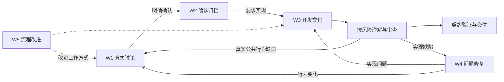

# 项目工作流与使用说明

工作流是“你交给 agent 某一类任务后，它应该怎样把事情做完”。本篇说明五种任务、处理过程、使用例子及相互衔接；可执行指引在仓库 `.agents/skills/`。你可以直接用自然语言交代任务，不必记住 skill 名称或逐步指挥。这里的工作流组织项目研发，不是引擎内部的 Flush，也不是未来 Platform 的业务编排。

2026-10-20 用户确认按五类工作流建设说明与流程；目标同时包含效率、可靠性和持续演进。本篇是工作方式的现行说明；不更改表单协议、分层责任或模块完成状态。第三方工具仍为候选，不因本轮确认而自动安装。

2026-10-24 用户要求按契约驱动、增量交付、行为理解与证据验证统一调整项目规则。保留五类主工作流，在 W3 补强预检，在 W3 / W4 复用辅助深度审查；重要实现关联 Design Intent → Contract → Code → Execution → Evidence。这里的确认是协作方式变更，不代表任何业务契约新增或生产验收完成。

## 先选你要做的任务 {#workflow-selection}

| 你可以这样说 | 使用哪一类 | 最后得到什么 | 项目 skill |
| --- | --- | --- | --- |
| “Studio 第一期应该做什么？给我完整方案。” | W1 方案讨论 | 完整草案、反例、影响和集中待确认点 | `$form-design` |
| “这部分确认，更新项目文档。” | W2 确认归档 | 现行主题及必要关联更新、构建与差异检查 | `$form-design-maintenance` |
| “把最小表单做出来。” | W3 开发交付 | 契约、实现、验收证据和运行方式 | `$form-delivery` |
| “旧异步结果覆盖新结果，修一下。” | W4 问题修复 | 复现、原因、修复和回归证据 | `$form-debug` |
| “每次都要重复找文档，改善一下。” | W5 流程改进 | 小范围流程 / 工具调整及效果判断 | `$form-workflow-improve` |

agent 根据实际任务选择入口，并简短说明本次范围。没有设计变化的代码修复不必先走 W1 / W2；只要求方案时不自动编码。讨论确认、编码授权和第三方安装分别按用户实际指令判断，不能由选中 skill 推导额外授权。

“只读审查 Runtime，解释调度和状态流转并检查设计偏差”直接使用 `$form-deep-review`。它是 W3 / W4 共用、也可单独调用的辅助能力，不增加第六类主工作流；独立审查结束交付结论，修复按既有授权进入 W3 / W4。

## 决策权限、契约与证据 {#workflow-contract-evidence}

三个闭环共用同一份现行契约：设计把意图和约束收敛为可执行范围；交付按行为切片实现并验证；理解 / 审查将实际执行与契约对照。发现实现偏差进入 W4，真实公共行为缺口进入 W1，重复问题进入 W5。架构与 ADR 解释决策理由；所属主题维护模块契约；当前对话、既有任务或 PR 记录本轮实现范围，引用权威章节，不复制第二份长期规格。

| 决策等级 | 判断依据 | agent 的处理方式 |
| --- | --- | --- |
| A · 需要用户决策 | 新增 / 改变状态所有权、职责边界、公共 API、可观察执行顺序、通知 / 一致性、错误或兼容语义 | 沿用已确认原则；真实缺口集中说明场景、反例、选项与影响，只暂停受影响部分 |
| B · 契约内实现 | 保持对外行为与不变量的内部数据结构、算法及协作方式 | 自主选择，记录影响理解、性能、维护或后续修改的重要权衡 |
| C · 局部组织 | 命名、辅助函数、普通类型和框架惯例 | 按工程约定直接完成 |

按行为影响判断，不按“内部模块”或“调度算法”名称判断。将同步队列改为微任务若改变观察时机，即涉及 A；存在已确认约束时遵循它，无需重问。发现缺口先核对权威正文及上下游，不能把普通实现错误、命名或框架惯例升级为架构阻塞。其他已授权独立工作继续。

| 证据类型 | 可以支持的结论 | 必须说明的范围 |
| --- | --- | --- |
| 源码事实 | 某判断、调用或状态修改在指定位置存在 | 文件、符号、行号和适用基线；不据此宣称实际执行过 |
| 运行结果 | 指定输入 / 时序下观察到某行为或断言通过 | 实际命令、结果、测试 / 轨迹、环境及代码基线；仅覆盖已执行场景 |
| 分析推断 | 依据代码与条件推导的可能路径或风险 | 推导依据、成立条件和待验证反例 |
| 未验证 | 缺少执行、访问、契约或足够证据 | 缺口、原因、对结论的影响和下一步 |

设计意图不是实现事实，实现者说明是审查线索；测试通过、静态图或没有发现问题均不证明全局无缺陷。文档 / 候选验证只支持各自范围。证据关联优先使用稳定章节、符号、现有测试名称与结果，不引入全仓人工编号台账。详见[契约验证](#contract-verification)。

## W1 · 方案讨论：把问题讨论清楚 {#workflow-design}

**什么时候用：**新增能力、目标不清、公共行为需要改变，或跨层责任存在真实冲突。已经确认的原则先作为输入，不重新逐项询问。

**怎么说：**“讨论 Studio 的首期范围，基于现有设计给出完整方案，先不要写入规范。”也可说“用 `$form-design` 讨论这个问题”。

1. 查现状：先读 [维护入口](../README.md)，再按议题读取现行主题、关联决策与未决项。
2. 明确场景：谁在什么情况下做什么、输入输出和本轮范围；仅询问无法从现有材料确定的关键信息。
3. 给完整草案：串起正常操作、失败路径、职责、接口草案、必要取舍与验收例子；明确状态所有权、副作用、可观察时机和关键不变量，按本轮场景裁剪。
4. 集中处理反馈：用真实反例和上下游约束检查方案；字段命名、内部容器及惯例由维护者整理，不把它们逐个变成用户决策。
5. 列出待确认结论：区分已确认基线、建议、冲突和待决策；按决策权限集中提出真正影响语义的取舍，留下实现自由度。专题明确确认后进入 W2。

**实际例子：**围绕“技术配置人员编辑定义 → 看到诊断 → 预览 → 保存”，一次解释每步由 Studio、L2、Runtime 或 Platform 谁负责。编辑模型、错误处理和首期排除范围随整体方案一起审阅。该场景用于演示工作方式，不预先确认 Studio 的产品范围。

**什么时候算完成：**已给出可完整审阅的方案；如用户尚未确认，明确保持待确认状态。完整专题未收敛时不逐段写 Markdown / HTML 或保存候选稿，除非用户明确改变这一要求。缺少确认不妨碍继续分析和完善草案。

## W2 · 确认归档：把结论放回项目 {#workflow-maintenance}

**什么时候用：**用户明确确认完整专题，或明确授权已确认范围的归档。已有确认与归档授权继续有效，无需重复索取。

**怎么说：**“上面这套方案确认了，归档并检查。”可显式使用 `$form-design-maintenance`。

1. 提取确认范围：区分新增、修改 / 替代、澄清、候选、冲突和实现细化。
2. 检查一致性并更新：把内容放回所属主题；按实际需要同步 ADR、演进、治理、术语和来源。保留设计意图与行为 / 验收的关联，既有实现受影响时说明验证需求，不凭归档关闭代码审查发现。完整程序以源码 `docs/README.md#incremental-maintenance` 为准；维护说明不另生成一套阅读正文。
3. 构建和验证：生成阅读页、检查同步，协议样例变化另跑验证；呈现变化进行实际渲染检查。
4. 审查并报告：检查本轮差异，保护已有改动，报告更新文件、确认范围、状态和实际验证结果。

**实际例子：**确认一个异步校验专题后，更新对应校验正文及必要关联；不按讨论轮次新建另一套规范，也不把“行为确认”写成“Runtime 已实现”。

**什么时候算完成：**确认内容在正确位置、关联及派生物一致，检查结果真实可查；不能执行的检查明确说明。无知识变化就报告无变化，不制造 ADR 或归档文件。

## W3 · 开发交付：把明确的能力做出来 {#workflow-delivery}

**什么时候用：**工程初始化、新功能、契约内重构，以及可交付版本建设。只要本次范围契约足够明确即可推进，不要求 Platform / Studio 全部设计完成。

**怎么说：**“按现有工程方案初始化并验证。”或“实现文本输入、必填校验和 Host 接收数据的最小表单。”可显式使用 `$form-delivery`。后一个例子是未来纵切任务，不表示当前接口已经完成。

1. 只读预检：核对范围、权威契约、基线、现有代码与实际安装；工程沿用 [已确认选型](engineering.md)。输出下方[预检结果](#implementation-preflight)，真实公共行为缺口集中交 W1，其余自主推进。
2. 安排行为切片：按依赖和可观察结果确定小批任务，每批包含入口、必要状态 / 协作、输出和验收；不只按文件或架构层交付。使用当前对话或已有任务记录，不为每步新增规范页。
3. 实现与反馈：从契约及反例形成行为测试，先观察能捕获缺失 / 错误行为的失败，再实现并复验；运行实际存在且适合本次改动的类型、测试、构建和运行检查，失败后继续修复。低影响修改按下方规则裁剪。
4. 理解与审查：复杂状态 / 调度 / 异步 / 跨层一致性变化读取辅助 `form-deep-review`，还原关键执行和状态并对照契约；普通变更做针对性差异审查。高风险变更按[独立审查规则](#deep-review)处理。
5. 验证并收口：修复阻塞问题，按[契约验证](#contract-verification)核对最终基线。跨层能力从输入到可观察输出验证，UI 操作不能只用 Runtime Command 代替。代码变化后复验受影响路径与结论。
6. 交付：报告运行方法、已完成行为、重要权衡、实际证据、审查结果和残余风险；有新设计变化按确认边界转 W1 / W2。提交 / 合并 / 发布依现有工程规则和用户授权，不从检查通过推导外部操作授权。

**实际例子：**文本输入 → Working Data 更新 → 空值校验 → 显示 Issue → 有效输入 → 完整校验 → Host 收到相应数据。验收同时覆盖空值拒绝及有效数据交付；具体提交 SDK 按现行契约与实现准备固化，不从本例推导新接口。

**小改动怎么做：**按钮间距或局部内部重构可以合并为“定位 → 修改 → 针对性检查 → 交付”，不强制完整需求稿，也不为可逆低影响修改编写只重复实现的测试。

**选型：**使用轻量 Spec-anchored SDD：现行主题持续维护，本次变更引用契约并补足验收；不复制第二份长期规格。暂不引入 SDD 框架、自动任务平台或新的生产脚本。对外发布作为交付分支，按 [工程方案](engineering.md)补充包兼容、Changesets、消费者验证及回退检查；用户要求的交付范围决定是否包含发布动作。

**什么时候算完成：**本次范围满足验收，已执行检查有证据，限制公开；候选探针、文档构建或目录存在都不能证明生产引擎已完成。契约尚缺时可先给完整契约草案、进行明确标注的隔离探索；不把猜测接口当成冻结契约。

### 实现预检：进入编码的条件 {#implementation-preflight}

预检先读契约及相关完整源码，不先生成大量实现。结果在当前任务交付，内容如下；已有任务记录时增量补足，不重抄已知背景。

| 项目 | 应交付的具体内容 |
| --- | --- |
| 范围与依据 | 本轮行为、排除范围、权威主题 / ADR / 章节、现有能力与基线 |
| 行为契约 | 入口 / 输出、状态所有权、不变量、身份 / 生命周期、错误 / 副作用与观察时机；不适用项说明原因 |
| 验收与反例 | 正常路径、无效变化、失败 / 边界；涉及异步时覆盖乱序、失效与销毁等相关场景 |
| 影响与切片 | 涉及的包 / 文件 / 上下游、可验证的行为增量与依赖 |
| 决策分类 | 已确认原则、B / C 自主事项与重要权衡、真正阻塞及其影响范围 |
| 验证入口 | 已存在命令 / 测试、本轮需补的行为检查、环境条件、未具备的验证能力 |

当本轮对外行为有依据、阻塞已解决或范围已明确排除、存在可执行的验收路径时，继续实现，无需再等一次“预检批准”。若关键验证能力尚缺，可在授权范围内先建设它；无法验证的重要行为必须保持未完成状态。未确认的公共语义不能由测试或默认实现反向冻结。

### 理解与深度审查 {#deep-review}

用户要求独立审查，或改动涉及复杂状态、调度、异步、跨层一致性、权限 / 数据正确性时，读取辅助 `form-deep-review`。普通文档或工具函数只做相应职责与差异检查，不强制生成图和完整报告。

1. **固定基线与范围。**明确对比的提交 / 分支及实际检出版本；工作区任务同时检查暂存、未暂存和未跟踪文件。记录纳入 / 排除范围，必要时使用内容摘要或快照；不能只靠 `git diff` 空结果判断无变更。开始和结束核对基线，期间变化则复核受影响部分，未能复核标为过期 / 未验证。
2. **覆盖文件与行为。**枚举新增、修改、删除、重命名及生成物，每项记录审查单元 / 检查方式 / 状态；生成物对照源与同步检查。沿调用关系读取必要的未修改实现和消费者。按跨文件行为划分单元，文件覆盖表不替代行为覆盖；大范围分批保留总清单和未审查项。
3. **建立理解。**每单元说明职责、入口出口、API / 依赖、状态归属和副作用。复杂单元还原调用链、正常 / 错误路径、重入、通知、调度顺序、取消 / 结果资格与清理。存在多方交互用时序图；存在生命周期用状态图或表，不机械要求所有模块都有三种图。模型注明源码位置及“源码推导”或实际轨迹，分支和未知处保留条件。
4. **对照契约取证。**逐项检查不变量、执行语义和上下游边界，查找真实反例。区分已证实缺陷、条件性风险、契约缺口和测试缺口；不把测试缺失直接定成代码 Bug，不把作者意图当证据。问题记录触发条件、影响、契约依据、文件 / 符号 / 行号、证据类型与验证状态。
5. **验证与结论。**优先运行适用的现有检查，用可控时序 / 输入检查高风险路径。只读模式不修改业务代码、测试或规范；需要新增反例测试时提出具体输入 / 顺序 / 断言，交由 W3 / W4 实现，或在已授权的临时隔离环境运行探针并明确其局限。不得降低断言、跳过失败或改规范使当前实现“通过”。

高风险变更优先在已有授权及能力支持下使用独立上下文审查：提供原始契约、基线、源码与可复现验证入口，审查者先独立取证再核对作者说明。无需复制实现者整个对话，也不把预设缺陷 / 结论当输入。多 agent 不是默认前置；没有独立上下文、额度或执行能力时报告自审事实及残余风险，不能宣称独立审查已完成。

完整报告在当前任务或既有 PR / 审查记录交付，按以下结构组织，不默认落地新的报告文件：

| 产物 | 必须能够回答的问题 |
| --- | --- |
| 结论与发现 | 建议合并 / 暂缓及依据；已证实问题按 P0 / P1 / P2 排序，风险 / 缺口另列 |
| 基线与覆盖 | 审了哪个版本、哪些文件 / 单元 / 相关消费者，哪些尚未审查及原因 |
| 模块理解与执行模型 | 入口、职责、状态、副作用和关键路径如何串起，模型依据及推断边界 |
| 契约一致性 | 哪项契约对应哪段实现与反例，存在什么偏差 |
| 验证证据 | 实际命令、结果、测试 / 轨迹、适用基线及未执行原因 |
| 后续动作 | 阻塞修复、建议测试、需用户决策、残余风险与复验范围 |

P0 表示广泛且紧急的严重错误，P1 表示应在本轮合并前修复的重要正确性问题，P2 表示影响较小或非本轮阻塞的明确缺陷；优先级说明影响，证据类型说明确定程度，二者分别记录。没有发现则明确说“本次范围未发现问题”，保留验证局限。审查给出合并建议，不代替用户或托管平台实际合并 / 发布授权。

### 契约验证与修复闭环 {#contract-verification}

重要行为使用下列最小关联表；按当前任务聚合，不逐函数建表，不新设长期契约副本。契约变化须有确认依据；只有实现偏差则修代码及回归测试。

| 契约 / 不变量及章节 | 实现文件 / 符号 | 测试 / 轨迹与输入条件 | 实际结果及基线 | 缺口 / 下一步 |
| --- | --- | --- | --- | --- |
| 本轮需要验证的关键行为 | 对应分支与上下游路径 | 正常 / 反例、可控异步顺序 | 通过 / 失败 / 未执行，以及证据位置 | 未覆盖条件、影响与补充方式 |

例如检查“同步联动稳定后才通知”时，追踪所有适用通知入口；测试在观察者中记录它看到的状态和通知顺序，不只断言最终数据。异步路径控制完成顺序，并分别验证取消动作与过期结果资格；可用现有测试工具或最小探针，不要求先建设通用 Trace 平台。轨迹按需收集事件 / 身份 / 顺序，避免敏感业务值。

W4 修复后重跑原反例及必要相邻路径；审查者在最终代码基线上复核问题是否关闭，未执行标为待复验。类型 / Lint / 依赖边界和业务行为证据各有范围，不能互相替代。P0 / P1 未关闭、必需检查失败 / 未执行，或重要契约与实现偏差未解决时，结论为暂缓合并；P2 和其他残余风险明确说明，不将建议擅自升级为新契约。必需门禁范围以[工程方案](engineering.md#engineering-gates)为准。

## W4 · 问题修复：从异常找到原因 {#workflow-debug}

**什么时候用：**缺陷、回归、偶发错误、性能退化、环境或工具故障。

**怎么说：**“快速修改两次输入，旧异步结果覆盖了新结果，定位并修复。”可显式使用 `$form-debug`。

1. 复现：记录输入、操作、预期和实际结果；偶发问题先控制时序，性能问题先固定规模、环境和测量方法。
2. 定位：沿最短相关链路检查日志、状态、契约和代码，验证原因假设，不先堆叠补丁；复杂行为用[深度审查](#deep-review)还原跨模块执行，区分代码问题、推断风险与测试缺口。
3. 分类：实现违反契约则直接修；表述歧义先核对依据；设计需要改变则进入 W1；环境故障修环境，不强行改业务语义。
4. 修复：实施必要最小改动，保护无关工作；缺复现或因果证据时继续调查，确实缺用户信息再集中询问。
5. 回归：先观察反例能捕获原故障，再修复并重跑原复现和必要相邻路径；按[契约验证](#contract-verification)记录最终基线的实际结果，修复过的发现仍需复验后关闭。重复问题进入 W5，优先沉淀为测试或静态规则。

**实际例子：**先让请求 A 慢于 B 返回，观察旧结果写入；核对已确认任务身份 / 有效性契约；修复实现后验证乱序、失效和销毁相关路径。没有生产 Runtime 时不能假装完成该修复，可用现有候选工具研究，但必须说明证据范围。

**什么时候算完成：**原因有证据，原复现已验证修复，必要回归通过；只凭“加了判断，应该可以”不关闭问题。只有公共行为变化才返回设计讨论，普通实现错误不重开架构。

## W5 · 流程改进：改善做事的方法 {#workflow-improve}

**什么时候用：**重复找背景、同类遗漏、无效确认、验证慢、规则负担过重，或评估新工具 / 模型。

**怎么说：**“每次开发都漏跨层约束，先改进任务准备流程。”可显式使用 `$form-workflow-improve`。

1. 找证据：选具体任务，描述重复摩擦或重要失败，区分偶发问题和流程缺口。
2. 提最小调整：明确改哪条 skill、命令或文档，预期减少什么成本或错误。
3. 在已授权范围实施：用户只要求建议时先讨论；涉及协作规则改变先确认范围；第三方安装单独给用途、影响和必要性，由用户选择。
4. 真实试用：在下一项适合的任务中观察效果；本次结构验证不能代替未来行为证据，不擅自创建定时任务。
5. 判断去留：比较收益和维护成本，保留、修订或撤回；记录在现有说明 / 演进及任务结果中，不新建每轮流水账。重复缺陷优先转成反例测试、静态规则或必要仓库约束；有可执行检查时避免同时堆叠多处同义提醒。

**实际例子：**发现任务准备遗漏相邻契约后，在 W3 的准备环节补上必要读取指引，再看后续任务是否减少遗漏与人工提醒。不要为此默认引入全库检索服务、多人 agent 团队或新任务平台。

**观察什么：**从目标明确到验收的总耗时、用户澄清 / 审查 / 纠偏时间、返工与契约遗漏、交付后缺陷，以及工具费用和维护成本。具体观察设计中断是否属于必要语义决策、哪些返工来自理解偏差、审查发现有多少可证实且值得修复、关键契约 / 状态转换有哪些实际验证。只记录真实可得数据；代码行数、提交数、测试覆盖率数字和主观顺畅不能单独证明提效或正确性。初期不为这些指标建设遥测平台。

**什么时候算完成：**本次调整已交付且检查完成，后续效果标为待验证；只有真实任务支持才能称有效。步骤长期无收益可删减，不以规则数量衡量成熟度。

## 一次任务怎样串起来 {#workflow-routing}

例如你说“讨论这个能力”，默认走 W1，等你确认后走 W2；你又说“开始实现”，进入 W3。使用中出现 bug 走 W4；同类遗漏反复出现才进入 W5。步骤不是逐步审批点：只有目标 / 范围 / 公共行为的真实取舍，或实际需要的授权才向用户集中确认。普通实现和可重复检查由 agent 连续推进。

可靠性依赖可执行反馈；效率包含等待、审查和返工。按本次风险裁剪步骤，避免所有任务都走完整设计流程。长任务循环是 W3 / W4 的执行策略，仅在目标和停止条件明确时使用；多 agent 按需要和授权采用，不是默认前置，不单独建立第六类工作流。

## 已建设的入口与共用环境 {#workflow-harness}

| 内容 | 本轮状态 | 如何使用 |
| --- | --- | --- |
| 本说明、五个主工作流 skill 与辅助深度审查 skill | 已建立；结构校验与场景演练、真实任务效果分别报告 | 自然语言或 `$form-…` 调用；辅助审查可单独请求 |
| AGENTS.md / docs/README | 增加路由入口，保留既有维护约定 | 新会话先读入口，再选所需章节 |
| 文档构建 / 同步检查 | 复用现有工具 | `.venv-docs/bin/python tools/docs/build_docs.py` 及 `--check` |
| 协议候选验证 | 复用现有工具，未改协议样例则无需重跑 | `.venv-docs/bin/python docs/validation/run_validation.py` |
| 工程构建 / 类型 / 测试 / CI | E1–E4 已完成工程配置与本地联验；远端 CI / 分支保护仍待启用 | 按 [工程方案](engineering.md)实施后使用实际脚本 |
| 可控异步 Host / 跨层示例 / 生产契约测试 | 按相关实现与实际执行结果核对，不由本次流程修改判定完成 | 作为 W3 / W4 的反馈环境，不在此生成空实现 |

`.agents/skills/` 是仓库级 skill 目录，随仓库维护，无需全局安装。五个主入口及 `form-deep-review` 的说明分别在各自 `SKILL.md`，它们引用本篇和现行主题，不内嵌另一份架构规范。Codex 的仓库发现与显式 / 隐式调用机制见 [官方 skill 文档](https://learn.chatgpt.com/docs/build-skills)；技能的指引与资源作用见 [官方 Skills 说明](https://developers.openai.com/plugins/concepts/skills)。新增 skill 未出现在选择器时可直接按路径读取，文件校验不代表宿主已完成发现或实际调用。

## Skill 和工具选择：哪些需要安装 {#workflow-tools}

| 项目 | 当前选择 | 用途与采用条件 |
| --- | --- | --- |
| 五个主工作流 skill 与辅助深度审查 skill | 仓库内建设，不需要额外插件 | 执行项目流程，缺第三方能力也能工作 |
| 已有 GrillMe 能力 | 可用时按需复用，不是必需依赖 | 目标模糊时澄清；关键方案集中检查反例，避免默认持续质询 |
| Superpowers | 当前会话已提供，按实际环境发现结果使用；项目不执行额外安装 | 可复用规划、TDD、调试与审查方法；项目确认边界、现有授权及风险裁剪优先，不强制逐问访谈或另建规格目录 |
| OpenSpec | 暂不安装 | 多条变更并行且反复出现差异 / 状态管理成本时再评估，防止产生第二套长期规格 |
| Spec Kit | 暂不安装 | 真正需要统一可配置流程体系时再评估，不与 OpenSpec 同时默认启用 |
| Node / pnpm / 工程依赖 | 已有工程配置，使用前核对实际环境和脚本 | 复用类型、Lint、dependency-cruiser、Vitest、Playwright 与现有门禁，不为流程修改重复初始化 |

ts-morph、CodeQL、属性 / 状态机测试等只在现有验证无法覆盖具体风险时评估；不因理论清单而一次性安装。测试报告、覆盖表和图本身不能代替反例执行；工具失败按真实原因处理，禁止降低断言或修改规范掩盖偏差。

第三方 skill 的行为以安装时的实际内容为准，不把本篇能力描述当作已安装保证；不复制未知脚本或把安装作为当前流程使用的阻塞。需要安装时先说明要解决的问题、已有替代、写入范围与验证方式，由用户决定后执行。

## 维护与试运行 {#workflow-evolution}

本轮建立的是可使用的流程入口；现已按 W3 跑通一次真实工程初始化与本地验收；这不等于五类流程都已试用，也不足以宣布效率提升。后续优先选一个已授权、范围明确的真实任务试运行，结果进入 W5。必要修改回到本篇、对应 skill 或现有工具；重要协作原则变化集中确认后统一归档，不按轮次复制新说明。

2026-10-24 本次将决策权限、预检、深度审查和契约验证贯穿五类主工作流，统一更新规则入口及工程要求。预期减少无效确认、实现偏差和人工逐行理解成本；维护成本是任务内的简短预检、关键证据关联及按风险展开的审查。后续用一个真实状态 / 调度任务观察总耗时、纠偏、返工和发现质量；无收益则合并或裁剪产物，保留权威契约和已验证回归。规则建设、基础校验、隔离演练与生产任务试用分别报告，本次未执行的独立审查不能计为通过。

来源和决策理由见 [工作流来源](source-map.md#src-workflows)及 [本轮演进](design-history.md#workflow-established)。这是工程协作程序，未改变引擎架构，不新增架构 ADR。模块状态和 E1–E4、T01–T07 等任务仍以 [设计进展](governance.md)为准。
