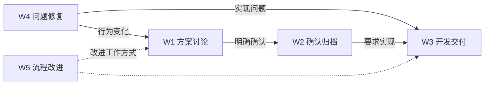

# 项目工作流与使用说明

工作流是“你交给 agent 某一类任务后，它应该怎样把事情做完”。本篇说明五种任务、处理过程、使用例子及相互衔接；可执行指引在仓库 `.agents/skills/`。你可以直接用自然语言交代任务，不必记住 skill 名称或逐步指挥。这里的工作流组织项目研发，不是引擎内部的 Flush，也不是未来 Platform 的业务编排。

2026-10-20 用户确认按五类工作流建设说明与流程；目标同时包含效率、可靠性和持续演进。本篇是工作方式的现行说明；不更改表单协议、分层责任或模块完成状态。第三方工具仍为候选，不因本轮确认而自动安装。

## 先选你要做的任务 {#workflow-selection}

| 你可以这样说 | 使用哪一类 | 最后得到什么 | 项目 skill |
| --- | --- | --- | --- |
| “Studio 第一期应该做什么？给我完整方案。” | W1 方案讨论 | 完整草案、反例、影响和集中待确认点 | `$form-design` |
| “这部分确认，更新项目文档。” | W2 确认归档 | 现行主题及必要关联更新、构建与差异检查 | `$form-design-maintenance` |
| “把最小表单做出来。” | W3 开发交付 | 契约、实现、验收证据和运行方式 | `$form-delivery` |
| “旧异步结果覆盖新结果，修一下。” | W4 问题修复 | 复现、原因、修复和回归证据 | `$form-debug` |
| “每次都要重复找文档，改善一下。” | W5 流程改进 | 小范围流程 / 工具调整及效果判断 | `$form-workflow-improve` |

agent 根据实际任务选择入口，并简短说明本次范围。没有设计变化的代码修复不必先走 W1 / W2；只要求方案时不自动编码。讨论确认、编码授权和第三方安装分别按用户实际指令判断，不能由选中 skill 推导额外授权。

## W1 · 方案讨论：把问题讨论清楚 {#workflow-design}

**什么时候用：**新增能力、目标不清、公共行为需要改变，或跨层责任存在真实冲突。已经确认的原则先作为输入，不重新逐项询问。

**怎么说：**“讨论 Studio 的首期范围，基于现有设计给出完整方案，先不要写入规范。”也可说“用 `$form-design` 讨论这个问题”。

1. 查现状：先读 [维护入口](../README.md)，再按议题读取现行主题、关联决策与未决项。
2. 明确场景：谁在什么情况下做什么、输入输出和本轮范围；仅询问无法从现有材料确定的关键信息。
3. 给完整草案：串起正常操作、失败路径、职责、接口草案、必要取舍与验收例子。
4. 集中处理反馈：用真实反例和上下游约束检查方案；字段命名、内部容器及惯例由维护者整理，不把它们逐个变成用户决策。
5. 列出待确认结论：区分已确认基线、建议、冲突和待决策。专题明确确认后进入 W2。

**实际例子：**围绕“技术配置人员编辑定义 → 看到诊断 → 预览 → 保存”，一次解释每步由 Studio、L2、Runtime 或 Platform 谁负责。编辑模型、错误处理和首期排除范围随整体方案一起审阅。该场景用于演示工作方式，不预先确认 Studio 的产品范围。

**什么时候算完成：**已给出可完整审阅的方案；如用户尚未确认，明确保持待确认状态。完整专题未收敛时不逐段写 Markdown / HTML 或保存候选稿，除非用户明确改变这一要求。缺少确认不妨碍继续分析和完善草案。

## W2 · 确认归档：把结论放回项目 {#workflow-maintenance}

**什么时候用：**用户明确确认完整专题，或明确授权已确认范围的归档。已有确认与归档授权继续有效，无需重复索取。

**怎么说：**“上面这套方案确认了，归档并检查。”可显式使用 `$form-design-maintenance`。

1. 提取确认范围：区分新增、修改 / 替代、澄清、候选、冲突和实现细化。
2. 检查一致性并更新：把内容放回所属主题；按实际需要同步 ADR、演进、治理、术语和来源。完整程序以源码 `docs/README.md#incremental-maintenance` 为准；维护说明不另生成一套阅读正文。
3. 构建和验证：生成阅读页、检查同步，协议样例变化另跑验证；呈现变化进行实际渲染检查。
4. 审查并报告：检查本轮差异，保护已有改动，报告更新文件、确认范围、状态和实际验证结果。

**实际例子：**确认一个异步校验专题后，更新对应校验正文及必要关联；不按讨论轮次新建另一套规范，也不把“行为确认”写成“Runtime 已实现”。

**什么时候算完成：**确认内容在正确位置、关联及派生物一致，检查结果真实可查；不能执行的检查明确说明。无知识变化就报告无变化，不制造 ADR 或归档文件。

## W3 · 开发交付：把明确的能力做出来 {#workflow-delivery}

**什么时候用：**工程初始化、新功能、契约内重构，以及可交付版本建设。只要本次范围契约足够明确即可推进，不要求 Platform / Studio 全部设计完成。

**怎么说：**“按现有工程方案初始化并验证。”或“实现文本输入、必填校验和 Host 接收数据的最小表单。”可显式使用 `$form-delivery`。后一个例子是未来纵切任务，不表示当前接口已经完成。

1. 核对范围、基线与现有代码：工程工具沿用 [已确认选型](engineering.md)，不重复选型；先检查实际安装和仓库状态。
2. 整合本次契约与验收：列出公共接口、输入输出、身份 / 生命周期、错误和必要正反例；内部实现细化由 agent 推进，真实公共行为缺口集中交 W1。
3. 安排小批任务：按依赖确定可交付步骤，使用当前对话或已有任务记录，不为每个步骤新增规范页。
4. 实现与反馈：运行实际存在且适合本次改动的类型、测试、构建和运行检查；失败后继续修复。
5. 验证完整范围：跨层功能从输入到可观察输出验证，UI 操作不能只用 Runtime Command 代替。
6. 审查交付：检查差异，必要时同步说明，报告运行方法、已完成行为、证据和限制；有新设计变化则按确认边界转 W1 / W2。

**实际例子：**文本输入 → Working Data 更新 → 空值校验 → 显示 Issue → 有效输入 → 完整校验 → Host 收到相应数据。验收同时覆盖空值拒绝及有效数据交付；具体提交 SDK 按现行契约与实现准备固化，不从本例推导新接口。

**小改动怎么做：**按钮间距或局部内部重构可以合并为“定位 → 修改 → 针对性检查 → 交付”，不强制完整需求稿，也不为可逆低影响修改编写只重复实现的测试。

**选型：**使用轻量 Spec-anchored SDD：现行主题持续维护，本次变更引用契约并补足验收；不复制第二份长期规格。暂不引入 SDD 框架、自动任务平台或新的生产脚本。对外发布作为交付分支，按 [工程方案](engineering.md)补充包兼容、Changesets、消费者验证及回退检查；用户要求的交付范围决定是否包含发布动作。

**什么时候算完成：**本次范围满足验收，已执行检查有证据，限制公开；候选探针、文档构建或目录存在都不能证明生产引擎已完成。契约尚缺时可先给完整契约草案、进行明确标注的隔离探索；不把猜测接口当成冻结契约。

## W4 · 问题修复：从异常找到原因 {#workflow-debug}

**什么时候用：**缺陷、回归、偶发错误、性能退化、环境或工具故障。

**怎么说：**“快速修改两次输入，旧异步结果覆盖了新结果，定位并修复。”可显式使用 `$form-debug`。

1. 复现：记录输入、操作、预期和实际结果；偶发问题先控制时序，性能问题先固定规模、环境和测量方法。
2. 定位：沿最短相关链路检查日志、状态、契约和代码，验证原因假设，不先堆叠补丁。
3. 分类：实现违反契约则直接修；表述歧义先核对依据；设计需要改变则进入 W1；环境故障修环境，不强行改业务语义。
4. 修复：实施必要最小改动，保护无关工作；缺复现或因果证据时继续调查，确实缺用户信息再集中询问。
5. 回归：重跑复现和必要相邻路径，留下能捕获原问题的检查并报告结果。

**实际例子：**先让请求 A 慢于 B 返回，观察旧结果写入；核对已确认任务身份 / 有效性契约；修复实现后验证乱序、失效和销毁相关路径。没有生产 Runtime 时不能假装完成该修复，可用现有候选工具研究，但必须说明证据范围。

**什么时候算完成：**原因有证据，原复现已验证修复，必要回归通过；只凭“加了判断，应该可以”不关闭问题。只有公共行为变化才返回设计讨论，普通实现错误不重开架构。

## W5 · 流程改进：改善做事的方法 {#workflow-improve}

**什么时候用：**重复找背景、同类遗漏、无效确认、验证慢、规则负担过重，或评估新工具 / 模型。

**怎么说：**“每次开发都漏跨层约束，先改进任务准备流程。”可显式使用 `$form-workflow-improve`。

1. 找证据：选具体任务，描述重复摩擦或重要失败，区分偶发问题和流程缺口。
2. 提最小调整：明确改哪条 skill、命令或文档，预期减少什么成本或错误。
3. 在已授权范围实施：用户只要求建议时先讨论；涉及协作规则改变先确认范围；第三方安装单独给用途、影响和必要性，由用户选择。
4. 真实试用：在下一项适合的任务中观察效果；本次结构验证不能代替未来行为证据，不擅自创建定时任务。
5. 判断去留：比较收益和维护成本，保留、修订或撤回；记录在现有说明 / 演进及任务结果中，不新建每轮流水账。

**实际例子：**发现任务准备遗漏相邻契约后，在 W3 的准备环节补上必要读取指引，再看后续任务是否减少遗漏与人工提醒。不要为此默认引入全库检索服务、多人 agent 团队或新任务平台。

**观察什么：**从目标明确到验收的总耗时、用户澄清 / 审查 / 纠偏时间、返工与契约遗漏、交付后缺陷，以及工具费用和维护成本。只记录真实可得数据；代码行数、提交数和主观顺畅不能单独证明提效。初期不为这些指标建设遥测平台。

**什么时候算完成：**本次调整已交付且检查完成，后续效果标为待验证；只有真实任务支持才能称有效。步骤长期无收益可删减，不以规则数量衡量成熟度。

## 一次任务怎样串起来 {#workflow-routing}

例如你说“讨论这个能力”，默认走 W1，等你确认后走 W2；你又说“开始实现”，进入 W3。使用中出现 bug 走 W4；同类遗漏反复出现才进入 W5。步骤不是逐步审批点：只有目标 / 范围 / 公共行为的真实取舍，或实际需要的授权才向用户集中确认。普通实现和可重复检查由 agent 连续推进。

可靠性依赖可执行反馈；效率包含等待、审查和返工。按本次风险裁剪步骤，避免所有任务都走完整设计流程。长任务循环是 W3 / W4 的执行策略，仅在目标和停止条件明确时使用；多 agent 按需要和授权采用，不是默认前置，不单独建立第六类工作流。

## 已建设的入口与共用环境 {#workflow-harness}

| 内容 | 本轮状态 | 如何使用 |
| --- | --- | --- |
| 本说明与五个项目 skill | 已建立，基础结构检查不等于真实任务效果已验证 | 自然语言或 `$form-…` 调用 |
| AGENTS.md / docs/README | 增加路由入口，保留既有维护约定 | 新会话先读入口，再选所需章节 |
| 文档构建 / 同步检查 | 复用现有工具 | `.venv-docs/bin/python tools/docs/build_docs.py` 及 `--check` |
| 协议候选验证 | 复用现有工具，未改协议样例则无需重跑 | `.venv-docs/bin/python docs/validation/run_validation.py` |
| 工程构建 / 类型 / 测试 / CI | E1–E4 已完成工程配置与本地联验；远端 CI / 分支保护仍待启用 | 按 [工程方案](engineering.md)实施后使用实际脚本 |
| 可控异步 Host / 跨层示例 / 生产契约测试 | 后续随真实实现建设 | 作为 W3 / W4 的反馈环境，不在此生成空实现 |

`.agents/skills/` 是仓库级 skill 目录，随仓库维护，无需全局安装。五个 skill 的说明分别在各自 `SKILL.md`，它们引用本篇和现行主题，不内嵌另一份架构规范。Codex 的仓库发现与显式 / 隐式调用机制见 [官方 skill 文档](https://learn.chatgpt.com/docs/build-skills)。新增 skill 未出现在选择器时，可重新打开项目会话；仍未刷新再重启 Codex。本轮只能验证文件与入口，不能假称宿主已完成发现或实际调用。

## Skill 和工具选择：哪些需要安装 {#workflow-tools}

| 项目 | 当前选择 | 用途与采用条件 |
| --- | --- | --- |
| 五个项目 skill | 仓库内建设，不需要额外插件 | 执行项目流程，缺第三方能力也能工作 |
| 已有 GrillMe 能力 | 可用时按需复用，不是必需依赖 | 目标模糊时澄清；关键方案集中检查反例，避免默认持续质询 |
| Superpowers | 可选，尚未安装；需用户选择 | 试用规划、TDD、调试与审查方法；安装前检查当前入口 / 自动触发规则是否与项目约定冲突 |
| OpenSpec | 暂不安装 | 多条变更并行且反复出现差异 / 状态管理成本时再评估，防止产生第二套长期规格 |
| Spec Kit | 暂不安装 | 真正需要统一可配置流程体系时再评估，不与 OpenSpec 同时默认启用 |
| Node / pnpm / 工程依赖 | 按已确认工程方案在初始化任务中准备 | 本轮仅建设工作流，不执行安装、脚手架或生产工程初始化 |

第三方 skill 的行为以安装时的实际内容为准，不把本篇能力描述当作已安装保证；不复制未知脚本或把安装作为当前流程使用的阻塞。需要安装时先说明要解决的问题、已有替代、写入范围与验证方式，由用户决定后执行。

## 维护与试运行 {#workflow-evolution}

本轮建立的是可使用的流程入口；现已按 W3 跑通一次真实工程初始化与本地验收；这不等于五类流程都已试用，也不足以宣布效率提升。后续优先选一个已授权、范围明确的真实任务试运行，结果进入 W5。必要修改回到本篇、对应 skill 或现有工具；重要协作原则变化集中确认后统一归档，不按轮次复制新说明。

来源和决策理由见 [工作流来源](source-map.md#src-workflows)及 [本轮演进](design-history.md#workflow-established)。这是工程协作程序，未改变引擎架构，不新增架构 ADR。模块状态和 E1–E4、T01–T07 等任务仍以 [设计进展](governance.md)为准。
