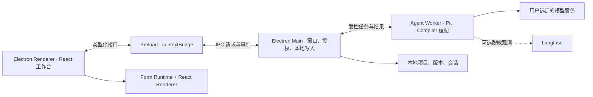

# 02 · 架构与目录



## 目录与依赖

```text
src/
  main/              Electron 入口、IPC、项目存储及任务监督
  preload/           类型化桥接
  renderer/          React 工作台、差异、配置编辑与试填
  agent/             Pi 适配、表单创作用例、工具、Worker 入口
  shared/            跨进程的请求、事件和诊断序列化类型
  engine-integration/ 引擎制品接入、Catalog 装配与身份核对
  observability/     结构化本地记录及 Langfuse 导出
tests/
  integration/       候选编译、存储、并发和恢复
  desktop/           Electron 打包应用走查
```

首版用单仓组织。`shared/` 只放实际跨进程的无副作用契约。React 访问 preload 和浏览器可用的引擎包。Agent 不依赖界面组件；引擎不依赖 Electron、Pi 或 Langfuse。Agent Worker 可用 Electron `utilityProcess`，具体启动方式由打包验证决定。它承担进程隔离和生命周期管理，工具权限仍由应用接口限制。 [Electron 进程模型](https://www.electronjs.org/docs/latest/tutorial/process-model) · [UtilityProcess](https://www.electronjs.org/docs/latest/api/utility-process)

## 状态与跨进程契约

| 所有者 | 持有内容 |
| --- | --- |
| React 工作台 | 当前 Tab、焦点、抽屉暂存、已应用的编辑草稿与撤销栈，以及预览实例。 |
| Main 本地持久化 | 项目标识、已保存的定义修订、候选、会话及轮次记录。提供原子保存与基线检查。 |
| Agent Worker | 当轮上下文、执行进度、取消信号和本次工具结果。持久记录通过 Main 按契约写入。 |
| Runtime 实例 | 本次试填的 Working Data、Scope、联动和校验结果。 |

IPC 首批按用例提供 `openProject`、`saveDraft`、`startRun`、`cancelRun`、`readRun`、`subscribeRun`、`compilePreview`。每条 Main handler 核验可信来源、请求结构和资源归属。只桥接业务方法与可取消订阅；订阅回调只接收业务载荷。Renderer 保持上下文隔离、沙箱及禁用 Node 集成。模型与遥测凭证由本地可信进程管理，优先使用可用的 OS 凭证能力；无法安全存储时允许只为当前会话配置。 [Electron IPC](https://www.electronjs.org/docs/latest/tutorial/ipc) · [Electron 安全清单](https://www.electronjs.org/docs/latest/tutorial/security) · [safeStorage](https://www.electronjs.org/docs/latest/api/safe-storage)

存储首版按事务要求选择 SQLite 或等价方案。`saveDraft` 接收 `projectId`、`expectedRevision`、`requestId` 和定义原文。成功后返回新修订及内容摘要；相同请求和载荷重试返回原回执，旧基线返回冲突并保留未保存输入。
