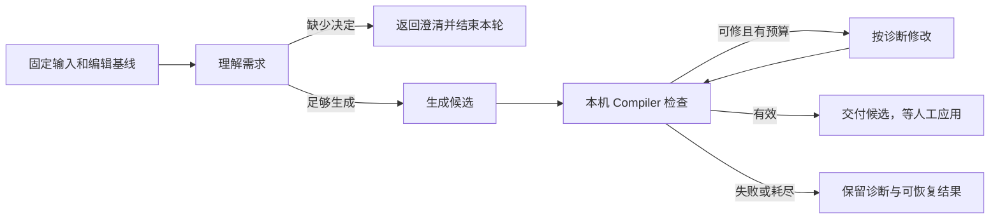

# 03 · Pi Agent 执行

对 Pi 的解释采用 Earendil Works 维护的 Pi SDK。建议从 `@earendil-works/pi-agent-core` 和 `@earendil-works/pi-ai` 接入，业务流程由本项目维护。依赖锁定时用正式发布制品核对包名、Node 要求、流事件、取消及工具 API，并用 Electron 打包后的进程实测。Pi 上游提供自定义工具和事件订阅，业务应用负责把它们投影成稳定的界面事件。 [Pi Agent Core](https://github.com/earendil-works/pi/tree/main/packages/agent) · [上游包清单](https://raw.githubusercontent.com/earendil-works/pi/main/packages/agent/package.json)

## 一轮执行

- **输入固定。** `startRun` 记录 `runId`、`conversationId`、当前 `projectId` 和基线修订，绑定需求及经用户指定的本地资料。任务输入是数据。持有它们的模型或工具没有额外操作权限。
- **工具表。** 只注册读取当前定义、查询本机 Catalog、查阅协议片段、检查候选等表单工具。工具按项目标识取已授权资源。候选交由应用用例接收。首版工具集限定在表单工作流。
- **检查与交付。** 结构化生成结果先校验形状，再交给真实 Compiler。回执绑定候选摘要、目标视图、Compiler 和 Catalog 身份。修复使用同一输入上下文及对应诊断，预算随运行明确记录。技术故障交付错误，业务信息不足交付问题。
- **人工应用。** 候选单独存储。基线匹配时由作者查看差异、应用成一个撤销单元。当前工作稿已改变时保留两份内容，提示重新生成或由作者审阅差异。随后由明确的保存动作持久化。
- **取消与重开。** 一次只接受同项目的一轮写候选任务。取消先传播给模型与工具，迟到回调不能更改终态。重开时以持久记录恢复已完成结果，把上次未结束轮次标为中断。首版允许显式重试；精确逐步骤重放后续单独验收。

公开事件统一包含 `runId`、单调 `seq` 和类型。发布 `started`、`text_delta`、`phase_changed`、`diagnostic`、`candidate_ready` 以及一个终态。事件先按运行身份排序，界面重连时通过已保存结果恢复，避免把重复或晚到增量写进其他轮次。
