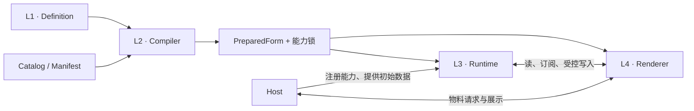

# 07 · 动态表单引擎设计

新项目沿用现有 TS 引擎和协议。Electron 提供宿主，Pi 提供创作能力；它们通过公开接口消费引擎。需要迁移源码时按发布包边界迁移，并带上验收用例和协议样本。引擎接入步骤见 [04](04-workbench.md)。

## 分层与依赖

| 层 | 持有和交付 | 主要设计 |
| --- | --- | --- |
| L1 · Protocol | 作者可编辑的 Definition、能力契约及 Prepared 的结构定义 | `data.schema` 描述业务数据，`views` 按 key 保存独立视图。Reference 有来源和 JSON Pointer，重复项由词法 Scope 绑定。Expression 负责求值，Constraint 负责合法性，Command 表达修改，Reaction 声明何时执行动作。 |
| L2 · Compiler | 读取定义、目标视图、确定 Catalog 与 Schema 资源；输出 Prepared 或诊断 | 规范化后检查词法引用、类型、规则、物料端口、Host 映射等，准备依赖、Schema 资源及制品能力锁。单视图可以默认选中，多视图要求明确目标。返回位置化诊断，失败时不交付可运行产物。 |
| L3 · Runtime | 一份 Working Data、不可变快照、成员标识、规则和校验状态 | 读取 Prepared 并核对环境；以 Command 写入、按依赖通知、调度 Reaction 与 Validation。对外提供读取、订阅、写入、校验和实例生命周期。 |
| L4 · React Renderer | 当前视图装配、订阅与局部 UI 状态 | 从 MaterialNode、ScopeNode、TemplateUse 组装组件和插槽。统一 Adapter 在挂载时关联 Scope、读取绑定和动态属性，改绑更新订阅，卸载释放。输入写入 Runtime，外部请求交给 Host。 |

Host 创建和处置运行实例，提供纯函数、物料、外部校验或请求适配。Host 自己决定业务基准、恢复与提交；它按当前完整校验结果及对应快照构造提交数据。正式运行和 Studio 试填共享引擎，各自使用本场景的 Host。

## Runtime 的执行顺序

1. **装载。** 用 Prepared、初始数据和确定的注册项创建实例。根数据与重复成员一起建立身份。`runOnActivate` 仅用于适用的新规则实例首次激活。
2. **提交命令。** 有效 Command 在当前调用即时写入 Working Data；在命令内完成变化检测。数组下标表示当前位置，成员句柄表示逻辑成员。换序更新位置，删除或替换使旧身份失效。
3. **匹配观察。** 静态读取依赖、规则 Watch 和活跃 View 订阅分别表达。Reaction 只因显式观察值的有效变化常规入队。View 由 Renderer 挂载时建立观察者。
4. **处理 Flush。** 同一待执行 Reaction 实例合并，实际执行时读最新状态。有序动作依次交付，有效同步级联留在当前轮。复合修改可部分成功，隔离错误按契约记录。预算触发后停本轮并保留已发生的写入；后续有效变化可以开启新轮。
5. **推进校验。** 管理根 Schema、内部 Constraint 及外部 Validator 结果。增量变化使相应校验状态失效，结果按声明来源保存、按字段聚合。同步前置绑定具体成员与规则，前置未达资格时后续跳过，独立任务继续。异步结果须核验任务代次、输入和成员身份。完整校验等待需要的结果，并交付与结论对应的快照。
6. **更新界面与观察。** Renderer 通过订阅读取最新数据、属性和校验状态。外部工作有独立生命周期。技术异常、业务 Issue 和外部失败保留各自来源，诊断和 Trace 解释实际发生的顺序。

## 四条迁移验收

| 场景 | 应观察到 |
| --- | --- |
| 两个布局共享同一 Schema | 显式选择目标视图可编译；同一 Runtime 切换 Profile 时保留数据和适用的规则状态。 |
| 一位被保人改年龄并换序 | Command 即时更新该成员；保费按显式 Watch 联动；换序后后续写入和校验仍跟随同一成员。 |
| 日期范围第二端失败、规则链未收敛 | 第一端成功的写入保留并可见；Flush 耗尽预算时有事实诊断，后续独立交互仍可执行。 |
| 快速变更输入或删除正在校验的成员 | 迟到的外部结果不会附到新输入或另一成员。完整校验的结果和数据快照能够对应。 |

## 原仓文件索引

复制完整协议、算法或签名时从下面的正文和当前包公开入口取证。路径相对于 Assemble Studio 仓库根，可用交接 README 所列基线定位。

- L1：`docs/design/l1/README.md` 及编号主题、`packages/protocol/src/`。优先带上正式 Schema 与旅险协议样本。
- L2：`docs/design/l2-preparation.md#l2-compile`、`docs/design/l2/compiler.md`、`packages/compiler/src/index.ts`。
- L3：`docs/design/l3-data-scope.md`、`docs/design/l3-reactive-engine.md#l3-flush`、`docs/design/l3-validation.md`、`docs/design/l3-observability.md`、`packages/runtime/src/index.ts`。
- L4：`docs/design/l4-renderer.md`、`docs/design/extension-integration.md`、`packages/renderer-react/src/index.ts`。

## 接入审查顺序

1. 对照 `docs/design/l1/07-examples.md` 中的旅险 Definition 和 `docs/design/l2/compiler.md` 的编译示例，核对输入 Schema、目标视图、Prepared 格式与能力身份。机器 Schema 位于 `packages/protocol/schemas/`。
2. 用成员改龄、换序和删除复核 Scope、Flush 与异步校验。将日期范围或重复项装配进桌面，检查输入交付、Adapter 生命周期和 Host 请求桥接。
3. 在锁定的真实制品上重复运行引擎仓库的 `tests/integration/travel-session.test.ts`、`member-session.test.ts`、`interaction-session.test.ts` 与 `observation-transport.test.ts` 所覆盖的场景，记录新项目实际取得的结果。
