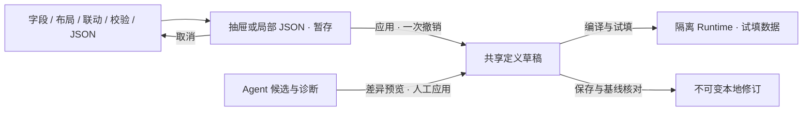

# 08 · 配置工作台设计

工作台保留字段、布局、联动、校验四个并列分区，另有整份 JSON。表单基本信息由工作台外层承接。页头展示当前版本、编辑或只读状态并承接检查、试填、保存，正文独立滚动。Agent 候选和人工工作稿打开同一套配置编辑入口。

## 一份定义如何编辑

| 状态 | 写入规则 |
| --- | --- |
| 局部暂存 | 保留初始节点身份和基线。抽屉内变更、尚未应用的规则和试算样本留在当前会话。取消丢弃局部暂存，离开前保护未应用修改。 |
| 共享定义草稿 | 用一次明确应用写入局部改动并生成一次撤销。结构编辑必须锁定当次目标；异步结果按输入和编辑代次核对，关闭抽屉或切换目标后丢弃过期结果。 |
| 原始 JSON | 使用可定位的 token/片段操作，保留未修改节点、未知属性及原文。重复键或歧义位置提供原文定位。无效 JSON 保留原文，修复后恢复结构化编辑。整份 JSON 回到原分区时恢复节点选择。 |
| 预览与版本 | 预览持有独立 Runtime 和试填数据。部分布局属性可以暂存试预览，正式保存只用应用后的定义。无变化时无需追加修订。已保存版本可用同一工作台只读查看。 |
| Agent 候选 | 保留源修订与候选原文，审阅差异后由用户应用。当前草稿变更时保留双方内容并提示冲突。应用可撤销，保存仍走本机修订流程。 |

## 四个编辑分区

### 字段

详细的[字段 Schema 编辑设计](09-field-schema-design.md)包括控件写回、规则的声明位置及多级暂存。

- 大纲区分表单结构与共享定义。对象、数组、数组元素和叶节点按各自结构提供新增、插入或删除。行内操作负责结构，编辑或查看打开统一抽屉。
- 抽屉分基础属性、校验属性、Schema 条件及高级设置。设置「始终必填」写回父对象 `required`。对象条件分支及依赖在原声明位置编辑，和始终必填分别维护。
- 共享定义的使用处保留引用与本地覆盖。更换引用目标时保留自身约束；重命名和删除先检查使用位置，存在无法可靠定位的引用时引导原文处理。
- 一次应用可以合并抽屉中的多个属性和规则变化。验收时删除一个必填子字段，核对其从父级 `required` 移除，再撤销恢复。

### 布局

- 默认试填，编排模式提供真实插入位置。插入线负责添加，画布节点负责删除，点节点进入抽屉改属性或替换物料。拖放支持同级排序和合法跨容器移动。
- 同一 Schema 可配置多个具名布局。复制生成独立视图树，改显示名保留稳定 key。物料选择器支持搜索和预览，候选与已有字段及声明端口匹配。
- 属性以 Manifest 为准，区分固定值、字段读取、表达式、绑定和 Host 请求。替换容器时尽可能保留兼容子树，确需删除子项时先明确影响。移动检查目标槽位和词法绑定，拒绝把同名别名误绑到另一数组。
- 属性修改可暂存预览。应用前检查编辑候选，失败显示诊断并保有原工作稿及上次可用预览。结构修改和局部 JSON 都进入同一撤销历史。

### 联动

- 从清单进入整条规则抽屉，按执行范围、观察、成立条件和有序动作组织。字段选择区分根数据、当前成员和校验观察投影。
- 明确区分读取和触发。表达式引用某字段时提示它尚未被观察，是否把它加入 Watch 由作者决定。动作增删和调序与 `then[]` 对应，首次激活独立配置。
- 同一条规则可在结构化表单与局部 JSON 间切换。完成时检查并一次写回，取消保留原规则，关闭后焦点回到触发项。

### 校验

- Schema 属性约束在字段页编辑，定义级 Constraint 在校验分区编辑。规则抽屉表达作用域、输入、适用条件、内部断言或 Host 校验、同步前置和 Issue 归属。
- 字段前置与规则前置按对应能力选择。引用需要可定位到当前成员的具体实例，自依赖和前置循环显示诊断。预览核对同名根字段与成员字段的不同结果。
- 布局、联动和校验共享字段选择及表达式编辑。调用方提供当前 Scope、候选、类型要求和写入位置。试算使用 Compiler/Runtime 的语义与隔离的样例数据，样例不写入定义。

具体复用方式、协议包装和试算流程见[共享表达式配置设计](10-expression-design.md)。

## 开发切片与验收

1. **共享草稿。** 用真实定义实现 JSON round-trip、一次应用、一次撤销、只读与保存重开。验证空白、未知属性和未触及原文。并发冲突保留本次未保存内容。
2. **布局纵切。** 插入日期范围 → 修改标题 → 取消替换 → JSON 核对 → 撤销 → 试填保存重开。再覆盖非法跨 Scope 移动和兼容子树替换。
3. **字段与规则。** 修改成员 Schema 与必填，配置逐人联动和姓名 Constraint。检查动作顺序、前置、结果归属以及视图切换后的定位恢复。
4. **Agent 协作。** 对当前基线生成候选，展示差异，人工应用与撤销。再用过期候选、保存重复请求与只读版本验证写入边界。

沿用 Studio 的原交互密度、共享组件和 Token。窄窗需要让抽屉操作可达、正文独立滚动。键盘走查覆盖 Tab 与 Shift+Tab、适用的 Enter / Space / Escape、弹窗关闭后的焦点恢复。

## 原仓文件索引

原仓权威设计位于 `docs/design/platform-studio.md` 的 `studio-visual-editing-boundary`、`studio-schema-drawer-review`、`studio-layout-visual`、`studio-reaction-visual`、`studio-expression-editor` 与 `studio-constraint-visual`。公共组件与视觉参考见 `packages/studio-design/guidelines.md` 和同包 Handbook。

可作为迁移基线的原仓浏览器用例位于 `apps/studio/tests/`，优先取 `schema-field-drawer-next.spec.ts`、`layout-editor.spec.ts`、`layout-material.spec.ts`、`reaction-editor.spec.ts`、`constraint-editor.spec.ts` 以及 `agent-draft-layout.spec.ts`。以桌面真实工作台入口执行等价走查。
