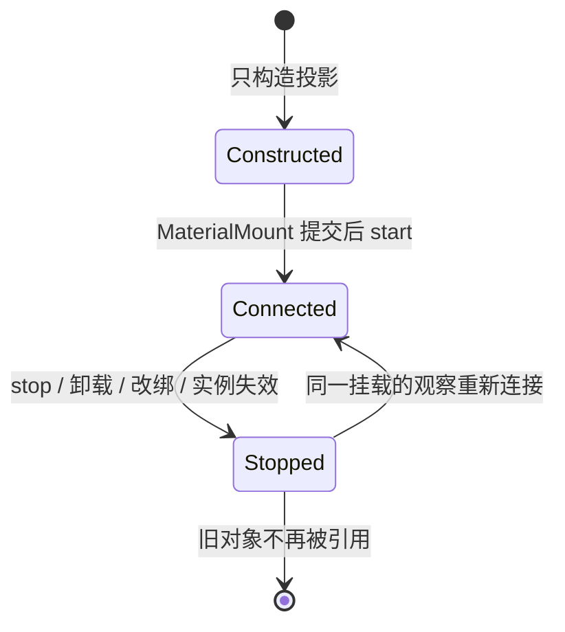
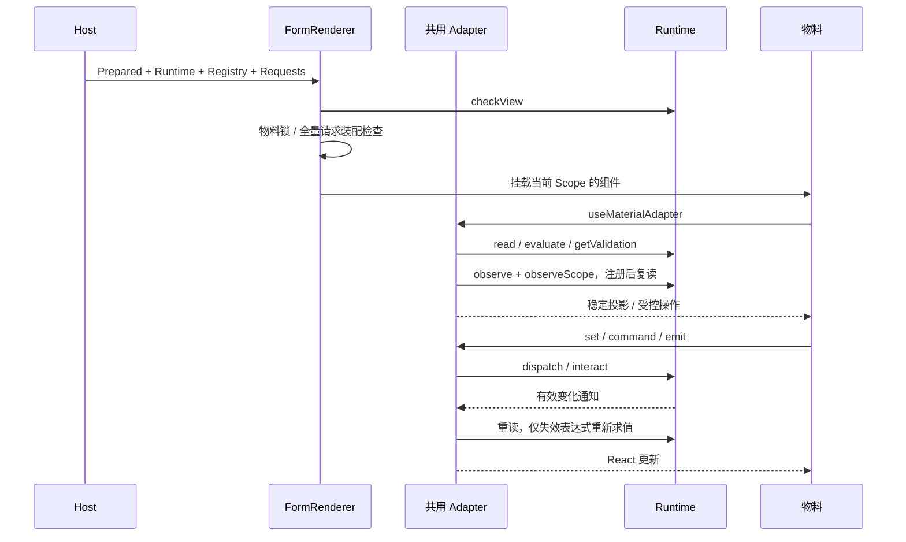

# React Renderer 与共用物料接入

本包实现 [L4 现行契约](../../docs/design/l4-renderer.md#react-sdk-delivery)，消费真实 Compiler 产出的 Prepared /2 与 Host 已创建的 Runtime。入口为 `FormRenderer`、`useMaterialAdapter` 和物料 / 请求类型辅助函数。React 以 peer dependency 外置；不默认加载基础物料或样式。

编译成功产物深度只读，根入口复用真实验证结果；外部 JSON 仍接管并检查。同一物料契约直接匹配，受控不可变契约复用摘要。Adapter 在自己的错误边界先固定输入，Runtime 复用该只读值，DataStore 保留独立替换，整条对象 set 路径由四次复制收敛为两次；并非取消所有输入检查。回归见 tests/adapter-performance.test.tsx。

## 从哪里阅读

| 路径 | 职责 / 关键不变量 |
| --- | --- |
| src/renderer/form-renderer.tsx、renderer-content.tsx、create-render-environment.ts | 根错误边界、内部执行体、静态装配检查；不创建 / 销毁 Runtime |
| src/renderer/nodes/*.tsx、composition/scope-projection.ts | 每种节点单文件：分发、物料边界、挂载、Scope 展开、所属资格、模板实例化 |
| src/material/registry.ts、types.ts | 确定契约、制品与组件注册；不引入逐物料 Adapter |
| src/adapter/use-material-adapter.ts、material-context.ts、projection.ts | 稳定快照、Binding / 校验、操作、挂载 / 释放与旧关联拒绝 |
| src/adapter/expressions.ts | 按完整 Prepared `$expr` 的 watch 分别缓存 / 失效；不分析 AST |
| src/requests/bridge.ts、contracts.ts | 调用资格、latest / parallel、立即 discarded、闭合 Schema 预编译复用 |
| src/diagnostics/material-boundary.tsx、material-fallback.tsx、emitter.ts | 错误边界、已知错误降级、结构化上报通道 |

## 组件与状态的阅读顺序

只需从两个主要运行入口进入：Host 使用 FormRenderer，物料使用 useMaterialAdapter。其余组件 / 状态对象属于内部实现；注册 / 类型辅助函数继续保持原公共入口。

```text
src/
  renderer/
    form-renderer.tsx       # 公开入口：根错误边界、配置接管与视图连接
    renderer-content.tsx   # 内部执行体：校验执行输入、创建环境、交付根节点
    renderer-context.ts    # 每个根实例的上下文值与依赖注入
    create-render-environment.ts # 校验输入与注册装配；不挂载 / 不订阅
    inspection.ts          # 很薄的开发观测登记；不含历史和 UI
    nodes/
      view-node.tsx        # 三类节点的纯分发
      material-node.tsx    # 一个物料的配置检查结果与错误隔离
      material-mount.tsx   # 构造 Projection、Slots，提交后连接 / 清理
      scope-node.tsx       # 用 Runtime 的 one / each 绑定展开子树
      owned-node.tsx       # 保留挂载所属资格，不扩大词法可见性
      template-node.tsx    # 只传显式形参，复用静态模板体
      types.ts             # 内部节点输入和固定递归能力
  adapter/                 # 共用 Hook、Context、投影与表达式缓存
  composition/             # Scope 位置观察源
  material/                # 静态物料契约、制品与注册辅助
  requests/                # 请求调用资格、契约检查和类型
  diagnostics/             # 错误隔离、业务降级、结构化上报；没有技术面板
```

递归能力由 ViewNode 通过内部 renderNode 参数传入，子组件无需反向 import 分发器；没有引入动态插件查找或新的配置语言。该函数引用在同一源码版本中固定。一个组件一个文件便于逐段 review，普通类型与同职责辅助函数仍就近组织，不逐个拆出无意义目录。

下表是源码事实，不把每个 useMemo 结果都称为业务状态：

| 对象 / Hook | 实际保存什么 | 谁更新、何时释放 |
| --- | --- | --- |
| FormRenderer 的 useMemo | 接管 compiledForm 与根上下文 / 恢复凭据，不含 Working Data | 配置接管仅依赖 prepared 引用；注册变化只替换上下文接入 |
| RendererContent 的 useMemo / useEffect / useRef | RenderEnvironment 与上次已交付的装配结果；提交后交付一次装配诊断 | 新装配结果重新交付，Strict Mode 模拟清理不重复；真实重挂重新开始 |
| MaterialMount 的 useMemo / useLayoutEffect | 本挂载的 Projection 与 Slots 元素 | 渲染只构造对象，提交 start，清理 stop；没有第二份 Working Data |
| ScopeNodeView / TemplateNodeView 的 useSyncExternalStore | 当前有效的 ScopeBinding[] 位置快照 | Runtime 通知后重读；Hook 释放观察，成员身份仍归 Runtime |
| OwnedNode 的 useMemo | 独立 owners 资格链 | 输入位置稳定时复用，不捕获额外词法别名 |
| useMaterialAdapter | 从 Context 取得 Projection，消费当前 Snapshot；不使用 useState 保存业务值 | 外部 Store 通知使 Hook 重读；返回聚合对象可随 render 新建，操作函数属于当前关联 |
| Projection | listeners、解除句柄、#active、最近 Snapshot、表达式缓存及请求桥接 | MaterialMount 提交后 start 建立观察，stop 撤销并释放；Hook subscribe 只管理监听者 |
| ExpressionProjection | 每个完整表达式的输入身份、watch 比较投影、value / error，普通容器稳定引用 | read 核对输入身份，变化后比较 watch，仅重算依赖变化项；Context 替换刷新全部动态项；不维护历史 |
| ScopeProjection | 当前定位数组及可复用绑定对象 | read 取得 Runtime 当前绑定；成员顺序变化后重新组织，未变句柄复用 |
| RequestBridge | 尚未结算调用的集合，每次调用闭包中的 done / resolver | 成功、错误、discarded 都只结算一次并移除；没有结果缓存 |
| MaterialBoundary | hasError 与上次 resetKey | 任意抛出值都进入局部降级；明确恢复输入变化清除标志，不重置 Runtime |
| MaterialFallback 的 useRef | 本挂载上次交付的诊断内容键与发布函数 | 同内容、同发布关联不重报；内容改变、新关联或真实重挂重新交付，不保存历史 |

内部命名按职责统一：RendererContextValue / contextValue 表示每个表单自己的上下文，不是全局单例或网络连接；compiledForm 表示已编译配置，environment 表示物料 / 请求装配结果。公共 prepared 属性与协议类型 PreparedForm 保持兼容。validateRenderInput 独立缓存静态格式 / 执行兼容检查，createRenderEnvironment 复用其结果；销毁检查不被静态缓存掩盖。

copyJson 表示独立 JSON 复制，captureJson 在真实接管凭据支持下复用只读子值，不凭浅冻结或类型断言跳过保护。配置接管不随 materials / requests 引用变化反复执行，Runtime 公共 checkView 保留外部输入保护。先前批次已收敛对象 set 的重复复制，本轮只修复呈现错误隔离与诊断交付；局部调用次数和测试不代表生产性能结论。

DiagnosticEmitter 只发布诊断、隔离消费者异常和暂存提交前的记录；根先登记开发消费者，再登记 Host 并 flushPending，将初次错误完整交给全部消费者。没有业务状态同步或历史重放。100 条历史与截断统计归 Runtime 开发观测目录的 DiagnosticHistory；它按 inspectionOwner 弱关联，同一 Strict Mode 模拟重连保留窗口，真实注销后不可查询，不强持有已释放根。

边界与交付反例见 tests/boundaries.test.tsx：覆盖 falsy / 无法转成字符串的异常、根装配失败、Strict Mode、回调更新、不同 Scope、新增成员、错误恢复及真实重挂。已知配置错误按诊断内容与本次发布关联交付，静态装配记录与具体挂载记录分别保留；不在通用发布器中全局去重，避免吞掉不同实例的新错误。

根身份只从接管副本安全读取，缺字段 / 非 JSON 也由边界内执行体报告，未知身份用占位标记；React key 用二元组编码，避免分隔符歧义。

Working Data、Scope 成员身份、校验 status / Issues、Reaction 状态始终由 Runtime 持有。物料可以持有焦点、输入法组合态、未确认选择、候选列表等交互状态；这些不进入 Projection 的权威业务状态。

### Hook 返回项分别是什么

| 返回项 | 来源 / 语义 |
| --- | --- |
| props | 当前 Prepared 配置经 Runtime 求值的只读结果；每个完整表达式独立失效 |
| values | Binding 名 → Runtime 的 ReadResult，区别合法值与 missing；读取错误进入物料边界 |
| validation | Binding 的当前字段聚合状态，不等于完整提交校验证明 |
| slots | 具名 React 子树；构造元素不等于订阅，实际呈现后才挂载 |
| set | 原样 JSON Literal 写入 Binding；返回 executed / inactive / error，executed 仍需看 result.ok |
| command | 当前 Scope 的既有 Command 入口，batch 保持非原子语义 |
| emit | 物料语义事件到 Prepared on 映射，没有业务返回值等待 |
| request | 当前调用的 result Promise 与 cancel；终态为 success / error / discarded，不自动写表单 |

下面是源码推导的关联生命周期。Connected 仅表示观察已经建立；真正可操作仍要求 `#active && Scope 存活 && owners 全部存活`。



同一挂载可能经历 React Strict Mode 的模拟清理与重新连接；真实改绑使用新的 Projection。旧实例的回调不能借用新 Scope。请求的“在途”仅表示 Promise 尚未结算，当前公开 RequestResult 没有 pending 枚举；业务 Loading 由 Host / 物料组织。

Hook 消费者可在同一物料内部独立切换，退订不结束整个物料关联，也不撤销其请求。快照读取不依赖表达式观察回调先到达：以 Runtime 的只读 Data / Context 输入身份核对缓存，输入变化时按 Prepared watch 比较依赖，避免 Host 观察者同步重渲染时组合旧 Props 与新 Binding。结构 watch 比较成员身份与顺序；同值标量 Context 的显式替换另由空 Data watch 管理通知保留刷新信号，不改变 Runtime 通知顺序。表达式求值错误保留 Runtime 原因，业务降级仍使用通用提示。回归入口为 tests/snapshots.test.tsx 与 tests/requests.test.tsx。

诊断 / 展示回调与装配缓存已分离。onDiagnostic 通过可释放通道更换监听者，业务错误降级通过独立 Context 更新；更换回调或工具连接不重建 Projection、不撤销请求。开发工具见 [独立包](../devtools/README.md)。

## 使用

Host 先编译 Definition，创建 Runtime，再传入同一执行契约对应的 Prepared：

```tsx
<FormRenderer
  prepared={prepared}
  runtime={runtime}
  materials={materials}
  requests={requests}
  onDiagnostic={report}
/>
```

Runtime 的事件 / 外部校验在 `createRuntime({ host })` 注册，物料有返回值的请求由 Renderer 的 requests 桥接。Host 负责释放 Runtime；应先卸载 Renderer 再释放实例。Renderer 自身卸载只释放本视图观察 / 回调 / 请求，不销毁业务状态。

物料用 `defineMaterialContract<Props, BindingNames, Events, Requests>(manifest)` 关联显式类型与 Manifest，`defineMaterial(contract, artifact, Component)` 关联组件及确定制品，再交 `createMaterialRegistry`。Manifest 供 Compiler 使用；组件实现供 Renderer 使用。辅助类型不声称从任意 JSON Schema 自动推导 TypeScript，也不替代运行期 Schema 检查。

物料内部 `useMaterialAdapter(contract)` 返回：

- props：已求值配置；values：Binding 的 value / missing / error；validation：Runtime 字段聚合。Schema 声明类型不禁止暂时非法工作值；未配置的声明 Binding 返回 missing / unverified。
- slots：具名 React 子树；容器决定实际呈现，未挂载子树没有自身观察。
- set：原样 JSON 值通过 Literal set 交付；command：已有七类 Command；返回 executed（含 Runtime 结果）、inactive 或 error。batch 非原子，不自动回滚。
- emit：物料语义事件到 Prepared on 映射，Event Payload 本次求值；不重复默认 Binding 写入。
- request：返回 `{result, cancel}`，result 为 success / error / discarded。结果不自动写表单；同挂载请求 latest 撤销旧调用、parallel 独立。取消 / 改绑 / 删除 / 销毁先失效并立即结算，再尽力取消底层任务。

请求类型可以由 `defineRequest<Input, Output>({ payloadSchema, resultSchema })` 明确提供；`defineHostRequests({ lookup: contract.requests.search }, { lookup: handler })` 复用契约限制静态注册名和参数 / 结果。动态 Prepared 的实际注册仍在装配阶段逐项检查，包括隐藏节点。Host handler 接收业务 JSON 和 `{signal}`，可以忽略信号；不得依赖网络真正取消才完成 discarded。网络防抖、重试与缓存归 Host / 具体物料。

## 执行模型

源码推导的主链：



模板的词法形参和挂载 ownership 分开：即使形参只引用全局字段，外层成员删除仍使旧写入 / 请求立即失效，不增加隐式别名捕获。Binding 保留 Object.is 观察语义，包括 -0 / 0 和同内容对象替换；稳定 Props 容器仅复用未失效结果。

挂载关联 `未激活 → 有效 → 已释放`；改绑创建新关联，旧方法永远指向旧关联，不借用最新 Scope。React Strict Mode 的模拟建立 / 清理可重新连接同一挂载对象；实际卸载或改绑使用新对象。Scope 生命周期观察与即时存活检查共同覆盖数据已删除、React 尚未清理的窗口。

Prepared 只有已选定的一个 Profile。切换需传入目标 Profile 的 Prepared；`runtime.checkView` 核对非视图执行内容、业务根 / 函数签名实际引用的 Schema 资源闭包及所需函数锁；请求专用外部资源可随视图更换。仅兼容视图可复用 Runtime；新增未装载函数被拒绝，不热替换能力、不重放 Reaction 激活。

开发态 Runtime / Renderer 自动登记只读观测源，独立浏览器扩展显示包括隐藏节点在内的装配遗漏。业务应用不导入 DevTools、不传展示开关，业务页面不显示技术详情；onDiagnostic 仍可供 Host 上报。默认产物不注册开发发现接口。

## 验证入口与范围

```bash
pnpm --filter @form-engine/renderer-react test
pnpm --filter @form-engine/renderer-react typecheck
pnpm --filter @form-engine/runtime test
pnpm test
pnpm test:integration
pnpm build
pnpm boundaries
pnpm packages:check
pnpm test:e2e
```

`tests/renderer.test.tsx` 验证真实首读 / 写入 / Host 改值 / 局部缺失；composition 覆盖表达式计数、Context、数组与模板；lifecycle 覆盖首次读取交接、Strict Mode、隐藏重挂、改绑、非法输入 / 确认、Host 通知、Profile、故障 / 恢复；requests 覆盖并发、取消、乱序 / 失败、注册缺失与实例销毁；type-contracts.ts 在独立测试类型检查中验证静态负例。

浏览器入口现为 Playground 首页及 `/demos/basic`、`/demos/members`、`/demos/interactions`、`/demos/travel`，源在 `apps/playground/src/demos`，全部使用正式物料与可控 Host。旧 `/l4` 专用物料夹具和 renderer.spec.ts 已移除；原输入、Scope、请求与提交行为由正式场景 E2E 覆盖，故障隔离与 Strict Mode 等 SDK 反例继续保留在包内测试。

当前交付以客户端交互为范围。首批 14 个正式物料、7 个业务函数及完整可控表单已本地交付，见[资产实施证据](../../docs/design/engineering.md#business-travel-implementation)。SSR 表单水合、Flutter、真实 Host 后端、生产设备性能与完整监控平台仍未验收；不能从测试通过外推这些能力。
