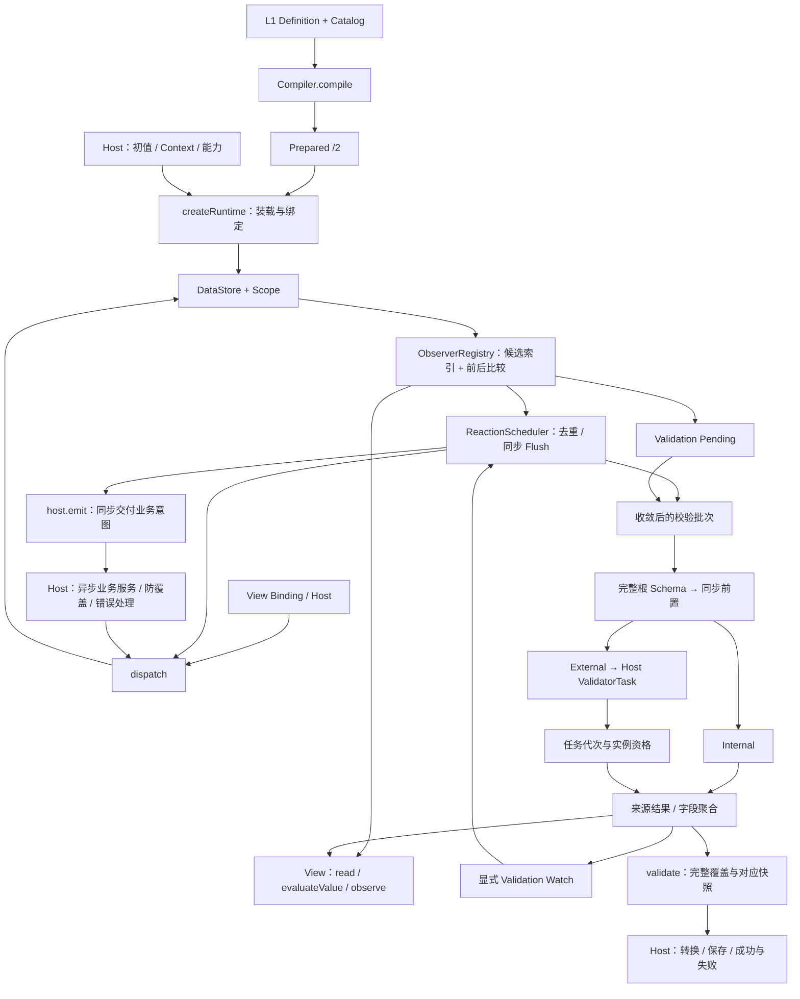
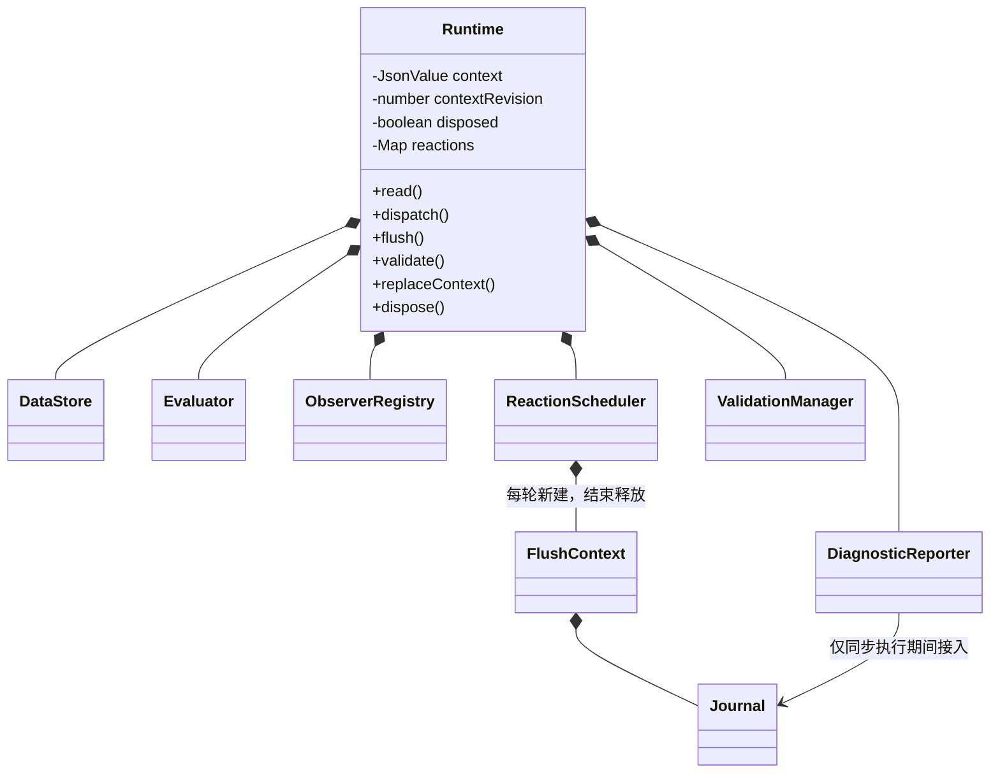
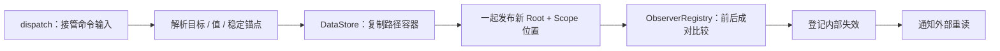
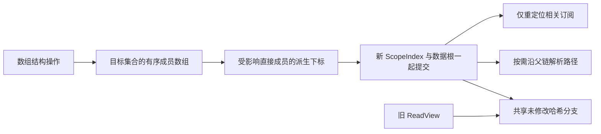
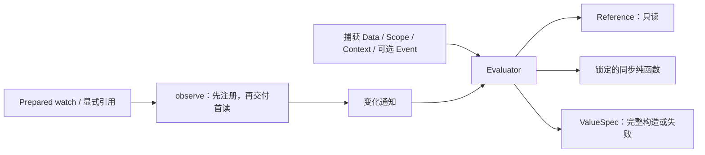
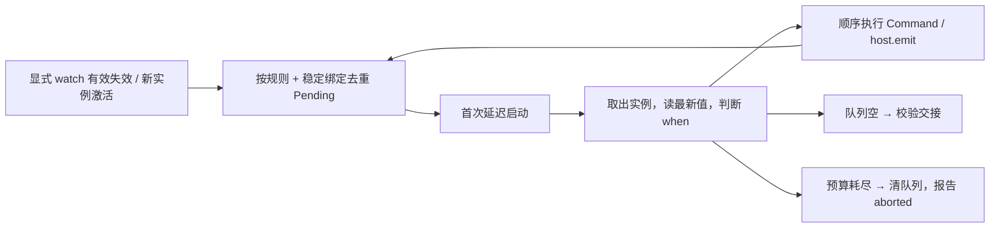
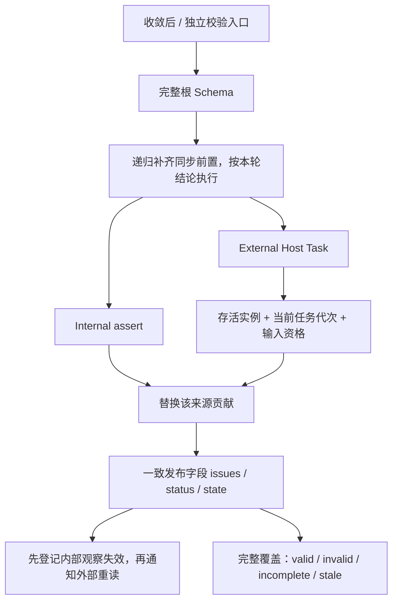
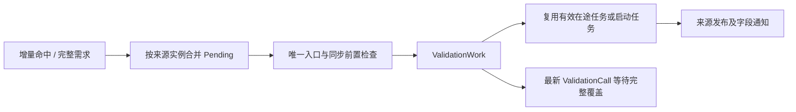
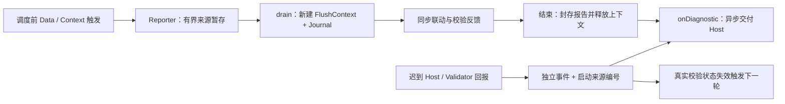

# L3 Runtime：代码 Review 入口

本包消费真实 Compiler 产出的 Prepared /2，提供无界面的数据、观察、联动和校验主链。设计依据为 [L3 总览](../../docs/design/l3-reactive-engine.md)、[数据与 Scope](../../docs/design/l3-data-scope.md)、[校验](../../docs/design/l3-validation.md)和 ADR-FE-018 / 019 / 020。下列 SDK 是本次实现的 review 草案；实现事实与剩余限制分别列出，不宣称已完成 React / Flutter 或生产性能验收。

## 总图与目录



```text
src/
  index.ts                 公共 exports
  types.ts                 FormRuntime / Host / 结果契约
  runtime.ts               Runtime class：状态、模块依赖、公共入口与规则生命周期
  lifecycle/load.ts        Prepared 结构、ABI、函数能力锁检查
  data/json.ts             严格 JSON 接管、Pointer、路径复制
  data/store.ts            唯一 Working Data 与逐条修改
  scope/registry.ts        稳定成员、词法绑定、成对读取视图
  scope/index.ts           父成员 + 相对集合 + 本层下标，按需解析绝对路径
  scope/table.ts           Scope 专用不可变哈希目录，旧视图共享未修改分支
  expression/evaluator.ts  Reference / Expression / ValueSpec
  observation/registry.ts  Data / Validation 分源索引与投递
  commands/execute.ts      七类 Command 的单条执行
  reactions/scheduler.ts   Pending、延迟启动、同步收敛与预算
  reactions/context.ts     单轮执行计数、停止标志与临时 Journal
  validation/fields.ts     Issue 的稳定成员定位
  validation/schema.ts     只读 Schema 编译、资源身份与检索别名
  validation/manager.ts    Schema / 前置 / 任务 / 来源 / 完整结果
  validation/work.ts       来源工作与完整调用等待，分离任务资格和调用结果
  diagnostics/journal.ts   单轮有界事件记录、封存报告及释放
  diagnostics/reporter.ts  实例诊断出口、前置来源与最近事件查询
tests/
  data.test.ts             初始化、快照与成员身份
  expression.test.ts       短路、Missing、签名、纯函数错误
  function-resources.test.ts  签名资源闭合与相对引用基址
  commands.test.ts         七类修改与位置 / 结构失败
  reaction.test.ts         编辑传播、去重、重入、熔断
  validation.test.ts       前置、乱序、来源、逐结果反馈
  validation-queue.test.ts 需求合并、在途复用、重入覆盖、重试与共享错误关联
  lifecycle.test.ts        装载、替换、释放、证明身份
  diagnostics.test.ts      独立轮次、触发来源、迟到任务、截断与出口异常
  scope-index.test.ts      增量索引、三层移动、旧视图、连续结构操作与清理通知
```

跨包场景见 [tests/integration/runtime.test.ts](../../tests/integration/runtime.test.ts)；纯函数实现和 Manifest 见 [pure-functions](../pure-functions/src/index.ts)。Runtime 生产代码不导入 Compiler；测试通过根工作区已有开发依赖生成真实输入。

`createRuntime(options)` 只负责创建 `Runtime`。打开 `runtime.ts` 时依次看字段、构造函数、公共方法、内部方法：固定依赖与可变状态都显式声明，调用路径由实例方法连接。私有字段使用原生 `#`，公共方法在构造时绑定，保留解构传递 / 作为回调调用的行为；公共对象继续冻结。Data、Context 和成员身份的业务语义沿用现有契约。



例如编辑路径现在可直接沿 `dispatch → #executeCommand → DataStore → ObserverRegistry` 阅读；联动路径为 `#enqueueReaction → #runReaction → #executeReactionAction`；队列收敛后由 `#afterReactions` 交接校验。`#refreshRuleInstances` 统一维护规则建立 / 删除，`dispose` 展示整个实例的释放顺序。

## 先从四种业务场景 Review

| 场景 | 调用路径 | 影响什么 | 组合影响来自哪里 |
| --- | --- | --- | --- |
| 1 初始化 | `compile → createRuntime → Runtime.constructor → loadPrepared → DataStore → #refreshRuleInstances → flush` | 初始 Root、数组身份、规则实例、初始校验；View 可立即首读 | Prepared + Host 初值 + Context + 锁定函数 / Host 能力；新 Reaction 仅按 runOnActivate 入队 |
| 2 编辑 / 显示 / 校验 | `dispatch → executeCommand → DataStore → dataChanged → enqueue → drain → ValidationManager.run` | 每条写入立即可读；命中观察的 View 重读、Reaction 入队、相关校验失效 | 显式 watch + 当前词法 Scope + 本条修改前后的逻辑值；Schema 不拦截业务非法工作态 |
| 3 结果再触发行为 | `ValidatorTask.result → eligibility → change → validationChanged → enqueue → when / then` | 仅有效来源更新字段 Issues / status；显式观察校验状态的 Reaction 可写数据或 emit；Data-only Reaction 不因 Issue 单独变化而执行 | 来源贡献 + 稳定成员 + 任务代次 + 前置资格 + 所观察投影；异步报价等 Host 任务由 Host 自己防覆盖 |
| 4 成功 / 失败 | `await flush → await validate → Host 保存已校验快照` | Flush 结果、完整证明和业务交付结果分别表达 | 当前输入身份 + 全部适用校验覆盖 + 业务错误 / 技术失败；Host 决定提示、告警、重试与提交 |

第三类中若 Reaction 发出 `host.emit`，Runtime 同步交付，继续本轮。Host 返回 Promise 不会阻塞 Flush；Host 对异步业务结果确认仍适用后，再调用普通 `dispatch`。External Validator 则由 Runtime 负责校验发布资格，不能把这两类异步任务混同。

## 数据与身份：一条修改内完成什么



| 方法 | 功能 / 输出 | 不可省略的约束 |
| --- | --- | --- |
| `DataStore.capture()` | 取得当前 Root、修订与对应 Scope 位置图 | 后续写入不修改旧视图；不是业务 Baseline |
| `snapshot()` | 当前只读业务 JSON | 不隐式 Flush / 校验 / 标记 Clean |
| `read(ref, scope?)` | `value / missing / error` | null / 0 / false / 空串均为值；失效成员是错误 |
| `bind(binders, parent?)` | 建立调用所需的词法绑定 | each 使用稳定成员；one 按声明位置绑定；不注入业务 ID |
| `resolvePath(view, ref, scope)` | 将词法引用解析为该视图中的实际 Pointer | 相对成员移动后跟随身份；绝对路径继续沿位置 |
| `write / patch / remove / array` | 返回是否产生修改；更新 Root 与身份 | 整数组 set 重建成员；move 保留身份；非法位置在修改前失败 |
| `dispatch(command, scope?, event?)` | `{ok, changed, errors}` | batch 逐条实时执行；可隔离失败继续；不回滚成功写入 |

set 允许新增已有对象的叶子属性，但不隐式创建缺失父容器。patch 为浅更新，修改到的子树按替换处理；未修改子树共享。remove 不删除根或数组成员；数组删除使用 array.remove。数字移动位置是最终下标；before / after 的锚点必须仍属于目标数组。

输入只接管纯 JSON；拒绝 undefined、非有限数、稀疏数组、访问器、循环和非普通对象。接管时复制；默认递归冻结引擎数据，不冻结 Host 原对象。可用 `freeze: false` 关闭运行期冻结，调用方仍须遵守只读契约。初值由 Host 明确提供；本批不隐式遍历 Schema 填默认值，也不在校验时启用 coerce / default / remove。

`ReadView.scopes` 现在保存相对位置事实。集合以“父成员 ID + 相对集合路径”定位，有序 ID 数组拥有顺序；成员目录中的 `index` 由同一结构操作更新。`memberIndex` 通过哈希目录取本层位置，`memberPath` 才沿父链组合绝对路径。父项移动只更新同层受影响区间，不改写后代；整数组替换重建该子树身份。普通标量编辑与标量 patch 复用原 ScopeIndex，并跳过规则实例协调及订阅路径重建。



`ScopeTable` 是为旧视图稳定性采用的内部目录：用固定七层散列分支共享未修改节点，叶节点的原生 Map 保留完整键以处理碰撞；不会为了每次尾插复制全体成员 Map，也不保存无限版本链。这增加了少量专用容器代码，回归覆盖碰撞、删除、旧版本和连续结构操作。其平均定位成本不代表整个 Command 为 O(1)：业务数组 / 顺序数组仍要复制，头部插删与移动最坏维护 O(k) 个同层下标，嵌套路径解析随深度增长。对象替换会扫描所属成员的相对集合目录以筛选受影响子树；结构或存在性改变时的规则实例协调仍可能遍历活跃集合。

## 求值与观察：读取为何不等于订阅



| 方法 | 功能 | 如何影响下游 |
| --- | --- | --- |
| `evaluate(expression)` | 返回纯表达式读取结果 | 本身不订阅、不写 Data、不发 I/O |
| `evaluateValue(spec)` | 递归对象 / 数组，仅在 `$expr` 进入表达式、`$literal` 保留原样 | 任一部分 Missing / 错误使整次失败，不交付半个 payload |
| `Evaluator.boolean()` | 要求真实 boolean | 业务 false 与技术执行失败分开 |
| `observe(watches, callback, scope)` | 返回初读 `values` 与 `dispose` | View / Host 收到通知后读当前状态；同一条 Command 的比较与全部内部失效先完成，再交付外部通知及取消回调 |
| `dataChanged / validationChanged` | 两个来源分别定位索引候选，再比较公开观察值 | Data 使用存在性与 Object.is；Validation 使用所选投影内容；structure 比较稳定成员序列 |

具名表达式使用根词法环境，不能捕获调用者 Scope / Event。Runtime 只绑定 Prepared 能力锁中的函数，核对 Manifest 摘要、版本和制品身份；不会因为注册表里多了函数就允许绕过锁执行。L4 仍负责物料实现与 Material 制品检查。自定义函数只接收已求值的 JSON 参数，调用时检查参数和返回 Schema，返回 Promise / 非 JSON / 抛错均是执行错误。`core.if / and / or / exists` 由求值器实现短路。

函数参数、rest 和返回值共用 Prepared 的闭合 Schema 资源，并使用与 Compiler 相同的函数位置基址解析相对 `$ref`；业务根 Schema 也沿用 Compiler 的默认基址，资源的相对 `$id` 与检索别名通过同一适配器处理，不联网补资源。新成员建立订阅时以当前读取为基线，不把“旧视图中不存在该 Scope”伪装成一次数据变化；首次执行只看 runOnActivate。

## 联动：去重、同步反馈与停止



`ReactionScheduler.enqueue()` 合并未执行实例，保留稳定执行次序；已执行实例再次失效可以重新入队。`drain()` 同步消费本轮，Command 和 Host 同步回调产生的新任务仍在当前轮。校验发布产生的同步 Reaction 也由同一个循环继续，不递归调用 Runner。

`flush()` 等待已安排的同步工作，返回 `{round, status, executions}`，status 为 settled / aborted / disposed；不等待网络。`maxExecutions` 默认 1000，限制单轮 Reaction 执行次数，并对没有 Reaction 的同步校验反馈轮次使用同一上限，具体生产阈值仍需标定。达到上限保留写入、清掉剩余 Reaction，不自动重试旧 Pending；下一次新有效交互正常建立新轮和预算。独立 `validate()` 不以历史 Flush 成功为提交资格。

## 校验：来源、前置和异步结果



| 方法 / 状态 | 作用 |
| --- | --- |
| `inputChanged()` | 任意实际 Data 改变使旧完整证明 stale；根 Schema 待重验；不一律取消独立外部任务 |
| `invalidate(instance)` | 对该来源撤销旧任务发布资格，尽力 cancel，撤销旧结果并登记去重 Pending |
| `run()` | 唯一同步入口；根 Schema 优先，然后本轮规则加递归同步前置；重入只补队列 |
| `startExternal()` | 捕获 Data / Scope / Context；登记代次后调用 Host；旧成功、旧异常、销毁后回报均不得发布 |
| `change()` | 替换一个来源，字段聚合完成后才通知；不清除其他来源 |
| `getValidation(field)` | 聚合字段状态与 Issues；来源保留在 Issue 中，字段地址跟随稳定成员 |
| `validate()` | 固定输入与全部覆盖需求，复用未完成工作；最新调用等待对应工作全部终结 |

2026-10-26 按已确认方案统一登记增量与完整需求：`Source.work` 是当前来源的共享工作，Pending 用来源实例键去重，`draining` 保证通知回调不能递归启动另一个 Runner。`ValidationCall.required` 保存本次必须覆盖的工作，避免只等待登记时已出现的 Promise 而漏掉尚在队列的规则。一次交接只消费当前队列切片，新增需求交回现有 Scheduler，保持同轮反馈预算。



工作处于 queued / running / pending 时可以复用；发布终态时进入 settling，随后 done，新完整调用允许重跑已完成的外部来源。新调用取代旧调用仅使旧结果 stale，不撤销共享请求；真正输入 / Context / Scope 失效才按原有来源规则撤销资格。同步前置在同一次执行内去重，不能把历史通过当成本次前置结论。字段仍按查询聚合，本次没有实现结果缓存、字段查询索引或全字段校验树。

`validation-queue.test.ts` 对连续 20 次完整调用断言：已有一个有效请求时，Host 校验器仍只启动一次、没有额外 cancel，最新调用完整等待，前 19 个调用返回 stale。计数只验证重叠需求的复用，不代表真实网络或设备耗时。已完成来源重试、成员隔离、前置失效、Schema / pending 发布重入和共享错误也有反例。决策与缓存 / 索引候选见 [ADR-FE-021](../../docs/design/decisions/ADR-FE-021-validation-work-coalescing.md)。

公开字段状态为 unverified / pending / valid / invalid / incomplete / blocked。blocked 表示业务前置已失败而该义务未执行；没有 Issue 不等于通过。多个来源组合时保留所有实际 Issues，同时优先展示未验证 / 在途 / 技术未完成，再区分业务错误、前置阻断和通过。完整结果优先级为 stale → incomplete → invalid → valid；正常业务前置失败的后置跳过不会凭空产生后置 Issue，也不单独变成技术 incomplete。

Host Validator 返回 `{result: Promise<ValidatorIssue[]>, cancel?}`；Issue 必须有 code，可带 message 与 Data target，缺省归属声明 target。Host 读取的是调用快照，不因之后成员移动而读到别人；结果定位保留稳定身份。输入 / 前置 / 实例失效先撤销发布资格，再尽力取消；取消失败只记诊断。A→B→A 不能复活旧任务。相同能力可由多个规则和成员独立调用。

根 Schema 用 Ajv 2020-12、只读、每实例编译一次；固定资源来自 Prepared，不联网。format 按注解处理，与当前 Compiler 一致，不声称提供 format 断言或 Dart 等价。Schema 未支持的严格关键字会在装载失败，不静默忽略。完整调用等待所有适用任务；编辑、Context 替换、实例销毁或新完整调用使旧调用 stale，不自动追赶，也不把新输入的 Issue 混进旧快照。

## Context、生命周期与错误承接

`replaceContext(snapshot)` 接管新快照、递增 Context 身份，保守失效动态读取与全部校验、撤销旧任务；不伪造 Data 修改或重新激活 Data Reaction。若重新校验产生真实的公开状态变化，显式 Validation Watch 按其声明正常消费。`dispose()` 幂等释放 Pending、订阅和任务资格；后续读取 / 修改报告实例已销毁，旧任务成功或异常不再发布。真实替换由 Host 创建新 Runtime 并销毁旧实例，不把普通导入伪装成首次激活。

| 结果类别 | Runtime 行为 | Host 承接 |
| --- | --- | --- |
| 业务不合法 | 保留 Working Data，Schema / Constraint 贡献 Issue | 展示问题、阻止不符合业务要求的保存 |
| 单条命令 / 联动异常 | 返回 / 记录错误，独立后续动作继续 | 开发诊断与监控，不把技术细节直接展示给终端用户 |
| 当前轮预算停止 | 返回 aborted，清剩余 Reaction，保留已写数据 | 告警；后续交互照常，可独立完整校验 |
| 必要校验缺能力 / 异常 | 完整结果 incomplete，无伪造业务 Issue | 业务提示 / 重试，不凭空放行 |
| 输入变化 | 旧完整结果 stale | 对新输入重新请求校验，或取消业务操作 |
| 转换 / 保存失败 | 不改写已完成的表单证明 | Host 处理转换、网络、权限、成功 / 失败提示 |

## 单轮记录与实例诊断出口

2026-10-24 按用户确认拆分生命周期：`Runtime` 持有 `DiagnosticReporter`，每次实际 `drain()` 新建 `FlushContext` 和 `Journal`。计数与熔断状态属于本轮，记录被截断或关闭不影响执行预算。结束时封存只读报告、解除当前 Journal 并释放内部记录；Runtime 不积累完整轮次历史，Host 可自行保留报告。



`RuntimeOptions.onDiagnostic(report)` 是可选实例出口：`kind: 'flush'` 包含 `outcome / entries / triggeredBy / truncated`，`kind: 'runtime'` 包含独立事件或必需异常证据。错误发生在活动 Flush 中时，也独立交付同序号的完整错误事件，Host 可按 Runtime 身份与事件序号去重。回调在微任务交付，抛错 / 拒绝被隔离，不阻断 Command 或递归调用失败出口；出口自身失败至少保留一条可查询事实，即使辅助 Trace 已关闭。`diagnostics()` 是有限最近查询，不是完整历史。

事件的 `round` 表示实际同步执行轮次；调度前来源通过 `triggeredBy` 带入新轮次。异步任务捕获轻量 `ExecutionTrace`：完整不可变启动输入、执行身份与 `origin`，不持有 FlushContext / Journal。`execution.callId` 保留实际启动调用身份，`relatedCalls` 关联正在等待共享工作的完整调用；原启动调用已过期时，共享任务错误仍进入最新调用的诊断。取消异常保留旧任务启动来源，真正失效 / 销毁后的任务不污染当前结果或诊断。

`Diagnostic.evidence` 包含完整 Data / Context、版本、稳定绑定及当时路径、准确 Reaction / Constraint / Validator 身份、Prepared 与能力锁、阶段及可用堆栈、合并触发输入，以及实际读取的 Validation 投影。部分动作成功后失败，`input` 是失败动作入口，`invocationInput` 是 Reaction 入口；Host 通知和合法 JSON 外部返回另附 `parameters`。不能接管为 JSON 的非法外部返回以异常表示，不伪造可重放参数。错误证据不受 `traceCapacity` 截断，Host 可逐次保存或批量持久化，Runtime 不自建网络 / local storage。

完整 `validate()` 用独立 `callId` 收集该调用启动或正在复用的工作诊断，结束后解除工作关联并释放收集器，不再附上实例最近尾部。普通事件有界，`diagnosticsTruncated` 如实标记；该调用的错误证据保留完整。`traceCapacity` 默认 200，0 关闭辅助 Trace，不关闭错误出口。完整 Devtools 路径、逐步差异、字节预算、脱敏与生产阈值仍未验收。

同步观察通知按原时机交付。反馈保护限制回调写回产生的连续反馈深度，普通订阅扇出不消耗该深度；活动轮次仍共享 Reaction 总预算及实例预算。达到边界时清空当前待投递及 Reaction 队列、停止后续动作，保留已写 Data，下次有效交互可重新启动。

## 本地验证与剩余范围

```bash
pnpm --filter @form-engine/runtime test
pnpm --filter @form-engine/runtime typecheck
pnpm --filter @form-engine/pure-functions test
pnpm exec vitest run tests/integration/runtime.test.ts
pnpm boundaries
pnpm packages:check
```

用例以可观察结果为依据，包含逐 Command 往返、多个 emit、同步回调重入、别名不同的前置、兄弟成员隔离、移动 / 删除、乱序与过期异常、完整覆盖和 Host 成功 / 失败。打包检查额外在独立 tarball 消费者验证 JS、只读 TS 类型和真实 Compiler → Runtime 输入输出。

当前仍是无界面核心实现：结构变化时规则实例协调、Schema 校验和字段来源聚合仍可能遍历活跃集合 / 数据；大量受影响订阅也须逐项维护，不能据局部索引改造宣称整条编辑链常量时间。成员句柄只在当前进程 / 实例中使用，不可持久化。函数和 Schema 的重复编译缓存、细粒度字段聚合索引、首次输入默认值策略、真实 React Adapter / UI 操作、Flutter 等价、极深输入的递归边界、设备基准与生产阈值仍需后续交付。
